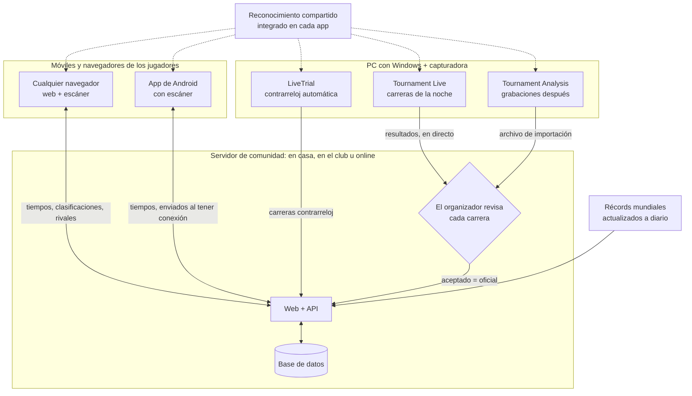

# MK8DX Ecosystem

**Aloja tu propia web de comunidad de Mario Kart 8 Deluxe: para Contrarreloj *y* para noches de torneo.**

Idioma: [English](README.md) · [Nederlands](README_NL.md) · [Deutsch](README_DE.md) · Español · [Français](README_FR.md) · [Italiano](README_IT.md) · [Português](README_PT.md) · [Русский](README_RU.md) · [日本語](README_JA.md) · [한국어](README_KO.md) · [简体中文](README_ZH_CN.md) · [繁體中文](README_ZH_TW.md)

*Esta traducción se ha hecho automáticamente a partir del README en inglés; las correcciones son bienvenidas.*

MK8DX Ecosystem es algo que alojas tú mismo. Le da a tu comunidad una sola web que guarda dos tipos
de resultados —**resultados de Contrarreloj** y **resultados de torneos**— y añade a cada uno su
propia forma de competir.

**⏱️ Contrarreloj**

- **Clasificaciones** por circuito y clase (150cc/200cc), para tu comunidad y junto a los
  **récords mundiales**, que se actualizan una vez al día.
- **Rivales**: elígelos una vez y verás siempre cómo están frente a ti.
- **Introduce un tiempo a tu manera**: escríbelo a mano, escanea la pantalla de resultados con una
  cámara —en la web o en la app de Android— o deja que la aplicación de Windows **LiveTrial** registre
  cada carrera por sí sola mediante una capturadora.
- **LiveTrial ve la propia carrera**: cuándo coges monedas, cuándo usas tus champiñones… y hace un
  **vídeo de cada carrera** que puedes usar como quieras.

**🏁 Torneos**

- **Noches LAN desde la inscripción hasta la final**: asientos, grupos, puntuaciones y clasificación,
  todo organizado para ti.
- **Resultados leídos de la pantalla** por Tournament Live, revisados por el organizador antes de que
  cuenten.
- **Puntuación TrueSkill**: una puntuación de habilidad que crece con cada noche de torneo.
- **No hace falta cuenta para jugar**: puedes organizar un torneo sin pedirle a nadie que se registre.
  Quien quiera sus resultados en su propia cuenta puede vincularlos más adelante, nunca es una
  obligación.

**✨ Qué lo hace único**

Hasta ahora no había una forma sólida de sacar los datos de Mario Kart 8 Deluxe de una Nintendo Switch
mediante una capturadora: casi siempre era volver a teclearlos, u OCR que solo lee texto. MK8DX lee los
tiempos, las posiciones y los puntos *y* reconoce las imágenes: el **personaje (incluido el color
correcto)**, la **carrocería, las ruedas, el ala delta** y la **bandera**, allí donde el juego los muestre.

Y ni siquiera necesitas una capturadora para eso: desde el sofá, apunta el móvil a la tele y escanea
una **pantalla de resultados** de Contrarreloj o una **pantalla de selección de fantasma**, y el
resultado va directo a tu web. Que sepamos, eso tampoco se había hecho antes.

**🏠 En casa o en línea: tú eliges**

- **Totalmente local**: ejecútalo en la red de tu casa o de tu club. Tras la instalación **no hace
  falta internet** para nada.
- **En línea**: alójalo en tu propio servidor o hosting web y compártelo con tu propia comunidad en
  línea.

En ambos casos es tu instalación, con tus propias cuentas y resultados. Sin cuenta en la nube, sin
suscripción, sin anuncios.

**🔑 Sin contraseñas, nunca**

- **Solo el administrador necesita una cuenta.** Esa cuenta es también el primer jugador, así que el
  sistema siempre tiene al menos un jugador; todos los demás pueden unirse a torneos sin cuenta.
- **Un enlace para iniciar sesión**: nadie tiene que inventarse ni recordar una contraseña. En casa,
  cada uno recibe una tarjeta de acceso personal (un enlace o un código QR). En línea, un usuario nuevo
  solo introduce una **dirección de correo electrónico** e inicia sesión con el enlace que le envía MK8DX.

---

## Cómo encaja todo

MK8DX no es un solo programa, sino una pequeña familia en torno a un **servidor de comunidad**. El
servidor guarda todo lo que cuenta: cuentas, tiempos, torneos y clasificaciones. Las apps a su alrededor leen la
pantalla del juego en tus propios dispositivos y envían lo que encuentran a la comunidad que elegiste.

**¿Qué piezas necesito?**

- **Un servidor de comunidad: la única pieza que toda comunidad necesita.** Es la web con su API y su
  base de datos. Ejecútalo en tu red de casa o del club ([A2](docs/install/A2_HOME_GUIDE_EN.md), sin internet
  tras la instalación) u online en un servidor o hosting web
  ([Alojar un servidor de comunidad](docs/guides/HOSTING.md)).
- **A los jugadores les basta un navegador.** La web incluye el escáner del navegador. La app de Android añade
  escanear con el móvil, tus tiempos sin internet y cambiar de comunidad con un toque
  ([Players](docs/guides/PLAYERS.md)).
- **Un PC con Windows y una capturadora es opcional.** LiveTrial registra solo cada carrera contrarreloj; la
  envías a tu comunidad con un clic, o automáticamente ([LiveTrial](docs/guides/LIVETRIAL.md)).
- **Las noches de torneo se gestionan en la web.** Tournament Live (durante la noche) y Tournament Analysis
  (grabaciones después) solo proponen resultados; las puntuaciones también se pueden teclear o importar desde
  Excel/CSV. Nada cambia la clasificación hasta que el organizador lo acepta
  ([Tournament Directors](docs/guides/TOURNAMENT_DIRECTORS.md)).
- **El reconocimiento es compartido, no un servicio.** Cada app lleva su propia copia y lee la pantalla en tu
  dispositivo; el servidor solo comprueba el resultado propuesto
  ([Pipeline de reconocimiento](docs/architecture/RECOGNITION_PIPELINE.md) ·
  [Arquitectura](docs/architecture/COMPONENTS.md)).

## Primeros pasos

| Quiero… | Empieza aquí |
| --- | --- |
| **ejecutar MK8DX en casa o en mi club** | El paquete A2 para tu ordenador desde [Releases](https://github.com/fromthelake/MK8DX-Ecosystem/releases): descomprímelo, inícialo y haz clic en Siguiente. Paso a paso (el paquete A2 también incluye una versión ilustrada): [English](docs/install/A2_HOME_GUIDE_EN.md) · [Nederlands](docs/install/A2_THUIS_HANDLEIDING_NL.md) |
| **organizar noches de torneo LAN** | [Tournament Directors](docs/guides/TOURNAMENT_DIRECTORS.md) |
| **registrar mis Contrarreloj automáticamente** | [LiveTrial](docs/guides/LIVETRIAL.md): Windows + una capturadora |
| **publicar y comparar mis tiempos** | [Players](docs/guides/PLAYERS.md): cualquier navegador; Android 8.0+ |
| **alojar una web de comunidad** | [Alojar un servidor de comunidad](docs/guides/HOSTING.md) |
| **cambiar el código** | [Guía para desarrolladores](docs/DEVELOPMENT.md), [Testing](docs/TESTING.md), [Contributing](CONTRIBUTING.md) |

Cada fila indica la guía que debes seguir de principio a fin. Compilar el servidor desde el código
fuente en lugar de usar un paquete de release es para desarrolladores: [Empezar desde el código fuente](docs/GETTING_STARTED.md).

### Qué ordenador para cada vía

Todas las vías te dan la misma web; se diferencian en dónde se ejecuta y quién puede acceder a ella.

| Vía | Para | Se ejecuta en | Estado |
| --- | --- | --- | --- |
| **A2** red de casa o del club | Tu propia red, sin internet tras la instalación, tarjetas de acceso para todos | Windows 11 (x86-64), Linux (x86-64 o arm64), Mac (Apple silicon o Intel) | Probado de principio a fin en Windows 11; Linux en WSL 2; Mac compilado, aún sin probar en un Mac real |
| **A1** un ordenador | Probarlo en el ordenador en el que estás sentado | Windows 11 o Linux, x86-64, con Docker | Probado: instalación, actualización, copia de seguridad |
| **A3** un ordenador sin Docker | Un PC con Windows en el que Docker no es una opción | Windows 11 con XAMPP y Node.js | Probado: instalación, actualización, copia de seguridad |
| **B1** web pública | Tu comunidad en línea, con tu propio dominio y correo | Un servidor Linux x86-64 (VPS) con Docker; documentado para Ubuntu 24.04 | Documentado, aún sin probar de principio a fin |
| **B2** hosting web | En línea, sin servidor propio | Un plan de hosting con Node.js (Passenger), MariaDB/MySQL y SSH | Nuestra propia web de comunidad funciona así; el paquete público aún no se ha instalado desde cero en una cuenta de hosting nueva |

Las apps que lo rodean:

| App | Se ejecuta en | Por qué |
| --- | --- | --- |
| Web y escáner del navegador | Cualquier navegador moderno; se recomienda Chrome o Edge para escanear | El escáner funciona por completo en tu dispositivo y necesita un navegador que le dé varios hilos |
| App de Android | Android 8.0 o posterior, se recomienda arm64 | Escanea en el propio móvil, también sin conexión |
| iPhone y iPad | La web en el navegador; el escaneo en Safari aún se está probando | No hay app para iOS: crearla y firmarla requiere un Mac y una cuenta de desarrollador de Apple |
| LiveTrial y Tournament Live | Windows en x86-64 (probado en Windows 11), con una capturadora HDMI USB por pantalla | Las capturadoras y el motor de reconocimiento incluido están hechos y probados para Windows; no hay versión para macOS ni Linux |

**Primer inicio de la app de Android:** te pide *Elige tu comunidad*. En casa o en el club escaneas la
tarjeta **Prepare a device** que te muestra tu administrador; para una comunidad en línea escribes la
dirección de su web. Después inicias sesión a través del navegador. Detalles:
[Players](docs/guides/PLAYERS.md#first-start).

**Una app, varias comunidades:** el selector de comunidad de arriba cambia de un toque entre tu club, tu
instalación de casa y una comunidad en línea; cada una conserva su propia cuenta y sus tiempos sin
enviar. En **Tú** → **Mis tiempos** ves tu mejor tiempo por circuito, también sin internet, y si tienes
más de una comunidad puedes llevar tus mejores tiempos a otra, si esa comunidad los acepta.

**¿Por qué no todo en todas partes?** Cada paquete solo se ofrece donde se ha compilado y probado. Las
imágenes de servidor A1 y B1 solo existen para x86-64; A2 también tiene arm64. Para los Mac con Intel ya
no se publica la biblioteca de seguridad que necesita A2 (`cryptography`), así que la release la compila
desde el código fuente en un Mac con Intel y la prueba allí
([cómo](docs/RELEASE_PACKAGES.md#intel-mac-a2-package)). A3 existe para quien no puede o no quiere usar
Docker. La [guía de hosting](docs/guides/HOSTING.md) y los [paquetes de release](docs/RELEASE_PACKAGES.md)
enumeran cada archivo y sus requisitos exactos.

Una instalación nueva empieza vacía: no hereda cuentas ni resultados de ninguna comunidad. Solo trae el
catálogo del juego y los conjuntos de referencia de los fantasmas del personal de Nintendo y de los
récords mundiales.

---

## 🏁 Noches de torneo LAN

¿Te acuerdas de las fiestas LAN? Dos jugadores por pantalla, una sala llena de Switch y todo el mundo
gritándole a la Senda Arco Iris. MK8DX recupera esas noches y se encarga de todo lo que rodea a las
carreras: quién se sienta dónde, qué grupo juega a continuación, las puntuaciones, las finales y la
clasificación.

- **Inscripción**: abre la inscripción de una noche con hora de cierre y un máximo de plazas; por orden
  de llegada o mediante un sorteo justo a partir de una semilla publicada. Los jugadores se inscriben
  con las Switch que traen.
- **Asientos que se organizan solos**: asistencia, consolas y asientos (dos jugadores por Switch),
  números de puesto y de cable. Elige un reparto por ranking o aleatorio y una colocación *Equilibrada*
  o de *Mínimo movimiento*; MK8DX crea los grupos de clasificación y después las finales por ti.
- **Tournament Live lee las carreras**: conecta una capturadora a cada pantalla. Después de cada carrera
  lee las posiciones de llegada, los personajes, las banderas, los puntos de carrera, los totales y el
  circuito (también a pantalla dividida para dos jugadores), los guarda localmente y los envía a la
  noche en la web.
- **Tú tienes el control**: el organizador revisa jugadores y posiciones antes de que cuente un
  resultado. Mientras tanto, la clasificación en directo se muestra de forma provisional.
- **Después**: clasificación final, un informe para compartir (WhatsApp, PNG, CSV, un artículo listo
  para WordPress) y, si quieres, una puntuación de comunidad al estilo TrueSkill a lo largo de las noches.

  
  

### ¿Sin Tournament Live esa noche? Analiza las grabaciones después

¿Grabaste la noche en lugar de capturarla en directo? La ventana **Tournament Analysis** lee las
grabaciones después: añade un vídeo, varios o una carpeta por torneo, pulsa **START ANALYSIS** y
encontrará cada carrera con sus posiciones, personajes y puntos, mientras un registro en directo y en
colores y una barra de progreso de la Senda Arco Iris muestran cuánto le falta. El resultado es un
libro de Excel, un CSV y un archivo de importación para la web, que el organizador revisa e importa: la
misma revisión que con Tournament Live. Una grabación de 22 minutos con cuatro carreras tardó unos 70 segundos en un portátil. En el paquete Tournament Tools para Windows, haz doble clic en
`TournamentAnalysis.cmd` (arrastrar un vídeo sobre `TournamentProcessor.cmd` sigue funcionando);
los desarrolladores ejecutan `python -m tournament_processor.gui`.
[Tournament Directors](docs/guides/TOURNAMENT_DIRECTORS.md#analyse-recordings-afterwards) explica los
pasos.

## ⏱️ Contrarreloj con LiveTrial: totalmente automático

Conecta tu Switch a tu PC con Windows mediante una capturadora y simplemente corre. Que sepamos, no
existía nada parecido.

LiveTrial observa la señal HDMI y reconoce por sí solo:

- los menús por los que pasas, el **circuito** y la **clase** (150cc/200cc);
- durante la carrera: el **cronómetro, el contador de vueltas, las monedas y los objetos**;
- en la pantalla de resultados: el **tiempo total, cada tiempo por vuelta** (3, o 7 en Baby Park), el
  **personaje, la carrocería, las ruedas, el ala delta** y la **bandera**;
- el panel de **selección de fantasma** —nombres, tiempos, vueltas y piezas de los fantasmas— y si un
  fantasma es uno de los **fantasmas del personal de Nintendo**;
- el **idioma de tu Switch** (los 12 idiomas del sistema), automáticamente.

Guarda un **vídeo de cada carrera** y de cada repetición de fantasma que veas hasta el final, un
historial de carreras con tablas y gráficos de vueltas, y te muestra tu diferencia con el **récord
mundial**, el **fantasma del personal de Nintendo**, tu **propio récord** y tus **rivales**. Envía
resultados a tu comunidad con un clic (o activa el envío automático) y, si quieres, sube un vídeo a tu
propio canal de YouTube.

## 📱 Escanea desde el sofá

¿Haciendo Contrarreloj en casa de un amigo? Coge tu móvil o tablet, apunta a la tele y el escáner lee
la pantalla de resultados: **total, vueltas, personaje, carrocería, ruedas, ala delta, bandera y nombre
del jugador**, o un **panel de fantasma** con su circuito y sus tiempos. Todo lo dudoso se muestra con
alternativas para que elijas la correcta antes de publicar.

El escáner del navegador funciona **por completo en tu dispositivo**: sin cuenta, sin servidor y sin
conexión tras la primera descarga. La app de Android también escanea en el propio dispositivo.

  
  

## 🏆 Tus récords, tus rivales

Cada jugador tiene sus propios récords por circuito, una clasificación con la familia, los amigos o el
club, rivales a los que perseguir (con toques, desafíos y algún que otro duelo de dados), avisos cuando
alguien bate tu tiempo y **23 niveles de maestría** medidos frente a los récords mundiales actuales.

  
  

## 🌍 Habla tu idioma: los 15

Mario Kart 8 Deluxe se juega en todas partes, así que MK8DX está hecho para todos los idiomas del juego:
la web, la app de Android, LiveTrial y las herramientas de Tournament están disponibles en **15
idiomas**, y el reconocimiento está preparado para **las 15 variantes de idioma del juego**: del
neerlandés y el inglés al japonés, el coreano, el chino, el ruso y muchos más. El inglés y el
neerlandés los revisan personas; los demás idiomas están traducidos automáticamente y el reconocimiento
en algunos de ellos aún se está verificando en consolas reales. ¿Juegas en tu idioma? Tu ayuda para
revisarlo es la contribución más valiosa que existe.

## 🛠️ Hazlo tuyo

MK8DX es de código abierto, hecho por jugadores para jugadores. Ejecútalo para tu club, tu familia o la
escena LAN de tu ciudad; adáptalo a cómo funcionan *tus* noches; y construye sobre él:

- **Traduce o revisa** tu idioma (la web, las apps y el reconocimiento dentro del juego).
- **Prueba el reconocimiento** con tu propia consola, idioma y capturadora, e informa de lo que se le escapa.
- **Añade lo que necesita tu comunidad**: nuevos formatos de torneo, estadísticas, formas de compartir resultados.
- **Mejora la documentación** para que el próximo organizador empiece aún más rápido.

Empieza por [Contributing](CONTRIBUTING.md) y la [guía para desarrolladores](docs/DEVELOPMENT.md).
Cada pull request, informe de error y corrección de traducción hace que la próxima noche LAN sea mejor
para todos.

## Estado del proyecto

Las versiones estables están en [GitHub Releases](https://github.com/fromthelake/MK8DX-Ecosystem/releases);
la 0.2.0 añadió A2, en casa o en el club; la 0.2.1 da a la app de Android una copia sin conexión de tus
tiempos y un diseño más tranquilo. La 0.2.2 hace que vuelva a funcionar el análisis de grabaciones y añade la ventana Tournament Analysis. La 0.2.3 ejecuta la pasarela web sin root y facilita empezar con el repositorio. Consulta el [registro de cambios](CHANGELOG.md), los
[paquetes de release](docs/RELEASE_PACKAGES.md) y la guía completa
([English](docs/install/MK8DX_User_Guide_EN.txt), [Nederlands](docs/install/MK8DX_Handleiding_NL.txt)).

El reconocimiento nunca hace oficial un resultado por sí solo: tú revisas tus propias Contrarreloj, y
un organizador revisa las carreras del torneo antes de que cuenten.

## Documentación

| Quiero… | Lee |
| --- | --- |
| entender cómo funciona el reconocimiento | [Recognition pipeline](docs/architecture/RECOGNITION_PIPELINE.md) |
| entender las partes y cómo viaja un resultado | [Arquitectura](docs/architecture/COMPONENTS.md) |
| compilar o cambiar el código | [Guía para desarrolladores](docs/DEVELOPMENT.md) y [Testing](docs/TESTING.md) |
| compilar los clientes nativos | [Client builds](docs/CLIENT_BUILDS.md) |
| gestionar una instalación (copia de seguridad, actualización, recuperación) | [Operations](docs/OPERATIONS.md) |
| saber por qué algo es como es | [Índice de decisiones](docs/decisions/README.md) |
| contribuir | [Contributing](CONTRIBUTING.md), [Código de conducta](CODE_OF_CONDUCT.md) |
| obtener ayuda | [Getting help](SUPPORT.md) |
| informar de un problema de seguridad | [Política de seguridad](SECURITY.md) |
| trabajar con un agente de programación | [AGENTS.md](AGENTS.md) |

## 💡 La historia detrás

**Todo empezó con un torneo local de Mario Kart, unas cuantas personas entusiastas y una invitación en diciembre de 2023.**

Aunque no lo creas, pese a haber jugado a Mario Kart en la Nintendo 64, apenas había tocado Mario Kart 8 Deluxe. Ni siquiera sabía que existía el derrape. Está claro que tenía mucho que ponerme al día.

Lo que descubrí fue un grupo maravilloso de personas a las que de verdad les encantaba reunir a otros para correr.

Y ese grupo no dejaba de crecer.

Lo que empezó con solo 16 jugadores acabó convirtiéndose en una comunidad de más de 68 participantes, con hasta **36 jugadores compitiendo en una sola noche**. Juntos han completado **más de 1000 carreras registradas**, en los 96 circuitos y durante incontables horas de competición amistosa.

El montaje evolucionó igual de rápido. Lo que empezó con **Wi-Fi, una GoPro, mucha revisión manual y un montón de problemas de conexión** fue evolucionando poco a poco hacia capturadoras, una red Ethernet totalmente cableada, seguimiento automático de las carreras y 36 jugadores compitiendo en una nave rodeados de consolas, pantallas, cables, amigos y, por supuesto, pizza.

Y cada torneo traía ideas nuevas.

Empezamos a analizar puntuaciones, seguir el rendimiento, optimizar la distribución de los asientos y buscar la manera de automatizar la tarea, cada vez más complicada, de mover a los jugadores entre las Nintendo Switch, incluido cambiar los cables Ethernet de sitio. Cualquiera que haya organizado algo así sabe que a veces las carreras son lo más fácil.

**Luego llegó la Contrarreloj.**

Lo que empezó como una pequeña competición pronto se convirtió en una rivalidad amistosa por arañar unos milisegundos más a nuestros tiempos. Baby Park y Big Blue en 150cc se convirtieron en nuestros favoritos. Siempre había alguien que marcaba una vuelta más rápida y siempre alguien decidido a batirla.

Como es lógico, también queríamos registrar bien esos resultados. El mismo entusiasmo por mejorar nuestros torneos acabó llevando a la grabación automática de Contrarreloj, al reconocimiento de imágenes, a estadísticas, clasificaciones y mucho más.

Una cosa llevó a la otra y, antes de darme cuenta, pasaba casi tanto tiempo creando herramientas en torno a Mario Kart como jugándolo.

### De la pasión a un ecosistema de código abierto

MK8DX Ecosystem está en desarrollo desde 2024, con mucha ayuda de la IA, o lo que ahora llamamos *vibe coding*.

Y quiero dejar algo claro: **no podría haber creado esto sin la IA, y la IA no podría haberlo creado sin mí.**

Conseguir que todo funcionara ha requerido una cantidad increíble de experimentación, paciencia, explicar la lógica del juego, revisar capturas de pantalla, corregir errores y reconducir a la IA en la dirección correcta. A veces una y otra vez.

Ha habido muchas sesiones que quemaban créditos alegremente sin conseguir absolutamente nada. Todavía me quitan el sueño (jaja).

Y, al parecer, las pruebas visuales generan bastantes datos. Ahora mismo tengo unos 4 TB de capturas de pantalla y grabaciones de QA generadas por IA que de verdad debería limpiar algún día.

Las técnicas por separado ya existían, pero unirlas en un ecosistema que funcione, que entienda lo que pasa en pantalla, extraiga la información del juego y la haga útil para jugadores y organizadores ha sido todo un viaje. Lo mismo vale para reunir y organizar los recursos del juego necesarios para que todo funcione.

Ha sido una experiencia de aprendizaje increíble, sobre todo en reconocimiento de imágenes, automatización y desarrollo de software.

Ahora, en 2026, por fin puedo compartir el resultado como un **ecosistema de código abierto**, para que otros puedan usarlo, mejorarlo y, ojalá, divertirse con él tanto como nosotros.

### Un homenaje a Volkert

También quiero reconocer a **Volkert**, un respetado rival de las contrarrelojes que falleció hace poco, demasiado joven.

Nuestra rivalidad, sobre todo en Parque Bebé y Big Blue en 150 cc, fue una motivación constante para mejorar. Estoy seguro de que los dos pasamos muchas horas intentando arañar esos últimos milisegundos, aunque sospecho que yo le dediqué bastantes más horas que él. Él simplemente tenía más experiencia y era más constante.

Lo que empezó con solo tres de nosotros apuntando nuestros tiempos en una hoja de Excel fue creciendo poco a poco hasta convertirse en las funciones de contrarreloj que hoy forman parte de este ecosistema.

Espero que este proyecto dé a otros la oportunidad de vivir esa misma rivalidad amistosa y esa motivación para seguir mejorando.

### Sigue corriendo, sigue compartiendo

No decimos ser los mejores jugadores ni los mejores desarrolladores, ni haber creado la solución perfecta. Pero desde luego no nos falta entusiasmo, curiosidad ni determinación para seguir mejorando.

Si este proyecto te ayuda a organizar un torneo LAN, empezar una rivalidad amistosa, batir un récord personal o simplemente pasar una gran noche con amigos, entonces habrá conseguido algo que vale la pena.

**Sigue compartiendo tus mejores momentos, tus ideas y tus mejoras.** Eso es lo que mantiene viva una comunidad como esta.

Y, por último, muchísimas gracias a **Nintendo** por crear unas consolas y unos juegos tan fantásticos. Si disfrutas de Mario Kart, apoya a quienes lo hacen posible: compra las consolas y los juegos originales, invita a tus amigos, familia o compañeros de trabajo y disfrutad jugando juntos.

Al fin y al cabo, así es como empezó toda esta aventura.

— [fromthelake](https://github.com/fromthelake)

## Licencia y Nintendo

Este es un proyecto aficionado, independiente y sin ánimo de lucro, para aprender a programar y hacer
Mario Kart 8 Deluxe más divertido. **No está afiliado a Nintendo ni cuenta con su respaldo.** Nintendo es
propietaria de sus marcas y del contenido de sus juegos; apoya a Nintendo comprando sus consolas y juegos.

El código y la documentación originales del proyecto tienen licencia [Mozilla Public License 2.0](LICENSE).
El [alcance de la licencia](LICENSE_SCOPE.md) explica lo que cubre: **no** cubre material de Nintendo,
imágenes del juego, plantillas de reconocimiento, modelos, fuentes ni otro material de terceros, que
mantienen sus propias condiciones. Consulta [Third-party materials](docs/THIRD_PARTY_MATERIALS.md). El
software se proporciona tal cual.
