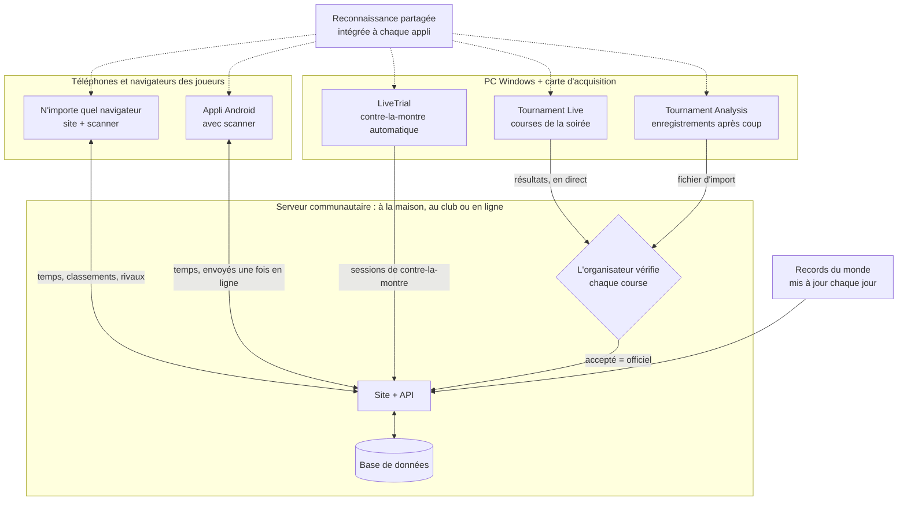

# MK8DX Ecosystem

**Héberge ton propre site communautaire Mario Kart 8 Deluxe — pour le contre-la-montre *et* les soirées tournoi.**

Langue : [English](README.md) · [Nederlands](README_NL.md) · [Deutsch](README_DE.md) · [Español](README_ES.md) · Français · [Italiano](README_IT.md) · [Português](README_PT.md) · [Русский](README_RU.md) · [日本語](README_JA.md) · [한국어](README_KO.md) · [简体中文](README_ZH_CN.md) · [繁體中文](README_ZH_TW.md)

*Cette traduction a été réalisée automatiquement à partir du README anglais ; les corrections sont les bienvenues.*

MK8DX Ecosystem, c'est toi qui l'héberges. Il offre à ta communauté un site web unique qui conserve
deux types de résultats — les **résultats de contre-la-montre** et les **résultats de tournoi** — et
ajoute à chacun sa propre forme de compétition.

**⏱️ Contre-la-montre**

- **Classements** par circuit et par cylindrée (150cc/200cc), pour ta communauté et à côté des
  **records du monde**, actualisés une fois par jour.
- **Rivaux** : choisis-les une fois et vois toujours où ils se situent par rapport à toi.
- **Saisis ton temps comme tu veux** : tape-le à la main, scanne l'écran de résultats avec une caméra
  — sur le site ou dans l'application Android — ou laisse l'application Windows **LiveTrial**
  enregistrer chaque course toute seule grâce à une carte d'acquisition.
- **LiveTrial voit la course elle-même** : quand tu ramasses des pièces, quand tu utilises tes
  champignons — et elle crée un **clip vidéo de chaque course**, que tu peux utiliser librement.

**🏁 Tournois**

- **Des soirées LAN de l'inscription à la finale** : placement, groupes, scores et classements,
  organisés pour toi.
- **Résultats lus directement à l'écran** par Tournament Live, vérifiés par l'organisateur avant de
  compter.
- **Classement TrueSkill** : une évaluation du niveau qui progresse à chaque soirée tournoi.
- **Pas besoin de compte pour jouer** : tu peux organiser un tournoi sans demander à quiconque de
  s'inscrire. Un joueur qui veut ses résultats sur son propre compte peut les y lier plus tard —
  jamais une obligation.

**✨ Ce qui le rend unique**

Jusqu'ici, il n'existait aucun moyen fiable d'extraire les données de Mario Kart 8 Deluxe sur une
Nintendo Switch via une carte d'acquisition : il fallait surtout tout recopier, ou utiliser un OCR qui
ne lit que du texte. MK8DX lit les temps, les positions et les points *et* reconnaît les images : le
**personnage (y compris la bonne couleur)**, la **carrosserie, les pneus, le planeur** et le
**drapeau** — partout où le jeu les affiche.

Et tu n'as même pas besoin d'une carte d'acquisition pour ça : depuis le canapé, pointe ton téléphone
vers la télé et scanne un **écran de résultats** de contre-la-montre ou un **écran de sélection de
fantôme**, et le résultat part directement sur ton site. À notre connaissance, ça non plus n'avait
jamais été fait.

**🏠 À la maison ou en ligne — à toi de choisir**

- **Entièrement local** : fais-le tourner sur ton réseau domestique ou celui de ton club. Après
  l'installation, **plus besoin d'internet** du tout.
- **En ligne** : héberge-le sur ton propre serveur ou hébergement web et partage-le avec ta propre
  communauté en ligne.

Dans les deux cas, c'est ton installation, avec tes propres comptes et résultats. Pas de compte cloud,
pas d'abonnement, pas de publicité.

**🔑 Jamais de mot de passe**

- **Seul l'administrateur a besoin d'un compte.** Ce compte est aussi le premier joueur, donc le système
  a toujours au moins un joueur ; tous les autres peuvent participer aux tournois sans compte.
- **Un lien pour se connecter** : personne n'a besoin d'inventer ni de retenir un mot de passe. À la
  maison, chacun reçoit une carte de connexion personnelle (un lien ou un code QR). En ligne, un nouvel
  utilisateur saisit seulement une **adresse e-mail** et se connecte avec le lien que MK8DX lui envoie.

---

## Comment tout s'articule

MK8DX n'est pas un seul programme mais une petite famille autour d'un **serveur communautaire**. Le
serveur garde tout ce qui compte : comptes, temps, tournois et classements. Les applis autour lisent l'écran du
jeu sur tes propres appareils et envoient ce qu'elles ont trouvé à la communauté que tu as choisie.

**De quelles pièces ai-je besoin ?**

- **Un serveur communautaire : la seule pièce dont chaque communauté a besoin.** C'est le site avec son
  API et sa base de données. Fais-le tourner sur ton réseau à la maison ou au club
  ([A2](docs/install/A2_HOME_GUIDE_EN.md), sans internet après l'installation) ou en ligne sur un serveur ou un
  hébergement web ([Héberger un serveur communautaire](docs/guides/HOSTING.md)).
- **Aux joueurs, un navigateur suffit.** Le site apporte avec lui le scanner dans le navigateur. L'appli Android
  ajoute le scan sur le téléphone, tes temps sans internet et le changement de communauté d'une touche
  ([Players](docs/guides/PLAYERS.md)).
- **Un PC Windows avec une carte d'acquisition est facultatif.** LiveTrial enregistre tout seul chaque session de
  contre-la-montre ; tu l'envoies à ta communauté d'un clic, ou automatiquement
  ([LiveTrial](docs/guides/LIVETRIAL.md)).
- **Les soirées tournoi se gèrent sur le site.** Tournament Live (pendant la soirée) et Tournament Analysis
  (enregistrements après coup) ne font que proposer des résultats ; les scores peuvent aussi être saisis à la main
  ou importés depuis Excel/CSV. Rien ne change le classement avant que l'organisateur ne l'accepte
  ([Tournament Directors](docs/guides/TOURNAMENT_DIRECTORS.md)).
- **La reconnaissance est partagée, ce n'est pas un service.** Chaque appli en a sa propre copie et lit l'écran
  sur ton appareil ; le serveur vérifie seulement le résultat proposé
  ([Pipeline de reconnaissance](docs/architecture/RECOGNITION_PIPELINE.md) ·
  [Architecture](docs/architecture/COMPONENTS.md)).

## Pour commencer

| Je veux… | Commence ici |
| --- | --- |
| **faire tourner MK8DX à la maison ou dans mon club** | Le paquet A2 pour ton ordinateur depuis les [Releases](https://github.com/fromthelake/MK8DX-Ecosystem/releases) : décompresse, lance, clique sur Suivant. Pas à pas (le paquet A2 contient aussi une version illustrée) : [English](docs/install/A2_HOME_GUIDE_EN.md) · [Nederlands](docs/install/A2_THUIS_HANDLEIDING_NL.md) |
| **organiser des soirées tournoi en LAN** | [Tournament Directors](docs/guides/TOURNAMENT_DIRECTORS.md) |
| **enregistrer mes contre-la-montre automatiquement** | [LiveTrial](docs/guides/LIVETRIAL.md) — Windows + une carte d'acquisition |
| **publier et comparer mes temps** | [Joueurs](docs/guides/PLAYERS.md) — n'importe quel navigateur ; Android 8.0+ |
| **héberger un site communautaire** | [Héberger un serveur communautaire](docs/guides/HOSTING.md) |
| **modifier le code** | [Guide du développeur](docs/DEVELOPMENT.md), [Tests](docs/TESTING.md), [Contributing](CONTRIBUTING.md) |

Chaque ligne indique le guide à suivre du début à la fin. Compiler le serveur depuis les sources au lieu
d'utiliser un paquet de release s'adresse aux développeurs : [Démarrer depuis les sources](docs/GETTING_STARTED.md).

### Quel ordinateur pour quelle voie

Chaque voie te donne le même site ; elles diffèrent par l'endroit où il tourne et par qui peut y accéder.

| Voie | Pour | Tourne sur | Statut |
| --- | --- | --- | --- |
| **A2** réseau domestique ou de club | Ton propre réseau, pas besoin d'internet après l'installation, des cartes de connexion pour tout le monde | Windows 11 (x86-64), Linux (x86-64 ou arm64), Mac (Apple silicon ou Intel) | Testé de bout en bout sous Windows 11 ; Linux sous WSL 2 ; Mac compilé, pas encore testé sur un vrai Mac |
| **A1** un seul ordinateur | L'essayer sur l'ordinateur devant lequel tu es assis | Windows 11 ou Linux, x86-64, avec Docker | Testé : installation, mise à niveau, sauvegarde |
| **A3** un seul ordinateur sans Docker | Un PC Windows sur lequel Docker n'est pas envisageable | Windows 11 avec XAMPP et Node.js | Testé : installation, mise à niveau, sauvegarde |
| **B1** site web public | Ta communauté en ligne, ton propre domaine et ton propre e-mail | Un serveur Linux x86-64 (VPS) avec Docker ; Ubuntu 24.04 documenté | Documenté, pas encore testé de bout en bout |
| **B2** hébergement web | En ligne, sans serveur à toi | Une offre d'hébergement avec Node.js (Passenger), MariaDB/MySQL et SSH | Notre propre site communautaire tourne ainsi ; le paquet public n'a pas encore été installé de zéro sur un nouveau compte d'hébergement |

Les applications autour :

| Application | Tourne sur | Pourquoi |
| --- | --- | --- |
| Site web et scanner du navigateur | N'importe quel navigateur moderne ; Chrome ou Edge recommandés pour scanner | Le scanner fonctionne entièrement sur ton appareil et a besoin d'un navigateur qui lui donne plusieurs threads |
| Application Android | Android 8.0 ou plus récent, arm64 recommandé | Scanne sur le téléphone lui-même, même sans connexion |
| iPhone et iPad | Le site dans le navigateur ; le scan dans Safari est encore en test | Il n'y a pas d'application iOS : en compiler et en signer une nécessite un Mac et un compte développeur Apple |
| LiveTrial et Tournament Live | Windows sur x86-64 (testé sous Windows 11), avec une carte d'acquisition HDMI USB par écran | Les cartes d'acquisition et le moteur de reconnaissance fourni sont conçus et testés pour Windows ; il n'y a pas de version macOS ni Linux |

**Premier lancement de l'application Android :** elle demande *Choisis ta communauté*. À la maison ou au
club, tu scannes la carte **Prepare a device** que ton administrateur affiche ; pour une communauté en
ligne, tu tapes l'adresse de son site. Ensuite, tu te connectes via le navigateur. Détails : [Joueurs](docs/guides/PLAYERS.md#first-start).

**Une application, plusieurs communautés :** la pastille de communauté en haut bascule d'un geste entre
ton club, ton installation à la maison et une communauté en ligne ; chacune garde son propre compte et
ses temps non encore envoyés. Sous **Toi** → **Mes temps**, tu vois ton meilleur temps par circuit,
même sans internet, et avec plus d'une communauté tu peux emporter tes meilleurs temps dans une autre —
si cette communauté les accepte.

**Pourquoi pas tout, partout ?** Chaque paquet n'est proposé que là où il a été compilé et essayé. Les
images serveur A1 et B1 n'existent qu'en x86-64 ; A2 existe aussi en arm64. Pour les Mac Intel, la
bibliothèque de sécurité dont A2 a besoin (`cryptography`) n'est plus publiée, donc la release la
compile à partir des sources sur un Mac Intel et la teste là-bas
([comment](docs/RELEASE_PACKAGES.md#intel-mac-a2-package)). A3 existe pour ceux qui ne peuvent pas ou
ne veulent pas utiliser Docker. Le [guide d'hébergement](docs/guides/HOSTING.md) et les [paquets de release](docs/RELEASE_PACKAGES.md)
listent chaque fichier et ses exigences précises.

Une nouvelle installation démarre vide : aucun compte ni résultat de communauté n'est repris. Elle
n'apporte que le catalogue du jeu et les jeux de référence des fantômes du staff Nintendo et des
records du monde.

---

## 🏁 Soirées tournoi en LAN

Tu te souviens des LAN parties ? Deux joueurs par écran, une salle pleine de Switch, tout le monde qui
hurle sur la Route Arc-en-ciel. MK8DX fait revivre ces soirées et s'occupe de tout ce qui entoure la
course : qui s'assoit où, quel groupe joue ensuite, les scores, les finales et le classement.

- **Inscription** — ouvre les inscriptions pour une soirée avec une heure de clôture et un nombre
  maximum ; premier arrivé, premier servi, ou un tirage équitable à partir d'une graine publiée. Les
  joueurs s'inscrivent avec les Switch qu'ils apportent.
- **Un placement qui se fait tout seul** — présences, consoles et places (deux joueurs par Switch),
  numéros de poste et de câble. Choisis un ordre de répartition classé ou aléatoire et un placement
  *Équilibré* ou *Déplacements minimaux* ; MK8DX constitue les groupes de qualification puis les
  finales pour toi.
- **Tournament Live lit les courses** — branche une carte d'acquisition sur chaque écran. Après chaque
  course, il lit les positions d'arrivée, les personnages, les drapeaux, les points de course, les
  totaux et le circuit (aussi en écran partagé à deux joueurs), les enregistre localement et les
  envoie à la soirée sur le site.
- **C'est toi qui décides** — l'organisateur vérifie les joueurs et les places avant qu'un résultat ne
  compte. En attendant, le classement en direct est affiché à titre provisoire.
- **Ensuite** — classement final, un rapport à partager (WhatsApp, PNG, CSV, un article prêt pour
  WordPress) et, en option, un classement communautaire façon TrueSkill sur l'ensemble des soirées.

  
  

### Pas de Tournament Live pendant la soirée ? Analyse les enregistrements après coup

Tu as enregistré la soirée au lieu de la capturer en direct ? La fenêtre **Tournament Analysis** lit
les enregistrements après coup : ajoute une vidéo, plusieurs, ou un dossier par tournoi, appuie sur
**START ANALYSIS**, et elle retrouve chaque course avec ses positions, personnages et points, pendant
qu'un journal coloré en direct et une barre de progression Route Arc-en-ciel montrent où elle en est.
Le résultat est un classeur Excel, un CSV et un fichier d'import pour le site, que l'organisateur
vérifie et importe — la même vérification que pour Tournament Live. Un enregistrement de 22 minutes avec quatre courses a pris environ 70 secondes sur un ordinateur portable. Dans le paquet Windows Tournament Tools, double-clique sur
`TournamentAnalysis.cmd` (glisser une vidéo sur `TournamentProcessor.cmd` fonctionne toujours) ;
les développeurs lancent `python -m tournament_processor.gui`.
[Tournament Directors](docs/guides/TOURNAMENT_DIRECTORS.md#analyse-recordings-afterwards) détaille
les étapes.

## ⏱️ Le contre-la-montre avec LiveTrial — entièrement automatique

Branche ta Switch à ton PC Windows via une carte d'acquisition et contente-toi de courir. À notre
connaissance, rien de tel n'existait auparavant.

LiveTrial surveille le signal HDMI et reconnaît, tout seul :

- les menus que tu traverses, le **circuit** et la **cylindrée** (150cc/200cc) ;
- pendant la course : le **chrono, le compteur de tours, les pièces et les objets** ;
- sur l'écran de résultats : le **temps total, chaque temps au tour** (3, ou 7 sur Baby Parc), le
  **personnage, la carrosserie, les pneus, le planeur** et le **drapeau** ;
- le panneau de **sélection de fantôme** — noms des fantômes, temps, tours et pièces du kart — et si un
  fantôme fait partie des **fantômes du staff de Nintendo** ;
- la **langue de ta Switch** (les 12 langues du système), automatiquement.

Il garde un **clip de chaque course** et de chaque replay de fantôme que tu regardes jusqu'au bout, un
historique des courses avec tableaux des tours et graphiques, et affiche ton écart avec le **record du
monde**, le **fantôme du staff Nintendo**, ton **propre record** et tes **rivaux**. Envoie tes
résultats à ta communauté en un clic (ou active l'envoi automatique) et, si tu veux, mets en ligne un
clip sur ta propre chaîne YouTube.

## 📱 Scanne depuis le canapé

Tu fais du contre-la-montre chez un ami ? Prends ton téléphone ou ta tablette, pointe-le vers la télé
et le scanner lit l'écran de résultats : **total, tours, personnage, carrosserie, pneus, planeur,
drapeau et nom du joueur**, ou un **panneau de fantôme** avec son circuit et ses temps. Tout ce qui est
incertain s'affiche avec des alternatives, pour que tu puisses choisir la bonne avant de publier.

Le scanner du navigateur fonctionne **entièrement sur ton appareil** — pas de compte, pas de serveur,
et hors ligne après le premier téléchargement. L'application Android scanne elle aussi sur l'appareil.

  
  

## 🏆 Tes records, tes rivaux

Chaque joueur a ses propres records par circuit, un classement avec sa famille, ses amis ou son club,
des rivaux à traquer (avec des petits coups de coude, des défis et un duel de dés de temps en temps),
des notifications quand quelqu'un bat ton temps, et **23 niveaux de maîtrise** mesurés par rapport aux
records du monde actuels.

  
  

## 🌍 Parle ta langue — les 15

On joue à Mario Kart 8 Deluxe partout, alors MK8DX est conçu pour chaque langue du jeu : le site,
l'application Android, LiveTrial et les outils de tournoi existent en **15 langues**, et la
reconnaissance est conçue pour **les 15 variantes linguistiques du jeu** — du néerlandais et de
l'anglais au japonais, au coréen, au chinois, au russe et plus encore. L'anglais et le néerlandais
sont relus par des humains ; les autres langues sont traduites automatiquement et la reconnaissance
dans certaines d'entre elles est encore en cours de vérification sur de vraies consoles. Tu joues dans
ta langue ? Ton aide pour la vérifier est la contribution la plus précieuse qui soit.

## 🛠️ Fais-en le tien

MK8DX est open source, créé par des joueurs pour des joueurs. Fais-le tourner pour ton club, ta
famille ou la scène LAN de ta ville ; adapte-le à la façon dont *tes* soirées se déroulent ; et
construis dessus :

- **Traduis ou relis** ta langue (le site, les applications et la reconnaissance en jeu).
- **Teste la reconnaissance** avec ta propre console, ta langue et ta carte d'acquisition, et signale
  ce qu'elle rate.
- **Ajoute ce dont ta communauté a besoin** — nouveaux formats de tournoi, statistiques, façons de
  partager les résultats.
- **Améliore la documentation** pour que le prochain organisateur démarre encore plus vite.

Commence par [Contributing](CONTRIBUTING.md) et le [guide du développeur](docs/DEVELOPMENT.md).
Chaque pull request, rapport de bug et correction de traduction rend la prochaine soirée LAN meilleure
pour tout le monde.

## État du projet

Les versions stables sont sur [GitHub Releases](https://github.com/fromthelake/MK8DX-Ecosystem/releases) ; la
0.2.0 a ajouté A2, à la maison ou au club ; la 0.2.1 donne à l'application Android une copie hors ligne de tes
temps et une mise en page plus calme. La 0.2.2 fait de nouveau fonctionner l'analyse des enregistrements et ajoute la fenêtre Tournament Analysis. La 0.2.3 fait tourner la passerelle web sans root et facilite la prise en main du dépôt. Elle fait aussi passer la base de données du serveur communautaire à MySQL 9.7 LTS et, dans chaque scanner, la couleur du kart et du deltaplane suit désormais le personnage. Consulte le [journal des modifications](CHANGELOG.md), les
[paquets de release](docs/RELEASE_PACKAGES.md) et le guide complet
([English](docs/install/MK8DX_User_Guide_EN.txt), [Nederlands](docs/install/MK8DX_Handleiding_NL.txt)).

La reconnaissance ne rend jamais un résultat officiel toute seule : tu vérifies tes propres
contre-la-montre, et un organisateur contrôle les courses de tournoi avant qu'elles ne comptent.

## Documentation

| Je veux… | Lire |
| --- | --- |
| comprendre comment fonctionne la reconnaissance | [Chaîne de reconnaissance](docs/architecture/RECOGNITION_PIPELINE.md) |
| comprendre les composants et le parcours d'un résultat | [Architecture](docs/architecture/COMPONENTS.md) |
| compiler ou modifier le code | [Guide du développeur](docs/DEVELOPMENT.md) et [Tests](docs/TESTING.md) |
| compiler les clients natifs | [Compilation des clients](docs/CLIENT_BUILDS.md) |
| gérer une installation (sauvegarde, mise à niveau, récupération) | [Exploitation](docs/OPERATIONS.md) |
| savoir pourquoi quelque chose est comme il est | [Index des décisions](docs/decisions/README.md) |
| contribuer | [Contributing](CONTRIBUTING.md), [Code de conduite](CODE_OF_CONDUCT.md) |
| obtenir de l'aide | [Obtenir de l'aide](SUPPORT.md) |
| signaler un problème de sécurité | [Politique de sécurité](SECURITY.md) |
| travailler avec un agent de programmation | [AGENTS.md](AGENTS.md) |

## 💡 L'histoire derrière le projet

**Tout a commencé avec un tournoi Mario Kart local, quelques passionnés et une invitation en décembre 2023.**

Crois-le ou non, alors que j'avais joué à Mario Kart sur la Nintendo 64, je n'avais presque jamais touché à Mario Kart 8 Deluxe. Je ne savais même pas que le dérapage existait. Inutile de dire que j'avais du retard à rattraper.

J'ai découvert un groupe formidable de gens qui adoraient sincèrement réunir les autres pour faire la course.

Et ce groupe n'a cessé de grandir.

Ce qui a commencé avec seulement 16 joueurs est devenu une communauté de plus de 68 participants, avec jusqu'à **36 joueurs en compétition lors d'une seule soirée**. Ensemble, ils ont disputé **plus de 1 000 courses enregistrées**, sur les 96 circuits et pendant d'innombrables heures de compétition amicale.

L'installation a évolué tout aussi vite. Ce qui a commencé avec **du Wi-Fi, une GoPro, beaucoup de vérifications à la main et une foule de problèmes de connexion** s'est peu à peu transformé en cartes d'acquisition, en un réseau Ethernet entièrement câblé, en suivi automatique des courses et en 36 joueurs s'affrontant dans un entrepôt entouré de consoles, d'écrans, de câbles, d'amis et, bien sûr, de pizza.

Et chaque tournoi apportait de nouvelles idées.

Nous avons commencé à analyser les scores, à suivre les performances, à optimiser le placement des joueurs et à chercher comment automatiser la tâche de plus en plus compliquée de faire passer les joueurs d'une Nintendo Switch à l'autre, y compris en rebranchant les câbles Ethernet. Tous ceux qui ont déjà organisé ce genre d'événement le savent : parfois, la course est la partie la plus facile.

**Puis est arrivé le contre-la-montre.**

Ce qui a commencé comme une petite compétition s'est vite transformé en une rivalité amicale pour grappiller encore quelques millisecondes sur nos temps. Baby Parc et Big Blue en 150cc sont devenus des favoris tout particuliers. Il y avait toujours quelqu'un pour signer un tour plus rapide, et toujours quelqu'un de bien décidé à le battre.

Naturellement, nous voulions aussi suivre ces résultats correctement. Le même enthousiasme qui nous poussait à améliorer nos tournois a trouvé sa place dans l'enregistrement automatique des contre-la-montre, la reconnaissance d'images, les statistiques, les classements et bien plus.

Une chose en entraînant une autre, avant même de m'en rendre compte, je passais presque autant de temps à créer des outils autour de Mario Kart qu'à y jouer vraiment.

### De la passion à un écosystème open source

MK8DX Ecosystem est en développement depuis 2024, avec beaucoup d'aide de l'IA — ou ce que l'on appelle aujourd'hui le *vibe coding*.

Et je veux être clair sur un point : **je n'aurais pas pu construire tout cela sans l'IA, et l'IA n'aurait pas pu le construire sans moi.**

Faire fonctionner l'ensemble a demandé une quantité incroyable d'expérimentations, de patience, d'explications sur la logique du jeu, de relectures de captures d'écran, de corrections d'erreurs et de recadrages de l'IA dans la bonne direction. Parfois encore et encore.

Il y a eu bon nombre de sessions qui ont joyeusement englouti des crédits sans aboutir à absolument rien. Elles m'empêchent encore de dormir la nuit (haha).

Et apparemment, les tests visuels produisent pas mal de données. Je suis maintenant assis sur environ 4 To de captures d'écran et d'enregistrements de QA générés par l'IA, qu'il faudrait vraiment que je trie un jour.

Les techniques individuelles existaient déjà, mais les réunir en un écosystème fonctionnel qui comprend ce qui se passe à l'écran, en extrait les informations du jeu et les rend utiles aux joueurs et aux organisateurs a été une sacrée aventure. Il en va de même pour la collecte et l'organisation des ressources du jeu nécessaires pour faire fonctionner tout cela.

Ça a été une expérience d'apprentissage incroyable, en particulier autour de la reconnaissance d'images, de l'automatisation et du développement logiciel.

Aujourd'hui, en 2026, je peux enfin partager le résultat sous la forme d'un **écosystème open source**, pour que d'autres puissent l'utiliser, l'améliorer et, je l'espère, s'amuser autant que nous avec.

### Un hommage à Volkert

Je tiens aussi à rendre hommage à **Volkert**, un rival respecté du contre-la-montre, qui nous a quittés récemment, bien trop jeune.

Notre rivalité, surtout sur Parc Baby et Big Blue en 150 cc, a été une motivation constante pour progresser. Je suis sûr que nous avons tous les deux passé de nombreuses heures à grappiller ces dernières millisecondes, même si je soupçonne d'en avoir passé bien plus que lui. Il était tout simplement plus expérimenté et plus régulier.

Ce qui a commencé à trois, en notant nos temps dans un tableau Excel, est peu à peu devenu les fonctions de contre-la-montre qui font aujourd'hui partie de cet écosystème.

J'espère que ce projet donnera à d'autres l'occasion de vivre cette même rivalité amicale et cette envie de toujours progresser.

### Continuez à rouler, continuez à partager

Nous ne prétendons pas être les meilleurs joueurs, les meilleurs développeurs, ni avoir construit la solution parfaite. Mais l'enthousiasme, la curiosité et la détermination à toujours nous améliorer ne nous manquent certainement pas.

Si ce projet t'aide à organiser un tournoi LAN, à lancer une rivalité amicale, à battre un record personnel ou simplement à passer une super soirée entre amis, alors il aura accompli quelque chose qui en valait la peine.

**Continuez à partager vos meilleurs moments, vos idées et vos améliorations.** C'est ce qui fait vivre une communauté comme celle-ci.

Et enfin, un grand merci à **Nintendo** pour avoir créé des consoles et des jeux aussi fantastiques. Si tu aimes Mario Kart, soutiens les gens qui le rendent possible : achète les consoles et les jeux originaux, invite tes amis, ta famille ou tes collègues, et profitez de jouer ensemble.

Après tout, c'est comme ça que toute cette aventure a commencé.

— [fromthelake](https://github.com/fromthelake)

## Licence et Nintendo

Ceci est un projet amateur indépendant et non commercial, pour apprendre la programmation et rendre
Mario Kart 8 Deluxe encore plus amusant. Il n'est **ni affilié à Nintendo ni approuvé par Nintendo**.
Nintendo détient ses marques et le contenu de ses jeux ; soutiens Nintendo en achetant ses consoles et
ses jeux.

Le code original et la documentation du projet sont distribués sous la [Mozilla Public License 2.0](LICENSE).
La [portée de la licence](LICENSE_SCOPE.md) explique ce qu'elle couvre : elle ne couvre **pas** le
matériel Nintendo, les images du jeu, les gabarits de reconnaissance, les modèles, les polices ni aucun
autre matériel tiers, qui restent soumis à leurs propres conditions. Voir [Matériels tiers](docs/THIRD_PARTY_MATERIALS.md).
Le logiciel est fourni tel quel.
