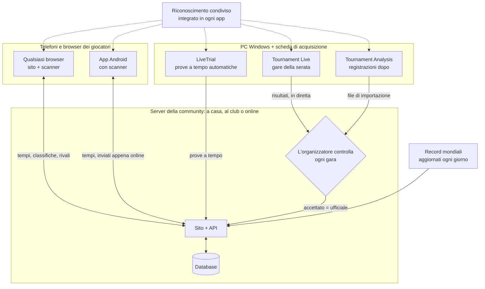

# MK8DX Ecosystem

**Ospita il sito della tua community di Mario Kart 8 Deluxe: per la Prova a tempo *e* per le serate di torneo.**

Lingua: [English](README.md) · [Nederlands](README_NL.md) · [Deutsch](README_DE.md) · [Español](README_ES.md) · [Français](README_FR.md) · Italiano · [Português](README_PT.md) · [Русский](README_RU.md) · [日本語](README_JA.md) · [한국어](README_KO.md) · [简体中文](README_ZH_CN.md) · [繁體中文](README_ZH_TW.md)

*Questa traduzione è stata realizzata automaticamente a partire dal README in inglese; le correzioni sono benvenute.*

MK8DX Ecosystem è qualcosa che ospiti tu stesso. Dà alla tua community un unico sito che raccoglie due
tipi di risultati — **risultati della Prova a tempo** e **risultati dei tornei** — e aggiunge a ciascuno
il suo modo di sfidarsi.

**⏱️ Prova a tempo**

- **Classifiche** per percorso e classe (150cc/200cc), per la tua community e accanto ai **record
  mondiali**, aggiornati una volta al giorno.
- **Rivali**: sceglili una volta e vedrai sempre come se la cavano rispetto a te.
- **Inserisci un tempo come preferisci**: digitalo a mano, scansiona la schermata dei risultati con una
  fotocamera — sul sito o nell'app Android — oppure lascia che l'applicazione Windows **LiveTrial**
  registri ogni corsa da sola tramite una scheda di acquisizione.
- **LiveTrial vede la gara stessa**: quando raccogli le monete, quando usi i funghi… e crea un **video
  di ogni corsa** che puoi usare come vuoi.

**🏁 Tornei**

- **Serate LAN dall'iscrizione alla finale**: posti, gironi, punteggi e classifiche, tutto organizzato
  per te.
- **Risultati letti dallo schermo** da Tournament Live, controllati dall'organizzatore prima che contino.
- **Punteggio TrueSkill**: un punteggio di abilità che cresce a ogni serata di torneo.
- **Nessun account per giocare**: puoi organizzare un torneo senza chiedere a nessuno di registrarsi.
  Chi vuole i propri risultati sul proprio account può collegarli in seguito — mai un obbligo.

**✨ Cosa lo rende unico**

Finora non esisteva un modo affidabile per estrarre i dati di Mario Kart 8 Deluxe da una Nintendo Switch
tramite una scheda di acquisizione: perlopiù si ricopiavano a mano, oppure si usava un OCR che legge
solo il testo. MK8DX legge i tempi, le posizioni e i punti *e* riconosce le immagini: il **personaggio
(compreso il colore giusto)**, il **veicolo, le ruote, il deltaplano** e la **bandiera** — ovunque il
gioco li mostri.

E per farlo non ti serve nemmeno una scheda di acquisizione: dal divano, punta il telefono verso la TV
e scansiona una **schermata dei risultati** della Prova a tempo o una **schermata di selezione del
fantasma**, e il risultato finisce dritto sul tuo sito. Per quanto ne sappiamo, nemmeno questo era mai
stato fatto prima.

**🏠 A casa o online: scegli tu**

- **Completamente in locale**: eseguilo sulla rete di casa o del club. Dopo l'installazione **internet
  non serve** affatto.
- **Online**: ospitalo sul tuo server o sul tuo hosting web e condividilo con la tua community online.

In entrambi i casi è la tua installazione, con i tuoi account e i tuoi risultati. Nessun account cloud,
nessun abbonamento, nessuna pubblicità.

**🔑 Niente password, mai**

- **Solo l'amministratore ha bisogno di un account.** Quell'account è anche il primo giocatore, quindi
  il sistema ha sempre almeno un giocatore; tutti gli altri possono partecipare ai tornei senza account.
- **Un link per accedere**: nessuno deve inventare o ricordare una password. A casa, ognuno riceve una
  tessera di accesso personale (un link o un codice QR). Online, un nuovo utente inserisce solo un
  **indirizzo email** e accede con il link che MK8DX gli invia.

---

## Come si incastra tutto

MK8DX non è un solo programma ma una piccola famiglia attorno a un **server della community**. Il
server conserva tutto ciò che conta: account, tempi, tornei e classifiche. Le app intorno leggono la schermata
del gioco sui tuoi dispositivi e inviano ciò che hanno trovato alla community che hai scelto.

**Quali pezzi mi servono?**

- **Un server della community: l'unico pezzo che serve a ogni community.** È il sito con la sua API e il
  suo database. Fallo girare sulla rete di casa o del club ([A2](docs/install/A2_HOME_GUIDE_EN.md), senza
  internet dopo l'installazione) oppure online su un server o un hosting web
  ([Ospitare un server della community](docs/guides/HOSTING.md)).
- **Ai giocatori basta un browser.** Il sito porta con sé lo scanner nel browser. L'app Android aggiunge la
  scansione sul telefono, i tuoi tempi senza internet e il passaggio da una community all'altra con un tocco
  ([Players](docs/guides/PLAYERS.md)).
- **Un PC Windows con una scheda di acquisizione è facoltativo.** LiveTrial registra da solo ogni prova a tempo;
  la invii alla tua community con un clic, oppure in automatico ([LiveTrial](docs/guides/LIVETRIAL.md)).
- **Le serate di torneo si gestiscono sul sito.** Tournament Live (durante la serata) e Tournament Analysis
  (registrazioni dopo) propongono soltanto i risultati; i punteggi si possono anche digitare o importare da
  Excel/CSV. Nulla cambia la classifica finché l'organizzatore non lo accetta
  ([Tournament Directors](docs/guides/TOURNAMENT_DIRECTORS.md)).
- **Il riconoscimento è condiviso, non un servizio.** Ogni app ne ha una propria copia e legge lo schermo sul tuo
  dispositivo; il server controlla solo il risultato proposto
  ([Pipeline di riconoscimento](docs/architecture/RECOGNITION_PIPELINE.md) ·
  [Architettura](docs/architecture/COMPONENTS.md)).

## Per iniziare

| Voglio… | Inizia qui |
| --- | --- |
| **usare MK8DX a casa o nel mio club** | Il pacchetto A2 per il tuo computer da [Releases](https://github.com/fromthelake/MK8DX-Ecosystem/releases): estrai, avvia, fai clic su Avanti. Passo passo (il pacchetto A2 contiene anche una versione illustrata): [English](docs/install/A2_HOME_GUIDE_EN.md) · [Nederlands](docs/install/A2_THUIS_HANDLEIDING_NL.md) |
| **organizzare serate di torneo LAN** | [Tournament Directors](docs/guides/TOURNAMENT_DIRECTORS.md) |
| **registrare automaticamente le mie Prove a tempo** | [LiveTrial](docs/guides/LIVETRIAL.md) — Windows + una scheda di acquisizione |
| **pubblicare e confrontare i miei tempi** | [Players](docs/guides/PLAYERS.md) — qualsiasi browser; Android 8.0+ |
| **ospitare un sito della community** | [Ospitare un server della community](docs/guides/HOSTING.md) |
| **modificare il codice** | [Guida per sviluppatori](docs/DEVELOPMENT.md), [Testing](docs/TESTING.md), [Contributing](CONTRIBUTING.md) |

Ogni riga indica la guida da seguire dall'inizio alla fine. Compilare il server dal codice sorgente
invece di usare un pacchetto di release è per gli sviluppatori: [Iniziare dal codice sorgente](docs/GETTING_STARTED.md).

### Quale computer per quale percorso

Ogni percorso ti dà lo stesso sito; cambiano il luogo in cui gira e chi può raggiungerlo.

| Percorso | Per | Gira su | Stato |
| --- | --- | --- | --- |
| **A2** rete di casa o del club | La tua rete, niente internet dopo l'installazione, tessere di accesso per tutti | Windows 11 (x86-64), Linux (x86-64 o arm64), Mac (Apple silicon o Intel) | Testato da capo a fondo su Windows 11; Linux in WSL 2; Mac compilato, non ancora testato su un Mac reale |
| **A1** un computer | Provarlo sul computer a cui sei seduto | Windows 11 o Linux, x86-64, con Docker | Testato: installazione, aggiornamento, backup |
| **A3** un computer senza Docker | Un PC Windows su cui Docker non è un'opzione | Windows 11 con XAMPP e Node.js | Testato: installazione, aggiornamento, backup |
| **B1** sito pubblico | La tua community online, con il tuo dominio e la tua email | Un server Linux x86-64 (VPS) con Docker; documentato per Ubuntu 24.04 | Documentato, non ancora testato da capo a fondo |
| **B2** hosting web | Online, senza un server tuo | Un piano di hosting con Node.js (Passenger), MariaDB/MySQL e SSH | Il sito della nostra community funziona così; il pacchetto pubblico non è ancora stato installato da zero su un nuovo account di hosting |

Le app intorno:

| App | Gira su | Perché |
| --- | --- | --- |
| Sito e scanner nel browser | Qualsiasi browser moderno; Chrome o Edge consigliati per la scansione | Lo scanner funziona interamente sul tuo dispositivo e ha bisogno di un browser che gli conceda più thread |
| App Android | Android 8.0 o successivo, arm64 consigliato | Scansiona sul telefono stesso, anche senza connessione |
| iPhone e iPad | Il sito nel browser; la scansione in Safari è ancora in fase di test | Non esiste un'app iOS: crearla e firmarla richiede un Mac e un account sviluppatore Apple |
| LiveTrial e Tournament Live | Windows su x86-64 (testato su Windows 11), con una scheda di acquisizione HDMI USB per schermo | Le schede di acquisizione e il motore di riconoscimento incluso sono creati e testati per Windows; non esiste una versione per macOS o Linux |

**Primo avvio dell'app Android:** ti chiede *Scegli la tua community*. A casa o al club scansioni la
tessera **Prepare a device** che ti mostra l'amministratore; per una community online digiti l'indirizzo
del suo sito. Poi accedi tramite il browser. Dettagli: [Players](docs/guides/PLAYERS.md#first-start).

**Un'app, più community:** il selettore della community in alto passa con un tocco dal tuo club alla tua
installazione di casa a una community online; ognuna conserva il proprio account e i tempi non ancora
inviati. In **Tu** → **I miei tempi** vedi il tuo miglior tempo per percorso, anche senza internet, e con
più di una community puoi portare i tuoi migliori tempi in un'altra — se quella community li accetta.

**Perché non tutto ovunque?** Ogni pacchetto viene offerto solo dove è stato compilato e provato. Le
immagini server A1 e B1 esistono solo per x86-64; A2 ha anche arm64. Per i Mac Intel la libreria di
sicurezza di cui A2 ha bisogno (`cryptography`) non viene più pubblicata, quindi la release la compila dai
sorgenti su un Mac Intel e la testa lì ([come](docs/RELEASE_PACKAGES.md#intel-mac-a2-package)). A3
esiste per chi non può o non vuole usare Docker. La [guida all'hosting](docs/guides/HOSTING.md) e i
[pacchetti di release](docs/RELEASE_PACKAGES.md) elencano ogni file e i suoi requisiti esatti.

Una nuova installazione parte vuota: non eredita account né risultati di alcuna community. Porta con sé
solo il catalogo del gioco e i set di riferimento dei fantasmi dello staff Nintendo e dei record mondiali.

---

## 🏁 Serate di torneo LAN

Ti ricordi i LAN party? Due giocatori per schermo, una sala piena di Switch, tutti a urlare contro la
Pista Arcobaleno. MK8DX riporta in vita quelle serate e si occupa di tutto ciò che sta intorno alle
gare: chi siede dove, quale girone gioca dopo, i punteggi, le finali e le classifiche.

- **Iscrizione** — apri le iscrizioni per una serata con un orario di chiusura e un numero massimo;
  in ordine di arrivo o con un sorteggio equo da un seed pubblicato. I giocatori si iscrivono con le
  Switch che portano.
- **Posti che si organizzano da soli** — presenze, console e posti (due giocatori per Switch), numeri
  di postazione e di cavo. Scegli un seeding per ranking o casuale e una disposizione *Bilanciata* o con
  *Spostamenti minimi*; MK8DX crea per te i gironi di qualificazione e poi le finali.
- **Tournament Live legge le gare** — collega una scheda di acquisizione a ogni schermo. Dopo ogni gara
  legge le posizioni d'arrivo, i personaggi, le bandiere, i punti gara, i totali e il percorso (anche
  in schermo condiviso a due giocatori), li salva in locale e li invia alla serata sul sito.
- **Il controllo resta a te** — l'organizzatore verifica giocatori e posizioni prima che un risultato
  conti. Nel frattempo le classifiche live vengono mostrate in via provvisoria.
- **Dopo** — classifiche finali, un report da condividere (WhatsApp, PNG, CSV, un articolo pronto per
  WordPress) e, se vuoi, un punteggio di community in stile TrueSkill nel corso delle serate.

  
  

### Niente Tournament Live quella sera? Analizza le registrazioni dopo

Hai registrato la serata invece di acquisirla dal vivo? La finestra **Tournament Analysis** legge le
registrazioni in seguito: aggiungi un video, più video o una cartella per torneo, premi **START
ANALYSIS** e troverà ogni gara con posizioni, personaggi e punti, mentre un registro live a colori e
una barra di avanzamento della Pista Arcobaleno mostrano a che punto è. Il risultato è una cartella di
lavoro Excel, un CSV e un file di importazione per il sito che l'organizzatore controlla e importa — la
stessa revisione di Tournament Live. Una registrazione di 22 minuti con quattro gare ha richiesto circa 70 secondi su un portatile. Nel pacchetto Tournament Tools per Windows, fai doppio clic su
`TournamentAnalysis.cmd` (trascinare un video su `TournamentProcessor.cmd` funziona ancora);
gli sviluppatori eseguono `python -m tournament_processor.gui`.
[Tournament Directors](docs/guides/TOURNAMENT_DIRECTORS.md#analyse-recordings-afterwards) spiega i
passaggi.

## ⏱️ Prova a tempo con LiveTrial: completamente automatica

Collega la tua Switch al PC Windows tramite una scheda di acquisizione e corri e basta. Per quanto ne
sappiamo, niente del genere esisteva prima.

LiveTrial osserva il segnale HDMI e riconosce da solo:

- i menu che attraversi, il **percorso** e la **classe** (150cc/200cc);
- durante la gara: il **cronometro, il contagiri, le monete e gli oggetti**;
- nella schermata dei risultati: il **tempo totale, ogni tempo sul giro** (3, o 7 su Baby Park), il
  **personaggio, il veicolo, le ruote, il deltaplano** e la **bandiera**;
- il pannello di **selezione del fantasma** — nomi, tempi, giri e componenti dei fantasmi — e se un
  fantasma è uno dei **fantasmi dello staff Nintendo**;
- la **lingua della tua Switch** (tutte le 12 lingue di sistema), automaticamente.

Conserva un **video di ogni gara** e di ogni replay di fantasma che guardi fino alla fine, una
cronologia delle corse con tabelle e grafici dei giri, e ti mostra il distacco dal **record mondiale**,
dal **fantasma dello staff Nintendo**, dal **tuo record** e dai tuoi **rivali**. Invia i risultati alla
tua community con un clic (o attiva l'invio automatico) e, se vuoi, carica un video sul tuo canale
YouTube.

## 📱 Scansiona dal divano

Fai la Prova a tempo a casa di un amico? Prendi il telefono o il tablet, puntalo verso la TV e lo
scanner legge la schermata dei risultati: **totale, giri, personaggio, veicolo, ruote, deltaplano,
bandiera e nome del giocatore**, oppure un **pannello del fantasma** con il suo percorso e i suoi tempi.
Tutto ciò che è incerto viene mostrato con delle alternative, così puoi scegliere quella giusta prima
di pubblicare.

Lo scanner nel browser funziona **interamente sul tuo dispositivo** — niente account, niente server e
offline dopo il primo download. Anche l'app Android scansiona direttamente sul dispositivo.

  
  

## 🏆 I tuoi record, i tuoi rivali

Ogni giocatore ha i propri record per percorso, una classifica con la famiglia, gli amici o il club,
rivali da inseguire (con richiami, sfide e qualche duello a dadi), notifiche quando qualcuno batte il
tuo tempo e **23 livelli di maestria** misurati rispetto agli attuali record mondiali.

  
  

## 🌍 Parla la tua lingua: tutte e 15

Mario Kart 8 Deluxe si gioca ovunque, quindi MK8DX è pensato per ogni lingua del gioco: il sito, l'app
Android, LiveTrial e gli strumenti Tournament sono disponibili in **15 lingue**, e il riconoscimento è
pensato per **tutte le 15 varianti linguistiche del gioco** — dall'olandese e l'inglese al giapponese,
al coreano, al cinese, al russo e altre ancora. L'inglese e l'olandese sono revisionati da persone; le
altre lingue sono tradotte automaticamente e il riconoscimento in alcune di esse è ancora in fase di
verifica su console reali. Giochi nella tua lingua? Il tuo aiuto per controllarla è il contributo più
prezioso che ci sia.

## 🛠️ Rendilo tuo

MK8DX è open source, creato da giocatori per i giocatori. Usalo per il tuo club, la tua famiglia o la
scena LAN della tua città; adattalo a come funzionano le *tue* serate; e costruisci sopra di esso:

- **Traduci o revisiona** la tua lingua (il sito, le app e il riconoscimento nel gioco).
- **Testa il riconoscimento** con la tua console, la tua lingua e la tua scheda di acquisizione, e segnala cosa gli sfugge.
- **Aggiungi ciò che serve alla tua community** — nuovi formati di torneo, statistiche, modi per condividere i risultati.
- **Migliora la documentazione** così il prossimo organizzatore partirà ancora più in fretta.

Inizia da [Contributing](CONTRIBUTING.md) e dalla [guida per sviluppatori](docs/DEVELOPMENT.md).
Ogni pull request, segnalazione di bug e correzione di traduzione rende la prossima serata LAN migliore
per tutti.

## Stato del progetto

Le versioni stabili sono su [GitHub Releases](https://github.com/fromthelake/MK8DX-Ecosystem/releases);
la 0.2.0 ha aggiunto A2, a casa o al club; la 0.2.1 dà all'app Android una copia offline dei tuoi tempi e
un layout più tranquillo. La 0.2.2 fa funzionare di nuovo l'analisi delle registrazioni e aggiunge la finestra Tournament Analysis. Vedi il [changelog](CHANGELOG.md), i [pacchetti di release](docs/RELEASE_PACKAGES.md)
e la guida completa ([English](docs/install/MK8DX_User_Guide_EN.txt), [Nederlands](docs/install/MK8DX_Handleiding_NL.txt)).

Il riconoscimento non rende mai ufficiale un risultato da solo: le tue Prove a tempo le controlli tu, e
un organizzatore verifica le gare del torneo prima che contino.

## Documentazione

| Voglio… | Leggi |
| --- | --- |
| capire come funziona il riconoscimento | [Recognition pipeline](docs/architecture/RECOGNITION_PIPELINE.md) |
| capire le parti e come viaggia un risultato | [Architettura](docs/architecture/COMPONENTS.md) |
| compilare o modificare il codice | [Guida per sviluppatori](docs/DEVELOPMENT.md) e [Testing](docs/TESTING.md) |
| compilare i client nativi | [Client builds](docs/CLIENT_BUILDS.md) |
| gestire un'installazione (backup, aggiornamento, ripristino) | [Operations](docs/OPERATIONS.md) |
| sapere perché qualcosa è com'è | [Indice delle decisioni](docs/decisions/README.md) |
| contribuire | [Contributing](CONTRIBUTING.md), [Codice di condotta](CODE_OF_CONDUCT.md) |
| ottenere aiuto | [Getting help](SUPPORT.md) |
| segnalare un problema di sicurezza | [Politica di sicurezza](SECURITY.md) |
| lavorare con un agente di programmazione | [AGENTS.md](AGENTS.md) |

## 💡 La storia dietro il progetto

**Tutto è iniziato con un torneo locale di Mario Kart, qualche appassionato e un invito a dicembre 2023.**

Che tu ci creda o no, pur avendo giocato a Mario Kart sul Nintendo 64, avevo a malapena toccato Mario Kart 8 Deluxe. Non sapevo nemmeno che esistesse la derapata. Inutile dire che avevo parecchio da recuperare.

Quello che ho scoperto è stato un gruppo meraviglioso di persone a cui piaceva davvero riunire gli altri per correre.

E quel gruppo continuava a crescere.

Quello che era iniziato con soli 16 giocatori è diventato una community di oltre 68 partecipanti, con fino a **36 giocatori in gara in una sola serata**. Insieme hanno completato **più di 1.000 gare registrate**, su tutti i 96 percorsi e in innumerevoli ore di sfide amichevoli.

L'allestimento si è evoluto altrettanto in fretta. Quello che era iniziato con **Wi-Fi, una GoPro, tanta revisione manuale e un sacco di problemi di connessione** si è trasformato pian piano in schede di acquisizione, una rete Ethernet completamente cablata, il rilevamento automatico delle gare e 36 giocatori in gara in un capannone circondati da console, schermi, cavi, amici e, naturalmente, pizza.

E ogni torneo portava nuove idee.

Abbiamo iniziato ad analizzare i punteggi, a seguire le prestazioni, a ottimizzare la disposizione dei posti e a capire come automatizzare il compito sempre più complicato di spostare i giocatori tra le Nintendo Switch, compreso lo scambio dei cavi Ethernet. Chiunque abbia organizzato qualcosa del genere sa che a volte correre è la parte facile.

**Poi è arrivata la Prova a tempo.**

Quella che era nata come una piccola sfida si è presto trasformata in una rivalità amichevole per limare ancora qualche millesimo dai nostri tempi. Baby Park e Big Blue a 150cc sono diventati i nostri preferiti. C'era sempre qualcuno che faceva un giro più veloce e sempre qualcuno deciso a batterlo.

Naturalmente volevamo anche registrare bene quei risultati. Lo stesso entusiasmo per migliorare i nostri tornei si è riversato nella registrazione automatica della Prova a tempo, nel riconoscimento delle immagini, nelle statistiche, nelle classifiche e altro ancora.

Una cosa tira l'altra e, prima che me ne accorgessi, passavo quasi più tempo a creare strumenti intorno a Mario Kart che a giocarci davvero.

### Dalla passione a un ecosistema open source

MK8DX Ecosystem è in sviluppo dal 2024, con molto aiuto dall'IA — o quello che oggi chiamiamo *vibe coding*.

E voglio essere chiaro su una cosa: **non avrei potuto costruire tutto questo senza l'IA, e l'IA non avrebbe potuto costruirlo senza di me.**

Far funzionare tutto ha richiesto un'incredibile quantità di sperimentazione, pazienza, spiegazioni della logica di gioco, revisione di screenshot, correzione di errori e lavoro per riportare l'IA nella giusta direzione. A volte ancora e ancora.

Ci sono state parecchie sessioni che hanno bruciato allegramente crediti senza ottenere assolutamente nulla. Mi tengono sveglio la notte ancora adesso (ahah).

E a quanto pare i test visivi producono parecchi dati. Ora mi ritrovo con circa 4 TB di screenshot e registrazioni di QA generati dall'IA che prima o poi dovrei proprio fare sparire.

Le singole tecniche esistevano già, ma metterle insieme in un ecosistema funzionante che capisce cosa succede sullo schermo, estrae le informazioni di gioco e le rende utili per giocatori e organizzatori è stato un bel viaggio. Lo stesso vale per raccogliere e organizzare le risorse di gioco necessarie a far funzionare il tutto.

È stata un'esperienza di apprendimento incredibile, soprattutto nel riconoscimento delle immagini, nell'automazione e nello sviluppo software.

Ora, nel 2026, posso finalmente condividere il risultato come **ecosistema open source**, così che altri possano usarlo, migliorarlo e, spero, divertirsi tanto quanto ci siamo divertiti noi.

### Un tributo a Volkert

Vorrei anche ricordare **Volkert**, un rispettato rivale nelle prove a tempo, scomparso di recente troppo giovane.

La nostra rivalità, soprattutto su Baby Park e Big Blue a 150cc, è stata una motivazione costante a migliorare. Sono sicuro che entrambi abbiamo passato molte ore a limare quegli ultimi millisecondi, anche se sospetto di averne passate parecchie più di lui. Lui era semplicemente più esperto e più costante.

Quello che è iniziato con noi tre che annotavamo i nostri tempi in un foglio Excel è cresciuto poco a poco fino a diventare le funzioni di prova a tempo che oggi fanno parte di questo ecosistema.

Spero che questo progetto dia ad altri l'opportunità di vivere la stessa rivalità amichevole e la stessa voglia di continuare a migliorare.

### Continua a correre, continua a condividere

Non pretendiamo di essere i giocatori migliori, gli sviluppatori migliori o di aver creato la soluzione perfetta. Ma di certo non ci mancano l'entusiasmo, la curiosità e la determinazione a continuare a migliorare.

Se questo progetto ti aiuta a organizzare un torneo LAN, ad avviare una rivalità amichevole, a battere un record personale o semplicemente a passare una bella serata con gli amici, allora avrà ottenuto qualcosa che vale.

**Continua a condividere i tuoi momenti migliori, le tue idee e i tuoi miglioramenti.** È questo che tiene viva una community come questa.

E infine, un grande grazie a **Nintendo** per aver creato console e giochi così fantastici. Se ti piace Mario Kart, sostieni chi lo rende possibile: compra le console e i giochi originali, invita amici, famiglia o colleghi e divertitevi a giocare insieme.

Dopotutto, è così che è iniziata tutta questa avventura.

— [fromthelake](https://github.com/fromthelake)

## Licenza e Nintendo

Questo è un progetto amatoriale indipendente e senza scopo di lucro, nato per imparare a programmare e
rendere Mario Kart 8 Deluxe ancora più divertente. **Non è affiliato né approvato da Nintendo.** Nintendo
detiene i propri marchi e i contenuti dei suoi giochi; sostieni Nintendo acquistando le sue console e i
suoi giochi.

Il codice e la documentazione originali del progetto sono distribuiti con licenza
[Mozilla Public License 2.0](LICENSE). L'[ambito della licenza](LICENSE_SCOPE.md) spiega cosa copre:
**non** copre il materiale Nintendo, le immagini del gioco, i template di riconoscimento, i modelli, i
font o altro materiale di terze parti, che mantengono i propri termini. Vedi
[Third-party materials](docs/THIRD_PARTY_MATERIALS.md). Il software è fornito così com'è.
