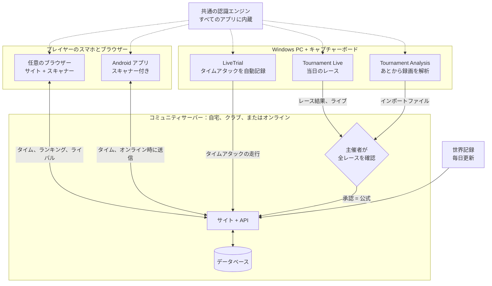

# MK8DX Ecosystem

**自分たちのマリオカート8 デラックス コミュニティサイトを、自分の手で運営しよう — タイムアタックにも、大会の夜にも。**

言語: [English](README.md) · [Nederlands](README_NL.md) · [Deutsch](README_DE.md) · [Español](README_ES.md) · [Français](README_FR.md) · [Italiano](README_IT.md) · [Português](README_PT.md) · [Русский](README_RU.md) · 日本語 · [한국어](README_KO.md) · [简体中文](README_ZH_CN.md) · [繁體中文](README_ZH_TW.md)

*この翻訳は英語版 README から機械翻訳したものです。修正のご提案を歓迎します。*

MK8DX Ecosystem は、自分でホストして使うソフトウェアです。コミュニティにひとつのウェブサイトを用意し、**タイムアタックの記録**と**大会の結果**という 2 種類の結果を保存して、それぞれに独自の楽しみ方を加えます。

**⏱️ タイムアタック**

- コースごと・クラスごと（150cc/200cc）の**ランキング**。コミュニティ内の順位を、1 日 1 回更新される**世界記録**と並べて表示します。
- **ライバル**：一度選んでおけば、相手と自分の差がいつでもわかります。
- **タイムの入力方法は自由**：手で入力するのも、リザルト画面をカメラでスキャンするのも（ウェブサイトでも Android アプリでも）OK。Windows アプリ **LiveTrial** を使えば、キャプチャーボード経由ですべての走行を自動で記録できます。
- **LiveTrial はレースそのものを見ています**：コインを取ったタイミングも、キノコを使ったタイミングも。さらに**すべての走行の動画クリップ**を作成し、自由に使えます。

**🏁 大会**

- **参加受付から決勝まで、LAN の夜をまるごと**：座席、グループ、スコア、順位をすべて自動で整理します。
- Tournament Live が**画面から結果を読み取り**、主催者が確認してから正式な結果になります。
- **TrueSkill レーティング**：大会の夜を重ねるごとに育っていくスキルレーティングです。
- **プレイにアカウントは不要**：誰にも登録を求めずに大会を開催できます。自分のアカウントに結果を残したいプレイヤーは、あとから紐付けられます。もちろん義務ではありません。

**✨ ここがユニーク**

これまで、Nintendo Switch のマリオカート8 デラックスからキャプチャーボード経由でデータをきちんと取り出す方法はありませんでした。ほとんどが手で書き写すか、文字しか読めない OCR でした。MK8DX はタイム、順位、ポイントを読み取る*だけでなく*、画像も認識します。**キャラクター（正しいカラーまで）**、**ボディ、タイヤ、グライダー**、そして**旗** — ゲームがそれらを表示する場所なら、どこでも。

しかもキャプチャーボードすら要りません。ソファに座ったままスマートフォンをテレビに向け、タイムアタックの**リザルト画面**や**ゴーストえらび画面**をスキャンすれば、結果がそのままあなたのウェブサイトに届きます。私たちの知る限り、これもこれまで誰も実現していなかったことです。

**🏠 自宅でもオンラインでも — 選ぶのはあなた**

- **完全ローカル**：自宅やクラブのネットワークで動かせます。セットアップ後は**インターネット接続は一切不要**です。
- **オンライン**：自分のサーバーやウェブホスティングで運用し、自分のオンラインコミュニティと共有できます。

どちらの場合も、あなた自身のアカウントと結果を持つ、あなたのインストールです。クラウドアカウントも、サブスクリプションも、広告もありません。

**🔑 パスワードは一切不要**

- **アカウントが必要なのは管理者だけ。** そのアカウントは最初のプレイヤーでもあるので、システムには常に少なくとも 1 人のプレイヤーがいます。ほかの全員はアカウントなしで大会に参加できます。
- **リンクひとつでサインイン**：誰もパスワードを考えたり覚えたりする必要はありません。自宅では、全員に個人用のサインインカード（リンクまたは QR コード）が配られます。オンラインでは、新しいユーザーは**メールアドレス**を入力し、MK8DX から届くリンクでサインインするだけです。

---

## 全体のつながり

MK8DX はひとつのプログラムではなく、ひとつの**コミュニティサーバー**を中心にした小さなファミリーです。サーバーは、アカウント、タイム、大会、順位表など、大切なものをすべて保存します。その周りのアプリは、あなた自身の端末でゲーム画面を読み取り、見つけた内容をあなたが選んだコミュニティに送ります。

**どの部分が必要？**

- **コミュニティサーバーひとつ — どのコミュニティにも必要な唯一の部分です。** API とデータベースを備えたウェブサイトです。自宅やクラブのネットワークで動かすか（[A2](docs/install/A2_HOME_GUIDE_EN.md)、セットアップ後はインターネット不要）、サーバーやウェブホスティングでオンライン運用します（[Host a community server](docs/guides/HOSTING.md)）。
- **プレイヤーに必要なのはブラウザーだけです。** ウェブサイトにはブラウザースキャナーが付いています。Android アプリでは、スマホでのスキャン、インターネットなしでの自分のタイム表示、ワンタップでのコミュニティ切り替えが加わります（[Players](docs/guides/PLAYERS.md)）。
- **キャプチャーボード付きの Windows PC は任意です。** LiveTrial はタイムアタックの走行をすべて自動で記録します。コミュニティへはワンクリック、または自動で送信できます（[LiveTrial](docs/guides/LIVETRIAL.md)）。
- **大会の夜はウェブサイトで運営します。** Tournament Live（当日）と Tournament Analysis（あとから録画を解析）はレース結果を提案するだけです。得点は手入力や Excel/CSV からのインポートでも登録できます。主催者が承認するまで順位表は変わりません（[Tournament Directors](docs/guides/TOURNAMENT_DIRECTORS.md)）。
- **認識は共通部品であり、サービスではありません。** 各アプリが自分用のコピーを持ち、あなたの端末で画面を読み取ります。サーバーは提案された結果を確認するだけです（[Recognition pipeline](docs/architecture/RECOGNITION_PIPELINE.md) · [Architecture](docs/architecture/COMPONENTS.md)）。

## はじめよう

| やりたいこと | ここから始めよう |
| --- | --- |
| **自宅やクラブで MK8DX を動かしたい** | [Releases](https://github.com/fromthelake/MK8DX-Ecosystem/releases) からお使いのコンピューター用の A2 パッケージを入手：展開して、起動して、「次へ」をクリック。ステップバイステップガイド（A2 パッケージには画像付きの版も入っています）：[English](docs/install/A2_HOME_GUIDE_EN.md) · [Nederlands](docs/install/A2_THUIS_HANDLEIDING_NL.md) |
| **LAN 大会の夜を運営したい** | [Tournament Directors](docs/guides/TOURNAMENT_DIRECTORS.md) |
| **タイムアタックを自動で記録したい** | [LiveTrial](docs/guides/LIVETRIAL.md) — Windows + キャプチャーボード |
| **タイムを投稿して比べたい** | [Players](docs/guides/PLAYERS.md) — どのブラウザーでも。Android 8.0 以降 |
| **コミュニティサイトをホストしたい** | [Host a community server](docs/guides/HOSTING.md) |
| **コードを変更したい** | [Developer guide](docs/DEVELOPMENT.md)、[Testing](docs/TESTING.md)、[Contributing](CONTRIBUTING.md) |

各行には、最初から最後までたどるべきガイドを挙げています。リリースパッケージではなくソースコードからサーバーをビルドするのは開発者向けです：[Getting started from source](docs/GETTING_STARTED.md)。

### どのルートにどのコンピューターを使うか

どのルートでも同じウェブサイトが手に入ります。違うのは、どこで動かすか、誰がアクセスできるかです。

| ルート | 用途 | 動作環境 | 状況 |
| --- | --- | --- | --- |
| **A2** 自宅またはクラブのネットワーク | 自分のネットワークで、セットアップ後はインターネット不要、全員にサインインカード | Windows 11 (x86-64)、Linux (x86-64 または arm64)、Mac (Apple シリコンまたは Intel) | Windows 11 でエンドツーエンドのテスト済み。Linux は WSL 2 上でテスト済み。Mac はビルド済みだが実機ではまだ未テスト |
| **A1** 1 台のコンピューター | 手元のコンピューターで試してみる | Windows 11 または Linux、x86-64、Docker あり | テスト済み：インストール、アップグレード、バックアップ |
| **A3** Docker なしの 1 台のコンピューター | Docker を使えない Windows PC | XAMPP と Node.js を入れた Windows 11 | テスト済み：インストール、アップグレード、バックアップ |
| **B1** 公開ウェブサイト | オンラインコミュニティ向け、独自ドメインとメール | Docker を入れた Linux x86-64 サーバー (VPS)。Ubuntu 24.04 の手順あり | ドキュメントあり、エンドツーエンドではまだ未テスト |
| **B2** ウェブホスティング | 自前のサーバーなしでオンライン運用 | Node.js (Passenger)、MariaDB/MySQL、SSH が使えるホスティングプラン | 私たち自身のコミュニティサイトはこの方法で動いています。公開パッケージを新しいホスティングアカウントにゼロからインストールしたことはまだありません |

周辺のアプリ：

| アプリ | 動作環境 | 理由 |
| --- | --- | --- |
| ウェブサイトとブラウザー版スキャナー | 最新のブラウザーならどれでも。スキャンには Chrome または Edge を推奨 | スキャナーは完全にデバイス上で動作し、複数のスレッドを使えるブラウザーが必要です |
| Android アプリ | Android 8.0 以降、arm64 推奨 | スマートフォン自体でスキャンするので、接続がなくても使えます |
| iPhone と iPad | ブラウザーでウェブサイトを利用。Safari でのスキャンは現在テスト中 | iOS アプリはありません：ビルドと署名には Mac と Apple の開発者アカウントが必要です |
| LiveTrial と Tournament Live | x86-64 の Windows（Windows 11 でテスト済み）、画面ごとに USB HDMI キャプチャーボード | キャプチャーボードと同梱の認識エンジンは Windows 向けにビルド・テストされています。macOS 版や Linux 版はありません |

**Android アプリの初回起動：** *コミュニティを選択* と表示されます。自宅やクラブでは、管理者が見せる **Prepare a device** カードをスキャンします。オンラインコミュニティの場合は、そのウェブサイトのアドレスを入力します。そのあとブラウザーでサインインします。詳しくは [Players](docs/guides/PLAYERS.md#first-start) をご覧ください。

**ひとつのアプリで、複数のコミュニティ：** 上部のコミュニティチップをワンタップするだけで、クラブ、自宅のインストール、オンラインコミュニティを切り替えられます。それぞれが独自のアカウントと未送信のタイムを保持します。**あなた** → **自分のタイム** では、インターネットがなくてもコースごとのベストタイムを確認できます。複数のコミュニティに参加している場合は、ベストタイムを別のコミュニティへ持ち込むこともできます — そのコミュニティが受け入れていれば。

**なぜすべてがどこでも使えるわけではないの？** 各パッケージは、ビルドして試した環境でのみ提供しています。A1 と B1 のサーバーイメージは x86-64 向けのみで、A2 には arm64 版もあります。Intel Mac では A2 が必要とするセキュリティライブラリ（`cryptography`）が配布されなくなったため、リリースでは Intel Mac 上でソースからビルドし、そこでテストしています（[方法](docs/RELEASE_PACKAGES.md#intel-mac-a2-package)）。A3 は、Docker を使えない、または使いたくない人のためにあります。[ホスティングガイド](docs/guides/HOSTING.md) と [リリースパッケージ](docs/RELEASE_PACKAGES.md) に、すべてのファイルとその正確な要件が載っています。

新しくインストールした環境は空の状態から始まります。コミュニティのアカウントや結果は引き継がれません。含まれるのは、ゲームカタログと、任天堂のスタッフゴーストおよび世界記録の参照データだけです。

---

## 🏁 LAN 大会の夜

LAN パーティーを覚えていますか？ 1 画面に 2 人、部屋いっぱいの Switch、レインボーロードに向かってみんなで叫ぶあの夜。MK8DX はその夜を取り戻し、レース以外のことをすべて引き受けます。誰がどこに座るか、次にどのグループが走るか、スコア、決勝、そして順位。

- **参加受付** — 締め切り時刻と定員を決めて、その夜の参加受付を開きます。先着順でも、公開したシードによる公平な抽選でも OK。プレイヤーは持参する Switch と一緒に申し込みます。
- **座席は自動で決まる** — 出欠、本体と座席（Switch 1 台につき 2 人）、ステーション番号とケーブル番号。ランキング順かランダムのシード、そして*バランス*か*最小限の移動*の配置を選べば、MK8DX が予選グループ、続いて決勝グループを組んでくれます。
- **Tournament Live がレースを読み取る** — 各画面にキャプチャーボードをつなぎます。レースのたびに、着順、キャラクター、旗、レースポイント、合計、コースを読み取り（2 人での画面分割にも対応）、ローカルに保存して、ウェブサイト上のその夜の大会へ送信します。
- **主導権はあなたに** — 結果が正式に反映される前に、主催者がプレイヤーと順位を確認します。それまでの間、ライブ順位は暫定として表示されます。
- **大会のあとで** — 最終順位、共有できるレポート（WhatsApp、PNG、CSV、WordPress にそのまま使える記事）、そして夜をまたいで積み上がる、TrueSkill 方式のコミュニティレーティング（任意）。

  
  

### 当日 Tournament Live を使わなかった？ あとから録画を解析しよう

ライブでキャプチャーせずに、その夜を録画していましたか？ **Tournament Analysis** ウィンドウなら、あとから録画を読み取れます。動画を 1 本、複数本、または大会ごとのフォルダーを追加して **START ANALYSIS** を押すだけ。すべてのレースを着順、キャラクター、ポイントとともに見つけ出し、その間、色分けされたライブログとレインボーロードの進捗バーが進み具合を表示します。結果は Excel ワークブック、CSV、ウェブサイト用のインポートファイルとして出力され、主催者が確認してインポートします — Tournament Live と同じ確認の流れです。4 レースを含む 22 分の録画は、ノートパソコンで約 70 秒で解析できました。Windows 版 Tournament Tools パッケージでは `TournamentAnalysis.cmd` をダブルクリックします（動画を `TournamentProcessor.cmd` にドラッグする方法も引き続き使えます）。開発者は `python -m tournament_processor.gui` を実行します。手順は [Tournament Directors](docs/guides/TOURNAMENT_DIRECTORS.md#analyse-recordings-afterwards) にあります。

## ⏱️ LiveTrial でタイムアタック — 完全自動

キャプチャーボードで Switch を Windows PC につないで、あとは走るだけ。私たちの知る限り、こんなものはこれまでありませんでした。

LiveTrial は HDMI の映像を見て、自動で次のものを認識します。

- 通過したメニュー、**コース**、**クラス**（150cc/200cc）
- レース中：**レースタイマー、ラップカウンター、コイン、アイテム**
- リザルト画面：**合計タイム、すべてのラップタイム**（3 周、ベビィパークでは 7 周）、**キャラクター、ボディ、タイヤ、グライダー**、**旗**
- **ゴーストえらび**パネル — ゴーストの名前、タイム、ラップ、パーツ — と、そのゴーストが**任天堂のスタッフゴースト**かどうか
- **Switch の言語**（全 12 のシステム言語）も自動で

**すべてのレースのクリップ**と、最後まで見たゴーストのリプレイのクリップを保存し、ラップ表やグラフ付きの走行履歴を残します。さらに、**世界記録**、**任天堂のスタッフゴースト**、**自己ベスト**、**ライバル**との差も表示します。結果はワンクリックでコミュニティへ送信でき（自動送信もオンにできます）、必要ならクリップを自分の YouTube チャンネルにアップロードすることもできます。

## 📱 ソファからスキャン

友だちの家でタイムアタック？ スマートフォンやタブレットをテレビに向ければ、スキャナーがリザルト画面を読み取ります：**合計、ラップ、キャラクター、ボディ、タイヤ、グライダー、旗、プレイヤー名**、あるいはコースとタイム付きの**ゴーストパネル**。自信のない部分は候補と一緒に表示されるので、投稿する前に正しいものを選べます。

ブラウザー版スキャナーは**すべてあなたのデバイス上で**動作します — アカウントもサーバーも不要で、最初のダウンロード後はオフラインでも使えます。Android アプリもデバイス上でスキャンします。

  
  

## 🏆 あなたの記録、あなたのライバル

プレイヤー一人ひとりに、コースごとの自己記録、家族や友だち、クラブとのランキング、追いかけるライバル（つつき、チャレンジ、ときどきサイコロ対決も）、誰かがあなたのタイムを抜いたときの通知、そして現在の世界記録を基準にした **23 段階のマスタリーレベル**が用意されています。

  
  

## 🌍 あなたの言語で — 全 15 言語に対応

マリオカート8 デラックスは世界中で遊ばれています。だから MK8DX はすべてのゲーム言語に対応するように作られています。ウェブサイト、Android アプリ、LiveTrial、Tournament ツールは **15 言語**で利用でき、認識も**全 15 のゲーム言語バリエーション**に対応しています — オランダ語や英語から、日本語、韓国語、中国語、ロシア語まで。英語とオランダ語は人の手で確認済みですが、その他の言語は機械翻訳で、一部の言語の認識は実機でまだ検証中です。あなたの言語で遊んでいますか？ その確認を手伝っていただくことが、何よりも価値のある貢献です。

## 🛠️ あなたのものにしよう

MK8DX はオープンソースで、プレイヤーがプレイヤーのために作っています。あなたのクラブ、家族、あるいは街の LAN シーンのために動かし、*あなたたち*の夜のやり方に合わせて調整し、その上にさらに作り上げてください。

- あなたの言語を**翻訳・レビュー**する（ウェブサイト、アプリ、ゲーム内の認識）。
- 自分の本体、言語、キャプチャーボードで**認識をテスト**し、読み取れなかったものを報告する。
- **コミュニティに必要なものを追加**する — 新しい大会形式、統計、結果の共有方法。
- **ドキュメントを改善**して、次の主催者がもっと早く始められるようにする。

まずは [Contributing](CONTRIBUTING.md) と [開発者ガイド](docs/DEVELOPMENT.md) から始めてください。プルリクエスト、バグ報告、翻訳の修正のひとつひとつが、次の LAN の夜をみんなにとってより良いものにします。

## プロジェクトの状況

安定版リリースは [GitHub Releases](https://github.com/fromthelake/MK8DX-Ecosystem/releases) にあります。0.2.0 では自宅やクラブで使える A2 が追加され、0.2.1 では Android アプリにタイムのオフラインコピーと、より落ち着いたレイアウトが加わりました。0.2.2 では録画の解析が再び動くようになり、Tournament Analysis ウィンドウが加わりました。0.2.3 では Web ゲートウェイが root なしで動作し、リポジトリを使い始めやすくなりました。また、コミュニティサーバーのデータベースが MySQL 9.7 LTS になり、すべてのスキャナーでカートとグライダーの色がキャラクターに従うようになりました。[変更履歴](CHANGELOG.md)、[Release packages](docs/RELEASE_PACKAGES.md)、そして完全版ガイド（[English](docs/install/MK8DX_User_Guide_EN.txt)、[Nederlands](docs/install/MK8DX_Handleiding_NL.txt)）をご覧ください。

認識が結果を勝手に正式なものにすることはありません。自分のタイムアタックは自分で確認し、大会のレースは主催者が確認してから反映されます。

## ドキュメント

| やりたいこと | 読むもの |
| --- | --- |
| 認識の仕組みを理解したい | [Recognition pipeline](docs/architecture/RECOGNITION_PIPELINE.md) |
| 構成要素と、結果がどのように伝わるかを理解したい | [Architecture](docs/architecture/COMPONENTS.md) |
| コードをビルド・変更したい | [Developer guide](docs/DEVELOPMENT.md) と [Testing](docs/TESTING.md) |
| ネイティブクライアントをビルドしたい | [Client builds](docs/CLIENT_BUILDS.md) |
| インストールを運用したい（バックアップ、アップグレード、復旧） | [Operations](docs/OPERATIONS.md) |
| なぜそうなっているのかを知りたい | [Decision index](docs/decisions/README.md) |
| 貢献したい | [Contributing](CONTRIBUTING.md)、[Code of conduct](CODE_OF_CONDUCT.md) |
| 助けがほしい | [Getting help](SUPPORT.md) |
| セキュリティ上の問題を報告したい | [Security policy](SECURITY.md) |
| コーディングエージェントと作業したい | [AGENTS.md](AGENTS.md) |

## 💡 誕生のストーリー

**すべては、地元のマリオカート大会と、数人の熱心な仲間と、2023 年 12 月に届いた 1 通の招待から始まりました。**

信じられないかもしれませんが、NINTENDO64 でマリオカートを遊んでいたにもかかわらず、私はマリオカート8 デラックスにはほとんど触れたことがありませんでした。ドリフトというものがあることさえ知らなかったのです。言うまでもなく、追いつかなければならないことがたくさんありました。

そこで出会ったのは、人を集めて一緒にレースをすることが心から好きな、素晴らしい仲間たちでした。

そして、その仲間はどんどん増えていきました。

わずか 16 人で始まった集まりは、やがて 68 人以上が参加するコミュニティに成長し、**ひと晩で最大 36 人が競い合う**までになりました。みんなで**1,000 以上の登録済みレース**を走り、全 96 コースを制覇し、数えきれないほどの楽しい競争の時間を過ごしてきました。

設備も同じくらいの速さで進化しました。**Wi-Fi、GoPro、大量の手作業での確認、そして数えきれない接続トラブル**から始まったものが、少しずつキャプチャーボード、完全有線の Ethernet ネットワーク、自動のレース記録へと進化し、ついには本体、画面、ケーブル、仲間、そしてもちろんピザに囲まれた倉庫で、36 人が競い合うまでになったのです。

そして、大会のたびに新しいアイデアが生まれました。

スコアを分析し、成績を記録し、座席の配置を最適化し、Nintendo Switch の間でプレイヤーを移動させる — Ethernet ケーブルの差し替えまで含めて — というどんどん複雑になる作業を自動化する方法を考え始めました。こういうイベントを運営したことのある人ならわかるでしょう。ときには、レースそのものがいちばん簡単な部分なのです。

**そして、タイムアタックが始まりました。**

ちょっとした競争として始まったものが、あと数ミリ秒でもタイムを縮めようとする、楽しいライバル関係へとすぐに変わっていきました。中でも 150cc のベビィパークとビッグブルーは特にお気に入りになりました。いつも誰かがより速いラップを出し、いつも誰かがそれを破ろうと燃えていました。

当然、その結果もきちんと記録したくなりました。大会をより良くしようとしたのと同じ熱意が、タイムアタックの自動記録、画像認識、統計、ランキング、そしてその先へとつながっていきました。

ひとつのことが次へとつながり、気づけば私は、マリオカートを実際に遊ぶのとほぼ同じくらいの時間を、マリオカートのためのツール作りに費やしていました。

### 情熱からオープンソースのエコシステムへ

MK8DX Ecosystem は 2024 年から開発を続けてきました。たくさんの AI の助けを借りて — 今でいう *vibe coding* です。

そして、ひとつはっきりさせておきたいことがあります。**AI がなければ私はこれを作れなかったし、私がいなければ AI もこれを作れなかった。**

すべてを動かすまでには、膨大な試行錯誤と忍耐、ゲームのロジックの説明、スクリーンショットの確認、間違いの修正、そして AI を正しい方向へ引き戻すことが必要でした。ときには、何度も何度も。

まったく何も達成しないまま、楽しそうにクレジットを燃やし尽くしたセッションも数えきれないほどありました。それを思い出すと、今でも夜眠れなくなります（笑）。

それに、どうやら目視テストというのはかなりのデータを生み出すようです。今の私の手元には、AI が生成した QA 用のスクリーンショットと録画がおよそ 4 TB あります。いつか本当に片付けなければなりません。

個々の技術はすでに存在していました。でも、それらを組み合わせて、画面で起きていることを理解し、ゲームの情報を取り出し、プレイヤーと主催者の役に立つ形にする、動くエコシステムに仕上げるのは、なかなかの旅でした。それを支えるのに必要なゲームアセットを集めて整理するのも同じです。

特に画像認識、自動化、ソフトウェア開発については、信じられないほど多くのことを学べる経験でした。

そして 2026 年の今、ついにその成果を**オープンソースのエコシステム**として共有できるようになりました。ほかの人たちが使い、改良し、そして私たちと同じくらい楽しんでもらえたらうれしいです。

### Volkert への追悼

最近、あまりにも若くして亡くなった、尊敬するタイムアタックのライバル **Volkert** のことにも触れておきたいと思います。

特にベビィパークとビッグブルーの 150cc での彼とのライバル関係は、上達し続けるための大きなモチベーションでした。最後の数ミリ秒を削るために、二人ともかなりの時間を費やしたはずです。もっとも、私のほうが彼よりずっと多くの時間をかけていたと思います。彼のほうが単純に経験豊富で、安定していました。

3 人で Excel のシートにタイムを記録することから始まったものが、少しずつ、今ではこのエコシステムの一部になっているタイムアタック機能へと育っていきました。

このプロジェクトが、ほかの人たちにも同じような友好的なライバル関係と、上達し続けたいという気持ちを味わう機会になればと願っています。

### 走り続けよう、共有し続けよう

私たちは、自分たちが最高のプレイヤーだとも、最高の開発者だとも、完璧なものを作ったとも思っていません。でも、熱意と好奇心、そしてもっと良くしていこうという意志なら、決して誰にも負けません。

このプロジェクトが、LAN 大会の運営や、楽しいライバル関係の始まり、自己ベストの更新、あるいは単に仲間との素敵な夜の役に立てたなら、それだけで価値のあることを成し遂げたと思います。

**これからも、最高の瞬間やアイデア、改善を共有してください。** それこそが、このようなコミュニティを生き生きとさせ続けるものです。

最後に、こんなに素晴らしいゲーム機とゲームを生み出してくれた**任天堂**に心から感謝します。マリオカートを楽しんでいるなら、それを可能にしている人たちを応援してください。正規のゲーム機とソフトを購入し、友だちや家族、同僚を誘って、一緒に遊ぶことを楽しんでください。

結局のところ、この冒険はすべてそうやって始まったのですから。

— [fromthelake](https://github.com/fromthelake)

## ライセンスと任天堂について

これは、プログラミングを学び、マリオカート8 デラックスをもっと楽しくするための、独立した非営利の趣味のプロジェクトです。**任天堂とは無関係であり、任天堂の承認を受けたものでもありません。** 任天堂は自社の商標とゲームコンテンツの権利を保有しています。ぜひゲーム機やソフトを購入して、任天堂を応援してください。

このプロジェクトのオリジナルのコードとドキュメントは [Mozilla Public License 2.0](LICENSE) の下でライセンスされています。[ライセンスの適用範囲](LICENSE_SCOPE.md) では、その適用範囲を説明しています。任天堂の素材、ゲーム画像、認識用テンプレート、モデル、フォント、その他の第三者の素材は対象**外**で、それぞれ独自の条件に従います。[Third-party materials](docs/THIRD_PARTY_MATERIALS.md) をご覧ください。本ソフトウェアは現状のまま提供されます。
