# MK8DX Ecosystem

**나만의 마리오 카트 8 디럭스 커뮤니티 웹사이트를 직접 운영하세요 — 타임 어택에도, 대회의 밤에도.**

언어: [English](README.md) · [Nederlands](README_NL.md) · [Deutsch](README_DE.md) · [Español](README_ES.md) · [Français](README_FR.md) · [Italiano](README_IT.md) · [Português](README_PT.md) · [Русский](README_RU.md) · [日本語](README_JA.md) · 한국어 · [简体中文](README_ZH_CN.md) · [繁體中文](README_ZH_TW.md)

*이 번역은 영어 README를 기계 번역한 것입니다. 수정 제안을 환영합니다.*

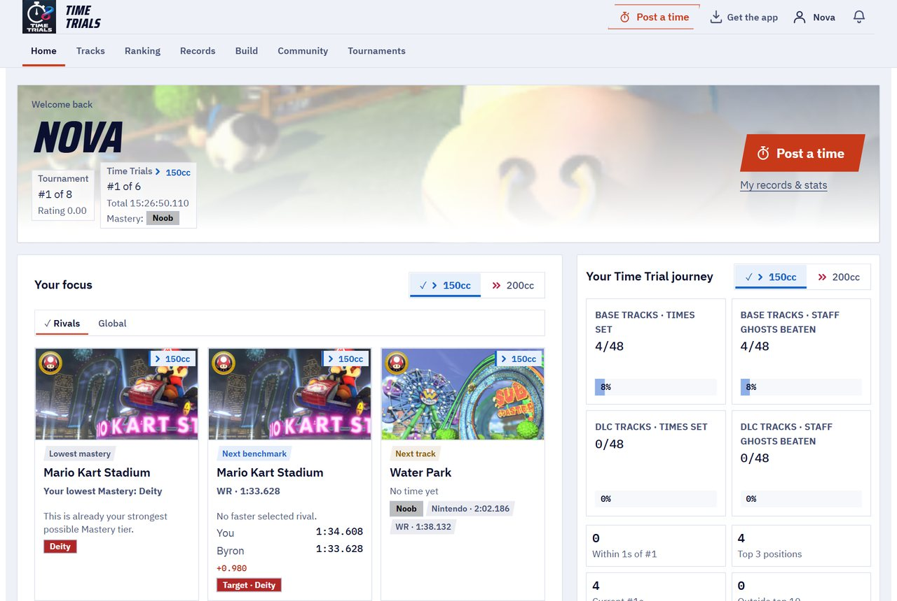

MK8DX Ecosystem은 직접 호스팅해서 사용하는 소프트웨어입니다. 커뮤니티에 하나의 웹사이트를 마련해 **타임 어택 기록**과 **대회 결과**라는 두 종류의 결과를 보관하고, 각각에 고유한 경쟁의 재미를 더해 줍니다.

**⏱️ 타임 어택**

- 코스별·클래스별(150cc/200cc) **순위표**. 커뮤니티 안의 순위를 하루에 한 번 갱신되는 **세계 기록**과 나란히 보여 줍니다.
- **라이벌**: 한 번만 골라 두면 상대와 나의 차이를 언제든지 확인할 수 있습니다.
- **기록 입력은 원하는 방식으로**: 직접 입력해도 되고, 결과 화면을 카메라로 스캔해도 됩니다(웹사이트에서도 Android 앱에서도). Windows 애플리케이션 **LiveTrial**을 쓰면 캡처 카드를 통해 모든 주행을 자동으로 기록합니다.
- **LiveTrial은 레이스 자체를 봅니다**: 코인을 먹는 순간, 버섯을 쓰는 순간까지. 게다가 **모든 주행의 동영상 클립**을 만들어 주니 마음껏 활용하세요.

**🏁 대회**

- **참가 신청부터 결승까지, LAN의 밤을 통째로**: 자리 배치, 그룹, 점수, 순위를 알아서 정리해 줍니다.
- Tournament Live가 **화면에서 결과를 읽고**, 주최자가 확인한 뒤에 정식 결과로 반영됩니다.
- **TrueSkill 레이팅**: 대회의 밤이 거듭될수록 함께 성장하는 실력 레이팅입니다.
- **플레이하는 데 계정이 필요 없습니다**: 누구에게도 가입을 요구하지 않고 대회를 열 수 있습니다. 자기 계정에 결과를 남기고 싶은 플레이어는 나중에 연결하면 됩니다. 물론 의무는 아닙니다.

**✨ 무엇이 특별한가요**

지금까지 Nintendo Switch의 마리오 카트 8 디럭스에서 캡처 카드를 통해 데이터를 제대로 뽑아낼 방법은 없었습니다. 대부분 손으로 옮겨 적거나, 글자만 읽을 수 있는 OCR을 쓰는 정도였죠. MK8DX는 기록, 순위, 포인트를 읽을 *뿐만 아니라* 그림도 알아봅니다. **캐릭터(정확한 색상까지)**, **바디, 타이어, 글라이더**, 그리고 **국기** — 게임이 그것들을 보여 주는 곳이라면 어디서든요.

게다가 캡처 카드조차 필요 없습니다. 소파에 앉은 채로 스마트폰을 TV에 비추고 타임 어택 **결과 화면**이나 **고스트 선택 화면**을 스캔하면, 결과가 곧바로 여러분의 웹사이트로 전송됩니다. 저희가 아는 한, 이것 역시 지금까지 아무도 해내지 못한 일입니다.

**🏠 집에서도 온라인에서도 — 선택은 여러분의 몫**

- **완전 로컬**: 집이나 클럽의 네트워크에서 실행하세요. 설정이 끝나면 **인터넷이 전혀 필요 없습니다**.
- **온라인**: 자신의 서버나 웹 호스팅에서 운영하고 자신의 온라인 커뮤니티와 공유하세요.

어느 쪽이든 여러분만의 계정과 결과를 가진, 여러분의 설치본입니다. 클라우드 계정도, 구독도, 광고도 없습니다.

**🔑 비밀번호는 절대 필요 없습니다**

- **계정이 필요한 사람은 관리자뿐입니다.** 그 계정은 첫 번째 플레이어이기도 해서, 시스템에는 항상 최소 한 명의 플레이어가 있습니다. 다른 사람들은 모두 계정 없이 대회에 참가할 수 있습니다.
- **링크 하나로 로그인**: 아무도 비밀번호를 만들거나 기억할 필요가 없습니다. 집에서는 모두가 개인 로그인 카드(링크 또는 QR 코드)를 받습니다. 온라인에서는 새 사용자가 **이메일 주소**만 입력하고, MK8DX가 보내 주는 링크로 로그인하면 됩니다.

---

## 전체가 어떻게 맞물리나요

MK8DX는 하나의 프로그램이 아니라 하나의 **커뮤니티 서버**를 중심으로 한 작은 가족입니다. 서버는 계정, 기록, 대회, 순위표 등 중요한 모든 것을 보관합니다. 그 주변의 앱들은 여러분의 기기에서 게임 화면을 읽고, 찾아낸 내용을 여러분이 선택한 커뮤니티로 보냅니다.

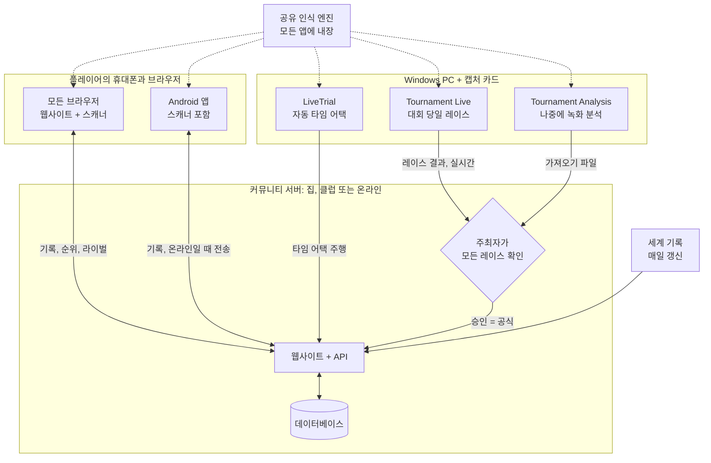

**어떤 구성 요소가 필요한가요?**

- **커뮤니티 서버 하나 — 모든 커뮤니티에 필요한 유일한 구성 요소입니다.** API와 데이터베이스를 갖춘 웹사이트입니다. 집이나 클럽 네트워크에서 실행하거나([A2](docs/install/A2_HOME_GUIDE_EN.md), 설치 후 인터넷 불필요) 서버 또는 웹 호스팅에서 온라인으로 운영하세요([Host a community server](docs/guides/HOSTING.md)).
- **플레이어에게는 브라우저만 있으면 됩니다.** 웹사이트에 브라우저 스캐너가 함께 들어 있습니다. Android 앱은 휴대폰에서의 스캔, 인터넷 없이 보는 내 기록, 한 번의 탭으로 커뮤니티 전환을 더해 줍니다([Players](docs/guides/PLAYERS.md)).
- **캡처 카드가 달린 Windows PC는 선택 사항입니다.** LiveTrial은 모든 타임 어택 주행을 스스로 기록합니다. 커뮤니티로는 클릭 한 번으로, 또는 자동으로 보낼 수 있습니다([LiveTrial](docs/guides/LIVETRIAL.md)).
- **대회의 밤은 웹사이트에서 운영합니다.** Tournament Live(당일)와 Tournament Analysis(나중에 녹화 분석)는 레이스 결과를 제안할 뿐입니다. 점수는 직접 입력하거나 Excel/CSV에서 가져올 수도 있습니다. 주최자가 승인하기 전에는 순위표가 바뀌지 않습니다([Tournament Directors](docs/guides/TOURNAMENT_DIRECTORS.md)).
- **인식은 공유 부품이지 서비스가 아닙니다.** 각 앱이 자체 사본을 가지고 여러분의 기기에서 화면을 읽으며, 서버는 제안된 결과를 확인할 뿐입니다([Recognition pipeline](docs/architecture/RECOGNITION_PIPELINE.md) · [Architecture](docs/architecture/COMPONENTS.md)).

## 시작하기

| 하고 싶은 일 | 여기서 시작하세요 |
| --- | --- |
| **집이나 클럽에서 MK8DX 실행하기** | [Releases](https://github.com/fromthelake/MK8DX-Ecosystem/releases)에서 내 컴퓨터용 A2 패키지를 받으세요: 압축을 풀고, 실행하고, '다음'을 클릭. 단계별 안내(A2 패키지에는 그림이 들어간 버전도 있습니다): [English](docs/install/A2_HOME_GUIDE_EN.md) · [Nederlands](docs/install/A2_THUIS_HANDLEIDING_NL.md) |
| **LAN 대회의 밤 운영하기** | [Tournament Directors](docs/guides/TOURNAMENT_DIRECTORS.md) |
| **타임 어택을 자동으로 기록하기** | [LiveTrial](docs/guides/LIVETRIAL.md) — Windows + 캡처 카드 |
| **내 기록을 올리고 비교하기** | [Players](docs/guides/PLAYERS.md) — 어떤 브라우저든 OK, Android 8.0 이상 |
| **커뮤니티 웹사이트 호스팅하기** | [Host a community server](docs/guides/HOSTING.md) |
| **코드 수정하기** | [Developer guide](docs/DEVELOPMENT.md), [Testing](docs/TESTING.md), [Contributing](CONTRIBUTING.md) |

각 행에는 처음부터 끝까지 따라갈 안내서가 적혀 있습니다. 릴리스 패키지 대신 소스 코드에서 서버를 빌드하는 것은 개발자용입니다: [Getting started from source](docs/GETTING_STARTED.md).

### 어떤 경로에 어떤 컴퓨터를

어떤 경로를 택해도 똑같은 웹사이트를 얻습니다. 다른 점은 어디에서 실행되고 누가 접속할 수 있느냐입니다.

| 경로 | 용도 | 실행 환경 | 상태 |
| --- | --- | --- | --- |
| **A2** 집 또는 클럽 네트워크 | 자신의 네트워크, 설정 후 인터넷 불필요, 모두에게 로그인 카드 | Windows 11 (x86-64), Linux (x86-64 또는 arm64), Mac (Apple 실리콘 또는 Intel) | Windows 11에서 처음부터 끝까지 테스트 완료. Linux는 WSL 2에서 테스트. Mac은 빌드는 했지만 실제 Mac에서는 아직 미테스트 |
| **A1** 컴퓨터 한 대 | 지금 앉아 있는 컴퓨터에서 한번 써 보기 | Windows 11 또는 Linux, x86-64, Docker 필요 | 테스트 완료: 설치, 업그레이드, 백업 |
| **A3** Docker 없는 컴퓨터 한 대 | Docker를 쓸 수 없는 Windows PC | XAMPP와 Node.js가 설치된 Windows 11 | 테스트 완료: 설치, 업그레이드, 백업 |
| **B1** 공개 웹사이트 | 온라인 커뮤니티, 자신의 도메인과 이메일 | Docker가 설치된 Linux x86-64 서버(VPS). Ubuntu 24.04 문서 제공 | 문서화 완료, 처음부터 끝까지의 테스트는 아직 |
| **B2** 웹 호스팅 | 자기 서버 없이 온라인으로 | Node.js (Passenger), MariaDB/MySQL, SSH를 지원하는 호스팅 요금제 | 저희 커뮤니티 사이트가 이 방식으로 운영 중. 공개 패키지를 새 호스팅 계정에 처음부터 설치해 본 적은 아직 없음 |

함께 쓰는 앱:

| 앱 | 실행 환경 | 이유 |
| --- | --- | --- |
| 웹사이트와 브라우저 스캐너 | 최신 브라우저라면 무엇이든. 스캔에는 Chrome 또는 Edge 권장 | 스캐너가 완전히 기기 안에서 실행되므로 여러 스레드를 쓸 수 있는 브라우저가 필요합니다 |
| Android 앱 | Android 8.0 이상, arm64 권장 | 휴대폰 자체에서 스캔하므로 연결이 없어도 됩니다 |
| iPhone과 iPad | 브라우저에서 웹사이트 이용. Safari에서의 스캔은 아직 테스트 중 | iOS 앱은 없습니다: 빌드하고 서명하려면 Mac과 Apple 개발자 계정이 필요합니다 |
| LiveTrial과 Tournament Live | x86-64 Windows(Windows 11에서 테스트), 화면마다 USB HDMI 캡처 카드 | 캡처 카드와 함께 제공되는 인식 엔진은 Windows용으로 빌드·테스트되었습니다. macOS나 Linux 빌드는 없습니다 |

**Android 앱 첫 실행:** *커뮤니티 선택* 화면이 나옵니다. 집이나 클럽에서는 관리자가 보여 주는 **Prepare a device** 카드를 스캔하고, 온라인 커뮤니티라면 그 웹사이트 주소를 입력합니다. 그런 다음 브라우저로 로그인합니다. 자세한 내용: [Players](docs/guides/PLAYERS.md#first-start).

**앱 하나로 여러 커뮤니티를:** 위쪽의 커뮤니티 칩을 한 번 탭하면 클럽, 집의 설치본, 온라인 커뮤니티 사이를 전환할 수 있습니다. 각각 자신의 계정과 아직 보내지 않은 기록을 따로 보관합니다. **나** → **내 기록**에서는 인터넷 없이도 코스별 최고 기록을 볼 수 있고, 커뮤니티가 둘 이상이라면 최고 기록을 다른 커뮤니티로 가져갈 수도 있습니다 — 그 커뮤니티가 받아 준다면요.

**왜 모든 것이 모든 곳에서 되지는 않나요?** 각 패키지는 빌드하고 시험해 본 환경에서만 제공됩니다. A1과 B1 서버 이미지는 x86-64 전용이고, A2에는 arm64 버전도 있습니다. Intel Mac에서는 A2에 필요한 보안 라이브러리(`cryptography`)가 더 이상 배포되지 않기 때문에, 릴리스 과정에서 Intel Mac에서 소스로부터 빌드하고 그곳에서 테스트합니다([방법](docs/RELEASE_PACKAGES.md#intel-mac-a2-package)). A3는 Docker를 쓸 수 없거나 쓰고 싶지 않은 분들을 위해 있습니다. [호스팅 가이드](docs/guides/HOSTING.md)와 [릴리스 패키지](docs/RELEASE_PACKAGES.md)에 모든 파일과 정확한 요구 사항이 나와 있습니다.

새로 설치하면 빈 상태에서 시작합니다. 커뮤니티 계정이나 결과는 이어받지 않습니다. 함께 들어 있는 것은 게임 카탈로그와 Nintendo 스태프 고스트 및 세계 기록 참조 데이터뿐입니다.

---

## 🏁 LAN 대회의 밤

LAN 파티를 기억하시나요? 화면 하나에 두 명, 방을 가득 채운 Switch, 레인보우 로드를 향해 다 함께 소리 지르던 그 밤. MK8DX는 그 밤을 되살리고, 레이스 말고 나머지는 모두 맡아 줍니다. 누가 어디에 앉을지, 다음에 어느 그룹이 달릴지, 점수, 결승, 그리고 순위까지.

- **참가 신청** — 마감 시간과 정원을 정해 그날 밤의 참가 신청을 엽니다. 선착순으로 받아도 되고, 공개된 시드로 공정하게 추첨해도 됩니다. 플레이어는 가져올 Switch와 함께 신청합니다.
- **자리 배치는 알아서** — 출석, 본체와 자리(Switch 한 대에 두 명), 스테이션 번호와 케이블 번호. 순위 기반 또는 무작위 시드, 그리고 *균형* 또는 *최소 이동* 배치를 고르면 MK8DX가 예선 그룹을, 이어서 결승 그룹을 짜 줍니다.
- **Tournament Live가 레이스를 읽습니다** — 각 화면에 캡처 카드를 연결하세요. 레이스가 끝날 때마다 도착 순위, 캐릭터, 국기, 레이스 포인트, 합계, 코스를 읽어(2인 분할 화면도 지원) 로컬에 저장하고, 웹사이트의 그날 밤 대회로 전송합니다.
- **결정은 여러분이** — 결과가 반영되기 전에 주최자가 플레이어와 순위를 확인합니다. 그동안 실시간 순위는 잠정 결과로 표시됩니다.
- **대회가 끝난 뒤에는** — 최종 순위, 공유할 수 있는 리포트(WhatsApp, PNG, CSV, WordPress에 바로 올릴 수 있는 글), 그리고 여러 밤에 걸쳐 쌓이는 TrueSkill 방식의 커뮤니티 레이팅(선택 사항).

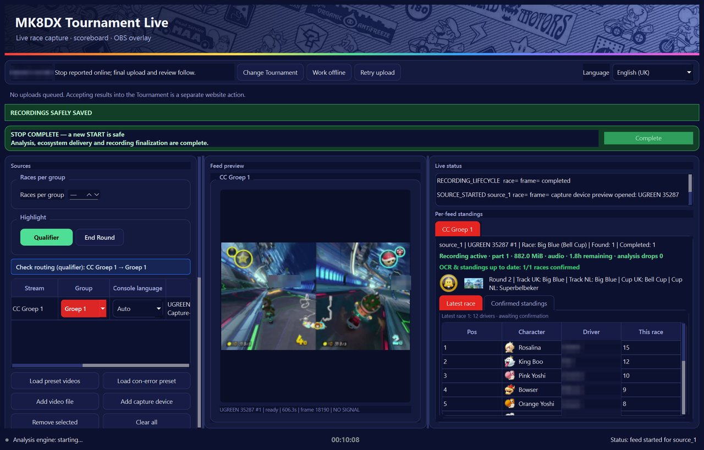

  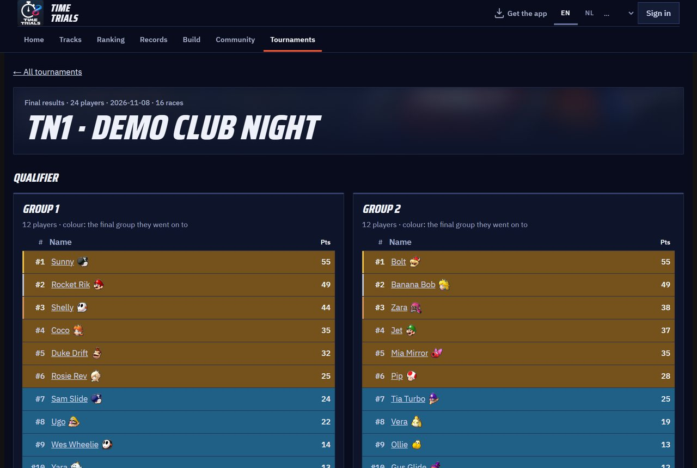
  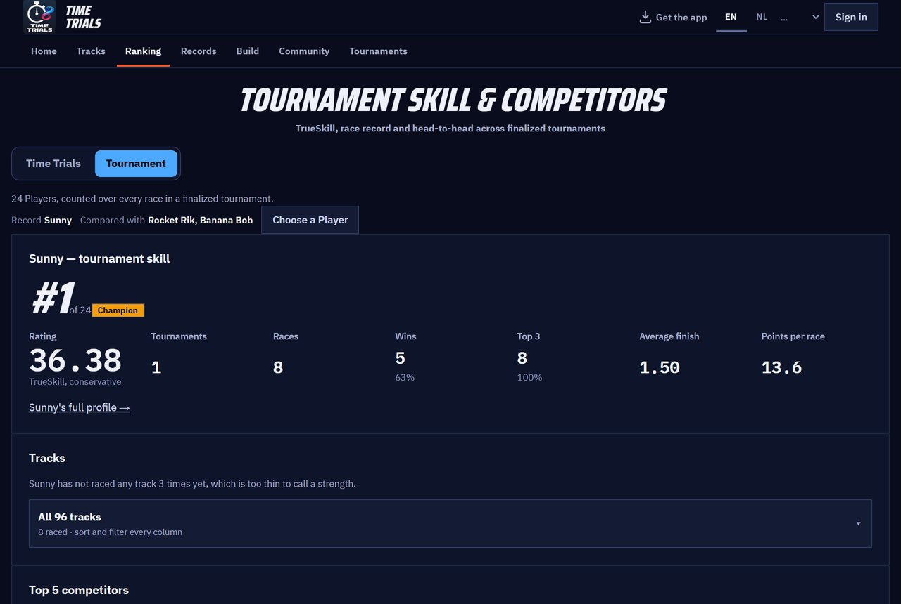

### 그날 Tournament Live를 쓰지 못했나요? 나중에 녹화를 분석하세요

실시간으로 캡처하지 않고 그 밤을 녹화해 두었나요? **Tournament Analysis** 창이 나중에 녹화를 읽어 줍니다. 동영상 하나, 여러 개, 또는 대회별 폴더를 추가하고 **START ANALYSIS**를 누르세요. 모든 레이스를 순위, 캐릭터, 포인트와 함께 찾아내고, 그동안 색으로 구분된 실시간 로그와 레인보우 로드 진행 막대가 진행 상황을 보여 줍니다. 결과는 Excel 통합 문서, CSV, 웹사이트용 가져오기 파일로 만들어지며, 주최자가 확인한 뒤 가져옵니다 — Tournament Live와 똑같은 검토 과정입니다. 레이스 네 번이 담긴 22분짜리 녹화를 노트북에서 약 70초 만에 분석했습니다. Windows용 Tournament Tools 패키지에서는 `TournamentAnalysis.cmd`를 더블클릭하세요(동영상을 `TournamentProcessor.cmd`로 끌어다 놓는 방법도 계속 쓸 수 있습니다). 개발자는 `python -m tournament_processor.gui`를 실행합니다. 자세한 단계는 [Tournament Directors](docs/guides/TOURNAMENT_DIRECTORS.md#analyse-recordings-afterwards)에 있습니다.

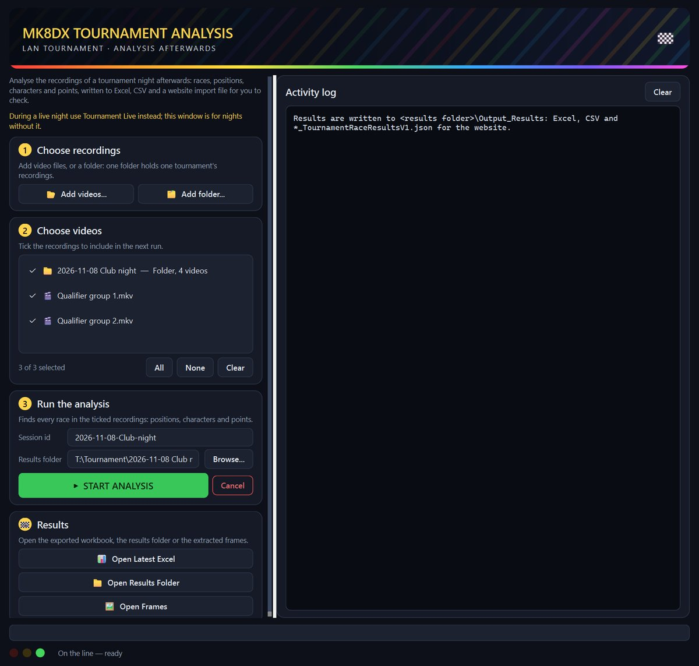

## ⏱️ LiveTrial로 타임 어택 — 완전 자동

캡처 카드로 Switch를 Windows PC에 연결하고 그냥 달리세요. 저희가 아는 한, 이런 것은 지금까지 없었습니다.

LiveTrial은 HDMI 화면을 지켜보며 다음을 스스로 알아봅니다.

- 거쳐 가는 메뉴, **코스**, **클래스**(150cc/200cc)
- 레이스 중: **레이스 타이머, 랩 카운터, 코인, 아이템**
- 결과 화면: **총 기록, 모든 랩 기록**(3랩, 베이비 파크에서는 7랩), **캐릭터, 바디, 타이어, 글라이더**, **국기**
- **고스트 선택** 패널 — 고스트 이름, 기록, 랩, 파츠 — 그리고 그 고스트가 **Nintendo 스태프 고스트**인지 여부
- **Switch 언어**(12개 시스템 언어 전부)도 자동으로

**모든 레이스의 클립**과 끝까지 본 고스트 리플레이의 클립을 저장하고, 랩 표와 차트가 담긴 주행 기록을 남깁니다. 또한 **세계 기록**, **Nintendo 스태프 고스트**, **자기 최고 기록**, **라이벌**과의 차이도 보여 줍니다. 결과는 클릭 한 번으로 커뮤니티에 보낼 수 있고(자동 전송을 켤 수도 있습니다), 원한다면 클립을 자신의 YouTube 채널에 올릴 수도 있습니다.

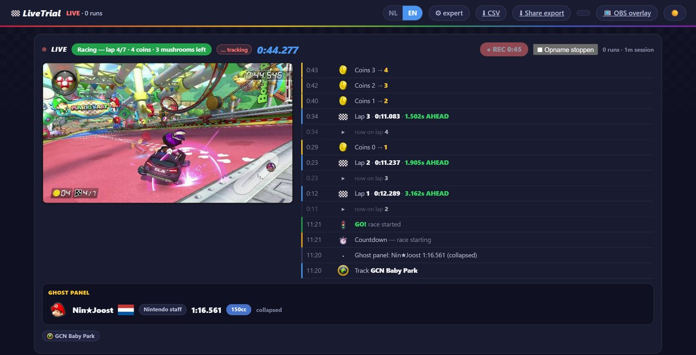

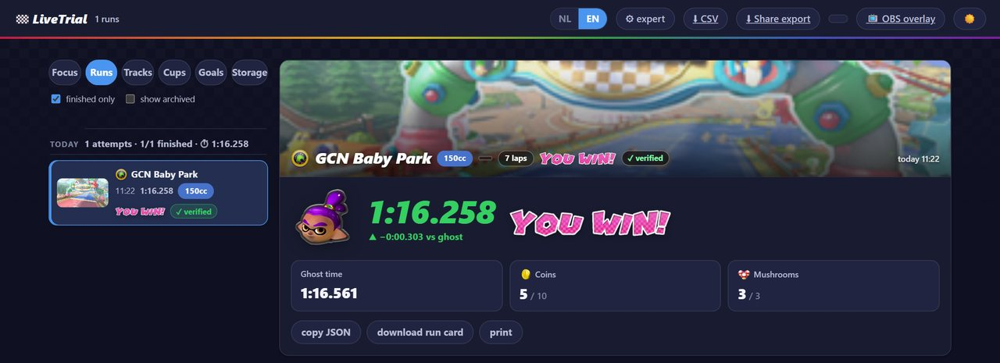

## 📱 소파에서 스캔하기

친구 집에서 타임 어택 중인가요? 스마트폰이나 태블릿을 TV에 비추면 스캐너가 결과 화면을 읽어 줍니다: **합계, 랩, 캐릭터, 바디, 타이어, 글라이더, 국기, 플레이어 이름**, 또는 코스와 기록이 담긴 **고스트 패널**까지. 확실하지 않은 부분은 후보와 함께 보여 주니, 올리기 전에 맞는 것을 고를 수 있습니다.

브라우저 스캐너는 **전부 여러분의 기기 안에서** 동작합니다 — 계정도 서버도 필요 없고, 처음 내려받은 뒤에는 오프라인에서도 쓸 수 있습니다. Android 앱도 기기 안에서 스캔합니다.

  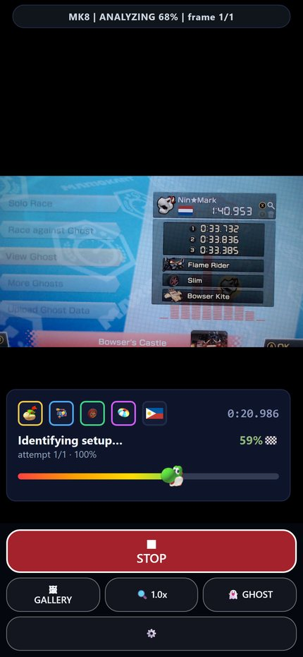
  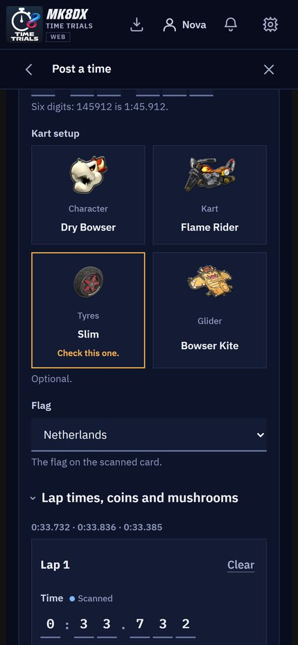

## 🏆 나의 기록, 나의 라이벌

모든 플레이어에게 코스별 자기 기록, 가족·친구·클럽과의 순위, 쫓아갈 라이벌(콕 찌르기, 도전, 가끔은 주사위 대결까지), 누군가 내 기록을 깼을 때의 알림, 그리고 현재 세계 기록을 기준으로 한 **23단계 마스터리 레벨**이 주어집니다.

  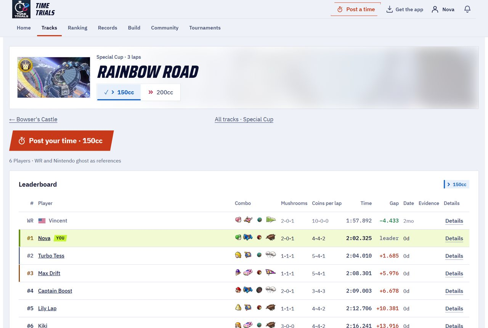
  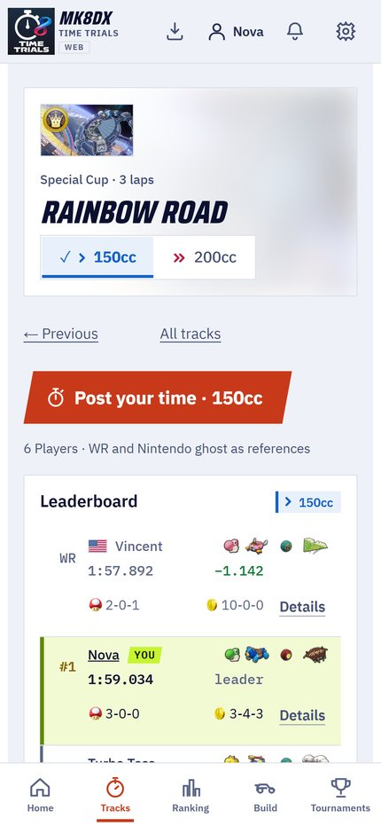

## 🌍 여러분의 언어로 — 15개 언어 모두

마리오 카트 8 디럭스는 전 세계에서 플레이됩니다. 그래서 MK8DX는 모든 게임 언어를 위해 만들어졌습니다. 웹사이트, Android 앱, LiveTrial, Tournament 도구는 **15개 언어**로 제공되며, 인식 기능도 **15개 게임 언어 버전 모두**에 맞춰 만들어졌습니다 — 네덜란드어와 영어부터 일본어, 한국어, 중국어, 러시아어 등까지. 영어와 네덜란드어는 사람이 검토했고, 나머지 언어는 기계 번역이며 일부 언어의 인식은 아직 실제 본체에서 검증 중입니다. 여러분의 언어로 플레이하고 계신가요? 그 확인을 도와주시는 것이 무엇보다 값진 기여입니다.

## 🛠️ 여러분의 것으로 만드세요

MK8DX는 플레이어가 플레이어를 위해 만든 오픈 소스입니다. 여러분의 클럽, 가족, 또는 우리 동네 LAN 모임을 위해 운영하고, *여러분*의 밤에 맞게 고치고, 그 위에 더 쌓아 올려 주세요.

- 여러분의 언어를 **번역하거나 검토**해 주세요(웹사이트, 앱, 게임 내 인식).
- 자신의 본체, 언어, 캡처 카드로 **인식을 테스트**하고, 놓친 부분을 알려 주세요.
- **커뮤니티에 필요한 것을 추가**해 주세요 — 새로운 대회 방식, 통계, 결과를 공유하는 방법.
- **문서를 개선**해서 다음 주최자가 더 빨리 시작할 수 있도록 해 주세요.

[Contributing](CONTRIBUTING.md)과 [개발자 가이드](docs/DEVELOPMENT.md)부터 시작하세요. 풀 리퀘스트, 버그 리포트, 번역 수정 하나하나가 다음 LAN의 밤을 모두에게 더 좋게 만듭니다.

## 프로젝트 현황

안정 릴리스는 [GitHub Releases](https://github.com/fromthelake/MK8DX-Ecosystem/releases)에 있습니다. 0.2.0에서는 집이나 클럽에서 쓰는 A2가 추가되었고, 0.2.1에서는 Android 앱에 내 기록의 오프라인 사본과 더 차분한 레이아웃이 생겼습니다. 0.2.2에서는 녹화 분석이 다시 동작하고 Tournament Analysis 창이 추가되었습니다. 0.2.3에서는 웹 게이트웨이가 root 없이 실행되고, 저장소를 더 쉽게 시작할 수 있게 되었습니다. [변경 내역](CHANGELOG.md), [Release packages](docs/RELEASE_PACKAGES.md), 그리고 전체 안내서([English](docs/install/MK8DX_User_Guide_EN.txt), [Nederlands](docs/install/MK8DX_Handleiding_NL.txt))를 참고하세요.

인식 기능이 스스로 결과를 공식으로 만드는 일은 없습니다. 자신의 타임 어택은 직접 검토하고, 대회 레이스는 주최자가 확인한 뒤에 반영됩니다.

## 문서

| 하고 싶은 일 | 읽을 문서 |
| --- | --- |
| 인식이 어떻게 동작하는지 이해하기 | [Recognition pipeline](docs/architecture/RECOGNITION_PIPELINE.md) |
| 구성 요소와 결과가 전달되는 과정 이해하기 | [Architecture](docs/architecture/COMPONENTS.md) |
| 코드를 빌드하거나 수정하기 | [Developer guide](docs/DEVELOPMENT.md)와 [Testing](docs/TESTING.md) |
| 네이티브 클라이언트 빌드하기 | [Client builds](docs/CLIENT_BUILDS.md) |
| 설치본 운영하기(백업, 업그레이드, 복구) | [Operations](docs/OPERATIONS.md) |
| 왜 이렇게 되어 있는지 알아보기 | [Decision index](docs/decisions/README.md) |
| 기여하기 | [Contributing](CONTRIBUTING.md), [Code of conduct](CODE_OF_CONDUCT.md) |
| 도움 받기 | [Getting help](SUPPORT.md) |
| 보안 문제 신고하기 | [Security policy](SECURITY.md) |
| 코딩 에이전트와 함께 작업하기 | [AGENTS.md](AGENTS.md) |

## 💡 이 프로젝트가 태어난 이야기

**모든 것은 동네의 마리오 카트 대회와 몇몇 열정적인 사람들, 그리고 2023년 12월에 받은 초대 한 통에서 시작되었습니다.**

믿기 어렵겠지만, 저는 닌텐도 64에서 마리오 카트를 즐겼으면서도 마리오 카트 8 디럭스는 거의 해 본 적이 없었습니다. 드리프트라는 게 있는 줄도 몰랐죠. 말할 것도 없이, 따라잡아야 할 게 많았습니다.

그곳에서 저는 사람들을 한자리에 모아 함께 레이스하는 것을 진심으로 좋아하는 멋진 사람들을 만났습니다.

그리고 그 모임은 계속 커졌습니다.

단 16명으로 시작한 모임은 결국 68명이 넘는 참가자가 있는 커뮤니티로 자라났고, **하룻밤에 최대 36명이 경쟁**하게 되었습니다. 함께 **1,000회가 넘는 등록된 레이스**를 달리며 96개 코스를 모두 누볐고, 셀 수 없이 많은 시간을 즐겁게 겨뤘습니다.

장비도 그만큼 빠르게 발전했습니다. **Wi-Fi, GoPro, 수많은 수작업 검토, 그리고 끝없는 연결 문제**로 시작했던 것이 점차 캡처 카드, 완전 유선 이더넷 네트워크, 자동 레이스 기록으로 발전했고, 마침내 본체와 화면, 케이블, 친구들, 그리고 물론 피자에 둘러싸인 창고에서 36명이 경쟁하게 되었습니다.

그리고 대회마다 새로운 아이디어가 생겨났습니다.

점수를 분석하고, 성적을 추적하고, 자리 배치를 최적화하고, Nintendo Switch 사이로 플레이어를 옮기는 — 이더넷 케이블을 바꿔 꽂는 일까지 포함해 — 점점 복잡해지는 작업을 자동화할 방법을 고민하기 시작했습니다. 이런 행사를 운영해 본 사람이라면 알 겁니다. 때로는 레이스가 가장 쉬운 부분이라는 걸요.

**그다음은 타임 어택이었습니다.**

작은 시합으로 시작한 것이 순식간에, 기록을 몇 밀리초라도 더 줄이려는 즐거운 라이벌 관계로 바뀌었습니다. 특히 150cc의 베이비 파크와 빅 블루가 모두의 최애 코스가 되었죠. 언제나 누군가는 더 빠른 랩을 세웠고, 언제나 누군가는 그것을 깨려고 이를 악물었습니다.

당연히 그 결과도 제대로 기록하고 싶어졌습니다. 대회를 더 좋게 만들려던 바로 그 열정이 자동 타임 어택 기록, 이미지 인식, 통계, 순위, 그리고 그 이상으로 이어졌습니다.

하나가 또 다른 하나로 이어졌고, 정신을 차려 보니 저는 마리오 카트를 실제로 플레이하는 시간만큼이나 마리오 카트를 위한 도구를 만드는 데 시간을 쓰고 있었습니다.

### 열정에서 오픈 소스 생태계로

MK8DX Ecosystem은 2024년부터 개발되어 왔습니다. AI의 도움을 정말 많이 받아서요 — 요즘 말로 *vibe coding*이죠.

그리고 한 가지는 분명히 해 두고 싶습니다. **AI가 없었다면 저는 이것을 만들 수 없었고, 제가 없었다면 AI도 이것을 만들 수 없었습니다.**

모든 것을 제대로 돌아가게 만들기까지 엄청난 양의 실험과 인내, 게임 로직 설명, 스크린샷 검토, 실수 수정, 그리고 AI를 올바른 방향으로 되돌려 놓는 일이 필요했습니다. 때로는 몇 번이고 계속해서요.

아무것도 이루지 못한 채 신나게 크레딧만 태워 버린 세션도 수없이 많았습니다. 그 생각만 하면 지금도 밤잠을 설칩니다(하하).

그리고 보아하니 시각적 테스트는 데이터를 꽤 많이 만들어 내는 모양입니다. 지금 제 손에는 AI가 생성한 QA 스크린샷과 녹화가 대략 4TB나 있는데, 언젠가는 정말 정리해야 합니다.

개별 기술은 이미 존재했습니다. 하지만 그것들을 하나로 엮어 화면에서 무슨 일이 일어나는지 이해하고, 게임 정보를 뽑아내고, 플레이어와 주최자에게 쓸모 있게 만드는 제대로 돌아가는 생태계로 완성하기까지는 꽤 긴 여정이었습니다. 이 모든 것을 뒷받침하는 데 필요한 게임 에셋을 모으고 정리하는 일도 마찬가지였고요.

특히 이미지 인식, 자동화, 소프트웨어 개발에 관해서는 믿을 수 없을 만큼 많은 것을 배운 경험이었습니다.

그리고 2026년인 지금, 드디어 그 결과를 **오픈 소스 생태계**로 공유할 수 있게 되었습니다. 다른 분들이 사용하고, 개선하고, 저희만큼이나 즐겁게 즐겨 주신다면 좋겠습니다.

### Volkert를 기리며

최근 너무 젊은 나이에 세상을 떠난, 존경하는 타임 어택 라이벌 **Volkert**도 기리고 싶습니다.

특히 베이비 파크와 빅 블루 150cc에서의 라이벌 관계는 실력을 키우는 꾸준한 동기가 되었습니다. 마지막 몇 밀리초를 줄이기 위해 우리 둘 다 꽤 많은 시간을 쏟았을 거라고 확신합니다. 물론 저는 그보다 훨씬 더 많은 시간을 들였을 겁니다. 그는 그저 경험이 더 많고 더 꾸준했습니다.

셋이서 엑셀 시트에 기록을 적어 두던 것에서 시작한 일이 조금씩 자라, 지금은 이 에코시스템의 일부가 된 타임 어택 기능이 되었습니다.

이 프로젝트가 다른 사람들에게도 같은 우정 어린 라이벌 관계와 계속 성장하고 싶은 동기를 경험할 기회가 되기를 바랍니다.

### 계속 달리고, 계속 나누세요

저희는 최고의 플레이어라거나, 최고의 개발자라거나, 완벽한 해결책을 만들었다고 말하지 않습니다. 하지만 열정과 호기심, 그리고 계속 더 나아지려는 의지만큼은 결코 부족하지 않습니다.

이 프로젝트가 LAN 대회를 여는 데, 즐거운 라이벌 관계를 시작하는 데, 자기 최고 기록을 깨는 데, 혹은 그저 친구들과 멋진 저녁을 보내는 데 도움이 된다면, 그것만으로도 충분히 가치 있는 일을 해낸 것입니다.

**앞으로도 여러분의 최고의 순간과 아이디어, 개선 사항을 계속 나눠 주세요.** 그것이 이런 커뮤니티를 계속 살아 있게 하는 힘입니다.

마지막으로, 이렇게 멋진 게임기와 게임을 만들어 준 **Nintendo**에 깊이 감사드립니다. 마리오 카트를 즐기신다면, 그것을 가능하게 해 주는 사람들을 응원해 주세요. 정품 게임기와 게임을 구입하고, 친구나 가족, 동료를 초대해서 함께 플레이하는 즐거움을 누리세요.

결국 이 모든 모험도 그렇게 시작되었으니까요.

— [fromthelake](https://github.com/fromthelake)

## 라이선스와 Nintendo

이것은 프로그래밍을 배우고 마리오 카트 8 디럭스를 더 재미있게 즐기기 위한, 독립적인 비상업 취미 프로젝트입니다. **Nintendo와 제휴하거나 Nintendo의 승인을 받은 프로젝트가 아닙니다.** Nintendo는 자사의 상표와 게임 콘텐츠에 대한 권리를 가지고 있습니다. 게임기와 게임을 구입해 Nintendo를 응원해 주세요.

이 프로젝트의 오리지널 코드와 문서는 [Mozilla Public License 2.0](LICENSE)에 따라 라이선스됩니다. [라이선스 적용 범위](LICENSE_SCOPE.md)에서 그 범위를 설명합니다. Nintendo 자료, 게임 이미지, 인식 템플릿, 모델, 글꼴, 기타 제3자 자료는 적용 대상이 **아니며**, 각자의 조건을 따릅니다. [Third-party materials](docs/THIRD_PARTY_MATERIALS.md)를 참고하세요. 이 소프트웨어는 있는 그대로 제공됩니다.
