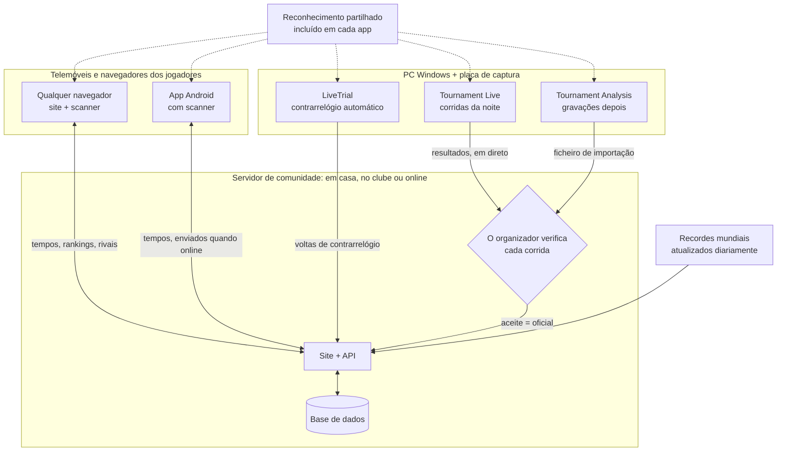

# MK8DX Ecosystem

**Aloja o teu próprio site de comunidade de Mario Kart 8 Deluxe — para Contrarrelógio *e* noites de torneio.**

Idioma: [English](README.md) · [Nederlands](README_NL.md) · [Deutsch](README_DE.md) · [Español](README_ES.md) · [Français](README_FR.md) · [Italiano](README_IT.md) · Português · [Русский](README_RU.md) · [日本語](README_JA.md) · [한국어](README_KO.md) · [简体中文](README_ZH_CN.md) · [繁體中文](README_ZH_TW.md)

*Esta tradução foi feita automaticamente a partir do README em inglês; correções são bem-vindas.*

O MK8DX Ecosystem é algo que alojas tu mesmo. Dá à tua comunidade um único site que guarda dois
tipos de resultados — **resultados de Contrarrelógio** e **resultados de torneios** — e acrescenta
a cada um o seu próprio tipo de competição.

**⏱️ Contrarrelógio**

- **Tabelas de classificação** por pista e categoria (150cc/200cc), para a tua comunidade e ao
  lado dos **recordes mundiais**, que são atualizados uma vez por dia.
- **Rivais**: escolhe-os uma vez e vê sempre onde estão em relação a ti.
- **Regista um tempo à tua maneira**: escreve-o à mão, digitaliza o ecrã de resultados com uma
  câmara — no site ou na app Android — ou deixa a aplicação Windows **LiveTrial** registar cada
  corrida sozinha através de uma placa de captura.
- **O LiveTrial vê a própria corrida**: quando apanhas moedas, quando usas os teus cogumelos — e
  faz um **vídeo de cada corrida** que podes usar como quiseres.

**🏁 Torneios**

- **Noites LAN da inscrição às finais**: lugares, grupos, pontuações e classificações, tudo
  organizado para ti.
- **Resultados lidos do ecrã** pelo Tournament Live, verificados pelo organizador antes de contarem.
- **Rating TrueSkill**: uma classificação de habilidade que cresce a cada noite de torneio.
- **Não é preciso conta para jogar**: podes organizar um torneio sem pedir a ninguém que se registe.
  Um jogador que queira os seus resultados na sua própria conta pode associá-los mais tarde — nunca
  é uma obrigação.

**✨ O que o torna único**

Até agora não havia uma forma sólida de tirar os dados do Mario Kart 8 Deluxe numa Nintendo Switch
através de uma placa de captura: era sobretudo voltar a escrever tudo, ou OCR que só lê texto. O
MK8DX lê os tempos, as posições e os pontos *e* reconhece as imagens: a **personagem (incluindo a
cor certa)**, a **carroçaria, as rodas, a asa-delta** e a **bandeira** — onde quer que o jogo as
mostre.

E nem sequer precisas de uma placa de captura para isso: do sofá, aponta o telemóvel para a
televisão e digitaliza um **ecrã de resultados** de Contrarrelógio ou um **ecrã de seleção de
fantasmas**, e o resultado vai diretamente para o teu site. Tanto quanto sabemos, também isso
nunca tinha sido feito.

**🏠 Em casa ou online — tu escolhes**

- **Totalmente local**: corre-o na tua rede de casa ou do clube. Depois da instalação **não é
  preciso internet** nenhuma.
- **Online**: aloja-o no teu próprio servidor ou alojamento web e partilha-o com a tua própria
  comunidade online.

Seja como for, a instalação é tua, com as tuas próprias contas e resultados. Sem conta na nuvem,
sem subscrição, sem anúncios.

**🔑 Nunca palavras-passe**

- **Só o administrador precisa de uma conta.** Essa conta é também o primeiro jogador, por isso o
  sistema tem sempre pelo menos um jogador; todos os outros podem entrar em torneios sem conta.
- **Um link para iniciar sessão**: ninguém tem de inventar ou decorar uma palavra-passe. Em casa,
  cada um recebe um cartão pessoal de início de sessão (um link ou código QR). Online, um novo
  utilizador só indica um **endereço de email** e inicia sessão com o link que o MK8DX lhe envia.

---

## Como tudo se liga

O MK8DX não é um único programa, mas uma pequena família à volta de um **servidor de comunidade**. O
servidor guarda tudo o que conta: contas, tempos, torneios e classificações. As apps à sua volta leem o ecrã do
jogo nos teus próprios dispositivos e enviam o que encontraram para a comunidade que escolheste.

**De que peças preciso?**

- **Um servidor de comunidade: a única peça de que todas as comunidades precisam.** É o site com a sua
  API e base de dados. Corre-o na rede de casa ou do clube ([A2](docs/install/A2_HOME_GUIDE_EN.md), sem internet
  depois da instalação) ou online num servidor ou alojamento web
  ([Alojar um servidor de comunidade](docs/guides/HOSTING.md)).
- **Os jogadores só precisam de um navegador.** O site traz consigo o scanner no navegador. A app Android
  acrescenta a digitalização no telemóvel, os teus tempos sem internet e a troca de comunidade com um toque
  ([Players](docs/guides/PLAYERS.md)).
- **Um PC Windows com placa de captura é opcional.** O LiveTrial regista sozinho cada volta de contrarrelógio;
  envias para a tua comunidade com um clique, ou automaticamente ([LiveTrial](docs/guides/LIVETRIAL.md)).
- **As noites de torneio correm no site.** O Tournament Live (durante a noite) e o Tournament Analysis
  (gravações depois) apenas propõem resultados; as pontuações também podem ser escritas à mão ou importadas do
  Excel/CSV. Nada muda a classificação até o organizador aceitar
  ([Tournament Directors](docs/guides/TOURNAMENT_DIRECTORS.md)).
- **O reconhecimento é partilhado, não um serviço.** Cada app tem a sua própria cópia e lê o ecrã no teu
  dispositivo; o servidor apenas verifica o resultado proposto
  ([Pipeline de reconhecimento](docs/architecture/RECOGNITION_PIPELINE.md) ·
  [Arquitetura](docs/architecture/COMPONENTS.md)).

## Começar

| Quero… | Começa aqui |
| --- | --- |
| **usar o MK8DX em casa ou no meu clube** | O pacote A2 para o teu computador em [Releases](https://github.com/fromthelake/MK8DX-Ecosystem/releases): descomprime, inicia, clica em Seguinte. Passo a passo (o pacote A2 também inclui uma versão ilustrada): [English](docs/install/A2_HOME_GUIDE_EN.md) · [Nederlands](docs/install/A2_THUIS_HANDLEIDING_NL.md) |
| **organizar noites de torneio LAN** | [Tournament Directors](docs/guides/TOURNAMENT_DIRECTORS.md) |
| **registar os meus Contrarrelógios automaticamente** | [LiveTrial](docs/guides/LIVETRIAL.md) — Windows + uma placa de captura |
| **publicar e comparar os meus tempos** | [Jogadores](docs/guides/PLAYERS.md) — qualquer navegador; Android 8.0+ |
| **alojar um site de comunidade** | [Alojar um servidor de comunidade](docs/guides/HOSTING.md) |
| **alterar o código** | [Guia do programador](docs/DEVELOPMENT.md), [Testes](docs/TESTING.md), [Contributing](CONTRIBUTING.md) |

Cada linha indica o guia a seguir do início ao fim. Compilar o servidor a partir do código-fonte em
vez de usar um pacote de release é para programadores: [Começar a partir do código-fonte](docs/GETTING_STARTED.md).

### Que computador para que via

Todas as vias dão-te o mesmo site; diferem no sítio onde corre e em quem lhe pode aceder.

| Via | Para | Corre em | Estado |
| --- | --- | --- | --- |
| **A2** rede de casa ou do clube | A tua própria rede, sem internet depois da instalação, cartões de início de sessão para todos | Windows 11 (x86-64), Linux (x86-64 ou arm64), Mac (Apple silicon ou Intel) | Testado de ponta a ponta no Windows 11; Linux em WSL 2; Mac compilado, ainda não testado num Mac real |
| **A1** um computador | Experimentar no computador onde estás sentado | Windows 11 ou Linux, x86-64, com Docker | Testado: instalação, atualização, cópia de segurança |
| **A3** um computador sem Docker | Um PC Windows onde o Docker não é opção | Windows 11 com XAMPP e Node.js | Testado: instalação, atualização, cópia de segurança |
| **B1** site público | A tua comunidade online, o teu próprio domínio e email | Um servidor Linux x86-64 (VPS) com Docker; Ubuntu 24.04 documentado | Documentado, ainda não testado de ponta a ponta |
| **B2** alojamento web | Online, sem servidor próprio | Um plano de alojamento com Node.js (Passenger), MariaDB/MySQL e SSH | O site da nossa própria comunidade funciona assim; o pacote público ainda não foi instalado de raiz numa conta de alojamento nova |

As apps à volta:

| App | Corre em | Porquê |
| --- | --- | --- |
| Site e scanner do navegador | Qualquer navegador moderno; Chrome ou Edge recomendados para digitalizar | O scanner corre inteiramente no teu dispositivo e precisa de um navegador que lhe dê várias threads |
| App Android | Android 8.0 ou mais recente, arm64 recomendado | Digitaliza no próprio telemóvel, também sem ligação |
| iPhone e iPad | O site no navegador; a digitalização no Safari ainda está a ser testada | Não há app iOS: criar e assinar uma exige um Mac e uma conta de programador Apple |
| LiveTrial e Tournament Live | Windows em x86-64 (testado no Windows 11), com uma placa de captura HDMI USB por ecrã | As placas de captura e o motor de reconhecimento incluído são feitos e testados para Windows; não há versão para macOS nem Linux |

**Primeiro arranque da app Android:** pergunta *Escolhe a tua comunidade*. Em casa ou no clube digitalizas o
cartão **Preparar um dispositivo** que o teu administrador mostra; para uma comunidade online escreves o endereço
do site. Depois inicias sessão através do navegador. Detalhes: [Jogadores](docs/guides/PLAYERS.md#first-start).

**Uma app, várias comunidades:** o chip de comunidade no topo alterna com um toque entre o teu clube, a tua
instalação de casa e uma comunidade online; cada uma guarda a sua própria conta e os tempos por enviar. Em **Tu** →
**Meus tempos** vês o teu melhor tempo por pista, também sem internet, e com mais de uma comunidade podes levar
os teus melhores tempos para outra — se essa comunidade os aceitar.

**Porque não tudo em todo o lado?** Cada pacote só é oferecido onde foi compilado e experimentado. As imagens de
servidor A1 e B1 existem só para x86-64; o A2 também tem arm64. Para Macs Intel, a biblioteca de segurança de que o
A2 precisa (`cryptography`) já não é publicada, por isso a release compila-a a partir do código-fonte num Mac Intel
e testa-a lá ([como](docs/RELEASE_PACKAGES.md#intel-mac-a2-package)). O A3 existe para quem não pode ou não
quer usar Docker. O [guia de alojamento](docs/guides/HOSTING.md) e os [pacotes de release](docs/RELEASE_PACKAGES.md)
listam cada ficheiro e os seus requisitos exatos.

Uma instalação nova começa vazia: não herda contas nem resultados de nenhuma comunidade. Traz apenas o catálogo
do jogo e os conjuntos de referência dos fantasmas da equipa da Nintendo e dos recordes mundiais.

---

## 🏁 Noites de torneio LAN

Lembras-te das LAN parties? Dois jogadores por ecrã, uma sala cheia de Switches, toda a gente a
gritar com a Estrada Arco-Íris. O MK8DX traz essa noite de volta e trata de tudo à volta das
corridas: quem se senta onde, que grupo joga a seguir, as pontuações, as finais e a classificação.

- **Inscrição** — abre as inscrições para uma noite com hora de fecho e um máximo; por ordem de
  chegada, ou um sorteio justo a partir de uma seed publicada. Os jogadores inscrevem-se com as
  Switches que trazem.
- **Lugares que se organizam sozinhos** — presenças, consolas e lugares (dois jogadores por
  Switch), números de posto e de cabo. Escolhe seeding por ranking ou aleatório e distribuição
  *Equilibrada* ou *Movimento mínimo*; o MK8DX monta os grupos de qualificação e depois as finais
  por ti.
- **O Tournament Live lê as corridas** — liga uma placa de captura a cada ecrã. Depois de cada
  corrida lê as posições finais, personagens, bandeiras, pontos da corrida, totais e a pista
  (também em ecrã dividido para dois jogadores), guarda-os localmente e envia-os para a noite no
  site.
- **Tu continuas no comando** — o organizador verifica jogadores e posições antes de um resultado
  contar. Entretanto, a classificação ao vivo é mostrada de forma provisória.
- **No fim** — classificação final, um relatório para partilhar (WhatsApp, PNG, CSV, um artigo
  pronto para WordPress) e, opcionalmente, um rating da comunidade ao estilo TrueSkill ao longo das
  noites.

  
  

### Sem Tournament Live na noite? Analisa as gravações depois

Gravaste a noite em vez de a captar ao vivo? A janela **Tournament Analysis** lê as gravações
depois: adiciona um vídeo, vários, ou uma pasta por torneio, carrega em **START ANALYSIS**, e ela
encontra cada corrida com as posições, personagens e pontos, enquanto um registo colorido ao vivo
e uma barra de progresso da Estrada Arco-Íris mostram até onde já chegou. O resultado é um
livro Excel, um CSV e um ficheiro de importação para o site, que o organizador verifica e importa —
a mesma revisão que no Tournament Live. Uma gravação de 22 minutos com quatro corridas levou cerca de 70 segundos num portátil. No pacote Windows Tournament Tools, faz duplo clique em
`TournamentAnalysis.cmd` (arrastar um vídeo para `TournamentProcessor.cmd` continua a funcionar);
os programadores executam `python -m tournament_processor.gui`.
[Tournament Directors](docs/guides/TOURNAMENT_DIRECTORS.md#analyse-recordings-afterwards) tem os
passos.

## ⏱️ Contrarrelógio com o LiveTrial — totalmente automático

Liga a tua Switch ao teu PC Windows através de uma placa de captura e simplesmente corre. Tanto
quanto sabemos, nada assim existia antes.

O LiveTrial observa o sinal HDMI e reconhece, sozinho:

- os menus por onde passas, a **pista** e a **categoria** (150cc/200cc);
- durante a corrida: o **cronómetro, o contador de voltas, as moedas e os itens**;
- no ecrã de resultados: **tempo total, cada tempo de volta** (3, ou 7 no Parque Bebé),
  **personagem, carroçaria, rodas, asa-delta** e **bandeira**;
- o painel de **seleção de fantasmas** — nomes, tempos, voltas e peças dos fantasmas — e se um
  fantasma é um dos **fantasmas da equipa da Nintendo**;
- o **idioma da tua Switch** (todos os 12 idiomas do sistema), automaticamente.

Guarda um **vídeo de cada corrida** e de cada repetição de fantasma que vês até ao fim, um
histórico de corridas com tabelas de voltas e gráficos, e mostra a tua diferença para o **recorde
mundial**, o **fantasma da equipa da Nintendo**, o teu **próprio recorde** e os teus **rivais**.
Envia resultados para a tua comunidade com um clique (ou ativa o envio automático) e, se quiseres,
carrega um vídeo no teu próprio canal de YouTube.

## 📱 Digitaliza a partir do sofá

A fazer Contrarrelógio em casa de um amigo? Pega no telemóvel ou tablet, aponta-o para a televisão
e o scanner lê o ecrã de resultados: **total, voltas, personagem, carroçaria, rodas, asa-delta,
bandeira e nome do jogador**, ou um **painel de fantasmas** com a pista e os tempos. Tudo o que for
incerto aparece com alternativas, para escolheres a certa antes de publicar.

O scanner do navegador corre **inteiramente no teu dispositivo** — sem conta, sem servidor e offline
depois do primeiro download. A app Android também digitaliza no próprio dispositivo.

  
  

## 🏆 Os teus recordes, os teus rivais

Cada jogador tem os seus próprios recordes por pista, uma classificação com a família, os amigos
ou o clube, rivais para perseguir (com toques, desafios e um ou outro duelo de dados), notificações
quando alguém bate o teu tempo, e **23 níveis de mestria** medidos em relação aos recordes mundiais
atuais.

  
  

## 🌍 Fala a tua língua — todas as 15

O Mario Kart 8 Deluxe joga-se em todo o lado, por isso o MK8DX foi feito para todos os idiomas do
jogo: o site, a app Android, o LiveTrial e as ferramentas Tournament existem em **15 idiomas**, e o
reconhecimento foi feito para **todas as 15 variantes de idioma do jogo** — do neerlandês e do
inglês ao japonês, coreano, chinês, russo e muito mais. O inglês e o neerlandês são revistos por
pessoas; os outros idiomas são traduzidos automaticamente e o reconhecimento em alguns deles ainda
está a ser verificado em consolas reais. Jogas no teu idioma? A tua ajuda a verificá-lo é a
contribuição mais valiosa que existe.

## 🛠️ Torna-o teu

O MK8DX é open source, feito por jogadores para jogadores. Usa-o no teu clube, com a tua família
ou na cena LAN da tua cidade; adapta-o à forma como funcionam as *tuas* noites; e constrói a partir
dele:

- **Traduz ou revê** o teu idioma (o site, as apps e o reconhecimento dentro do jogo).
- **Testa o reconhecimento** com a tua própria consola, idioma e placa de captura, e reporta o que
  lhe escapa.
- **Acrescenta o que a tua comunidade precisa** — novos formatos de torneio, estatísticas, formas
  de partilhar resultados.
- **Melhora a documentação** para que o próximo organizador comece ainda mais depressa.

Começa por [Contributing](CONTRIBUTING.md) e pelo [guia do programador](docs/DEVELOPMENT.md).
Cada pull request, relatório de erro e correção de tradução torna a próxima noite LAN melhor para
todos.

## Estado do projeto

As versões estáveis estão em [GitHub Releases](https://github.com/fromthelake/MK8DX-Ecosystem/releases); a 0.2.0
acrescentou o A2, em casa ou no clube; a 0.2.1 dá à app Android uma cópia offline dos teus tempos e um layout mais
calmo. A 0.2.2 volta a pôr a análise de gravações a funcionar e acrescenta a janela Tournament Analysis. Vê o [changelog](CHANGELOG.md), os [Pacotes de release](docs/RELEASE_PACKAGES.md) e o guia completo
([English](docs/install/MK8DX_User_Guide_EN.txt), [Nederlands](docs/install/MK8DX_Handleiding_NL.txt)).

O reconhecimento nunca torna um resultado oficial por si só: tu revês os teus próprios Contrarrelógios, e um
organizador verifica as corridas de torneio antes de contarem.

## Documentação

| Quero… | Lê |
| --- | --- |
| perceber como funciona o reconhecimento | [Pipeline de reconhecimento](docs/architecture/RECOGNITION_PIPELINE.md) |
| perceber as partes e o percurso de um resultado | [Arquitetura](docs/architecture/COMPONENTS.md) |
| compilar ou alterar o código | [Guia do programador](docs/DEVELOPMENT.md) e [Testes](docs/TESTING.md) |
| compilar os clientes nativos | [Builds dos clientes](docs/CLIENT_BUILDS.md) |
| gerir uma instalação (cópia de segurança, atualização, recuperação) | [Operações](docs/OPERATIONS.md) |
| saber porque é que algo é como é | [Índice de decisões](docs/decisions/README.md) |
| contribuir | [Contributing](CONTRIBUTING.md), [Código de conduta](CODE_OF_CONDUCT.md) |
| obter ajuda | [Obter ajuda](SUPPORT.md) |
| reportar um problema de segurança | [Política de segurança](SECURITY.md) |
| trabalhar com um agente de programação | [AGENTS.md](AGENTS.md) |

## 💡 A história por trás

**Tudo começou com um torneio local de Mario Kart, umas quantas pessoas entusiasmadas e um convite em dezembro de 2023.**

Acreditem ou não, apesar de ter jogado Mario Kart na Nintendo 64, mal tinha tocado no Mario Kart 8 Deluxe. Nem sequer sabia que derrapar era uma coisa. Escusado será dizer que tinha muito para recuperar.

O que descobri foi um grupo maravilhoso de pessoas que adoravam genuinamente juntar os outros para correr.

E esse grupo não parou de crescer.

O que começou com apenas 16 jogadores acabou por se tornar uma comunidade de mais de 68 participantes, com até **36 jogadores a competir numa só noite**. Juntos, completaram **mais de 1.000 corridas registadas**, em todas as 96 pistas e com incontáveis horas de competição amigável.

A montagem evoluiu igualmente depressa. O que começou com **Wi-Fi, uma GoPro, muita revisão manual e muitos problemas de ligação** foi evoluindo aos poucos para placas de captura, uma rede Ethernet totalmente cablada, registo automático das corridas e 36 jogadores a competir num armazém rodeados de consolas, ecrãs, cabos, amigos e, claro, pizza.

E cada torneio trazia novas ideias.

Começámos a analisar pontuações, a acompanhar desempenhos, a otimizar a distribuição dos lugares e a descobrir como automatizar a tarefa cada vez mais complicada de mudar jogadores entre Nintendo Switches, incluindo trocar cabos Ethernet de sítio. Quem já organizou algo assim sabe que, às vezes, as corridas são a parte fácil.

**Depois vieram os Contrarrelógios.**

O que começou como uma pequena competição depressa se transformou numa rivalidade amigável para tirar só mais uns milissegundos aos nossos tempos. O Parque Bebé e o Big Blue em 150cc tornaram-se favoritos especiais. Havia sempre alguém a fazer uma volta mais rápida e sempre alguém determinado a batê-la.

Naturalmente, também quisemos registar esses resultados como deve ser. O mesmo entusiasmo por melhorar os nossos torneios chegou ao registo automático de Contrarrelógio, ao reconhecimento de imagem, às estatísticas, às classificações e a muito mais.

Uma coisa levou a outra e, quando dei por mim, passava quase tanto tempo a construir ferramentas à volta do Mario Kart como a jogá-lo.

### Da paixão a um ecossistema open source

O MK8DX Ecosystem está em desenvolvimento desde 2024, com muita ajuda da IA — ou aquilo a que hoje chamamos *vibe coding*.

E quero deixar uma coisa clara: **eu não teria conseguido construir isto sem IA, e a IA não o teria conseguido construir sem mim.**

Pôr tudo a funcionar exigiu uma quantidade incrível de experimentação, paciência, explicar a lógica do jogo, rever capturas de ecrã, corrigir erros e reconduzir a IA na direção certa. Às vezes vezes sem conta.

Houve muitas sessões que gastaram créditos alegremente sem conseguir absolutamente nada. Essas ainda me tiram o sono (haha).

E, pelos vistos, os testes visuais produzem bastantes dados. Tenho agora cerca de 4 TB de capturas de ecrã e gravações de QA geradas por IA que um dia destes devia mesmo arrumar.

As técnicas individuais já existiam, mas juntá-las num ecossistema que funciona, que percebe o que está a acontecer no ecrã, extrai informação do jogo e a torna útil para jogadores e organizadores, foi uma grande viagem. O mesmo vale para reunir e organizar os recursos do jogo necessários para suportar tudo isto.

Foi uma experiência de aprendizagem incrível, sobretudo em reconhecimento de imagem, automação e desenvolvimento de software.

Agora, em 2026, consigo finalmente partilhar os resultados como um **ecossistema open source**, para que outros o possam usar, melhorar e, espero, divertir-se tanto com ele como nós.

### Uma homenagem ao Volkert

Quero também lembrar o **Volkert**, um rival respeitado nas provas contra o relógio, que faleceu recentemente, demasiado jovem.

A nossa rivalidade, sobretudo em Parque Bebé e Big Blue a 150cc, foi uma motivação constante para melhorar. Tenho a certeza de que ambos passámos muitas horas a tentar tirar aqueles últimos milissegundos, embora suspeite que eu tenha dedicado bastantes mais horas do que ele. Ele era simplesmente mais experiente e mais consistente.

O que começou connosco, apenas três, a registar os nossos tempos numa folha de Excel cresceu aos poucos até se tornar nas funcionalidades de contrarrelógio que hoje fazem parte deste ecossistema.

Espero que este projeto dê a outros a oportunidade de viver essa mesma rivalidade amigável e essa motivação para continuar a melhorar.

### Continuem a correr, continuem a partilhar

Não afirmamos ser os melhores jogadores, os melhores programadores nem ter construído a solução perfeita. Mas não falta, de certeza, entusiasmo, curiosidade nem determinação para continuar a melhorar.

Se este projeto te ajudar a organizar um torneio LAN, a começar uma rivalidade amigável, a bater um recorde pessoal ou simplesmente a passar uma ótima noite com amigos, então terá conseguido algo que vale a pena.

**Continuem a partilhar os vossos melhores momentos, as vossas ideias e as vossas melhorias.** É isso que mantém viva uma comunidade como esta.

E, por fim, um grande obrigado à **Nintendo** por criar consolas e jogos tão fantásticos. Se gostas de Mario Kart, apoia as pessoas que o tornam possível: compra as consolas e os jogos originais, convida os teus amigos, família ou colegas, e divirtam-se a jogar juntos.

Afinal, foi assim que toda esta aventura começou.

— [fromthelake](https://github.com/fromthelake)

## Licença e Nintendo

Este é um projeto amador independente e não comercial, para aprender a programar e tornar o Mario Kart 8 Deluxe
ainda mais divertido. **Não é afiliado nem aprovado pela Nintendo**. A Nintendo é dona das suas marcas e do
conteúdo dos jogos; apoia a Nintendo comprando as suas consolas e jogos.

O código e a documentação originais do projeto estão licenciados sob a [Mozilla Public License 2.0](LICENSE).
O [âmbito da licença](LICENSE_SCOPE.md) explica o que isso abrange: **não** abrange material da Nintendo,
imagens do jogo, templates de reconhecimento, modelos, tipos de letra ou outro material de terceiros, que mantêm
os seus próprios termos. Vê [Materiais de terceiros](docs/THIRD_PARTY_MATERIALS.md). O software é fornecido tal
como está.
