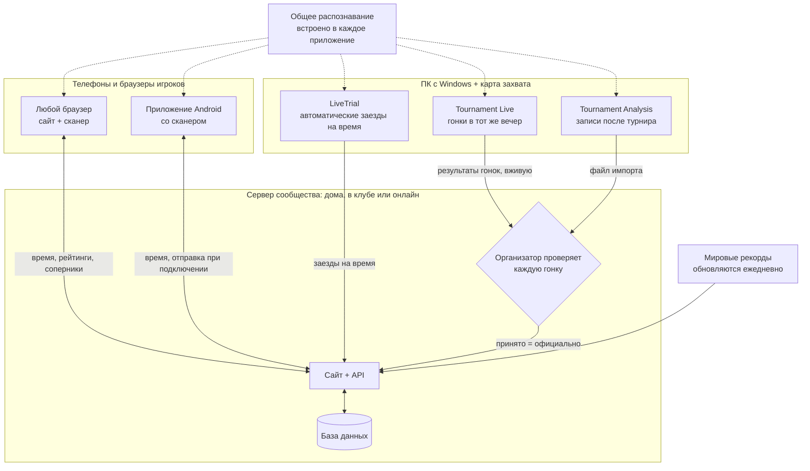

# MK8DX Ecosystem

**Разместите собственный сайт сообщества Mario Kart 8 Deluxe — для гонок на время *и* турнирных вечеров.**

Язык: [English](README.md) · [Nederlands](README_NL.md) · [Deutsch](README_DE.md) · [Español](README_ES.md) · [Français](README_FR.md) · [Italiano](README_IT.md) · [Português](README_PT.md) · Русский · [日本語](README_JA.md) · [한국어](README_KO.md) · [简体中文](README_ZH_CN.md) · [繁體中文](README_ZH_TW.md)

*Этот перевод сделан машинным способом с английского README; исправления приветствуются.*

MK8DX Ecosystem вы размещаете сами. Он даёт вашему сообществу один сайт, который хранит два вида
результатов — **результаты гонок на время** и **турнирные результаты** — и добавляет к каждому
свой вид соревнования.

**⏱️ Гонки на время**

- **Таблицы лидеров** по каждой трассе и классу (150cc/200cc) — для вашего сообщества и рядом с
  **мировыми рекордами**, которые обновляются раз в день.
- **Соперники**: выберите их один раз — и всегда будете видеть, где они по сравнению с вами.
- **Вносите время как удобно**: введите его вручную, отсканируйте экран результатов камерой — на
  сайте или в Android-приложении — или позвольте Windows-приложению **LiveTrial** самому
  записывать каждый заезд через карту захвата.
- **LiveTrial видит саму гонку**: когда вы собираете монеты, когда используете грибы — и делает
  **видеоклип каждого заезда**, который вы можете использовать как угодно.

**🏁 Турниры**

- **LAN-вечера от регистрации до финалов**: рассадка, группы, очки и турнирная таблица —
  всё организовано за вас.
- **Результаты считываются с экрана** программой Tournament Live и проверяются организатором,
  прежде чем засчитаться.
- **Рейтинг TrueSkill**: рейтинг мастерства, который растёт с каждым турнирным вечером.
- **Для участия не нужен аккаунт**: вы можете провести турнир, никого не прося регистрироваться.
  Игрок, который хочет видеть свои результаты в собственном аккаунте, может привязать их позже —
  но это никогда не обязательно.

**✨ Что делает его уникальным**

До сих пор не было надёжного способа получить данные из Mario Kart 8 Deluxe на Nintendo Switch
через карту захвата: в основном всё перепечатывали вручную или использовали OCR, который читает
только текст. MK8DX считывает время, позиции и очки *и* распознаёт изображения: **персонажа
(включая правильный цвет)**, **корпус карта, колёса, планер** и **флаг** — везде, где игра их
показывает.

И для этого даже не нужна карта захвата: прямо с дивана наведите телефон на телевизор и
отсканируйте **экран результатов** гонки на время или **экран выбора призрака** — результат сразу
попадёт на ваш сайт. Насколько нам известно, такого раньше тоже никто не делал.

**🏠 Дома или онлайн — выбирать вам**

- **Полностью локально**: запустите его в домашней или клубной сети. После установки **интернет
  вообще не нужен**.
- **Онлайн**: разместите его на собственном сервере или веб-хостинге и делитесь им со своим
  онлайн-сообществом.

В любом случае это ваша установка, с вашими собственными аккаунтами и результатами. Никакого
облачного аккаунта, никакой подписки, никакой рекламы.

**🔑 Никаких паролей**

- **Аккаунт нужен только администратору.** Этот аккаунт также является первым игроком, так что в
  системе всегда есть хотя бы один игрок; все остальные могут участвовать в турнирах без аккаунта.
- **Одна ссылка для входа**: никому не нужно придумывать или запоминать пароль. Дома каждый
  получает личную карточку входа (ссылку или QR-код). Онлайн новый пользователь вводит только
  **адрес электронной почты** и входит по ссылке, которую ему отправляет MK8DX.

---

## Как всё связано

MK8DX — это не одна программа, а небольшое семейство вокруг одного **сервера сообщества**. Сервер
хранит всё, что важно: учётные записи, время, турниры и таблицы. Приложения вокруг него считывают экран игры на
ваших собственных устройствах и отправляют найденное в выбранное вами сообщество.

**Какие части мне нужны?**

- **Один сервер сообщества — единственная часть, нужная каждому сообществу.** Это сайт с API и базой
  данных. Запустите его в домашней или клубной сети ([A2](docs/install/A2_HOME_GUIDE_EN.md), после установки
  интернет не нужен) или онлайн на сервере либо веб-хостинге
  ([Разместить сервер сообщества](docs/guides/HOSTING.md)).
- **Игрокам достаточно браузера.** Сайт сразу включает браузерный сканер. Приложение Android добавляет
  сканирование на телефоне, ваше время без интернета и переключение между сообществами одним касанием
  ([Players](docs/guides/PLAYERS.md)).
- **ПК с Windows и картой захвата — по желанию.** LiveTrial сам записывает каждый заезд на время; вы
  отправляете его в своё сообщество одним щелчком или автоматически ([LiveTrial](docs/guides/LIVETRIAL.md)).
- **Турнирные вечера проводятся на сайте.** Tournament Live (во время вечера) и Tournament Analysis (записи
  после турнира) только предлагают результаты гонок; очки можно также ввести вручную или импортировать из
  Excel/CSV. Таблица не меняется, пока организатор не примет результат
  ([Tournament Directors](docs/guides/TOURNAMENT_DIRECTORS.md)).
- **Распознавание общее, а не сервис.** У каждого приложения своя копия, и экран считывается на вашем
  устройстве; сервер лишь проверяет предложенный результат
  ([Конвейер распознавания](docs/architecture/RECOGNITION_PIPELINE.md) ·
  [Архитектура](docs/architecture/COMPONENTS.md)).

## С чего начать

| Я хочу… | Начните здесь |
| --- | --- |
| **запустить MK8DX дома или в своём клубе** | Пакет A2 для вашего компьютера из [Releases](https://github.com/fromthelake/MK8DX-Ecosystem/releases): распакуйте, запустите, нажимайте «Далее». Пошагово (в пакете A2 есть и иллюстрированная версия): [English](docs/install/A2_HOME_GUIDE_EN.md) · [Nederlands](docs/install/A2_THUIS_HANDLEIDING_NL.md) |
| **организовывать турнирные LAN-вечера** | [Tournament Directors](docs/guides/TOURNAMENT_DIRECTORS.md) |
| **автоматически записывать свои гонки на время** | [LiveTrial](docs/guides/LIVETRIAL.md) — Windows + карта захвата |
| **публиковать и сравнивать своё время** | [Игроки](docs/guides/PLAYERS.md) — любой браузер; Android 8.0+ |
| **разместить сайт сообщества** | [Разместить сервер сообщества](docs/guides/HOSTING.md) |
| **изменять код** | [Руководство разработчика](docs/DEVELOPMENT.md), [Тестирование](docs/TESTING.md), [Contributing](CONTRIBUTING.md) |

В каждой строке указано руководство, которому нужно следовать от начала до конца. Сборка сервера из исходного
кода вместо пакета релиза — для разработчиков: [Начало работы из исходного кода](docs/GETTING_STARTED.md).

### Какой компьютер для какого варианта

Каждый вариант даёт вам один и тот же сайт; они различаются тем, где он работает и кто может к нему
подключиться.

| Вариант | Для чего | Работает на | Статус |
| --- | --- | --- | --- |
| **A2** домашняя или клубная сеть | Ваша собственная сеть, интернет не нужен после установки, карточки входа для всех | Windows 11 (x86-64), Linux (x86-64 или arm64), Mac (Apple silicon или Intel) | Полностью протестирован на Windows 11; Linux в WSL 2; Mac собран, но ещё не протестирован на настоящем Mac |
| **A1** один компьютер | Попробовать на компьютере, за которым вы сидите | Windows 11 или Linux, x86-64, с Docker | Протестировано: установка, обновление, резервная копия |
| **A3** один компьютер без Docker | ПК с Windows, где Docker не вариант | Windows 11 с XAMPP и Node.js | Протестировано: установка, обновление, резервная копия |
| **B1** публичный сайт | Ваше онлайн-сообщество, собственный домен и почта | Сервер Linux x86-64 (VPS) с Docker; документирован Ubuntu 24.04 | Задокументировано, ещё не протестировано полностью |
| **B2** веб-хостинг | Онлайн, без собственного сервера | Тариф хостинга с Node.js (Passenger), MariaDB/MySQL и SSH | Сайт нашего сообщества работает именно так; публичный пакет ещё не устанавливался с нуля на новый аккаунт хостинга |

Приложения вокруг него:

| Приложение | Работает на | Почему |
| --- | --- | --- |
| Сайт и сканер в браузере | Любой современный браузер; для сканирования рекомендуются Chrome или Edge | Сканер работает полностью на вашем устройстве и нуждается в браузере, который даёт ему несколько потоков |
| Android-приложение | Android 8.0 или новее, рекомендуется arm64 | Сканирует на самом телефоне, в том числе без соединения |
| iPhone и iPad | Сайт в браузере; сканирование в Safari ещё тестируется | Приложения для iOS нет: для его сборки и подписи нужны Mac и аккаунт разработчика Apple |
| LiveTrial и Tournament Live | Windows на x86-64 (протестировано на Windows 11), с USB-картой захвата HDMI на каждый экран | Карты захвата и встроенный движок распознавания собраны и протестированы для Windows; версий для macOS и Linux нет |

**Первый запуск Android-приложения:** оно спросит *Выбери своё сообщество*. Дома или в клубе вы сканируете
карточку **Подготовить устройство**, которую показывает администратор; для онлайн-сообщества вы вводите адрес его
сайта. Затем вы входите через браузер. Подробности: [Игроки](docs/guides/PLAYERS.md#first-start).

**Одно приложение, несколько сообществ:** переключатель сообщества вверху одним касанием переключает между вашим
клубом, домашней установкой и онлайн-сообществом; у каждого свой аккаунт и свои неотправленные результаты. В разделе
**Вы** → **Мои результаты** вы видите своё лучшее время на каждой трассе, в том числе без интернета, а если у вас
несколько сообществ, вы можете перенести свои лучшие результаты в другое — если это сообщество их принимает.

**Почему не всё и не везде?** Каждый пакет предлагается только там, где он собран и опробован. Серверные образы A1
и B1 существуют только для x86-64; у A2 есть ещё и arm64. Для Mac на Intel библиотека безопасности, нужная A2
(`cryptography`), больше не публикуется, поэтому релиз собирает её из исходного кода на Mac с Intel и тестирует там
же ([как](docs/RELEASE_PACKAGES.md#intel-mac-a2-package)). A3 существует для тех, кто не может или не хочет
использовать Docker. [Руководство по хостингу](docs/guides/HOSTING.md) и [пакеты релиза](docs/RELEASE_PACKAGES.md)
перечисляют каждый файл и его точные требования.

Новая установка начинается пустой: никакие аккаунты или результаты сообществ не наследуются. Она содержит только
каталог игры и эталонные наборы призраков сотрудников Nintendo и мировых рекордов.

---

## 🏁 Турнирные LAN-вечера

Помните LAN-вечеринки? Два игрока на экран, комната, полная Switch, и все кричат на Трассу Радуга.
MK8DX возвращает такие вечера и берёт на себя всё, что происходит вокруг гонок: кто где сидит,
какая группа играет следующей, очки, финалы и итоговая таблица.

- **Регистрация** — откройте регистрацию на вечер с временем закрытия и лимитом участников; по
  принципу «кто первый», или честная жеребьёвка по опубликованному сиду. Игроки регистрируются со
  своими Switch, которые принесут.
- **Рассадка, которая делает себя сама** — присутствие, консоли и места (два игрока на одну
  Switch), номера станций и кабелей. Выберите посев по рейтингу или случайный и размещение
  *Сбалансированное* или *Минимум перемещений*; MK8DX составит отборочные группы, а затем и финалы
  за вас.
- **Tournament Live считывает гонки** — подключите карту захвата к каждому экрану. После каждой
  гонки программа считывает финишные позиции, персонажей, флаги, очки за гонку, суммы и трассу
  (в том числе в режиме разделённого экрана на двоих), сохраняет их локально и отправляет в
  вечер на сайте.
- **Решаете вы** — организатор проверяет игроков и места, прежде чем результат будет засчитан. А
  пока предварительная таблица показывается в реальном времени.
- **После** — итоговая таблица, отчёт, которым можно поделиться (WhatsApp, PNG, CSV, готовая статья
  для WordPress), и по желанию рейтинг сообщества в стиле TrueSkill по всем вечерам.

  
  

### Не было Tournament Live на вечере? Проанализируйте записи потом

Записали вечер вместо захвата в реальном времени? Окно **Tournament Analysis** читает записи
позже: добавьте одно видео, несколько или папку на каждый турнир, нажмите **START ANALYSIS** — и
оно найдёт каждую гонку с позициями, персонажами и очками, а цветной журнал в реальном времени и
индикатор прогресса в стиле Трассы Радуга покажут, сколько уже сделано. Результат — книга Excel,
CSV и файл импорта для сайта, которые организатор проверяет и импортирует, — та же проверка, что
и для Tournament Live. 22-минутная запись с четырьмя гонками обработалась на ноутбуке примерно за 70 секунд. В Windows-пакете Tournament Tools дважды щёлкните
`TournamentAnalysis.cmd` (перетаскивание видео на `TournamentProcessor.cmd` по-прежнему работает);
разработчики запускают `python -m tournament_processor.gui`.
Пошаговая инструкция — в [Tournament Directors](docs/guides/TOURNAMENT_DIRECTORS.md#analyse-recordings-afterwards).

## ⏱️ Гонки на время с LiveTrial — полностью автоматически

Подключите Switch к ПК с Windows через карту захвата и просто гоняйте. Насколько нам известно,
ничего подобного раньше не существовало.

LiveTrial следит за HDMI-сигналом и сам распознаёт:

- меню, через которые вы проходите, **трассу** и **класс** (150cc/200cc);
- во время гонки: **часы гонки, счётчик кругов, монеты и предметы**;
- на экране результатов: **общее время, время каждого круга** (3, или 7 на Луна-парке Малыш),
  **персонажа, корпус, колёса, планер** и **флаг**;
- панель **выбора призрака** — имена призраков, время, круги и детали — и является ли призрак
  одним из **призраков сотрудников Nintendo**;
- **язык вашей Switch** (все 12 системных языков) — автоматически.

Он сохраняет **клип каждой гонки** и каждого повтора призрака, который вы досмотрели до конца,
историю заездов с таблицами кругов и графиками, и показывает ваше отставание от **мирового
рекорда**, **призрака сотрудника Nintendo**, **вашего собственного рекорда** и **ваших соперников**.
Отправляйте результаты в своё сообщество одним щелчком (или включите автоматическую отправку) и,
по желанию, загружайте клип на свой YouTube-канал.

## 📱 Сканируйте с дивана

Гоняете на время в гостях у друга? Возьмите телефон или планшет, наведите его на телевизор — и
сканер прочитает экран результатов: **общее время, круги, персонажа, корпус, колёса, планер, флаг
и имя игрока**, или **панель призрака** с трассой и временем. Всё, в чём есть сомнения,
показывается с вариантами, чтобы вы выбрали правильный перед публикацией.

Сканер в браузере работает **полностью на вашем устройстве** — без аккаунта, без сервера и офлайн
после первой загрузки. Android-приложение тоже сканирует прямо на устройстве.

  
  

## 🏆 Ваши рекорды, ваши соперники

У каждого игрока свои рекорды на каждой трассе, рейтинг с семьёй, друзьями или клубом, соперники,
которых нужно догнать (с тычками, вызовами и иногда дуэлью на кубиках), уведомления, когда кто-то
побил ваше время, и **23 уровня мастерства**, измеряемые относительно текущих мировых рекордов.

  
  

## 🌍 Говорит на вашем языке — на всех 15

В Mario Kart 8 Deluxe играют повсюду, поэтому MK8DX создан для всех языков игры: сайт,
Android-приложение, LiveTrial и инструменты Tournament доступны на **15 языках**, а распознавание
рассчитано на **все 15 языковых вариантов игры** — от нидерландского и английского до японского,
корейского, китайского, русского и других. Английский и нидерландский проверены людьми; остальные
языки переведены машинно, а распознавание на некоторых из них ещё проверяется на настоящих
консолях. Играете на своём языке? Ваша помощь в проверке — самый ценный вклад, какой только может
быть.

## 🛠️ Сделайте его своим

MK8DX — проект с открытым исходным кодом, созданный игроками для игроков. Запускайте его для своего
клуба, своей семьи или LAN-сцены своего города; адаптируйте под то, как проходят *ваши* вечера; и
развивайте его:

- **Переводите или проверяйте** свой язык (сайт, приложения и распознавание в игре).
- **Тестируйте распознавание** на своей консоли, своём языке и своей карте захвата и сообщайте,
  что оно пропускает.
- **Добавляйте то, что нужно вашему сообществу** — новые форматы турниров, статистику, способы
  делиться результатами.
- **Улучшайте документацию**, чтобы следующий организатор начал ещё быстрее.

Начните с [Contributing](CONTRIBUTING.md) и [руководства разработчика](docs/DEVELOPMENT.md).
Каждый pull request, отчёт об ошибке и исправление перевода делает следующий LAN-вечер лучше для
всех.

## Состояние проекта

Стабильные версии находятся в [GitHub Releases](https://github.com/fromthelake/MK8DX-Ecosystem/releases); 0.2.0
добавила A2 — дома или в клубе; 0.2.1 даёт Android-приложению офлайн-копию ваших результатов и более спокойный
интерфейс. 0.2.2 снова позволяет анализировать записи и добавляет окно Tournament Analysis. 0.2.3 запускает веб-шлюз без прав root и упрощает начало работы с репозиторием. Смотрите [журнал изменений](CHANGELOG.md), [Пакеты релиза](docs/RELEASE_PACKAGES.md) и полное
руководство ([English](docs/install/MK8DX_User_Guide_EN.txt), [Nederlands](docs/install/MK8DX_Handleiding_NL.txt)).

Распознавание никогда само по себе не делает результат официальным: свои гонки на время вы проверяете сами, а
турнирные гонки проверяет организатор, прежде чем они будут засчитаны.

## Документация

| Я хочу… | Читать |
| --- | --- |
| понять, как работает распознавание | [Конвейер распознавания](docs/architecture/RECOGNITION_PIPELINE.md) |
| понять составные части и путь результата | [Архитектура](docs/architecture/COMPONENTS.md) |
| собрать или изменить код | [Руководство разработчика](docs/DEVELOPMENT.md) и [Тестирование](docs/TESTING.md) |
| собрать нативные клиенты | [Сборки клиентов](docs/CLIENT_BUILDS.md) |
| обслуживать установку (резервная копия, обновление, восстановление) | [Эксплуатация](docs/OPERATIONS.md) |
| узнать, почему что-то устроено именно так | [Указатель решений](docs/decisions/README.md) |
| внести вклад | [Contributing](CONTRIBUTING.md), [Кодекс поведения](CODE_OF_CONDUCT.md) |
| получить помощь | [Получение помощи](SUPPORT.md) |
| сообщить о проблеме безопасности | [Политика безопасности](SECURITY.md) |
| работать с ИИ-агентом для программирования | [AGENTS.md](AGENTS.md) |

## 💡 История проекта

**Всё началось с местного турнира по Mario Kart, нескольких увлечённых людей и приглашения в декабре 2023 года.**

Хотите верьте, хотите нет, но, хотя я играл в Mario Kart ещё на Nintendo 64, к Mario Kart 8 Deluxe я почти не прикасался. Я даже не знал, что здесь есть дрифт. Само собой, мне было что наверстать.

Я открыл для себя замечательную группу людей, которые искренне любили собирать других вместе, чтобы погонять.

И эта группа продолжала расти.

То, что начиналось всего с 16 игроков, со временем выросло в сообщество из более чем 68 участников, где **за один вечер соревновались до 36 игроков**. Вместе они провели **более 1000 зарегистрированных гонок** на всех 96 трассах и бессчётные часы дружеского соперничества.

Оснащение развивалось так же быстро. То, что начиналось с **Wi-Fi, GoPro, большого количества ручной проверки и множества проблем с соединением**, постепенно превратилось в карты захвата, полностью проводную сеть Ethernet, автоматический учёт гонок и 36 игроков, соревнующихся на складе в окружении консолей, экранов, кабелей, друзей и, конечно же, пиццы.

И каждый турнир приносил новые идеи.

Мы начали анализировать очки, отслеживать результаты, оптимизировать рассадку и придумывать, как автоматизировать всё более сложную задачу перемещения игроков между Nintendo Switch, включая перестановку Ethernet-кабелей. Любой, кто организовывал что-то подобное, знает: иногда сами гонки — самая простая часть.

**Потом появились гонки на время.**

То, что начиналось как небольшое соревнование, быстро превратилось в дружеское соперничество за то, чтобы срезать со своего времени ещё несколько миллисекунд. Особенно полюбились Луна-парк Малыш и Синеморье на 150cc. Всегда находился кто-то, кто проезжал круг быстрее, и всегда кто-то, кто был полон решимости его побить.

Естественно, нам захотелось как следует учитывать и эти результаты. Тот же энтузиазм, с которым мы улучшали наши турниры, нашёл выход в автоматической записи гонок на время, распознавании изображений, статистике, рейтингах и многом другом.

Одно потянуло за собой другое, и не успел я оглянуться, как уже тратил на создание инструментов вокруг Mario Kart почти столько же времени, сколько на саму игру.

### От увлечения к экосистеме с открытым исходным кодом

MK8DX Ecosystem разрабатывается с 2024 года при большой помощи ИИ — или того, что сейчас называют *vibe coding*.

И я хочу кое-что прояснить: **я не смог бы создать это без ИИ, а ИИ не смог бы создать это без меня.**

Чтобы всё заработало, потребовалось невероятное количество экспериментов, терпения, объяснений игровой логики, просмотра скриншотов, исправления ошибок и возвращения ИИ на верный путь. Иногда снова и снова.

Было немало сессий, которые радостно сжигали кредиты, не добиваясь абсолютно ничего. Из-за них я до сих пор не сплю по ночам (ха-ха).

И, как оказалось, визуальное тестирование порождает довольно много данных. Сейчас у меня примерно 4 ТБ сгенерированных ИИ QA-скриншотов и записей, которые мне действительно стоит когда-нибудь разобрать.

Отдельные техники уже существовали, но объединить их в работающую экосистему, которая понимает, что происходит на экране, извлекает игровую информацию и делает её полезной для игроков и организаторов, — это было настоящее путешествие. То же касается сбора и упорядочивания игровых ресурсов, необходимых для всего этого.

Это был невероятный опыт обучения, особенно в области распознавания изображений, автоматизации и разработки программного обеспечения.

И вот, в 2026 году, я наконец могу поделиться результатами как **экосистемой с открытым исходным кодом**, чтобы другие могли ею пользоваться, улучшать её и, надеюсь, получать от неё столько же удовольствия, сколько и мы.

### Памяти Volkert

Я также хочу отдать дань уважения **Volkert**, уважаемому сопернику в заездах на время, который недавно ушёл из жизни слишком молодым.

Наше соперничество, особенно на трассах «Луна-парк Малыш» и «Синеморье» в классе 150cc, постоянно мотивировало меня становиться лучше. Уверен, мы оба провели немало часов, пытаясь отыграть эти последние миллисекунды, хотя подозреваю, что я потратил на это гораздо больше времени, чем он. Он просто был опытнее и стабильнее.

То, что началось с того, что мы втроём записывали свои результаты в таблицу Excel, постепенно выросло в функции заездов на время, которые теперь стали частью этой экосистемы.

Надеюсь, этот проект даст и другим возможность испытать то же дружеское соперничество и то же желание становиться лучше.

### Продолжайте гонять, продолжайте делиться

Мы не утверждаем, что мы лучшие игроки, лучшие разработчики или что создали идеальное решение. Но энтузиазма, любопытства и решимости становиться лучше у нас точно хватает.

Если этот проект поможет вам организовать LAN-турнир, начать дружеское соперничество, побить личный рекорд или просто провести отличный вечер с друзьями, значит, он добился чего-то стоящего.

**Пожалуйста, продолжайте делиться своими лучшими моментами, идеями и улучшениями.** Именно это поддерживает жизнь в таком сообществе.

И наконец, огромное спасибо **Nintendo** за такие замечательные консоли и игры. Если вам нравится Mario Kart, поддержите тех, кто делает его возможным: покупайте оригинальные консоли и игры, приглашайте друзей, семью или коллег и наслаждайтесь игрой вместе.

В конце концов, именно так и началось всё это приключение.

— [fromthelake](https://github.com/fromthelake)

## Лицензия и Nintendo

Это независимый некоммерческий любительский проект, созданный, чтобы учиться программированию и сделать Mario
Kart 8 Deluxe ещё веселее. Он **не связан с Nintendo и не одобрен ею**. Nintendo принадлежат её товарные знаки и
игровой контент; пожалуйста, поддержите Nintendo, покупая её консоли и игры.

Оригинальный код и документация проекта распространяются по лицензии [Mozilla Public License 2.0](LICENSE).
[Область действия лицензии](LICENSE_SCOPE.md) объясняет, что она охватывает: она **не** распространяется на
материалы Nintendo, игровые изображения, шаблоны распознавания, модели, шрифты и другие сторонние материалы, на
которые действуют их собственные условия. См. [Сторонние материалы](docs/THIRD_PARTY_MATERIALS.md). Программное
обеспечение предоставляется «как есть».
