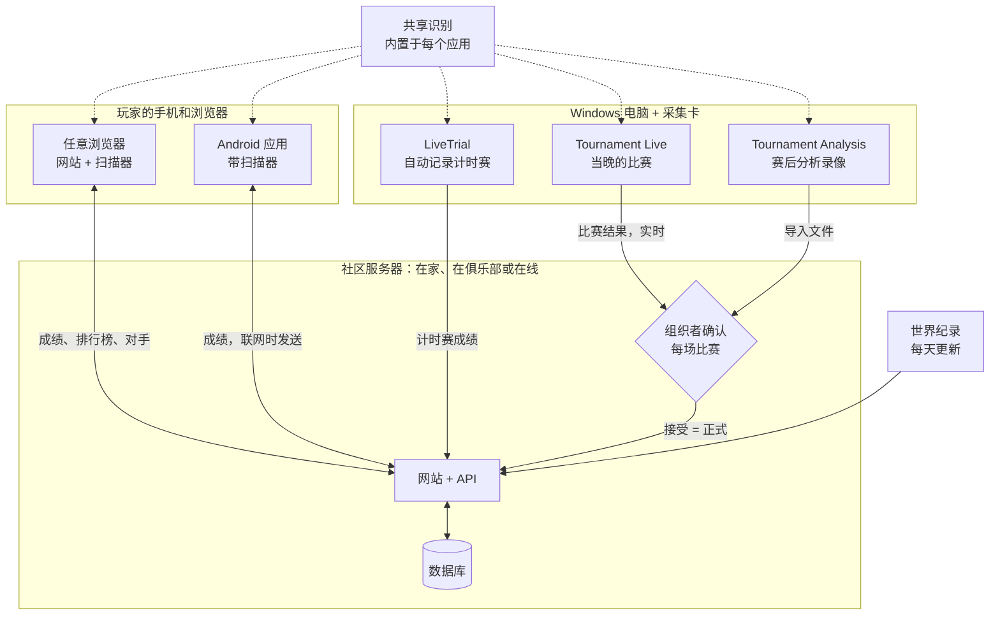

# MK8DX Ecosystem

**自己搭建属于你的马力欧卡丁车8 豪华版社区网站——计时赛*和*锦标赛之夜，一站搞定。**

语言：[English](README.md) · [Nederlands](README_NL.md) · [Deutsch](README_DE.md) · [Español](README_ES.md) · [Français](README_FR.md) · [Italiano](README_IT.md) · [Português](README_PT.md) · [Русский](README_RU.md) · [日本語](README_JA.md) · [한국어](README_KO.md) · 简体中文 · [繁體中文](README_ZH_TW.md)

*本译文由机器根据英文版 README 翻译而成，欢迎指正。*

MK8DX Ecosystem 是一套由你自己部署的系统。它为你的社区提供一个网站，同时保存两类成绩——**计时赛成绩**和**锦标赛成绩**——并为每一类都加入了独具特色的比拼方式。

**⏱️ 计时赛**

- 按赛道和级别（150cc/200cc）划分的**排行榜**，既有社区内的排名，也能与每天更新一次的**世界纪录**并列对比。
- **对手**：只需选一次，就能随时看到他们和你的差距。
- **按你喜欢的方式录入成绩**：手动输入、用相机扫描结果画面（网站或 Android 应用都可以），或者让 Windows 应用 **LiveTrial** 通过采集卡自动记录你的每一次跑图。
- **LiveTrial 能看懂比赛本身**：你什么时候吃到金币、什么时候用了蘑菇，它都知道——而且会为**每一次跑图生成一段视频片段**，随你使用。

**🏁 锦标赛**

- **从报名到决赛的 LAN 之夜**：座位、分组、得分和排名，统统帮你安排好。
- **成绩直接从屏幕读取**：由 Tournament Live 识别，经组织者核对后才正式计入。
- **TrueSkill 评分**：一个随每场锦标赛之夜不断成长的实力评分。
- **参赛无需账号**：举办锦标赛时不必要求任何人注册。想把成绩归到自己账号下的玩家，可以之后再关联——绝不强制。

**✨ 独特之处**

在此之前，一直没有可靠的办法通过采集卡把 Nintendo Switch 上马力欧卡丁车8 豪华版的数据提取出来：大多只能手动抄录，或者用只能识别文字的 OCR。MK8DX 不仅能读取时间、名次和积分，*还*能识别图像：**角色（包括正确的配色）**、**车身、轮胎、滑翔翼**和**旗帜**——只要游戏画面中出现，它都能认出来。

而且你甚至不需要采集卡：坐在沙发上，把手机对准电视，扫描计时赛的**结果画面**或**选择幽灵画面**，成绩就会直接上传到你的网站。据我们所知，这在以前也从未有人做到过。

**🏠 本地还是在线——由你决定**

- **完全本地**：在家庭或俱乐部网络中运行。完成设置后**完全不需要联网**。
- **在线**：部署在你自己的服务器或虚拟主机上，与你的在线社区共享。

无论哪种方式，这都是属于你的安装，拥有你自己的账号和成绩。不需要云账号，没有订阅，也没有广告。

**🔑 永远不需要密码**

- **只有管理员需要账号。** 这个账号同时也是第一位玩家，因此系统里至少总有一名玩家；其他人无需账号就能参加锦标赛。
- **一个链接即可登录**：没有人需要想密码或记密码。在家里，每个人都会拿到一张专属的登录卡（一个链接或二维码）。在线时，新用户只需输入**电子邮箱地址**，然后点击 MK8DX 发送的链接即可登录。

---

## 各部分如何协同

MK8DX 不是一个单独的程序，而是围绕一台**社区服务器**的一个小家族。服务器保存所有重要的东西：账号、成绩、锦标赛和排名。周围的应用在你自己的设备上读取游戏画面，并把识别到的内容发送到你选择的社区。

**我需要哪些部分？**

- **一台社区服务器——每个社区唯一必需的部分。** 它就是带有 API 和数据库的网站。可以运行在家里或俱乐部的网络上（[A2](docs/install/A2_HOME_GUIDE_EN.md)，安装后无需联网），也可以在线部署到服务器或网站托管上（[搭建社区服务器](docs/guides/HOSTING.md)）。
- **玩家只需要一个浏览器。** 网站自带浏览器扫描器。Android 应用还增加了手机扫描、离线查看自己的成绩，以及一键切换社区（[Players](docs/guides/PLAYERS.md)）。
- **带采集卡的 Windows 电脑是可选的。** LiveTrial 会自动记录每一次计时赛；你可以一键发送到你的社区，也可以自动发送（[LiveTrial](docs/guides/LIVETRIAL.md)）。
- **锦标赛之夜在网站上进行。** Tournament Live（当晚）和 Tournament Analysis（赛后分析录像）只会提出比赛结果；分数也可以手动输入或从 Excel/CSV 导入。在组织者接受之前，排名不会改变（[Tournament Directors](docs/guides/TOURNAMENT_DIRECTORS.md)）。
- **识别是共享组件，而不是一项服务。** 每个应用都带有自己的一份副本，在你的设备上读取画面；服务器只检查提交的结果（[Recognition pipeline](docs/architecture/RECOGNITION_PIPELINE.md) · [Architecture](docs/architecture/COMPONENTS.md)）。

## 快速开始

| 我想要… | 从这里开始 |
| --- | --- |
| **在家里或俱乐部运行 MK8DX** | 从 [Releases](https://github.com/fromthelake/MK8DX-Ecosystem/releases) 下载适合你电脑的 A2 软件包：解压、启动、点击“下一步”。分步说明（A2 软件包里还有带插图的版本）：[English](docs/install/A2_HOME_GUIDE_EN.md) · [Nederlands](docs/install/A2_THUIS_HANDLEIDING_NL.md) |
| **组织 LAN 锦标赛之夜** | [Tournament Directors](docs/guides/TOURNAMENT_DIRECTORS.md) |
| **自动记录我的计时赛** | [LiveTrial](docs/guides/LIVETRIAL.md)——Windows + 一张采集卡 |
| **提交并比较我的成绩** | [Players](docs/guides/PLAYERS.md)——任意浏览器；Android 8.0+ |
| **搭建社区网站** | [搭建社区服务器](docs/guides/HOSTING.md) |
| **修改代码** | [开发者指南](docs/DEVELOPMENT.md)、[测试](docs/TESTING.md)、[Contributing](CONTRIBUTING.md) |

每一行列出需要从头到尾照着做的指南。不使用发布软件包、而是从源代码构建服务器，适合开发者：[从源代码开始](docs/GETTING_STARTED.md)。

### 哪种路线适合哪种电脑

每种路线都会给你同样的网站；区别在于它运行在哪里，以及谁能访问它。

| 路线 | 适用于 | 运行环境 | 状态 |
| --- | --- | --- | --- |
| **A2** 家庭或俱乐部网络 | 你自己的网络，设置完成后无需联网，每人一张登录卡 | Windows 11（x86-64）、Linux（x86-64 或 arm64）、Mac（Apple 芯片或 Intel） | 已在 Windows 11 上完成端到端测试；Linux 在 WSL 2 中测试；Mac 版已构建，尚未在真实 Mac 上测试 |
| **A1** 单台电脑 | 在你面前的这台电脑上试用 | Windows 11 或 Linux，x86-64，需要 Docker | 已测试：安装、升级、备份 |
| **A3** 不使用 Docker 的单台电脑 | 无法使用 Docker 的 Windows 电脑 | Windows 11，配合 XAMPP 和 Node.js | 已测试：安装、升级、备份 |
| **B1** 公开网站 | 你的在线社区，使用你自己的域名和邮箱 | 装有 Docker 的 Linux x86-64 服务器（VPS）；文档以 Ubuntu 24.04 为例 | 已有文档，尚未进行端到端测试 |
| **B2** 虚拟主机 | 在线运行，无需自己的服务器 | 支持 Node.js（Passenger）、MariaDB/MySQL 和 SSH 的主机方案 | 我们自己的社区网站就是这样运行的；公开软件包尚未在全新的主机账户上从零安装过 |

配套应用：

| 应用 | 运行环境 | 原因 |
| --- | --- | --- |
| 网站和浏览器扫描器 | 任意现代浏览器；扫描推荐使用 Chrome 或 Edge | 扫描器完全在你的设备上运行，需要能为它提供多线程的浏览器 |
| Android 应用 | Android 8.0 或更高版本，推荐 arm64 | 直接在手机上扫描，没有网络也能用 |
| iPhone 和 iPad | 在浏览器中使用网站；Safari 中的扫描功能仍在测试 | 没有 iOS 应用：构建和签名 iOS 应用需要一台 Mac 和一个 Apple 开发者账号 |
| LiveTrial 和 Tournament Live | x86-64 架构的 Windows（已在 Windows 11 上测试），每块屏幕配一张 USB HDMI 采集卡 | 采集卡和内置的识别引擎都是针对 Windows 构建和测试的；没有 macOS 或 Linux 版本 |

**首次启动 Android 应用**：它会询问*选择你的社区*。在家里或俱乐部，扫描管理员展示的 **Prepare a device** 卡片；如果是在线社区，则输入它的网站地址。然后通过浏览器登录。详情：[Players](docs/guides/PLAYERS.md#first-start)。

**一个应用，多个社区**：顶部的社区标签只需轻点一下，就能在你的俱乐部、你的家庭安装和某个在线社区之间切换；每个社区都保留各自的账号和尚未发送的成绩。在 **你** → **我的成绩** 中，你可以看到自己在每条赛道上的最佳成绩，没有网络也能查看；如果你加入了多个社区，还可以把最佳成绩带到另一个社区——前提是那个社区愿意接收。

**为什么不是所有东西都能在所有地方运行？** 每个软件包只在已经构建并试用过的平台上提供。A1 和 B1 的服务器镜像只有 x86-64 版本；A2 还提供 arm64 版本。对于 Intel Mac，A2 所需的安全库（`cryptography`）已不再发布预编译版本，因此发布流程会在 Intel Mac 上从源码构建并在那里测试（[方法](docs/RELEASE_PACKAGES.md#intel-mac-a2-package)）。A3 是为无法或不想运行 Docker 的人准备的。[托管指南](docs/guides/HOSTING.md)和[发布软件包](docs/RELEASE_PACKAGES.md)列出了每个文件及其确切要求。

全新安装从空白开始：不会继承任何社区账号或成绩。它只带有游戏目录，以及任天堂工作人员幽灵和世界纪录的参考数据集。

---

## 🏁 LAN 锦标赛之夜

还记得 LAN 聚会吗？每块屏幕前两名玩家，满屋子的 Switch，所有人都对着彩虹之路大喊大叫。MK8DX 把那样的夜晚带了回来，并包揽了比赛之外的一切：谁坐哪里、下一轮哪组上场、得分、决赛和排名。

- **报名**——为某个夜晚开放报名，设置截止时间和人数上限；先到先得，或者根据公开的种子进行公平抽签。玩家报名时注明自己会带来的 Switch。
- **座位自动安排**——出席情况、主机和座位（每台 Switch 两名玩家）、机位编号和网线编号。可选择按排名或随机分配种子，以及*均衡*或*最少移动*的座位方案；MK8DX 会为你生成资格赛分组，随后再生成决赛分组。
- **Tournament Live 读取每场比赛**——给每块屏幕接上一张采集卡。每场比赛结束后，它会读取完赛名次、角色、旗帜、单场积分、总分和赛道（双人分屏也可以），保存到本地，并发送到网站上的当晚赛事。
- **一切由你掌控**——在成绩计入之前，组织者会核对玩家和名次。期间实时排名会以临时结果的形式显示。
- **赛后**——最终排名、可分享的赛事报告（WhatsApp、PNG、CSV，以及可直接发布到 WordPress 的文章），还有可选的跨夜 TrueSkill 风格社区评分。

  
  

### 当晚没有用 Tournament Live？赛后分析录像

当晚只录了像，没有实时采集？**Tournament Analysis** 窗口可以在赛后读取录像：添加一个视频、多个视频，或者每场锦标赛一个文件夹，按下 **START ANALYSIS**，它就会找出每一场比赛及其名次、角色和积分，同时用实时的彩色日志和一条彩虹之路进度条显示进度。分析结果是一个 Excel 工作簿、一个 CSV 文件和一个网站导入文件，供组织者核对后导入——审核流程与 Tournament Live 完全相同。一段 22 分钟、包含四场比赛的录像，在笔记本电脑上大约 70 秒就能分析完。在 Windows 版 Tournament Tools 软件包中，双击 `TournamentAnalysis.cmd` 即可（把视频拖到 `TournamentProcessor.cmd` 上仍然可用）；开发者可运行 `python -m tournament_processor.gui`。具体步骤见 [Tournament Directors](docs/guides/TOURNAMENT_DIRECTORS.md#analyse-recordings-afterwards)。

## ⏱️ 用 LiveTrial 跑计时赛——全自动

用采集卡把 Switch 连接到 Windows 电脑，然后尽情比赛吧。据我们所知，以前从没有过这样的东西。

LiveTrial 会监看 HDMI 画面，并自动识别：

- 你经过的菜单、**赛道**和**级别**（150cc/200cc）；
- 比赛过程中：**比赛计时、圈数、金币和道具**；
- 结果画面上：**总时间、每一圈的时间**（3 圈，宝宝公园则是 7 圈）、**角色、车身、轮胎、滑翔翼**和**旗帜**；
- **选择幽灵**面板——幽灵名称、时间、圈速和配件——以及某个幽灵是否属于**任天堂工作人员幽灵**；
- 自动识别你的 **Switch 语言**（全部 12 种系统语言）。

它会保存**每一场比赛的片段**，以及你完整观看的每一段幽灵回放；提供带圈速表和图表的跑图历史；并显示你与**世界纪录**、**任天堂工作人员幽灵**、**你自己的纪录**和**你的对手**之间的差距。一键即可把成绩发送到你的社区（也可以开启自动发送），还能选择把片段上传到你自己的 YouTube 频道。

## 📱 坐在沙发上就能扫描

在朋友家跑计时赛？拿起手机或平板，对准电视，扫描器就会读取结果画面：**总时间、圈速、角色、车身、轮胎、滑翔翼、旗帜和玩家名称**，或者读取一个**幽灵面板**及其赛道和时间。任何不确定的内容都会给出备选项，方便你在提交前选出正确的那个。

浏览器扫描器**完全在你的设备上运行**——不需要账号，不需要服务器，首次下载后即可离线使用。Android 应用同样在设备端完成扫描。

  
  

## 🏆 你的纪录，你的对手

每位玩家都拥有自己在每条赛道上的纪录、与家人、朋友或俱乐部成员的排名、可以追赶的对手（还有戳一戳、挑战，偶尔来一场掷骰对决）、有人打破你的成绩时的通知，以及以当前世界纪录为标准的 **23 个精通度等级**。

  
  

## 🌍 说你的语言——全部 15 种

马力欧卡丁车8 豪华版风靡全球，所以 MK8DX 为每一种游戏语言而打造：网站、Android 应用、LiveTrial 和 Tournament 工具都提供 **15 种语言**，识别功能也支持**全部 15 种游戏语言版本**——从荷兰语、英语到日语、韩语、中文、俄语等等。英语和荷兰语经过人工审校；其他语言为机器翻译，其中部分语言的识别仍在真实主机上验证中。你在用自己的语言玩吗？帮忙检查一下，就是最宝贵的贡献。

## 🛠️ 打造属于你的版本

MK8DX 是开源项目，由玩家为玩家打造。你可以为你的俱乐部、你的家人或你所在城市的 LAN 圈子运行它；按照*你们*的比赛之夜的方式来调整它；并在它的基础上继续开发：

- **翻译或审校**你的语言（网站、应用以及游戏内识别）。
- **测试识别效果**：用你自己的主机、语言和采集卡来测试，并反馈它漏掉了什么。
- **添加你的社区需要的功能**——新的锦标赛赛制、统计数据、分享成绩的方式。
- **完善文档**，让下一位组织者能更快上手。

从 [Contributing](CONTRIBUTING.md) 和[开发者指南](docs/DEVELOPMENT.md)开始吧。每一个 pull request、每一份 bug 报告、每一处翻译修正，都会让下一个 LAN 之夜对所有人来说变得更好。

## 项目状态

稳定版本发布在 [GitHub Releases](https://github.com/fromthelake/MK8DX-Ecosystem/releases)；0.2.0 新增了 A2，可在家里或俱乐部使用；0.2.1 为 Android 应用加入了成绩的离线副本，并带来更清爽的布局。0.2.2 让录像分析重新可用，并新增了 Tournament Analysis 窗口。0.2.3 让 Web 网关无需 root 运行，并让这个仓库更容易上手。请参阅[更新日志](CHANGELOG.md)、[发布软件包](docs/RELEASE_PACKAGES.md)和完整指南（[English](docs/install/MK8DX_User_Guide_EN.txt)、[Nederlands](docs/install/MK8DX_Handleiding_NL.txt)）。

识别结果永远不会自动成为正式成绩：你自己的计时赛由你审核，锦标赛的比赛则要经组织者核对后才会计入。

## 文档

| 我想要… | 阅读 |
| --- | --- |
| 了解识别是如何工作的 | [识别流程](docs/architecture/RECOGNITION_PIPELINE.md) |
| 了解各个组成部分，以及一条成绩是如何流转的 | [架构](docs/architecture/COMPONENTS.md) |
| 构建或修改代码 | [开发者指南](docs/DEVELOPMENT.md)和[测试](docs/TESTING.md) |
| 构建原生客户端 | [客户端构建](docs/CLIENT_BUILDS.md) |
| 运维一套安装（备份、升级、恢复） | [运维](docs/OPERATIONS.md) |
| 了解某样东西为什么是现在这个样子 | [决策索引](docs/decisions/README.md) |
| 参与贡献 | [Contributing](CONTRIBUTING.md)、[行为准则](CODE_OF_CONDUCT.md) |
| 获取帮助 | [获取帮助](SUPPORT.md) |
| 报告安全问题 | [安全策略](SECURITY.md) |
| 与编程智能体协作 | [AGENTS.md](AGENTS.md) |

## 💡 背后的故事

**一切始于一场本地的马力欧卡丁车锦标赛、几位热情的伙伴，以及 2023 年 12 月的一份邀请。**

说来你可能不信，虽然我在 Nintendo 64 上玩过马力欧卡丁车，但马力欧卡丁车8 豪华版我几乎没怎么碰过。我甚至不知道还有漂移这回事。不用说，我有很多课要补。

我发现的是一群很棒的人，他们真心热爱把大家聚在一起比赛。

而这个圈子一直在壮大。

从最初只有 16 名玩家，最终发展成一个拥有 68 名以上参与者的社区，**单晚最多有 36 名玩家同场竞技**。大家一起完成了**超过 1,000 场有记录的比赛**，跑遍了全部 96 条赛道，度过了数不清的友好竞赛时光。

设备也进化得同样迅速。最初是 **Wi-Fi、一台 GoPro、大量人工核对，还有层出不穷的连接问题**，后来逐渐演变成采集卡、全有线以太网、自动化比赛记录，以及 36 名玩家在一间仓库里比赛——四周是主机、屏幕、线缆、朋友，当然，还有披萨。

而每一场锦标赛都会带来新点子。

我们开始分析得分、追踪表现、优化座位安排，并琢磨如何把越来越复杂的玩家换机工作自动化——在一台台 Nintendo Switch 之间调动玩家，还包括来回换网线。组织过这类活动的人都知道，有时候比赛本身反而是最简单的部分。

**然后，计时赛来了。**

起初只是一场小比赛，很快就变成了一场友好的较量：大家都想再从成绩里抠掉那么几毫秒。150cc 的宝宝公园和碧海尤其受欢迎。总有人跑出更快的一圈，也总有人下定决心要打破它。

自然而然，我们也想好好记录这些成绩。改进锦标赛的那份热情，同样延伸到了计时赛的自动记录、图像识别、统计、排名等更多方面。

一件事引出另一件事，不知不觉间，我花在为马力欧卡丁车打造工具上的时间，几乎和真正玩游戏的时间一样多了。

### 从热爱到开源生态

MK8DX Ecosystem 从 2024 年开始开发，过程中得到了 AI 的大量帮助——也就是我们现在所说的 *vibe coding*。

有一点我想说清楚：**没有 AI，我做不出这个项目；没有我，AI 也做不出来。**

让一切正常运转，需要大量的试验和耐心：解释游戏逻辑、检查截图、纠正错误，把 AI 一次次拉回正确的方向。有时候要反反复复很多遍。

也有不少会话欢快地烧掉了大把额度，却什么成果都没有。这些至今仍让我夜不能寐（哈哈）。

而且看来，视觉测试会产生相当多的数据。我现在手上大约有 4 TB 由 AI 生成的 QA 截图和录像，真该找一天好好清理一下了。

单项技术早已存在，但要把它们整合成一个能理解屏幕上正在发生什么、提取游戏信息并让玩家和组织者真正用得上的生态系统，确实是一段不短的旅程。收集和整理支撑这一切所需的游戏素材也是如此。

这是一段不可思议的学习经历，尤其是在图像识别、自动化和软件开发方面。

如今，在 2026 年，我终于可以把成果作为一个**开源生态系统**分享出来，让更多人能够使用它、改进它，也希望大家能和我们一样，从中获得同样多的乐趣。

### 致敬 Volkert

我还想向 **Volkert** 致敬。他是一位令人尊敬的计时赛对手，不久前英年早逝。

我们之间的较量，尤其是在宝宝公园和碧海的 150cc 上，一直激励着我不断进步。我相信我们俩都花了很多时间去抠最后那几毫秒，不过我猜我投入的时间要比他多得多。他只是更有经验，也更稳定。

起初只是我们三个人在 Excel 表格里记录各自的成绩，后来一点点发展成了如今这个生态系统中的计时赛功能。

希望这个项目能让更多人体验到同样友好的较量，以及不断进步的动力。

### 继续比赛，继续分享

我们不敢说自己是最好的玩家、最好的开发者，也不敢说做出了完美的方案。但我们绝不缺乏热情、好奇心，以及不断改进的决心。

如果这个项目能帮你组织一场 LAN 锦标赛、开启一段友好的较量、刷新一项个人纪录，或者只是和朋友们度过一个愉快的夜晚，那它就已经做成了一件有意义的事。

**请继续分享你的精彩时刻、你的想法和你的改进。** 正是这些，让这样的社区保持活力。

最后，衷心感谢 **Nintendo** 创造了如此出色的主机和游戏。如果你喜欢马力欧卡丁车，请支持让这一切成为可能的人们：购买正版主机和游戏，邀请你的朋友、家人或同事，一起享受游戏的乐趣。

毕竟，这整段冒险就是这样开始的。

— [fromthelake](https://github.com/fromthelake)

## 许可证与 Nintendo

这是一个独立的、非商业性的业余项目，目的是学习编程，并让马力欧卡丁车8 豪华版变得更加有趣。本项目**与 Nintendo 没有任何关联，也未获得 Nintendo 的认可**。Nintendo 拥有其商标和游戏内容；请购买 Nintendo 的主机和游戏来支持 Nintendo。

本项目的原创代码和文档采用 [Mozilla Public License 2.0](LICENSE) 授权。[许可范围](LICENSE_SCOPE.md)说明了它涵盖的内容：它**不**涵盖 Nintendo 的素材、游戏图像、识别模板、模型、字体或其他第三方素材，这些素材仍适用其各自的条款。请参阅[第三方素材](docs/THIRD_PARTY_MATERIALS.md)。本软件按“原样”提供。
