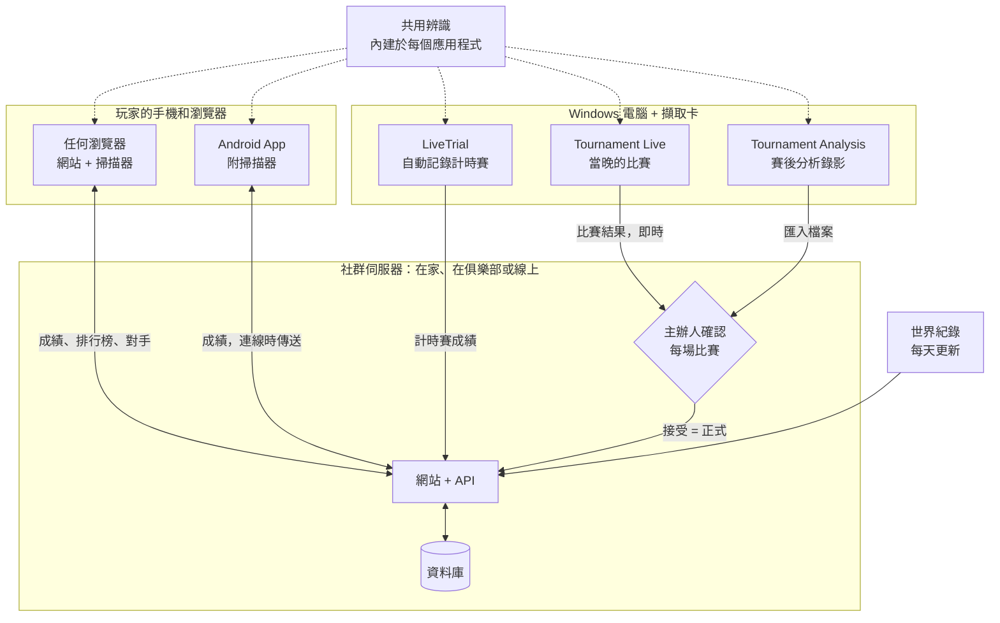

# MK8DX Ecosystem

**自己架設專屬的瑪利歐賽車8 豪華版社群網站——計時賽*和*錦標賽之夜，一次搞定。**

語言：[English](README.md) · [Nederlands](README_NL.md) · [Deutsch](README_DE.md) · [Español](README_ES.md) · [Français](README_FR.md) · [Italiano](README_IT.md) · [Português](README_PT.md) · [Русский](README_RU.md) · [日本語](README_JA.md) · [한국어](README_KO.md) · [简体中文](README_ZH_CN.md) · 繁體中文

*本譯文由機器根據英文版 README 翻譯而成，歡迎指正。*

MK8DX Ecosystem 是一套由你自己架設的系統。它為你的社群提供一個網站，同時保存兩種成績——**計時賽成績**和**錦標賽成績**——並為每一種都加入了獨具特色的較量方式。

**⏱️ 計時賽**

- 依賽道和等級（150cc/200cc）區分的**排行榜**，既有社群內的排名，也能和每天更新一次的**世界紀錄**並列比較。
- **對手**：只要選一次，就能隨時看到他們和你的差距。
- **用你喜歡的方式登錄成績**：手動輸入、用相機掃描結果畫面（網站或 Android App 都可以），或是讓 Windows 應用程式 **LiveTrial** 透過擷取卡自動記錄你的每一趟跑圖。
- **LiveTrial 看得懂比賽本身**：你什麼時候吃到金幣、什麼時候用了蘑菇，它都知道——而且會為**每一趟跑圖製作一段影片片段**，任你使用。

**🏁 錦標賽**

- **從報名到決賽的 LAN 之夜**：座位、分組、分數和排名，全部幫你安排好。
- **成績直接從螢幕讀取**：由 Tournament Live 辨識，經主辦人確認後才正式計入。
- **TrueSkill 評分**：一個隨著每場錦標賽之夜持續成長的實力評分。
- **參賽不需要帳號**：舉辦錦標賽時不必要求任何人註冊。想把成績歸到自己帳號下的玩家，可以之後再連結——絕不強迫。

**✨ 獨特之處**

在此之前，一直沒有可靠的方法能透過擷取卡，把 Nintendo Switch 上瑪利歐賽車8 豪華版的資料擷取出來：大多只能手動抄寫，或是用只能辨識文字的 OCR。MK8DX 不只能讀取時間、名次和積分，*還*能辨識圖像：**角色（包括正確的顏色）**、**車身、輪胎、滑翔翼**和**旗幟**——只要遊戲畫面上有出現，它都認得出來。

而且你甚至不需要擷取卡：坐在沙發上，把手機對準電視，掃描計時賽的**結果畫面**或**幽靈選擇畫面**，成績就會直接送到你的網站。據我們所知，這在以前也從來沒有人做到過。

**🏠 在家還是線上——由你決定**

- **完全在地端**：在家中或俱樂部的網路上執行。設定完成後**完全不需要網際網路**。
- **線上**：架設在你自己的伺服器或虛擬主機上，和你的線上社群分享。

不管哪一種方式，這都是屬於你的安裝，擁有你自己的帳號和成績。不需要雲端帳號，沒有訂閱，也沒有廣告。

**🔑 永遠不需要密碼**

- **只有管理員需要帳號。** 這個帳號同時也是第一位玩家，所以系統裡至少一定有一位玩家；其他人不需要帳號就能參加錦標賽。
- **一個連結就能登入**：沒有人需要想密碼或記密碼。在家裡，每個人都會拿到一張個人專屬的登入卡（一個連結或 QR Code）。在線上，新使用者只要輸入**電子郵件地址**，再點 MK8DX 寄來的連結就能登入。

---

## 各部分如何協同運作

MK8DX 不是單一程式，而是圍繞一台**社群伺服器**的一個小家族。伺服器保存所有重要的東西：帳號、成績、錦標賽和排名。周圍的應用程式在你自己的裝置上讀取遊戲畫面，並把辨識到的內容傳送到你選擇的社群。

**我需要哪些部分？**

- **一台社群伺服器——每個社群唯一必需的部分。** 它就是附有 API 和資料庫的網站。可以在家裡或俱樂部的網路上執行（[A2](docs/install/A2_HOME_GUIDE_EN.md)，安裝後不需連網），也可以在線上的伺服器或網站代管上架設（[架設社群伺服器](docs/guides/HOSTING.md)）。
- **玩家只需要一個瀏覽器。** 網站本身就附有瀏覽器掃描器。Android App 還增加了手機掃描、離線查看自己的成績，以及一鍵切換社群（[Players](docs/guides/PLAYERS.md)）。
- **附擷取卡的 Windows 電腦是選用的。** LiveTrial 會自動記錄每一次計時賽；你可以一鍵傳送到你的社群，也可以自動傳送（[LiveTrial](docs/guides/LIVETRIAL.md)）。
- **錦標賽之夜在網站上進行。** Tournament Live（當晚）和 Tournament Analysis（賽後分析錄影）只會提出比賽結果；分數也可以手動輸入或從 Excel/CSV 匯入。在主辦人接受之前，排名不會改變（[Tournament Directors](docs/guides/TOURNAMENT_DIRECTORS.md)）。
- **辨識是共用元件，而不是一項服務。** 每個應用程式都帶有自己的一份副本，在你的裝置上讀取畫面；伺服器只檢查提交的結果（[Recognition pipeline](docs/architecture/RECOGNITION_PIPELINE.md) · [Architecture](docs/architecture/COMPONENTS.md)）。

## 開始使用

| 我想要… | 從這裡開始 |
| --- | --- |
| **在家裡或俱樂部執行 MK8DX** | 從 [Releases](https://github.com/fromthelake/MK8DX-Ecosystem/releases) 下載適合你電腦的 A2 套件：解壓縮、啟動、點選「下一步」。逐步說明（A2 套件裡另有附插圖的版本）：[English](docs/install/A2_HOME_GUIDE_EN.md) · [Nederlands](docs/install/A2_THUIS_HANDLEIDING_NL.md) |
| **舉辦 LAN 錦標賽之夜** | [Tournament Directors](docs/guides/TOURNAMENT_DIRECTORS.md) |
| **自動記錄我的計時賽** | [LiveTrial](docs/guides/LIVETRIAL.md)——Windows + 一張擷取卡 |
| **送出並比較我的成績** | [Players](docs/guides/PLAYERS.md)——任何瀏覽器；Android 8.0 以上 |
| **架設社群網站** | [架設社群伺服器](docs/guides/HOSTING.md) |
| **修改程式碼** | [開發者指南](docs/DEVELOPMENT.md)、[測試](docs/TESTING.md)、[Contributing](CONTRIBUTING.md) |

每一列列出需要從頭到尾照著做的指南。不使用發行套件、而是從原始碼建置伺服器，適合開發者：[從原始碼開始](docs/GETTING_STARTED.md)。

### 哪種路線適合哪種電腦

每種路線給你的都是同一個網站；差別在於它在哪裡執行，以及誰能連上它。

| 路線 | 適用於 | 執行環境 | 狀態 |
| --- | --- | --- | --- |
| **A2** 家用或俱樂部網路 | 你自己的網路，設定完成後不需要網際網路，每人一張登入卡 | Windows 11（x86-64）、Linux（x86-64 或 arm64）、Mac（Apple 晶片或 Intel） | 已在 Windows 11 上完成端對端測試；Linux 在 WSL 2 中測試；Mac 版已建置，尚未在實體 Mac 上測試 |
| **A1** 單台電腦 | 在你眼前這台電腦上試用 | Windows 11 或 Linux，x86-64，需要 Docker | 已測試：安裝、升級、備份 |
| **A3** 不使用 Docker 的單台電腦 | 無法使用 Docker 的 Windows 電腦 | Windows 11，搭配 XAMPP 和 Node.js | 已測試：安裝、升級、備份 |
| **B1** 公開網站 | 你的線上社群，使用你自己的網域和電子郵件 | 裝有 Docker 的 Linux x86-64 伺服器（VPS）；文件以 Ubuntu 24.04 為例 | 已有文件，尚未進行端對端測試 |
| **B2** 虛擬主機 | 線上執行，不需要自己的伺服器 | 支援 Node.js（Passenger）、MariaDB/MySQL 和 SSH 的主機方案 | 我們自己的社群網站就是這樣運作的；公開套件尚未在全新的主機帳號上從頭安裝過 |

周邊的 App：

| App | 執行環境 | 原因 |
| --- | --- | --- |
| 網站和瀏覽器掃描器 | 任何新式瀏覽器；掃描建議使用 Chrome 或 Edge | 掃描器完全在你的裝置上執行，需要能提供多個執行緒的瀏覽器 |
| Android App | Android 8.0 或更新版本，建議使用 arm64 | 直接在手機上掃描，沒有連線也能用 |
| iPhone 和 iPad | 在瀏覽器中使用網站；Safari 中的掃描功能仍在測試 | 沒有 iOS App：建置和簽署 iOS App 需要一台 Mac 和一個 Apple 開發者帳號 |
| LiveTrial 和 Tournament Live | x86-64 的 Windows（已在 Windows 11 上測試），每個螢幕配一張 USB HDMI 擷取卡 | 擷取卡和內建的辨識引擎都是針對 Windows 建置和測試的；沒有 macOS 或 Linux 版本 |

**第一次啟動 Android App**：它會詢問*選擇你的社群*。在家裡或俱樂部，掃描管理員出示的 **Prepare a device** 卡片；如果是線上社群，就輸入它的網址。接著透過瀏覽器登入。詳情：[Players](docs/guides/PLAYERS.md#first-start)。

**一個 App，多個社群**：上方的社群標籤只要點一下，就能在你的俱樂部、你家裡的安裝和某個線上社群之間切換；每個社群都保有各自的帳號和尚未送出的成績。在 **你** → **我的成績** 裡，你可以看到自己在每條賽道上的最佳成績，沒有網路也能看；如果你加入了不只一個社群，還可以把最佳成績帶到另一個社群——前提是那個社群願意接受。

**為什麼不是所有東西都能在所有地方執行？** 每個套件只在已經建置並試用過的平台上提供。A1 和 B1 的伺服器映像檔只有 x86-64 版本；A2 另外還有 arm64 版本。對於 Intel Mac，A2 需要的安全性程式庫（`cryptography`）已不再發布預先編譯的版本，因此發行流程會在 Intel Mac 上從原始碼建置，並在那裡測試（[方法](docs/RELEASE_PACKAGES.md#intel-mac-a2-package)）。A3 是為無法或不想執行 Docker 的人準備的。[架設指南](docs/guides/HOSTING.md)和[發行套件](docs/RELEASE_PACKAGES.md)列出了每個檔案和它確切的需求。

全新安裝會從空白開始：不會沿用任何社群帳號或成績。它只附帶遊戲目錄，以及任天堂工作人員幽靈和世界紀錄的參考資料集。

---

## 🏁 LAN 錦標賽之夜

還記得 LAN 派對嗎？每個螢幕前兩位玩家，滿屋子的 Switch，所有人都對著彩虹之路大吼大叫。MK8DX 把那樣的夜晚帶了回來，並包辦比賽以外的一切：誰坐哪裡、下一輪輪到哪一組、分數、決賽和排名。

- **報名**——為某個晚上開放報名，設定截止時間和人數上限；先搶先贏，或依照公開的種子公平抽籤。玩家報名時登記自己會帶來的 Switch。
- **座位自動安排**——出席狀況、主機和座位（每台 Switch 兩位玩家）、機台編號和線材編號。可選擇依排名或隨機分配種子，以及*平衡*或*最少移動*的座位配置；MK8DX 會幫你產生預賽組別，接著再產生決賽組別。
- **Tournament Live 讀取每場比賽**——每個螢幕接上一張擷取卡。每場比賽結束後，它會讀取完賽名次、角色、旗幟、單場積分、總分和賽道（雙人分割畫面也可以），儲存在本機，並傳送到網站上當晚的賽事。
- **一切由你掌控**——在成績計入之前，主辦人會確認玩家和名次。在這段期間，即時排名會以暫定結果顯示。
- **賽後**——最終排名、可以分享的賽事報告（WhatsApp、PNG、CSV，以及可直接發布到 WordPress 的文章），還有可選用、橫跨多個夜晚的 TrueSkill 式社群評分。

  
  

### 當晚沒有用 Tournament Live？賽後再分析錄影

當晚只有錄影，沒有即時擷取？**Tournament Analysis** 視窗可以在賽後讀取錄影：加入一部影片、多部影片，或每場錦標賽一個資料夾，按下 **START ANALYSIS**，它就會找出每一場比賽和各自的名次、角色與積分，同時用即時的彩色記錄和一條彩虹之路進度條顯示進度。分析結果是一個 Excel 活頁簿、一個 CSV 檔，以及一個網站匯入檔，讓主辦人確認後匯入——審核流程和 Tournament Live 完全相同。一段 22 分鐘、包含四場比賽的錄影，在筆電上大約 70 秒就分析完成。在 Windows 版 Tournament Tools 套件中，按兩下 `TournamentAnalysis.cmd` 即可（把影片拖曳到 `TournamentProcessor.cmd` 上一樣可行）；開發者可以執行 `python -m tournament_processor.gui`。詳細步驟請見 [Tournament Directors](docs/guides/TOURNAMENT_DIRECTORS.md#analyse-recordings-afterwards)。

## ⏱️ 用 LiveTrial 跑計時賽——全自動

用擷取卡把 Switch 連接到 Windows 電腦，然後盡情比賽就好。據我們所知，以前從來沒有這樣的東西。

LiveTrial 會監看 HDMI 畫面，並自動辨識：

- 你經過的選單、**賽道**和**等級**（150cc/200cc）；
- 比賽進行中：**比賽計時、圈數、金幣和道具**；
- 結果畫面上：**總時間、每一圈的時間**（3 圈，寶寶公園則是 7 圈）、**角色、車身、輪胎、滑翔翼**和**旗幟**；
- **幽靈選擇**面板——幽靈名稱、時間、圈速和零件——以及某個幽靈是不是**任天堂工作人員幽靈**；
- 自動辨識你的 **Switch 語言**（全部 12 種系統語言）。

它會保留**每一場比賽的片段**，以及你完整看完的每一段幽靈重播；提供附有圈速表和圖表的跑圖歷史；並顯示你和**世界紀錄**、**任天堂工作人員幽靈**、**你自己的紀錄**以及**你的對手**之間的差距。按一下就能把成績傳送到你的社群（也可以開啟自動傳送），還能選擇把片段上傳到你自己的 YouTube 頻道。

## 📱 坐在沙發上就能掃描

在朋友家跑計時賽？拿起手機或平板，對準電視，掃描器就會讀取結果畫面：**總時間、圈速、角色、車身、輪胎、滑翔翼、旗幟和玩家名稱**，或是讀取一個**幽靈面板**和它的賽道與時間。任何不確定的內容都會提供替代選項，讓你在送出前挑出正確的那一個。

瀏覽器掃描器**完全在你的裝置上執行**——不需要帳號，不需要伺服器，第一次下載後就能離線使用。Android App 也同樣在裝置上完成掃描。

  
  

## 🏆 你的紀錄，你的對手

每位玩家都有自己在每條賽道上的紀錄、和家人、朋友或俱樂部成員之間的排名、可以追趕的對手（還有戳一下、挑戰，偶爾來場骰子對決）、有人打破你的成績時的通知，以及以目前世界紀錄為基準的 **23 個熟練度等級**。

  
  

## 🌍 說你的語言——全部 15 種

瑪利歐賽車8 豪華版在世界各地都有人玩，所以 MK8DX 是為每一種遊戲語言打造的：網站、Android App、LiveTrial 和 Tournament 工具都提供 **15 種語言**，辨識功能也支援**全部 15 種遊戲語言版本**——從荷蘭語、英語到日語、韓語、中文、俄語等等。英語和荷蘭語經過人工審閱；其他語言是機器翻譯，其中部分語言的辨識仍在實體主機上驗證中。你是用自己的語言在玩嗎？幫忙檢查看看，就是最寶貴的貢獻。

## 🛠️ 打造屬於你的版本

MK8DX 是開源專案，由玩家為玩家打造。你可以為你的俱樂部、你的家人或你所在城市的 LAN 圈子執行它；依照*你們*比賽之夜的進行方式來調整它；並在它的基礎上繼續開發：

- **翻譯或審閱**你的語言（網站、App 以及遊戲內辨識）。
- **測試辨識效果**：用你自己的主機、語言和擷取卡來測試，並回報它漏掉了什麼。
- **加入你的社群需要的功能**——新的錦標賽賽制、統計數據、分享成績的方式。
- **改善文件**，讓下一位主辦人能更快上手。

從 [Contributing](CONTRIBUTING.md) 和[開發者指南](docs/DEVELOPMENT.md)開始吧。每一個 pull request、每一份 bug 回報、每一處翻譯修正，都會讓下一個 LAN 之夜對所有人來說更美好。

## 專案狀態

穩定版本發布在 [GitHub Releases](https://github.com/fromthelake/MK8DX-Ecosystem/releases)；0.2.0 新增了 A2，可以在家裡或俱樂部使用；0.2.1 讓 Android App 擁有成績的離線副本，版面也更加清爽。0.2.2 讓錄影分析重新可用，並新增了 Tournament Analysis 視窗。0.2.3 讓 Web 閘道不需 root 即可執行，並讓這個儲存庫更容易上手。請參閱[變更紀錄](CHANGELOG.md)、[發行套件](docs/RELEASE_PACKAGES.md)和完整指南（[English](docs/install/MK8DX_User_Guide_EN.txt)、[Nederlands](docs/install/MK8DX_Handleiding_NL.txt)）。

辨識結果永遠不會自動成為正式成績：你自己的計時賽由你審核，錦標賽的比賽則要經過主辦人確認後才會計入。

## 文件

| 我想要… | 閱讀 |
| --- | --- |
| 了解辨識是怎麼運作的 | [辨識流程](docs/architecture/RECOGNITION_PIPELINE.md) |
| 了解各個組成部分，以及一筆成績是怎麼傳遞的 | [架構](docs/architecture/COMPONENTS.md) |
| 建置或修改程式碼 | [開發者指南](docs/DEVELOPMENT.md)和[測試](docs/TESTING.md) |
| 建置原生用戶端 | [用戶端建置](docs/CLIENT_BUILDS.md) |
| 維運一套安裝（備份、升級、復原） | [維運](docs/OPERATIONS.md) |
| 了解某件事為什麼是現在這個樣子 | [決策索引](docs/decisions/README.md) |
| 參與貢獻 | [Contributing](CONTRIBUTING.md)、[行為準則](CODE_OF_CONDUCT.md) |
| 取得協助 | [取得協助](SUPPORT.md) |
| 回報安全性問題 | [安全性政策](SECURITY.md) |
| 和程式設計代理一起工作 | [AGENTS.md](AGENTS.md) |

## 💡 背後的故事

**一切都從一場在地的瑪利歐賽車錦標賽、幾位熱情的夥伴，以及 2023 年 12 月的一份邀請開始。**

說出來你可能不信，雖然我在 Nintendo 64 上玩過瑪利歐賽車，但瑪利歐賽車8 豪華版我幾乎沒怎麼碰過。我甚至不知道還有甩尾這回事。不用說，我有很多進度要追。

我發現的是一群很棒的人，他們打從心底喜歡把大家聚在一起比賽。

而這群人一直在增加。

從一開始只有 16 位玩家，最後發展成一個有超過 68 位參與者的社群，**單一晚上最多有 36 位玩家同場較勁**。大家一起完成了**超過 1,000 場有紀錄的比賽**，跑遍全部 96 條賽道，度過了數不清的友誼賽時光。

設備也進化得一樣快。一開始是 **Wi-Fi、一台 GoPro、大量人工檢查，還有一大堆連線問題**，後來慢慢演變成擷取卡、全有線的乙太網路、自動化的比賽記錄，以及 36 位玩家在一間倉庫裡比賽——四周都是主機、螢幕、線材、朋友，當然，還有披薩。

而每一場錦標賽都會帶來新的點子。

我們開始分析分數、追蹤表現、最佳化座位安排，並研究怎麼把越來越複雜的工作自動化：讓玩家在一台台 Nintendo Switch 之間移動，還包括把網路線換來換去。辦過這類活動的人都知道，有時候比賽本身反而是最簡單的部分。

**接著，計時賽登場了。**

一開始只是個小比賽，很快就變成一場友好的較勁：大家都想再從成績裡多擠出那幾毫秒。150cc 的寶寶公園和碧海特別受歡迎。總是有人跑出更快的一圈，也總是有人下定決心要打破它。

很自然地，我們也想好好記錄這些成績。改善錦標賽的那股熱情，也一路延伸到計時賽的自動記錄、影像辨識、統計數據、排名等等。

一件事接著一件事，不知不覺中，我花在為瑪利歐賽車打造工具的時間，幾乎跟真正玩遊戲的時間一樣多了。

### 從熱愛到開源生態系

MK8DX Ecosystem 從 2024 年開始開發，過程中得到 AI 很大的幫助——也就是我們現在所說的 *vibe coding*。

有一件事我想說清楚：**沒有 AI，我做不出這個專案；沒有我，AI 也做不出來。**

要讓一切順利運作，需要大量的實驗和耐心：解釋遊戲邏輯、檢查螢幕截圖、修正錯誤，把 AI 一次又一次拉回正確的方向。有時候要反覆好多遍。

也有不少工作階段開開心心地燒掉一大堆額度，結果什麼成果都沒有。這些到現在還會讓我晚上睡不著（哈哈）。

而且看來，視覺測試會產生相當多的資料。我現在手上大約有 4 TB 由 AI 產生的 QA 螢幕截圖和錄影，真的該找一天好好整理一下。

個別的技術早就存在，但要把它們整合成一個能理解螢幕上正在發生什麼、擷取遊戲資訊，並讓玩家和主辦人真正派得上用場的生態系，確實是一段漫長的旅程。蒐集和整理支撐這一切所需的遊戲素材也是一樣。

這是一段不可思議的學習經驗，特別是在影像辨識、自動化和軟體開發方面。

現在，在 2026 年，我終於能把成果以**開源生態系**的形式分享出來，讓更多人可以使用它、改進它，也希望大家能和我們一樣，從中得到同樣多的樂趣。

### 向 Volkert 致敬

我也想向 **Volkert** 致敬。他是一位令人尊敬的計時賽對手，不久前英年早逝。

我們之間的較量，尤其是在寶寶公園和碧海的 150cc 上，一直激勵著我不斷進步。我相信我們兩個都花了很多時間去拚最後那幾毫秒，不過我猜我投入的時間比他多得多。他只是更有經驗，也更穩定。

一開始只是我們三個人在 Excel 表格裡記錄各自的成績，後來一點一點發展成如今這個生態系統中的計時賽功能。

希望這個專案能讓更多人體驗到同樣友善的較量，以及不斷進步的動力。

### 繼續比賽，繼續分享

我們不敢說自己是最強的玩家、最厲害的開發者，也不敢說做出了完美的解決方案。但我們絕對不缺熱情、好奇心，以及持續進步的決心。

如果這個專案能幫你舉辦一場 LAN 錦標賽、開啟一段友好的較勁、刷新一項個人紀錄，或只是和朋友們度過一個愉快的夜晚，那它就已經做到了一件有意義的事。

**請繼續分享你的精彩時刻、你的點子和你的改進。** 正是這些，讓這樣的社群保持活力。

最後，衷心感謝 **Nintendo** 創造了這麼出色的主機和遊戲。如果你喜歡瑪利歐賽車，請支持讓這一切成真的人們：購買正版主機和遊戲，邀請你的朋友、家人或同事，一起享受遊戲的樂趣。

畢竟，這整段冒險就是這樣開始的。

— [fromthelake](https://github.com/fromthelake)

## 授權與 Nintendo

這是一個獨立、非商業性的業餘專案，目的是學習程式設計，並讓瑪利歐賽車8 豪華版變得更好玩。本專案**與 Nintendo 沒有任何關聯，也未獲得 Nintendo 的認可**。Nintendo 擁有其商標和遊戲內容；請購買 Nintendo 的主機和遊戲來支持 Nintendo。

本專案的原創程式碼和文件採用 [Mozilla Public License 2.0](LICENSE) 授權。[授權範圍](LICENSE_SCOPE.md)說明了它涵蓋的內容：它**不**涵蓋 Nintendo 的素材、遊戲圖像、辨識範本、模型、字型或其他第三方素材，這些素材仍適用各自的條款。請參閱[第三方素材](docs/THIRD_PARTY_MATERIALS.md)。本軟體依「現狀」提供。
