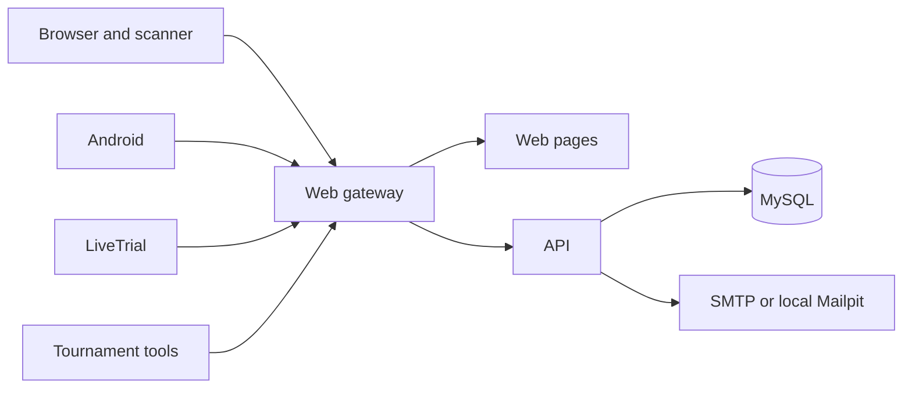

# MK8DX Ecosystem architecture

[Nederlandse versie](COMPONENTS_NL.md) · [Developer guide](../DEVELOPMENT.md)

MK8DX Ecosystem is one product with a server and several clients. The server owns accounts, authorization, accepted results and publication. Clients recognize or collect evidence and send it to the community selected by their user. The browser scanner is served with the website. The native clients are not Docker services.

The diagram shows logical traffic. Mailpit captures sign-in mail only for the one-computer test route. A public installation needs its own working outbound SMTP service. The gateway serves the website, scanner, public client configuration and assets; it forwards API and readiness requests. The public client configuration contains the website origin, never server secrets.

## Follow a result

1. LiveTrial, Android, the browser scanner or Tournament recognizes an image, recording or capture. A person reviews the proposed fields. Processor and Live results can need player mapping and correction.
2. The client stores local evidence or a waiting item and sends it to the **chosen community origin** after the normal account sign-in. Changing server does not silently move an old session or waiting item to another installation.
3. The API authenticates the sender, validates the contract and records the submission in that installation's MySQL database. A `UserAccount`, `Player`, claim and observed alias have different meanings; recognizing a name alone does not establish ownership.
4. The product's review and acceptance rules determine when a Time Trial or Tournament race becomes official. A provisional Tournament Live table is not a published result. The website reads the accepted or published state through the API.

The local end-to-end checks proved this chain for LiveTrial and Tournament Processor/Connect on fresh Docker and XAMPP/Node installations, including database rows and signed-out website views. Tournament Live replay exercised its processing path but did not yield a canonical race suitable for delivery. A physical capture run followed later; see [What is included and what was verified](#what-is-included-and-what-was-verified).

## Find the source

| Responsibility | Source | What to inspect first |
| --- | --- | --- |
| Website, public views, administration and gateway image | `apps/timetrials-web/` | Component README, `src/`, Dockerfile |
| Browser scanner and recognition UI | `apps/timetrials-scanner-web/` | Component README, `src/` |
| Central reader: icons, digits, times, frame geometry (Python, TypeScript, Java) | `packages/icon-matcher/` | Its README and `vectors/` |
| HTTP API, authentication, result and Tournament workflows | `backend/api/` | Component README, `src/`, `test/` |
| Database schema and the two reference seeds | `infrastructure/mysql/` | Migration catalog, migrations, reference README |
| Shared contracts, Time Trial rules and design tokens | `packages/domain/`, `packages/time-trial-rules/`, `packages/design-tokens/` | Each package README |
| Internal shared asset collection and consumer selections | `packages/assets/` | Collection manifest and README |
| Android app | `apps/timetrials-android/` | Component README and app module |
| LiveTrial engine and desktop client | `apps/timetrials-desktop/` | Component README and `vision-runtime/` |
| Tournament recognition and connection | `apps/tournament-processor/`, `apps/tournament-live/`, `packages/tournament-extraction/`, `packages/tournament-connected/` | Their README/source and client build guide |
| Installation, lifecycle and Docker packaging | `tooling/`, `infrastructure/docker/`, root `compose*.yaml` | `tooling/install.py`, lifecycle helper and route overlays |

The [component registry](../../component-registry.json) is the detailed dependency and test map. [Compatibility](../../compatibility.json) records the coordinated API, migration and asset versions. `python tooling/check_boundaries.py` checks the registry and generated graph. Do not keep a separate hand-maintained dependency graph in this page.

The [recognition pipeline](RECOGNITION_PIPELINE.md) identifies which search,
match, decision and result rules are shared and which pixel/capture steps still
belong to each client. It also shows how each product packages its local copy.

### References in code comments

Code comments often cite internal decision records (`ADR-0178` and other `ADR-NNNN` numbers), the internal
design-system documents (`docs/design-system/…`), `docs/provenance/…` and the retired `apps/tournament-manager`.
These are the maintainer's history and are not part of the public tree, so the links do not resolve here. The
code and its tests are the reference: they hold the rule the comment refers to. Ask in an issue if a comment's
reasoning is unclear.

## What is included and what was verified

The full source archive contains the tracked source and the hydrated internal asset collection. The prebuilt host package contains the amd64 API/Web images, MySQL and local Mailpit images, Compose files and the installer. Android, LiveTrial and Tournament have separate client packages; see [Release packages](../RELEASE_PACKAGES.md). The Docker (A1) and XAMPP/Node.js (A3) routes were tested on Windows 11 with new accounts and empty databases, and the A2 route end to end on Windows 11, including an Android phone on the network. A physical 1× Tournament Live capture run with the v0.2.2 Tournament Tools package delivered its results to a disposable local server ([issue #137](https://github.com/fromthelake/MK8DX-Ecosystem/issues/137)). A VPS, macOS, ARM and native Linux have no equivalent end-to-end test yet (A2 on those platforms: [issue #181](https://github.com/fromthelake/MK8DX-Ecosystem/issues/181)).

The server owns only the two reviewed reference-result sets on a fresh install: Nintendo Ghost Staff and World Records. Ordinary community accounts and results are created by that installation. [Third-party materials](../THIRD_PARTY_MATERIALS.md) lists the material that the project's license does not cover.
