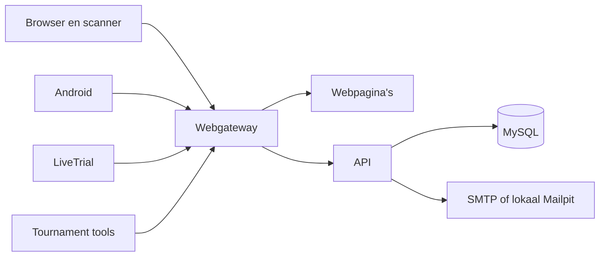

# MK8DX Ecosystem in hoofdlijnen

[English version](COMPONENTS.md) · [Ontwikkelaarsgids](../DEVELOPMENT_NL.md)

MK8DX Ecosystem is één product met een server en meerdere clients. De server beheert accounts, bevoegdheden, geaccepteerde resultaten en publicatie. Clients herkennen of verzamelen bewijs en sturen het naar de community die hun gebruiker heeft gekozen. De browserscanner wordt met de website aangeboden. De losse clients draaien niet in Docker.

Het schema toont de logische verbindingen. Mailpit vangt aanmeldmail alleen op voor de proef op één computer. Een publieke installatie heeft eigen werkende uitgaande SMTP nodig. De gateway biedt website, scanner, publieke clientinstellingen en assets aan; API- en gereedheidsverzoeken gaan naar de API. De publieke clientinstellingen bevatten het websiteadres, nooit servergeheimen.

## Volg een resultaat

1. LiveTrial, Android, de browserscanner of Tournament herkent een afbeelding, opname of capture. Een persoon bekijkt de voorgestelde gegevens. Bij Processor- en Live-resultaten kunnen spelerskoppeling en correctie nodig zijn.
2. De client bewaart lokaal bewijs of een wachtende inzending en verzendt naar het **gekozen communityadres** na de gewone aanmelding. Een serverwijziging verhuist een oude sessie of wachtrij niet stilzwijgend naar een andere installatie.
3. De API controleert de afzender en het contract en schrijft de inzending in de MySQL-database van die installatie. `UserAccount`, `Player`, claim en herkende alias hebben ieder een andere betekenis; een herkende naam bewijst geen eigendom.
4. De productregels voor beoordeling en acceptatie bepalen wanneer een Time Trial of toernooirace officieel wordt. Een voorlopige Tournament Live-stand is geen gepubliceerde uitslag. De website leest de geaccepteerde of gepubliceerde toestand via de API.

De lokale eind-tot-eindproeven bewezen deze keten voor LiveTrial en Tournament Processor/Connect op verse Docker- en XAMPP/Node-installaties, inclusief database en niet aangemelde websiteweergave. Een Tournament Live-replay doorliep het verwerkingspad maar leverde geen verzendbare canonical race op. Een fysieke capture-proef volgde later; zie [Wat is meegeleverd en getest?](#wat-is-meegeleverd-en-getest).

## Vind de broncode

| Verantwoordelijkheid | Bronmap | Begin hier |
| --- | --- | --- |
| Website, publieke pagina's, beheer en gateway-image | `apps/timetrials-web/` | README, `src/`, Dockerfile |
| Browserscanner en herkenningsscherm | `apps/timetrials-scanner-web/` | README, `src/` |
| Centrale lezer: iconen, cijfers, tijden, schermgeometrie (Python, TypeScript, Java) | `packages/icon-matcher/` | README en `vectors/` |
| HTTP-API, aanmelding, resultaten en toernooien | `backend/api/` | README, `src/`, `test/` |
| Database en beide referentieseeds | `infrastructure/mysql/` | Migratiecatalogus, migraties, README |
| Gedeelde contracten, Time Trial-regels en ontwerptokens | `packages/domain/`, `packages/time-trial-rules/`, `packages/design-tokens/` | README per pakket |
| Interne assetcollectie en selecties per product | `packages/assets/` | Collectiemanifest en README |
| Android-app | `apps/timetrials-android/` | README en appmodule |
| LiveTrial-engine en desktopclient | `apps/timetrials-desktop/` | README en `vision-runtime/` |
| Tournament-herkenning en websitekoppeling | `apps/tournament-processor/`, `apps/tournament-live/`, `packages/tournament-extraction/`, `packages/tournament-connected/` | README's, bron en clientbouwgids |
| Installer, beheer en Docker | `tooling/`, `infrastructure/docker/`, `compose*.yaml` in de root | `tooling/install.py`, lifecycle en route-overlays |

Het [componentenregister](../../component-registry.json) bevat de gedetailleerde afhankelijkheden en testkoppelingen. [Compatibility](../../compatibility.json) legt de gezamenlijke API-, migratie- en assetversies vast. `python tooling/check_boundaries.py` controleert het register en de gegenereerde graaf. Houd hier geen tweede handmatige afhankelijkhedengraaf bij.

De [herkenningspijplijn](RECOGNITION_PIPELINE_NL.md) laat zien welke zoek-,
match-, beslis- en resultaatregels gedeeld zijn, welk pixel- en opnamewerk
nog per client gebeurt en hoe de lokale code in elk pakket komt.

### Verwijzingen in codecommentaar

Codecommentaar noemt vaak interne beslisdocumenten (`ADR-0178` en andere `ADR-NNNN`-nummers), de interne
design-systemdocumenten (`docs/design-system/…`), `docs/provenance/…` en het afgeschafte
`apps/tournament-manager`. Dat is de geschiedenis van de maintainer en zit niet in de publieke boom; die
verwijzingen lopen hier dus dood. De code en haar tests zijn de referentie: daarin staat de regel waar het
commentaar naar verwijst. Vraag het in een issue als de redenering van een commentaar onduidelijk is.

## Wat is meegeleverd en getest?

Het volledige bronarchief bevat de gevolgde bronbestanden en de volledige interne assetcollectie. Het voorgebouwde hostpakket bevat amd64-API/Web-images, MySQL en lokale Mailpit-images, Compose en de installer. Android, LiveTrial en Tournament hebben afzonderlijke clientpakketten; zie [Release packages](../RELEASE_PACKAGES.md). De Docker- (A1) en XAMPP/Node.js-route (A3) zijn op Windows 11 getest met nieuwe accounts en lege databases, en de A2-route van begin tot eind op Windows 11, ook met een Android-telefoon op het netwerk. Een fysieke 1×-capture-proef van Tournament Live met het Tournament Tools-pakket van v0.2.2 leverde zijn resultaten af bij een lokale wegwerpserver ([issue #137](https://github.com/fromthelake/MK8DX-Ecosystem/issues/137)). Een VPS, macOS, ARM en native Linux hebben nog geen gelijkwaardige eind-tot-eindproef (A2 op die platforms: [issue #181](https://github.com/fromthelake/MK8DX-Ecosystem/issues/181)).

Een nieuwe installatie krijgt als bestaande resultaten uitsluitend de twee beoordeelde referentiesets Nintendo Ghost Staff en World Records. Gewone communityaccounts en resultaten ontstaan per installatie. [Third-party materials](../THIRD_PARTY_MATERIALS.md) noemt het materiaal dat de projectlicentie niet dekt.
