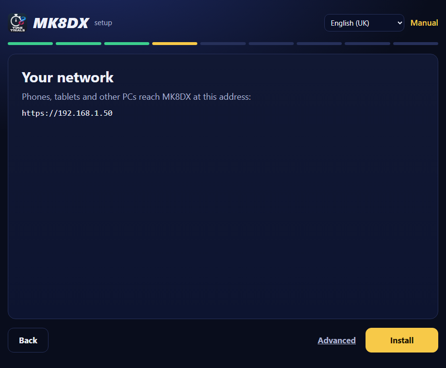
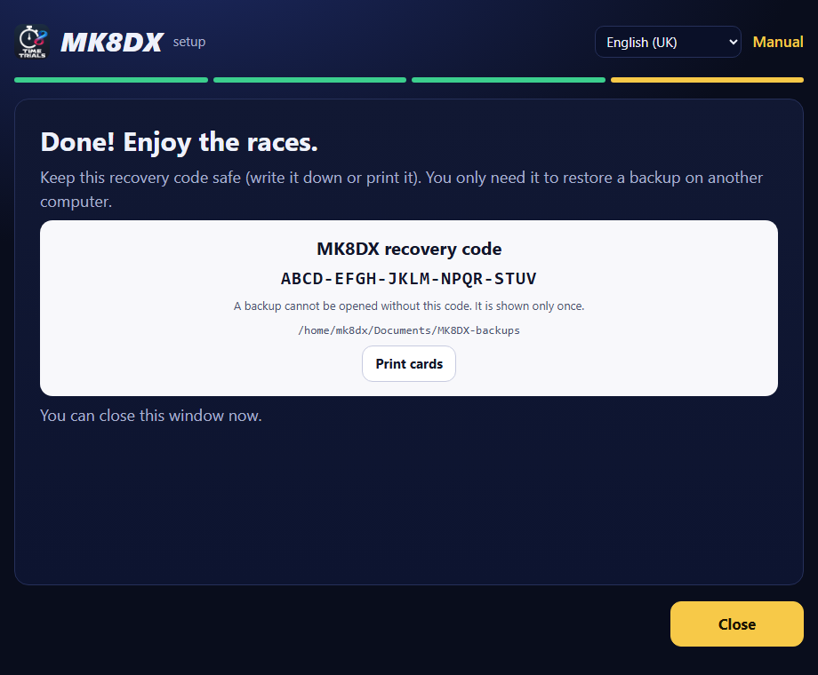
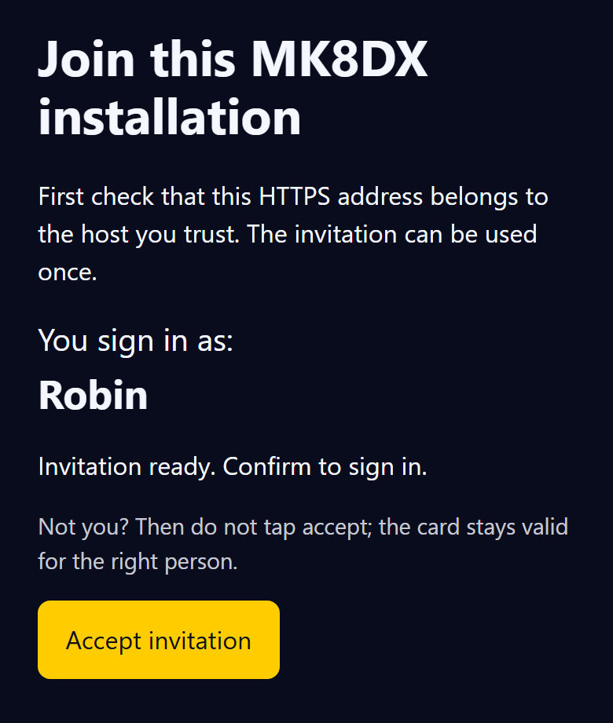

# MK8DX zu Hause oder in deinem Verein — Handbuch

*Dies ist eine maschinelle Übersetzung der [englischen Anleitung](../../A2_HOME_GUIDE_EN.md); maßgeblich ist die englische Fassung. Korrekturen sind willkommen über das Issue-Formular „Translation correction“.*

Dieses Handbuch führt dich Schritt für Schritt von einem leeren Computer bis zu einem gespielten Abend. Du brauchst keine IT-Kenntnisse. Lies die Kapitel der Reihe nach; jedes Kapitel baut auf dem vorherigen auf.

**Zuerst ehrlich gesagt:** Die Installation für zu Hause und den Verein gibt es seit Version 0.2.0. Windows 11 ist von Anfang bis Ende getestet, einschließlich eines Android-Handys im Netzwerk. Linux wurde nur in WSL 2 getestet, noch nicht auf einem eigenen Linux-PC oder einem Raspberry Pi. Die macOS-Pakete sind gebaut, aber noch nicht auf einem echten Mac getestet, und ein iPhone wurde noch nicht getestet. Wo etwas noch nicht getestet oder noch nicht gebaut ist, steht das beim jeweiligen Schritt.

**So liest du einen Schritt:** Nach **Aktion** steht, was du tust, nach **Du siehst**, was dann passieren sollte, und nach **Siehst du etwas anderes?**, was du in diesem Fall tust. Fett gedruckte Wörter sind Schaltflächen oder Texte, die du genau so auf dem Bildschirm siehst. Die Einrichtung (MK8DX beheer), das Startfenster und einige Systemfenster sind auf Englisch; dort steht die deutsche Bedeutung beim ersten Vorkommen in Klammern.

## 1. Was ist MK8DX zu Hause oder in deinem Verein, und was brauchst du?

MK8DX ist eine Website für Mario Kart 8 Deluxe: Zeitfahren, LiveTrial-Aufnahmen und Turnierabende festhalten und vergleichen. Mit dieser Installation läuft die Website auf einem Computer in deinem eigenen Netzwerk. Handys, Tablets und andere Computer im selben Netzwerk öffnen die Website über diesen Computer. Nichts geht ins Internet.

Jeder meldet sich mit einer persönlichen **Anmeldekarte** an: einer Karte mit einem QR-Code. Ein QR-Code ist ein quadratischer Strichcode, den du mit der Kamera deines Handys oder Tablets scannst.

In diesem Handbuch heißt der Computer, auf dem MK8DX läuft, **der MK8DX-Computer**.

Was du brauchst:

- **Einen Computer, der eingeschaltet bleibt, solange gespielt wird:** Windows 11 mit einem Intel- oder AMD-Prozessor, Linux oder macOS. 8 GB Arbeitsspeicher werden empfohlen. Die Einrichtung prüft, dass mindestens 6 GB Speicherplatz frei sind.
- **Ein Heimnetzwerk:** das WLAN oder die Netzwerkkabel deines Routers. Ein Router ist das Gerät, das dein Netzwerk aufbaut (oft von deinem Internetanbieter). Alle Geräte müssen im selben Netzwerk sein. Benutze kein Gastnetzwerk: Es hält Geräte meistens voneinander getrennt.
- **Handys, Tablets oder andere Computer** für die Spieler, am besten mit einer Kamera zum Scannen von QR-Codes.
- **Ein Drucker** ist praktisch, um Anmeldekarten und den Wiederherstellungscode auszudrucken, aber nicht nötig.

Was du nicht brauchst:

- **Kein Internet beim Spielen.** Nur bei der Vorbereitung lädst du einmal Docker, Python und das MK8DX-Paket herunter (oder jemand gibt sie dir auf einem USB-Stick).
- **Kein Konto bei einer anderen Firma**, keine E-Mail-Adresse und keine Cloud.
- **Kein Abo.** MK8DX und Python sind kostenlos. Docker Desktop ist für die private Nutzung und kleine Organisationen kostenlos; die Bedingungen stehen auf der Website von Docker. Unter Linux benutzt du die kostenlose Docker Engine.

<!-- image: network-overview -->

## 2. Den Computer vorbereiten

MK8DX braucht zwei kostenlose Hilfsprogramme:

- **Docker** führt Programme in abgeschirmten „Containern“ aus. Darin laufen die MK8DX-Website und die Datenbank. Unter Windows und macOS heißt das Programm Docker Desktop.
- **Python** ist eine Programmiersprache. Das MK8DX-Installationsprogramm ist darin geschrieben. Du brauchst Python 3.12 bis 3.15.

Mach nur den Teil für deinen Computer (2A, 2B oder 2C) und überspring die anderen beiden.

## 2A. Windows 11 vorbereiten

1. **Aktion:** Prüfe, welchen Prozessor dein Computer hat: Start → **Settings** (Einstellungen) → **System** → **About** (Info), Zeile **System type** (Systemtyp). → **Du siehst:** „64-bit operating system, x64-based processor“ (64-Bit-Betriebssystem, x64-basierter Prozessor). → **Siehst du etwas anderes?** Steht dort ARM, passt das MK8DX-Paket für Windows nicht: Es gibt es nur für x64 (Intel und AMD).
2. **Aktion:** Installiere zuerst **WSL** (Windows-Subsystem für Linux). Das ist ein Teil von Windows, auf dem Docker läuft; ohne WSL lässt sich Docker Desktop nicht installieren. Klicke mit der rechten Maustaste auf die Start-Schaltfläche und wähle **Terminal (Admin)** (Terminal (Administrator)) oder **Windows PowerShell (Admin)** (Windows PowerShell (Administrator)). Klicke auf **Yes** (Ja), wenn Windows um Erlaubnis fragt. Tippe `wsl --install` und drücke die Eingabetaste. → **Du siehst:** Windows lädt WSL und Ubuntu herunter und installiert sie; das dauert ein paar Minuten. Am Ende steht dort, dass du den Computer neu starten musst. Starte den Computer neu. → **Siehst du etwas anderes?** Öffnet sich nach dem Neustart ein Fenster, das nach einem Benutzernamen und Passwort für Ubuntu fragt: Gib einen Namen und ein Passwort deiner Wahl ein (MK8DX braucht sie nicht) und schließ das Fenster dann. Steht dort, dass WSL schon installiert ist, tippe `wsl --update` und drücke die Eingabetaste. Ist von **Virtualisierung** die Rede („Virtual Machine Platform“ oder „virtualization“), dann ist die Virtualisierung im BIOS des Computers ausgeschaltet; schalte sie ein (Hersteller nennen sie oft Intel VT-x oder AMD-V) oder hol dir Hilfe.
3. **Aktion:** Lade **Docker Desktop** für Windows (x86_64 / AMD64) von docker.com herunter und öffne die heruntergeladene Datei. → **Du siehst:** das Docker-Installationsprogramm mit der Wahl, WSL 2 zu verwenden. WSL ist ein Teil von Windows, auf dem Docker läuft. Lass diese Option angehakt und klicke auf **OK**. → **Siehst du etwas anderes?** Fragt Windows, ob diese App Änderungen vornehmen darf, klicke auf **Yes** (Ja).
4. **Aktion:** Warte, bis die Installation fertig ist, und starte den Computer neu, wenn Docker darum bittet. → **Du siehst:** Nach dem Neustart öffnet sich Docker Desktop (oder öffne es selbst über das Startmenü). Beim ersten Mal bittet Docker dich, seine Bedingungen anzunehmen. → **Siehst du etwas anderes?** Bittet Docker dich, dich anzumelden oder ein Konto anzulegen: MK8DX braucht kein Docker-Konto, überspring das, wenn Docker es anbietet. Meldet Docker weiterhin, dass WSL fehlt oder aktualisiert werden muss, mach Schritt 2 noch einmal (`wsl --install` oder `wsl --update`) und starte neu.
5. **Aktion:** Warte im Fenster von Docker Desktop. → **Du siehst:** **Engine running** (Engine läuft) unten links. → **Siehst du etwas anderes?** „Engine starting“ (Engine startet) kann ein paar Minuten dauern. Hängt es oder erscheint ein Fehler, starte den Computer neu und öffne Docker Desktop erneut. Docker muss im normalen Linux-Container-Modus sein (nicht „Windows containers“).
6. **Aktion:** Geh auf python.org → **Downloads** und lade den **Python install manager** für Windows herunter (die Datei endet auf `.msix`). Das ist inzwischen der offizielle Weg, Python unter Windows zu installieren. Öffne die heruntergeladene Datei und klicke auf **Install** (Installieren). → **Du siehst:** Windows installiert den Python install manager; danach kannst du das Fenster schließen. → **Siehst du etwas anderes?** Du kannst ihn auch aus dem Microsoft Store installieren: Such nach „Python install manager“ und klicke auf **Install** (Installieren). Nimm eins von beiden, nicht beides.
7. **Aktion:** Klicke auf Start, tippe `PowerShell`, öffne **Windows PowerShell**, tippe `py install 3.15` und drücke die Eingabetaste. Damit wird Python selbst installiert (der install manager ist nur das Werkzeug, das Python holt). → **Du siehst:** beim ersten Mal ein paar Fragen zur Prüfung der Einstellungen; beantworte sie mit der Eingabetaste (die vorgeschlagene Wahl) oder `y`. Dann wird Python heruntergeladen und installiert. Eine Frage, ob ein Ordner zu deinem PATH hinzugefügt werden soll, kannst du mit `y` beantworten; nötig ist das nicht. → **Siehst du etwas anderes?** Installiere genau 3.15 wie oben; 3.12, 3.13 oder 3.14 funktionieren auch, eine neuere Version (3.16 oder später) noch nicht.
8. **Aktion:** Schließ PowerShell, öffne es wieder, tippe `python --version` und drücke die Eingabetaste. → **Du siehst:** `Python 3.15` gefolgt von einer Zahl, zum Beispiel `Python 3.15.2`. → **Siehst du etwas anderes?** Öffnet sich der Microsoft Store oder steht dort, dass python nicht gefunden wurde: Klicke auf Start, tippe **Manage app execution aliases** (App-Ausführungsaliase verwalten) und öffne es. Schalte **Python (default)** ein und **App Installer python.exe** und **python3.exe** aus. Hast du früher ein altes Python oder den „Python launcher“ installiert, entferne ihn über **Settings → Apps → Installed apps** (Einstellungen → Apps → Installierte Apps) und versuch es erneut.

<!-- image: docker-engine-running -->

<!-- image: python-install-manager -->

## 2B. Linux vorbereiten (Ubuntu oder Debian)

Linux wurde noch nicht von Anfang bis Ende mit MK8DX getestet. Die Schritte sind für Ubuntu 24.04 oder neuer geschrieben. Du tippst sie in ein **Terminal**: ein Fenster, in dem du Textbefehle eingibst (unter Ubuntu öffnest du es mit Strg+Alt+T). Schließ jeden Befehl mit der Eingabetaste ab. **sudo** vor einem Befehl bedeutet „als Administrator dieses Computers“: Linux fragt dann nach deinem Passwort, und beim Tippen siehst du keine Zeichen. Das ist normal.

1. **Aktion:** Tippe `python3 --version`. → **Du siehst:** `Python 3.12`, `3.13`, `3.14` oder `3.15`. → **Siehst du etwas anderes?** Eine niedrigere Zahl (Debian 12 hat zum Beispiel 3.11) ist zu alt; 3.16 oder höher wird noch nicht unterstützt. Du brauchst dann eine neuere Version deines Linux; Ubuntu 24.04 hat Python 3.12.
2. **Aktion:** Tippe `sudo apt update` und danach `sudo apt install docker.io docker-compose-v2 python3-venv`. Beantworte die Frage, ob du fortfahren willst, mit Y (bzw. J bei deutscher Systemsprache) und der Eingabetaste. → **Du siehst:** Die Pakete werden heruntergeladen und installiert. → **Siehst du etwas anderes?** Findet apt ein Paket nicht, hat es auf deinem Linux einen anderen Namen (das kann bei Debian vorkommen). Mach weiter und prüfe in Schritt 5, ob Docker Compose funktioniert.
3. **Aktion:** Tippe `sudo systemctl enable --now docker`. Damit startet Docker jetzt und bei jedem Start des Computers. → **Du siehst:** keinen Fehler (manchmal eine Zeile, die mit „Created symlink“ beginnt).
4. **Aktion:** Tippe `sudo usermod -aG docker $USER`. Damit bekommt dein Benutzer das Recht, Docker zu benutzen. Melde dich danach ab und wieder an (oder starte neu): Das Recht gilt erst nach einer neuen Anmeldung. → **Du siehst:** keinen Fehler. → **Hinweis:** Wer in der Gruppe docker ist, hat praktisch Administratorrechte auf diesem Computer. Füge nur dich selbst hinzu.
5. **Aktion:** Prüfe mit `docker info` und danach mit `docker compose version`. → **Du siehst:** eine Liste mit Angaben ohne Fehler und „Docker Compose version“ mit einer Nummer. → **Siehst du etwas anderes?** „permission denied“ (Zugriff verweigert): Mach Schritt 4 und vergiss nicht, dich abzumelden. „Cannot connect to the Docker daemon“ (keine Verbindung zum Docker-Dienst): Mach Schritt 3.

Eine **Firewall** ist ein Schutz, der entscheidet, welche Verbindungen ein Computer hereinlässt. Ist auf deinem Linux die Firewall ufw oder firewalld aktiv, zeigt die Einrichtung in Kapitel 3, mit welchem Befehl du MK8DX durchlässt.

## 2C. macOS vorbereiten

**Hinweis:** macOS wurde noch nicht auf einem echten Mac getestet. Die folgenden Schritte richten sich danach, was die Einrichtung unter macOS erwartet.

1. **Aktion:** Wähle Apple-Menü → **About This Mac** (Über diesen Mac) und schau bei **Chip** oder **Processor** (Prozessor). → **Du siehst:** einen Apple-Chip (M1, M2 und neuer): Nimm das Paket `macos-arm64`. → **Siehst du etwas anderes?** Einen Intel-Prozessor: Nimm das Paket `macos-amd64`. Es braucht macOS 10.15 oder neuer und ein Docker Desktop, das deinen Mac noch unterstützt.
2. **Aktion:** Lade **Docker Desktop** für Mac mit dem passenden Chip von docker.com herunter, öffne die heruntergeladene Datei und zieh Docker nach **Applications** (Programme). → **Du siehst:** Docker in deinem Ordner Programme.
3. **Aktion:** Öffne Docker. Nimm die Bedingungen an; fragt macOS nach deinem Passwort, gib es ein. → **Du siehst:** nach einer Weile **Engine running** (Engine läuft) im Fenster von Docker Desktop. → **Siehst du etwas anderes?** Bittet Docker dich, dich anzumelden: MK8DX braucht kein Docker-Konto, überspring das, wenn Docker es anbietet.
4. **Aktion:** Lade das macOS-Installationsprogramm von Python 3.15 von python.org herunter und öffne es. Klicke dich mit **Continue** (Fortfahren) und **Install** (Installieren) durch die Schritte. → **Du siehst:** die Meldung, dass die Installation erfolgreich war.
5. **Aktion:** Öffne **Terminal** (Programme → Dienstprogramme → Terminal), tippe `python3 --version` und drücke die Eingabetaste. → **Du siehst:** `Python 3.12` bis `3.15`. → **Siehst du etwas anderes?** Eine niedrigere Zahl (zum Beispiel 3.9 von Apple selbst): Schließ das Terminal und öffne es wieder. Ist sie immer noch niedriger, installiere Python erneut von python.org.
6. **Aktion:** Tippe `docker info` im Terminal. → **Du siehst:** eine Liste mit Angaben ohne Fehler. → **Siehst du etwas anderes?** Starte Docker Desktop und warte auf Engine running.

## 3. MK8DX installieren

**Das Paket entpacken**

1. **Aktion:** Lade das MK8DX-Paket für zu Hause oder den Verein für dein System herunter: Windows, Linux oder macOS, und für Linux und macOS außerdem für deinen Prozessor (amd64 oder arm64). Um zu prüfen, ob der Download korrekt ist, vergleiche seinen SHA-256-Wert mit seiner Zeile in `SHA256SUMS.txt` aus demselben Release (Windows: `Get-FileHash <file> -Algorithm SHA256`; Linux: `sha256sum <file>`; macOS: `shasum -a 256 <file>`); siehe auch `docs/RELEASE_PACKAGES.md#check-a-download`. → **Du siehst:** eine ZIP-Datei in deinem Ordner Downloads. → **Siehst du etwas anderes?** Warnt der Browser, dass die Datei unsicher ist oder selten heruntergeladen wird: Wähle **Keep** (Beibehalten). Windows: Klicke danach mit der rechten Maustaste auf die ZIP-Datei → **Properties** (Eigenschaften), hake unten **Unblock** (Zulassen) an und klicke auf **OK**. Mach das vor dem Entpacken; sonst kann Windows (Smart App Control, Intelligente App-Steuerung) später `Start-MK8DX-LAN.cmd` blockieren. Schalte Smart App Control nicht aus: Es lässt sich danach nur mit einer Neuinstallation von Windows wieder einschalten.
2. **Aktion:** Entpacke die ZIP-Datei in einen dauerhaften Ordner, zum Beispiel einen Ordner MK8DX in Dokumente. Windows: Klicke mit der rechten Maustaste auf die ZIP-Datei → **Extract All** (Alle extrahieren). Wähle einen Ordner, der bleibt: MK8DX startet später immer aus diesem Ordner, also verschieb oder lösch ihn nicht. → **Du siehst:** einen Ordner mit unter anderem `Start-MK8DX-LAN.cmd`, `README-FIRST.txt` und den Ordnern `docs`, `images` und `tooling`. → **Siehst du etwas anderes?** Hast du die ZIP-Datei nur im Explorer geöffnet, entpacke sie wirklich: Ein Start aus der ZIP-Datei heraus funktioniert nicht.

<!-- os: windows -->

**Unter Windows starten**

1. **Aktion:** Doppelklicke im entpackten Ordner auf **Start-MK8DX-LAN.cmd**. → **Du siehst:** ein Fenster mit dem MK8DX-Logo und einem 3-2-1-GO-Countdown mit Pieptönen ([so lässt du ihn weg](../../../guides/HOSTING.md#the-launcher-window-look-and-options)), dann Zeilen wie „MK8DX package:“ (MK8DX-Paket) und „Private installation:“ (private Installation). Beim ersten Mal zeigt es auch „Preparing the included Python packages (once, without internet).“ (Die mitgelieferten Python-Pakete werden vorbereitet, einmalig, ohne Internet.) und „Loading the included Docker images. This can take several minutes.“ (Die mitgelieferten Docker-Images werden geladen. Das kann mehrere Minuten dauern.) Das dauert ein paar Minuten. Dann zeigt es „MK8DX setup is open in your browser:“ (Die MK8DX-Einrichtung ist in deinem Browser geöffnet), und die Einrichtung öffnet sich in deinem Browser. → **Siehst du etwas anderes?** Siehe die Meldungen unten.
2. **Aktion:** Lass das schwarze Fenster offen, bis du in der Einrichtung auf **Finish** (Fertigstellen) geklickt hast. Das Fenster sagt das auch: „Keep this window open until you click Finish.“ (Lass dieses Fenster offen, bis du auf Finish klickst.)

Meldungen im schwarzen Fenster unter Windows:

- **„Python 3.12 to 3.15 is missing. Install the Python install manager from python.org (or the Microsoft Store), run: py install 3.15, reopen PowerShell and retry.“** (Python 3.12 bis 3.15 fehlt.) Mach Kapitel 2A, Schritte 6 bis 8, und doppelklicke dann erneut auf Start-MK8DX-LAN.cmd.
- **„Docker Desktop is missing or not running. Start Docker Desktop in Linux-container mode, wait until it shows "Engine running", and retry.“** (Docker Desktop fehlt oder läuft nicht.) Starte Docker Desktop, warte auf Engine running und doppelklicke erneut.
- Unter einem Fehler steht **„The selected step stopped. Read the message above before retrying.“** (Der gewählte Schritt wurde abgebrochen. Lies die Meldung darüber, bevor du es erneut versuchst.) Lies die Zeile darüber, behebe das Problem und drück eine Taste, um das Fenster zu schließen.

<!-- /os -->

<!-- os: linux macos -->

**Unter Linux und macOS starten**

1. **Aktion:** Öffne ein Terminal im entpackten Ordner. Linux: Klicke mit der rechten Maustaste in den Ordner und wähle „Im Terminal öffnen“, wenn dein Dateimanager das anbietet. Unter macOS und Linux geht auch das: Öffne das Terminal, tippe `cd ` (mit einem Leerzeichen dahinter), zieh den Ordner in das Fenster und drücke die Eingabetaste. → **Du siehst:** Das Terminal ist im Paketordner.
2. **Aktion:** Tippe `sh tooling/start-mk8dx.sh` und drücke die Eingabetaste. → **Du siehst:** das MK8DX-Logo und einen 3-2-1-GO-Countdown, dann „MK8DX package:“ (MK8DX-Paket), die Python-Nummer, „Docker Compose version“. Beim ersten Mal auch „Loading the included Docker images. This can take several minutes.“ (Die mitgelieferten Docker-Images werden geladen. Das kann mehrere Minuten dauern.) und „Preparing the included Python packages (once, without internet).“ (Die mitgelieferten Python-Pakete werden vorbereitet, einmalig, ohne Internet.) Dann „Private installation:“ (private Installation) und „MK8DX setup is open in your browser:“ (Die MK8DX-Einrichtung ist in deinem Browser geöffnet), und die Einrichtung öffnet sich in deinem Browser. → **Siehst du etwas anderes?** Öffnet sich kein Browser, kopiere die Adresse, die mit `http://127.0.0.1:` beginnt, aus dem Terminal in deinen Browser.
3. **Aktion:** Lass das Terminal offen, bis du auf **Finish** (Fertigstellen) geklickt hast.

Meldungen im Terminal unter Linux und macOS:

- **„Python 3.12 to 3.15 is missing. Install it (Ubuntu/Debian: sudo apt install python3 python3-venv; macOS: python.org) and retry.“** (Python 3.12 bis 3.15 fehlt.) Mach Kapitel 2B oder 2C noch einmal.
- **„Docker is not running or this user may not use it (Linux: sudo systemctl start docker, and join the docker group; macOS: start Docker Desktop).“** (Docker läuft nicht oder dieser Benutzer darf es nicht verwenden.) Linux: Mach Kapitel 2B, Schritte 3 und 4. macOS: Starte Docker Desktop.
- **„Could not create the private Python environment (Ubuntu/Debian: sudo apt install python3-venv).“** (Die private Python-Umgebung konnte nicht angelegt werden.) Installiere python3-venv wie in Kapitel 2B, Schritt 2.

<!-- /os -->

**Die Einrichtung im Browser**

Die Einrichtung ist eine Seite in deinem Browser, die nur auf dem MK8DX-Computer selbst funktioniert. Sie ist auf Niederländisch, wenn dein Browser Niederländisch verwendet, und sonst auf Englisch. Oben rechts steht **Manual** (Handbuch): Es öffnet dieses Handbuch. Unten stehen **Back** (Zurück), manchmal **Advanced** (Erweitert) und **Next** (Weiter). Die Punkte oben zeigen, wie weit du bist.

1. **Welcome to MK8DX.** (Willkommen bei MK8DX.) **Aktion:** Lies den Bildschirm und klicke auf **Next** (Weiter). → **Du siehst:** „Quick check“ (Schnellprüfung). Die Schaltfläche **Restore a backup** (Ein Backup wiederherstellen) auf diesem Bildschirm ist nur für einen neuen Computer (Kapitel 10).
2. **Quick check.** (Schnellprüfung.) **Aktion:** Warte einen Moment. → **Du siehst:** drei grüne Haken bei **Docker Desktop is running** (Docker Desktop läuft), **Enough free disk space** (Genug freier Speicherplatz, mit der Anzahl GB) und **Windows, Linux or macOS** (Windows, Linux oder macOS). Klicke auf **Next**. → **Siehst du etwas anderes?** Ein Ausrufezeichen mit einer Erklärung, zum Beispiel „Start Docker Desktop, wait for 'Engine running' and click Try again.“ (Starte Docker Desktop, warte auf „Engine running“ und klicke auf Try again.) oder „Free at least 6 GB on this drive.“ (Mach auf diesem Laufwerk mindestens 6 GB frei.) Behebe das und klicke auf **Try again** (Erneut versuchen). Unter Linux heißt die erste Prüfung ebenfalls „Docker Desktop is running“; dort geht es um die Docker Engine.
3. **What kind of installation?** (Welche Art von Installation?) **Aktion:** Lass **Home, club or LAN-night network, no internet needed** (Netzwerk zu Hause, im Verein oder für einen LAN-Abend, kein Internet nötig; empfohlen) ausgewählt und klicke auf **Next**. → **Du siehst:** „Your network“ (Dein Netzwerk).
4. **Your network.** (Dein Netzwerk.) Eine **Netzwerkadresse** (IP-Adresse) ist die Nummer, über die Geräte diesen Computer in deinem Netzwerk finden, wie eine Hausnummer. **Aktion:** Lies die Adresse unter „Phones, tablets and other PCs reach MK8DX at this address:“ (Handys, Tablets und andere PCs erreichen MK8DX unter dieser Adresse) und schreib sie auf, zum Beispiel `https://192.168.1.50`. Klicke auf **Install** (Installieren). → **Du siehst:** unter Windows „This network is set up as a home (private) network.“ (Dieses Netzwerk ist als privates Heimnetzwerk eingerichtet.) oder „Windows currently treats this network as public. When you click Install, MK8DX marks it private and allows only MK8DX.“ (Windows behandelt dieses Netzwerk derzeit als öffentlich. Wenn du auf Install klickst, markiert MK8DX es als privat und lässt nur MK8DX zu.) Unter Linux und macOS wird hier kein Satz zum Netzwerk angezeigt. → **Siehst du etwas anderes?** Hat der Computer mehr als eine Verbindung (Kabel und WLAN), klicke auf **Advanced** (Erweitert) und wähle bei „Choose another address of this computer:“ (Eine andere Adresse dieses Computers wählen) die Adresse des Netzwerks, in dem auch die Handys sind. Steht dort „No network address found.“ (Keine Netzwerkadresse gefunden.), verbinde den Computer mit deinem Heimnetzwerk und klicke auf **Try again** (Erneut versuchen).
5. **Installing.** (Installation läuft.) **Aktion:** Warte und lass das Fenster offen. → **Du siehst:** „MK8DX is being set up. Keep this window open.“ (MK8DX wird eingerichtet. Lass dieses Fenster offen.) und nacheinander „Preparing the installation“ (Installation wird vorbereitet), „Allowing the network (Windows asks for permission)“ (Netzwerk wird freigegeben, Windows fragt um Erlaubnis), „Starting the database and website“ (Datenbank und Website werden gestartet), „Checking“ (Prüfung) und schließlich „MK8DX is running. Two short steps left.“ (MK8DX läuft. Noch zwei kurze Schritte.) Klicke auf **Next**. Unter Windows fragt ein Windows-Fenster einmal, ob Windows PowerShell Änderungen vornehmen darf: Klicke auf **Yes** (Ja). Damit markiert MK8DX dein Heimnetzwerk als privat und lässt nur MK8DX durch die Firewall (den Schutz von Windows). → **Siehst du etwas anderes?** Ein roter Fehler: Klicke auf **Details**, um zu lesen, was schiefgegangen ist, behebe das und klicke auf **Try again**. Hast du im Windows-Fenster auf Nein geklickt, steht dort, dass Windows die Änderung nicht erlaubt hat; klicke auf **Try again** und dann auf **Yes** (Ja).
6. **Nur Linux: die Firewall.** **Aktion:** Klicke während oder nach der Installation auf **Details** und such die Zeile, die mit „Network:“ (Netzwerk) beginnt. → **Du siehst:** „not-needed“ (nicht nötig, also nichts zu tun) oder „manual:“ (manuell) gefolgt von einem Befehl wie `sudo ufw allow from 192.168.1.0/24 to 192.168.1.50 port 80,443 proto tcp`. → **Danach:** Tippe genau diesen Befehl (mit deiner Adresse, wie dort angezeigt) in ein Terminal. Ohne diesen Befehl können Handys die Website nicht öffnen.
7. **Your administrator account.** (Dein Administratorkonto.) Der **Administrator** ist die Person, die Leute hinzufügt und Anmeldekarten erstellt; das bist du. **Aktion:** Gib bei **Your name** (Dein Name) einen Namen ein, zum Beispiel „Papa“ oder „Vereinsteam“, und klicke auf **Next**. Der Name ist nur innerhalb dieser Installation sichtbar. → **Du siehst:** „Who plays?“ (Wer spielt?)
8. **Who plays?** (Wer spielt?) **Aktion:** Tippe die Namen der Spieler bei **Names (one per line)** (Namen, einer pro Zeile) ein, jeden in eine eigene Zeile, und klicke auf **Add** (Hinzufügen). Oder klicke gleich auf **Skip** (Überspringen): Das kannst du später genauso in MK8DX beheer machen (Kapitel 5). → **Du siehst:** die Namen unter „In this installation:“ (In dieser Installation), dich selbst mit „(administrator)“ hinter deinem Namen. Klicke auf **Next**.
9. **Sign in on phones and PCs.** (Auf Handys und PCs anmelden.) **Aktion:** Du kannst hier schon Anmeldekarten erstellen (Kapitel 5 und 6 erklären, wie), oder klicke einfach auf **Next**. → **Du siehst:** „Done! Enjoy the races.“ (Fertig! Viel Spaß beim Fahren.)
10. **Done! Enjoy the races.** (Fertig! Viel Spaß beim Fahren.) **Aktion:** Schreib die beiden Adressen auf: **Website** (zum Beispiel `https://192.168.1.50`) und **New device** (Neues Gerät, zum Beispiel `http://192.168.1.50/setup`). Lass die drei Haken gesetzt: **Start MK8DX with Windows** (MK8DX mit Windows starten), **Make a backup every night** (Jede Nacht ein Backup erstellen) und **Put an 'MK8DX beheer' shortcut on the desktop** (Eine Verknüpfung „MK8DX beheer“ auf dem Desktop anlegen). Klicke auf **Finish** (Fertigstellen). → **Du siehst:** deinen Wiederherstellungscode (Kapitel 4). → **Unter Linux und macOS** heißt der erste Haken „Start MK8DX when the computer starts“ (MK8DX beim Start des Computers starten). Unter macOS öffnet er dann Docker Desktop, wenn du dich anmeldest. Unter Linux kümmert sich `sudo systemctl enable --now docker` aus Kapitel 2B darum; hast du das noch nicht gemacht, zeigt die Einrichtung genau diesen Befehl nach Finish.
11. **Abschließen.** **Aktion:** Lies Kapitel 4 und bewahre den Wiederherstellungscode auf. Klicke dann auf **Close** (Schließen). → **Du siehst:** „You can close this window now.“ (Du kannst dieses Fenster jetzt schließen.) Schließ den Browser-Tab. Unter Windows wartet das schwarze Fenster auf einen Tastendruck; drück eine Taste, und es schließt sich. Tust du nichts, beendet sich die Einrichtungsseite nach 10 Minuten von selbst. MK8DX selbst läuft weiter.

<!-- image: windows-permission -->

## 4. Der Wiederherstellungscode und der Backup-Ordner

Ein **Backup** ist eine Reservekopie von allem in MK8DX: Leute, Zeiten, Turniere und Einstellungen. MK8DX erstellt jede Nacht um 03:00 Uhr ein Backup und behält die neuesten 7. Die Backups sind verschlüsselt: Ohne den Schlüssel lassen sie sich nicht lesen.

Der **Wiederherstellungscode** ist dieser Schlüssel. Er besteht aus fünf Gruppen von vier Buchstaben und Ziffern, zum Beispiel `ABCD-EFGH-JKLM-NPQR-STUV`. Du brauchst ihn nur, um ein Backup auf einem anderen Computer wiederherzustellen.

1. **Aktion:** Schau nach **Finish** (Fertigstellen) auf die Karte **MK8DX recovery code** (MK8DX-Wiederherstellungscode). → **Du siehst:** den Code, den Satz „A backup cannot be opened without this code. It is shown only once.“ (Ohne diesen Code lässt sich ein Backup nicht öffnen. Er wird nur einmal angezeigt.) und darunter den Ordner, in den die Backups kommen.
2. **Aktion:** Schreib den Code auf Papier ab oder klicke auf **Print cards** (Karten drucken), um diese Seite auszudrucken. Prüfe ihn Buchstabe für Buchstabe. → **Du siehst:** den Code auf Papier. → **Warum nur einmal?** MK8DX bewahrt den Code für das nächtliche Backup geschützt auf diesem Computer auf, zeigt ihn aber nie wieder an. Geht der Computer kaputt, bleibt nur das Papier.
3. **Aktion:** Bewahre das Papier an einem sicheren Ort auf, nicht neben dem Computer. Wer den Code und ein Backup hat, kann alles öffnen.

Wo die Backups liegen:

- **Windows:** im Ordner Dokumente, Ordner `MK8DX-backups` (auf dem Laufwerk: `C:\Users\<your name>\Documents\MK8DX-backups`).
- **Linux und macOS:** in deinem Benutzerordner, Ordner `Documents/MK8DX-backups` (also `~/Documents/MK8DX-backups`). Selbst auf einem Linux in einer anderen Sprache heißt dieser Ordner Documents.
- Die Einrichtung zeigt den genauen Ordner unter dem Wiederherstellungscode.

Kopiere den Ordner `MK8DX-backups` ab und zu auf einen USB-Stick oder ein anderes Laufwerk. Sonst liegen die Backups, wenn der Computer kaputtgeht, nur auf diesem kaputten Computer.

Entfernst du den Haken bei **Make a backup every night** (Jede Nacht ein Backup erstellen), bekommst du keinen Wiederherstellungscode, und es werden keine Backups erstellt. Schaltest du es später in MK8DX beheer wieder ein und klickst auf **Finish**, siehst du in diesem Moment deinen Wiederherstellungscode.

## 5. Leute und Anmeldekarten (MK8DX beheer)

**MK8DX beheer** (Niederländisch für „MK8DX-Verwaltung“) ist dieselbe Seite wie die Einrichtung, aber für später: Leute hinzufügen und Anmeldekarten erstellen. Sie funktioniert nur auf dem MK8DX-Computer selbst. Die Desktop-Verknüpfung heißt in jeder Sprache „MK8DX beheer“; der Seitentitel auf Englisch ist **MK8DX administration** (MK8DX-Verwaltung).

Ein **Konto** ist, wer sich anmeldet. Ein **Spieler** ist der Spieler in den Ranglisten, mit seinen Zeiten. Nach der Anmeldung wählt oder beansprucht jeder seinen eigenen Spieler auf der Website. Namen werden nie automatisch verknüpft.

**MK8DX beheer öffnen**

1. **Aktion (Windows):** Doppelklicke auf dem Desktop auf **MK8DX beheer**. Diese Verknüpfung startet dasselbe wie Start-MK8DX-LAN.cmd. → **Du siehst:** das Startfenster mit seinem kurzen Renn-Intro und dann im Browser die Seite mit „administration“ oben und dem Titel **MK8DX administration**. → **Siehst du etwas anderes?** Keine Verknüpfung: Doppelklicke im MK8DX-Ordner auf Start-MK8DX-LAN.cmd.
2. **Aktion (Linux):** Starte **MK8DX beheer** vom Desktop oder aus dem App-Menü. Auf manchen Linux-Desktops musst du ein solches Symbol erst erlauben (klicke mit der rechten Maustaste darauf und wähle die Option, die das Starten erlaubt). Es geht auch mit `sh tooling/start-mk8dx.sh` im MK8DX-Ordner, wie in Kapitel 3. → **Du siehst:** ein Terminal und dann die Seite **MK8DX administration**.
3. **Aktion (macOS, nicht getestet):** Doppelklicke auf dem Desktop auf **MK8DX beheer.command** oder starte `sh tooling/start-mk8dx.sh` wie in Kapitel 3. → **Du siehst:** das Terminal und dann die Seite **MK8DX administration**.

**Leute hinzufügen**

1. **Aktion:** Tippe die Namen bei **Names (one per line)** (Namen, einer pro Zeile) ein und klicke auf **Add** (Hinzufügen). → **Du siehst:** die Namen unter „In this installation:“ (In dieser Installation).
2. **Aktion:** Klicke auf **Next** (Weiter). → **Du siehst:** „Sign in on phones and PCs“ (Auf Handys und PCs anmelden) in zwei Schritten: **Step 1 · Prepare the device** (Schritt 1 · Das Gerät vorbereiten) mit der Karte **Prepare a device** (Gerät vorbereiten; einmal pro Gerät, sie meldet dich noch nicht an) und **Step 2 · Sign in as the right person** (Schritt 2 · Als die richtige Person anmelden) mit einem Feld für jede Person mit der Schaltfläche **Make card** (Karte erstellen).

**Karten erstellen und drucken**

1. **Aktion:** Klicke neben einer Person auf **Make card** (Karte erstellen). → **Du siehst:** einen QR-Code mit „Valid until“ (Gültig bis) und einer Uhrzeit. Eine Karte funktioniert einmal und 15 Minuten lang. Lass die Person sie sofort scannen (Kapitel 6) oder drucke sie aus.
2. **Aktion:** Erstelle zuerst die Karten, die du willst, und klicke dann auf **Print cards** (Karten drucken). → **Du siehst:** das Druckfenster deines Browsers mit jeder Karte auf dem Bildschirm, einschließlich der Karte Prepare a device.
3. **Aktion:** Erstelle auch eine Karte für dich selbst (der Name mit „(administrator)“), wenn du dich auf deinem Handy anmelden willst.

**Eine Karte ersetzen oder widerrufen**

- **New card** (Neue Karte): erstellt eine neue Karte für diese Person. Die vorherige Karte dieser Person auf diesem Bildschirm funktioniert dann nicht mehr.
- **Revoke card** (Karte widerrufen): Die Karte funktioniert sofort nicht mehr. Du siehst „Revoked: this card no longer works.“ (Widerrufen: Diese Karte funktioniert nicht mehr.) Nutze das, wenn eine Karte verloren gegangen ist oder bei der falschen Person gelandet ist.
- Du kannst nur eine Karte widerrufen, die noch auf diesem Bildschirm ist. Hast du MK8DX beheer schon geschlossen, läuft eine unbenutzte Karte nach 15 Minuten von selbst ab. Könnte sie schon benutzt worden sein, wähle unten **Sign out everywhere** (Überall abmelden).

**Jemanden überall abmelden**

1. **Aktion:** Öffne MK8DX beheer. Auf dem ersten Bildschirm hat jede Person eine Schaltfläche **Sign out everywhere** (Überall abmelden). Klicke darauf. → **Du siehst:** Die Schaltfläche ändert sich zu **Sure? Click again** (Sicher? Noch einmal klicken).
2. **Aktion:** Klicke noch einmal. → **Du siehst:** „Signed out on every device. A new card lets this person sign in again.“ (Auf jedem Gerät abgemeldet. Mit einer neuen Karte kann sich diese Person wieder anmelden.) Diese Person ist jetzt auf der Website und in der App abgemeldet, der Wechsel zu diesem Konto mit einem Tippen verschwindet, und offene Karten dieser Person funktionieren nicht mehr. → **Siehst du etwas anderes?** Neben deinem eigenen Namen steht „Sign yourself out from the account menu on the website ('Sign out on all devices').“ (Melde dich selbst über das Kontomenü auf der Website ab: **Auf allen Geräten abmelden**.)

**MK8DX beheer schließen**

1. **Aktion:** Klicke auf **Next**, bis „Done! Enjoy the races.“ (Fertig! Viel Spaß beim Fahren.) erscheint, lass die Haken gesetzt, klicke auf **Finish** (Fertigstellen) und dann auf **Close** (Schließen). → **Du siehst:** „You can close this window now.“ (Du kannst dieses Fenster jetzt schließen.) MK8DX läuft weiter.

## 6. Ein Gerät vorbereiten und anmelden

Ein **Zertifikat** ist ein digitaler Identitätsnachweis. Damit weiß ein Handy sicher, dass es mit deinem MK8DX-Computer spricht und mit nichts anderem, und die Verbindung ist verschlüsselt (https). Weil MK8DX ohne Internet funktioniert, erstellt die Einrichtung ihr eigenes Zertifikat. Jedes Gerät muss einmal lernen, ihm zu vertrauen. Der **Fingerabdruck** ist ein kurzer Code, der genau zu diesem Zertifikat gehört; damit prüfst du, dass du das richtige Zertifikat installierst.

**Warum ein Zertifikat, auch zu Hause ohne Internet?**

- **Sicher wissen, dass es dein MK8DX ist.** In einem Heim- oder Vereinsnetzwerk kann jeder im selben WLAN vorgeben, dein MK8DX-Computer zu sein, zum Beispiel ein Gast mit einem Laptop. Ohne Zertifikat kann dein Handy den Unterschied nicht erkennen. Mit dem Zertifikat lehnt der Browser jeden anderen Computer ab.
- **Niemand hört mit.** Anmeldekarten, deine Anmeldesitzung und alles, was du eingibst, gehen verschlüsselt über das WLAN.
- **Warum MK8DX sein eigenes Zertifikat erstellt.** Websites im Internet verwenden Zertifikate von bekannten Ausstellern, die schon auf jedem Gerät hinterlegt sind. Diese stellen keine Zertifikate für eine Heimadresse wie `192.168.1.50` aus und funktionieren nicht ohne Internet. Deshalb erstellt MK8DX bei der Installation sein eigenes Zertifikat, und du sagst jedem Gerät einmal, dass es ihm vertrauen darf.
- **Was du mit der Installation erlaubst.** Das Zertifikat gilt nur für die privaten Netzwerkadressen von MK8DX, und sein geheimer Schlüssel bleibt geschützt auf dem MK8DX-Computer. Installiere nur das Zertifikat deines eigenen MK8DX (prüfe den Fingerabdruck) und entferne es von einem Gerät, wenn du diese Installation nicht mehr nutzt.

**Was funktioniert nicht, wenn du das Zertifikat nicht installierst?**

- Der Browser zeigt bei jedem Besuch eine ganzseitige Warnung wie „Dies ist keine sichere Verbindung“. Du kannst sie wegklicken, aber tu es nicht: Dann siehst du nicht mehr, ob du wirklich mit deinem MK8DX sprichst.
- Auch nach dem Wegklicken funktionieren **Browser-Benachrichtigungen** nicht: Der Browser erlaubt sie nur mit einem vertrauenswürdigen Zertifikat. Andere Browserfunktionen können sich auch verweigern.
- Was ohne installiertes Zertifikat funktioniert: die **Android-App**. Sie lernt das Zertifikat selbst über die Karte **Prepare a device** (Gerät vorbereiten; Kapitel 7). Ein Browser auf demselben Gerät braucht das Zertifikat trotzdem.

**Der MK8DX-Computer selbst**

Auch der Computer, auf dem MK8DX läuft, muss MK8DX einmal vertrauen, sonst warnt sein Browser vor der Website.

1. **Aktion:** Öffne MK8DX beheer, klicke auf **Next** (Weiter), bis „Sign in on phones and PCs“ (Auf Handys und PCs anmelden) erscheint, und schau auf den Block **This computer** (Dieser Computer) unter **Step 1** (Schritt 1). → **Du siehst:** „This computer already trusts MK8DX.“ (Dieser Computer vertraut MK8DX bereits.) Dann bist du fertig. → **Siehst du etwas anderes?** Wird die Schaltfläche **Prepare this computer** (Diesen Computer vorbereiten) angezeigt, geh zu Schritt 2.
2. **Aktion:** Klicke auf **Prepare this computer**. → **Du siehst:** ein Windows-Fenster **Security Warning** (Sicherheitswarnung), das fragt, ob du das Zertifikat installieren willst, mit einem **thumbprint (sha1)** (Fingerabdruck (sha1)). Vergleiche ihn mit dem Fingerabdruck in MK8DX beheer; stimmen sie überein, klicke auf **Yes** (Ja). → **Du siehst:** „This computer already trusts MK8DX.“ → **Siehst du etwas anderes?** Hast du auf **No** (Nein) geklickt oder unterscheiden sich die Fingerabdrücke: Klicke nicht auf Ja, schließ das Fenster und hol dir Hilfe. Unter Linux oder macOS steht statt der Schaltfläche dort, dass du die Adresse unter Prepare a device im Browser dieses Computers öffnen sollst; folge dann auf diesem Computer den Schritten unten.

**Einmal pro Gerät: Prepare a device (Gerät vorbereiten)**

1. **Aktion:** Verbinde das Handy, Tablet oder den PC mit demselben WLAN oder Kabelnetzwerk wie den MK8DX-Computer. Benutze auf einem Handy keine mobilen Daten statt WLAN. → **Du siehst:** den Namen deines eigenen WLANs bei der Verbindung.
2. **Aktion:** Scanne mit der Kamera den QR-Code auf der Karte **Prepare a device** (in MK8DX beheer oder auf Papier) und tippe auf den Link, der erscheint. Ohne Kamera tippst du die Adresse **New device** (Neues Gerät) in den Browser, zum Beispiel `http://192.168.1.50/setup`. → **Du siehst:** die Seite **Prepare this device** (Dieses Gerät vorbereiten) mit „Do this once per phone, tablet or PC. Afterwards, scan your personal sign-in card.“ (Mach das einmal pro Handy, Tablet oder PC. Scanne danach deine persönliche Anmeldekarte.) → **Siehst du etwas anderes?** Öffnet sich die Seite nicht: Prüfe das Netzwerk und ob der MK8DX-Computer eingeschaltet ist (Kapitel 11).
3. **Aktion:** Vergleiche den Code unter „First check this code.“ (Prüfe zuerst diesen Code.) mit dem **Fingerprint** (Fingerabdruck) auf der Karte Prepare a device (vier Gruppen zu vier Zeichen). → **Du siehst:** genau denselben Code. → **Siehst du etwas anderes?** Ist der Code anders, installiere nichts. Du bist vielleicht in einem anderen Netzwerk oder unter einer anderen Adresse; prüfe das zuerst.
4. **Aktion:** Folge dem Teil für dein Gerät. Der Teil für das Gerät, das du gerade benutzt, ist schon geöffnet; für ein anderes Gerät öffnest du ihn unter „Another kind of device?“ (Eine andere Art von Gerät?). Tippe auf **Download certificate** (Zertifikat herunterladen; bei iPhone und iPad: **Download profile**, Profil herunterladen) und folge den Schritten unten. → **Du siehst:** unten „Done? Scan your personal sign-in card, or open“ (Fertig? Scanne deine persönliche Anmeldekarte oder öffne) mit der Adresse der Website.

Die Schritte auf der Seite Prepare this device:

<!-- filter: device -->

- **Android:** Tippe auf die Schaltfläche, um das Zertifikat herunterzuladen. Öffne die Einstellungen und such nach „Zertifikat“ (oft: Sicherheit → Weitere Sicherheitseinstellungen → Verschlüsselung und Anmeldedaten → Zertifikat installieren → CA-Zertifikat). Wähle die heruntergeladene MK8DX-Datei und bestätige mit deiner PIN. Die Menünamen unterscheiden sich je nach Handymarke.
- **iPhone und iPad (mit dieser Installation noch nicht getestet):** Tippe auf die Schaltfläche, um das Profil herunterzuladen, und erlaube es. Öffne Einstellungen → Profil geladen → Installieren. Dann Einstellungen → Allgemein → Info → Zertifikatsvertrauenseinstellungen → MK8DX einschalten.
- **Windows:** Lade das Zertifikat herunter und öffne es. Wähle Zertifikat installieren → Aktueller Benutzer → Alle Zertifikate in folgendem Speicher speichern → Vertrauenswürdige Stammzertifizierungsstellen. Wähle nicht Zwischenzertifizierungsstellen. Starte den Browser neu.
- **Mac (macOS ist noch nicht von Anfang bis Ende getestet):** Lade das Zertifikat herunter und öffne es; die Schlüsselbundverwaltung öffnet sich. Öffne das MK8DX-Zertifikat → Vertrauen → Immer vertrauen.
- **Linux (dieser Weg ist noch nicht von Anfang bis Ende getestet):** Füge dasselbe Zertifikat dem vertrauenswürdigen Stammzertifikatsspeicher deiner Distribution oder deines Browsers hinzu. Die genauen Schritte unterscheiden sich je nach Distribution.

<!-- /filter -->

**Mit deiner persönlichen Karte anmelden**

1. **Aktion:** Scanne deine eigene Karte (die Karte mit deinem Namen) und tippe auf den Link. → **Du siehst:** **Join this MK8DX installation** (Dieser MK8DX-Installation beitreten) und „First check that this HTTPS address belongs to the host you trust. The invitation can be used once.“ (Prüfe zuerst, dass diese HTTPS-Adresse zu dem Host gehört, dem du vertraust. Die Einladung kann einmal verwendet werden.) Die Adressleiste des Browsers muss die Adresse der Website zeigen, zum Beispiel `https://192.168.1.50`. → **Siehst du etwas anderes?** Eine Browserwarnung zum Zertifikat oder zu einer unsicheren Verbindung: Klick sie niemals weg. Mach zuerst Prepare a device wie oben.
2. **Aktion:** Prüfe den Namen der Karte unter **You sign in as:** (Du meldest dich an als). Ist es dein Name, warte auf „Invitation ready. Confirm to sign in.“ (Einladung bereit. Bestätige, um dich anzumelden.) und tippe auf **Accept invitation** (Einladung annehmen). Steht dort ein anderer Name, tippe nicht auf Annehmen: Die Karte bleibt für die richtige Person gültig. → **Du siehst:** „You are signed in as“ (Du bist angemeldet als) mit deinem Namen und **Continue to MK8DX** (Weiter zu MK8DX). Tippe darauf. → **Siehst du etwas anderes?** „This invitation is invalid. Ask the administrator for a new QR code.“ (Diese Einladung ist ungültig. Bitte den Administrator um einen neuen QR-Code.) oder „Sign-in failed. Ask the administrator for a new invitation.“ (Anmeldung fehlgeschlagen. Bitte den Administrator um eine neue Einladung.): Die Karte wurde schon benutzt, ist abgelaufen oder wurde widerrufen. Lass den Administrator eine **New card** (Neue Karte) erstellen.
3. **Aktion:** Folge den Willkommensschritten auf der Website: ob du hier schon Zeiten oder Turniere hast und wie du heißen willst. So wählst oder beanspruchst du deinen eigenen Spieler. → **Du siehst:** deinen Namen und deine Zeiten. → **Siehst du etwas anderes?** Ist der Name auf deiner Karte (zum Beispiel „Papa“) nicht schon eingetragen: Das ist richtig. Der Name auf der Karte ist nur die Bezeichnung in MK8DX administration; deinen Spielernamen wählst du hier selbst.

**Ein weiteres Gerät für dieselbe Person**

- Ein Spieler kann selbst eine Karte erstellen: Das Kontomenü auf der Website hat **Auch auf einem anderen Gerät anmelden**. Es öffnet **Auf einem anderen Gerät anmelden** mit einer Karte, die „Funktioniert einmal, gültig bis“ zu einer Uhrzeit. Scanne sie mit dem anderen Gerät. Zeig sie nur deinem eigenen Gerät: Wer sie scannt, ist in deinem Konto angemeldet.
- Administratoren haben diese Schaltfläche nicht. Sie erstellen sich in MK8DX beheer eine **New card** (Neue Karte).
- Ein neues Gerät macht immer zuerst einmal Prepare a device.
- **Keine Kamera, oder Anmeldung auf dem MK8DX-Computer selbst?** Erstelle die Karte dieser Person in MK8DX beheer und klicke auf **Sign in on this computer** (Auf diesem Computer anmelden; öffnet die Anmeldeseite im Browser des MK8DX-Computers) oder **Copy link** (Link kopieren). Schick einen kopierten Link nur an die Person selbst, zum Beispiel in einer privaten Nachricht: Wer ihn öffnet, kann sich als diese Person anmelden. Er funktioniert einmal und 15 Minuten lang. Auf der Karte Prepare a device kopiert **Copy address** (Adresse kopieren) die Adresse; sie ist nicht geheim.

**Diese Installation auf einem Gerät verlassen:** Entferne das Zertifikat wieder in denselben Einstellungen, in denen du es installiert hast.

## 7. Die Android-App und LiveTrial

**Die Android-App koppeln**

Dafür brauchst du App-Version 2.95.0 oder neuer. Die App braucht das Zertifikat nicht in den Android-Einstellungen, aber die Anmeldung läuft über den Browser des Handys. Mach deshalb zuerst Kapitel 6 auf diesem Handy: Prepare a device (Gerät vorbereiten) und mit deiner Karte im Browser anmelden.

1. **Aktion:** Öffne die App. Bei einer neuen Installation startet sie mit **Wähle deine Community**; sonst tippe oben in der App auf den Namen der Community und dann auf **Eine Community hinzufügen**. → **Du siehst:** **Wähle deine Community** mit den Feldern **Zu Hause oder im Verein** und **Online-Community**. Tippe unter **Zu Hause oder im Verein** auf **QR-Code scannen**.
2. **Aktion:** Tippe bei Bedarf auf **Kamera verwenden** und erlaube die Kamera. Scanne den QR-Code auf der Karte **Prepare a device**. → **Du siehst:** **Prüfe, ob das deine Installation ist** mit einer **Adresse** und einem **Schlüssel-Fingerabdruck (SHA-256)**. → **Siehst du etwas anderes?** „This is not the QR code of a Prepare a device card.“ (Das ist nicht der QR-Code einer Karte Prepare a device.): Du hast eine persönliche Karte gescannt. Scanne die Karte Prepare a device. Klappt das Scannen nicht, tippe die Adresse New device (zum Beispiel `http://192.168.1.50/setup`) bei **Oder den Setup-Link einfügen** ein und tippe auf **Weiter**.
3. **Aktion:** Vergleiche die Adresse mit der Adresse der Website und den langen Schlüssel mit der Seite Prepare this device: Öffne dort **Full fingerprints** (Vollständige Fingerabdrücke) und schau bei „Root public key SHA-256 (SPKI)“. Du kannst diese Seite auf einem anderen Gerät öffnen oder auf dem MK8DX-Computer selbst über die Adresse New device. → **Du siehst:** beide genau gleich. Tippe auf **Verbinden** (war die App schon auf einen anderen Server eingestellt, bestätige den Wechsel). → **Siehst du etwas anderes?** Unterscheiden sie sich, tippe auf **Zurück** und verbinde nicht. „Could not get a matching certificate from“ (Kein passendes Zertifikat erhalten von): Prüfe das Netzwerk und ob der MK8DX-Computer eingeschaltet ist, und versuch es erneut.
4. **Aktion:** Tippe in **Einstellungen** bei **Spieler auf diesem Handy** auf **Anmelden**. Die App erinnert dich daran, dass du dich zu Hause oder im Verein mit deiner persönlichen Anmeldekarte anmeldest, nicht per E-Mail. Tippe auf **Zum Synchronisieren anmelden**. → **Du siehst:** Der Browser öffnet die Genehmigungsseite. Prüfe, dass die Seite denselben Code wie die App zeigt, und bestätige das Gerät. Geh zurück in die App. → **Siehst du etwas anderes?** Fragt der Browser, ob du dich anmelden willst, melde dich zuerst mit deiner Karte an (Kapitel 6).
5. **Aktion:** Poste eine Zeit in der App. → **Du siehst:** die Zeit auf der Website der Installation.

Entkoppeln: Tippe oben auf den Namen der Community → **Eine Community hinzufügen** → **Diese Installation vergessen**.

Verein und Zuhause in einer App: Die App kann mehrere Communities enthalten. Tippe oben auf den Namen der Community und dann auf **Community wechseln**; jede Community behält ihr eigenes Konto und ihre ungesendeten Zeiten. Deine eigenen Zeiten findest du unter deinem Namen → **Meine Zeiten**, auch wenn das Handy den MK8DX-Computer nicht erreichen kann.

**LiveTrial auf einem zweiten Windows-PC**

LiveTrial ist ein Windows-Programm, das deine Zeitfahren über eine Capture-Karte erkennt und festhält (ein Gerät, das das Bild deiner Switch an den PC schickt). Wie du LiveTrial selbst installierst, steht in Kapitel 6 von `docs/install/MK8DX_User_Guide_EN.txt`. Getestet auf einer Testinstallation mit LiveTrial 3.37.0. Die Schritte in Kürze:

1. Lass diesen PC zuerst der Installation vertrauen: Kapitel 6, Teil Windows. Prüfe, dass sich die Website im Browser ohne Warnung öffnet.
2. Sorge dafür, dass dein Konto auf der Website einen **Spieler** hat.
3. Öffne LiveTrial, klicke auf das Zahnrad (**Einstellungen**) und gib bei **Adresse der Community-Website** die Adresse der Website ein, zum Beispiel `https://192.168.1.50`.
4. Klicke auf **Anmelden** und wähle **Genehmigungsseite öffnen**. Bestätige das Gerät im Browser.
5. Sende Läufe mit **Jetzt senden** oder schalte in den Einstellungen **Neue Läufe automatisch senden** ein.

Gut zu wissen: Ohne Spieler endet die Anmeldung in LiveTrial mit einer Meldung, dass du zuerst deinen Spieler auf der Website einrichten sollst. Nachdem du die Adresse geändert hast, startet LiveTrial neu; tut es das nicht, beende es und öffne es erneut. Konten und wartende Läufe für einen anderen Server bleiben bei diesem Server. Wenn du diesen PC nicht mehr mit der Installation nutzt, entferne das MK8DX-Zertifikat wieder aus **Vertrauenswürdige Stammzertifizierungsstellen** (Kapitel 6).

## 8. Alltag

**Der MK8DX-Computer muss eingeschaltet sein.** Solange jemand spielen will, muss der MK8DX-Computer eingeschaltet, wach und mit dem Netzwerk verbunden sein. Schalte den Energiesparmodus während eines Spielabends am besten aus. Docker muss laufen; unter Windows und macOS startet Docker Desktop von selbst, wenn du dich anmeldest (Kapitel 10).

**Ein Handy oder Tablet für die ganze Familie**

- Jeder meldet sich einmal mit seiner eigenen Karte auf diesem Gerät an.
- **Website:** Danach wechselst du mit einem Tippen über das Kontomenü: Wähle **Konto wechseln** und dann die Person.
- **PIN:** Jeder kann auf der Website unter **Einstellungen** → **PIN zum Kontowechsel** eine 4-stellige PIN festlegen. Der Wechsel zu diesem Konto fragt dann zuerst nach dieser PIN.
- **Android-App:** Tippe oben auf deinen Namen → **Spieler wechseln** (oder **Einstellungen** → **Spieler auf diesem Handy**) und wähle die Person mit **Spieler wechseln**. Hat diese Person eine PIN, fragt die App **PIN erforderlich** und **PIN (4 Ziffern)**. Eine falsche PIN ergibt „Diese PIN stimmt nicht.“
- **Administratoren** stehen nur in dieser Liste, wenn sie eine PIN festgelegt haben (Einstellungen → PIN zum Kontowechsel). Ohne PIN melden sie sich neu mit einer Karte an. Für einen Administrator gilt es strenger: Nach der 5. falschen PIN verschwindet das Administratorkonto von diesem Gerät, ebenso nach 14 Tagen ohne Nutzung; dann ist wieder eine Karte nötig. In der Android-App stehen Administratoren (noch) nicht in der Liste.

**Abmelden**

- Auf der Website über das Kontomenü oben rechts: **Abmelden** (nur dieses Gerät) oder **Auf allen Geräten abmelden**.
- Jemand anderen überall abzumelden, macht der Administrator in MK8DX beheer mit **Sign out everywhere** (Überall abmelden; Kapitel 5).

**Karte verloren oder Handy verloren**

- Verlorene Karte, die noch nicht benutzt wurde: **Revoke card** (Karte widerrufen), wenn sie noch auf dem Bildschirm in MK8DX beheer ist; sonst läuft sie nach 15 Minuten von selbst ab.
- Handy verloren, oder eine Karte könnte schon benutzt worden sein: Wähle in MK8DX beheer neben dieser Person **Sign out everywhere** und klicke noch einmal. Gib der Person dann eine **New card** (Neue Karte).

**Hell oder dunkel:** Auf einem neuen Gerät folgt die Website der Einstellung **System** dieses Geräts. Wähle nach der Anmeldung **Konto** → **Einstellungen** → **Darstellung** → **Dunkel** für das dunkle Aussehen; diese Wahl wird mit deinem Konto gespeichert.

**Ein Name für deine Community:** Ein Administrator kann der Installation auf der Website unter **Verwaltung** → **Installationseinstellungen** → **Community-Name** einen Namen geben, zum Beispiel „Club Noord“, und auf **Namen speichern** klicken. Die Apps zeigen dann diesen Namen statt der Webadresse. Lass das Feld leer und speichere, um den Namen wieder zu entfernen.

**Zeiten aus anderen Communitys:** Wer auch in einer anderen Community spielt (einem anderen Verein oder einer Website im Internet), kann seine Zeiten über die Android-App hierher mitnehmen. Ein Administrator wählt auf der Website unter **Verwaltung** → **Installationseinstellungen** → **Zeiten aus anderen Communitys**: **Aus** (die Standardeinstellung: solche Zeiten werden abgelehnt), **Mit Freigabe** (jede mitgenommene Zeit bleibt unsichtbar, bis ein Administrator unter **Verwaltung** → **Zeitfahren** daneben auf **Veröffentlichen** klickt) oder **Erlaubt**. Eine mitgenommene Zeit zeigt immer, woher sie stammt.

## 9. Ein Turnierabend

Dieses Kapitel ist nur ein Überblick. Die eigentlichen Schritte stehen in den unten genannten Handbüchern. Einen Turnierabend führst du auf der Website deiner Installation durch; der **Turnierleiter** (Director) ist die Person, die den Abend leitet.

- **Der Abend auf der Website:** Die Schritte 0 bis 10 (Teilnehmer und Anwesenheit, Konsolen, Gruppen und Plätze, Punkte, Finale und Abschluss) stehen in `docs/guides/TOURNAMENT_DIRECTORS.md` (im Repository auf GitHub; nicht im Paket) und in Kapitel 6 „Use Android, LiveTrial, the scanner, and Tournament“ (Android, LiveTrial, den Scanner und Tournament nutzen) von `docs/install/MK8DX_User_Guide_EN.txt` (im Paket).
- **Tournament Live:** ein Windows-Programm, das die Rennen von einer Capture-Karte liest. Siehe `docs/product/README_TOURNAMENT_LIVE_LAPTOP.md` im Repository.
- **Tournament Processor:** liest ein aufgenommenes Video (.mp4 oder .mkv) und macht daraus Excel-, CSV- und Ergebnisdateien. Siehe `docs/product/README_TOURNAMENT_PROCESSOR_FALLBACK_LAPTOP.md` und `docs/product/USING_MK8DX_TOURNAMENT_TOOLS.md` im Repository.
- **Excel oder CSV als Ausweichlösung:** Auf der Website kannst du Punkte auch von Hand eingeben oder aus einer Excel-/CSV-Datei importieren. Dafür brauchst du kein zusätzliches Programm.
- **Die Erkennung macht ein Ergebnis nie von selbst offiziell.** Der Turnierleiter prüft und bestätigt jedes Rennen.
- **Noch nicht getestet:** Die Verbindung der Tournament Tools mit einer Installation zu Hause oder im Verein ist noch nicht beschrieben oder getestet. Ergebnisdateien aus dem Processor oder aus Tournament Live kannst du über die Website importieren.

## 10. Backups, ein neuer Computer, eine neue Adresse, Neustarts und Updates

**Backups aufbewahren**

1. **Aktion:** Steck ab und zu einen USB-Stick in den MK8DX-Computer und kopiere den ganzen Ordner `MK8DX-backups` (Kapitel 4) darauf. → **Du siehst:** auf dem Stick einen Ordner `MK8DX-backups` mit Ordnern, die mit einem Datum beginnen, zum Beispiel `20261111-030000`.
2. **Aktion:** Bewahre den Stick und das Papier mit dem Wiederherstellungscode an verschiedenen Orten auf.

**Auf einem neuen Computer wiederherstellen**

Das funktioniert nur auf einem Computer, auf dem MK8DX noch nicht installiert ist.

1. **Aktion:** Bereite den neuen Computer wie in Kapitel 2 vor. → **Du siehst:** Docker läuft und Python funktioniert.
2. **Aktion:** Kopiere den Ordner `MK8DX-backups` von deinem USB-Stick in den Ordner Dokumente (Windows) oder `~/Documents` (Linux und macOS). Oder lass den USB-Stick eingesteckt. → **Du siehst:** den Ordner `MK8DX-backups` auf dem neuen Computer oder auf dem Stick.
3. **Aktion:** Entpacke das MK8DX-Paket und starte es wie in Kapitel 3. Klicke auf dem Willkommensbildschirm auf **Restore a backup** (Ein Backup wiederherstellen). → **Du siehst:** „Quick check“ (Schnellprüfung) und dann **Restore a backup** mit „Choose the backup and enter the recovery code you wrote down during the first installation.“ (Wähle das Backup und gib den Wiederherstellungscode ein, den du bei der ersten Installation aufgeschrieben hast.)
4. **Aktion:** Wähle das Backup (das neueste steht oben, mit Datum und Uhrzeit). → **Siehst du etwas anderes?** „There is no MK8DX backup in this folder.“ (In diesem Ordner gibt es kein MK8DX-Backup.; diese Meldung nennt den Windows-Ordner, auch unter Linux und macOS): Tippe den Ordner mit den Backups bei **Another folder (for example a USB stick):** (Ein anderer Ordner, zum Beispiel ein USB-Stick) ein und klicke auf **Search** (Suchen). Dieses Feld erscheint auch, wenn du auf **Advanced** (Erweitert) klickst.
5. **Aktion:** Tippe deinen Code vom Papier bei **Recovery code** (Wiederherstellungscode) ein. Leerzeichen, Kleinbuchstaben oder weggelassene Bindestriche spielen keine Rolle. Klicke auf **Next** (Weiter). → **Du siehst:** „Your network“ (Dein Netzwerk). Die Schaltfläche Next funktioniert erst, wenn der ganze Code eingegeben ist.
6. **Aktion:** Prüfe die Adresse wie in Kapitel 3 und klicke auf **Restore** (Wiederherstellen). → **Du siehst:** „Opening and restoring the backup“ (Backup wird geöffnet und wiederhergestellt) und dann „MK8DX is running again, with everything from the backup.“ (MK8DX läuft wieder, mit allem aus dem Backup.) Unter Windows fragt Windows noch einmal um Erlaubnis: Klicke auf **Yes** (Ja). → **Siehst du etwas anderes?** „This recovery code does not open the backup. Check the code and try again.“ (Dieser Wiederherstellungscode öffnet das Backup nicht. Prüfe den Code und versuch es erneut.): Klicke zweimal auf **Back** (Zurück), bis du wieder beim Wiederherstellungscode bist, korrigiere den Code (oder wähle ein anderes Backup) und versuch es erneut.
7. **Aktion:** Klicke dich mit **Next** durch MK8DX beheer, bis „Done! Enjoy the races.“ (Fertig! Viel Spaß beim Fahren.) erscheint, und klicke auf **Finish** (Fertigstellen). → **Du siehst:** „New backups use the same recovery code as before.“ (Neue Backups verwenden denselben Wiederherstellungscode wie vorher.) Dein Code auf Papier bleibt gültig.
8. **Nach der Wiederherstellung:** Alle Leute, alle Zeiten, Turniere und Einstellungen sind wieder da. Handys und PCs vertrauen MK8DX weiterhin. Hat der neue Computer eine andere Adresse, scannt jeder einmal die Karte **Prepare a device** (Gerät vorbereiten) und meldet sich erneut an; koppel Apps erneut (Kapitel 7).

**Eine andere Netzwerkadresse**

Dein Router gibt dem MK8DX-Computer seine Adresse. Meistens bleibt sie gleich, aber das ist nicht garantiert: Nach einem neuen Router, einem Stromausfall oder wenn der Computer lange aus war, oder in einem anderen Netzwerk (zum Beispiel im Verein) kann sich die Adresse ändern. Dann muss MK8DX umziehen, und alle scannen die Karte erneut. Eine feste Adresse verhindert das.

**Dem Computer eine feste Adresse geben (empfohlen, einmalig)**

Eine feste Adresse richtest du am besten im Router ein, mit einer **DHCP-Reservierung**: Der Router hält dann eine Adresse für diesen Computer frei und gibt sie nie einem anderen Gerät.

1. **Aktion:** Finde die Adresse und die physische Adresse des Computers. Windows: Öffne die **Eingabeaufforderung**, tippe `ipconfig /all` und drücke die Eingabetaste. Linux: Tippe `ip -br addr` und `ip -br link`. → **Du siehst:** für die Verbindung, die du benutzt (**WLAN** bzw. **Wi-Fi** oder **Ethernet**), eine **IPv4-Adresse** (zum Beispiel `192.168.1.50`) und eine **Physische Adresse** (auch MAC-Adresse genannt, zum Beispiel `3C-52-82-AB-CD-EF`). Kabel und WLAN haben jeweils ihre eigene physische Adresse: Nimm die der Verbindung, die der Computer wirklich benutzt (am besten ein Kabel).
2. **Aktion:** Öffne die Einstellungen deines Routers im Browser. Die Adresse und das Passwort stehen oft auf einem Aufkleber am Router (zum Beispiel `192.168.1.1` oder `192.168.0.1`).
3. **Aktion:** Such die Reservierung. Der Name unterscheidet sich je nach Marke, zum Beispiel „DHCP-Reservierung“, „Adressreservierung“, „Statische IP“, „Static lease“ oder „Diesem Netzwerkgerät immer die gleiche IPv4-Adresse zuweisen“. Sie steht meistens unter **LAN**, **Netzwerk**, **DHCP** oder **Heimnetz**, neben der Liste der verbundenen Geräte.
4. **Aktion:** Wähle den MK8DX-Computer in der Liste (oder gib seine physische Adresse ein), behalte seine **aktuelle** Adresse und speichere. → **Du siehst:** Der Computer steht in der Liste der Reservierungen.
5. **Aktion:** Starte den Computer neu und prüfe mit `ipconfig`, dass die Adresse gleich geblieben ist. Ist es die Adresse, die MK8DX schon benutzt, musst du nichts weiter tun. Hast du im Router eine andere Adresse gewählt, zieh MK8DX wie unten beschrieben um.

**Einen Adresskonflikt vermeiden**

Ein Adresskonflikt entsteht, wenn zwei Geräte dieselbe Adresse benutzen. Eines davon (manchmal der MK8DX-Computer) ist dann ab und zu oder ständig nicht erreichbar; Windows meldet manchmal „Es besteht ein IP-Adressenkonflikt“.

- Benutze eine Reservierung im Router, keine Adresse, die du selbst in den Netzwerkeinstellungen von Windows oder Linux eintippst. Der Router kennt eine eingetippte Adresse nicht: Er kann sie später einem Handy oder einer Konsole geben.
- Kommst du nicht an den Router heran (zum Beispiel im Verein) und muss es von Hand sein: Wähle eine Adresse außerhalb des Bereichs, den der Router vergibt (der „DHCP-Pool“; vergibt der Router `192.168.1.100` bis `192.168.1.199`, wähle zum Beispiel `192.168.1.50`) und prüfe zuerst, dass niemand sie benutzt: `ping 192.168.1.50` darf keine Antwort bekommen. Übernimm Subnetzmaske, Gateway und DNS, die der Router vergeben hat. Frag am besten die Person, die dieses Netzwerk verwaltet.
- Lass in einem Netzwerk nur ein Gerät Adressen vergeben. Zwei Router hintereinander (zum Beispiel das Modem deines Anbieters und dein eigener WLAN-Router) sind zwei Netzwerke: Bring den MK8DX-Computer und alle Handys in dasselbe Netzwerk oder schalte den zweiten Router in den **Access-Point-Modus**.
- Nach einem Konflikt: Gib dem anderen Gerät eine andere Adresse (oder dem MK8DX-Computer eine Reservierung) und öffne MK8DX beheer. Siehst du **This computer has a new network address** (Dieser Computer hat eine neue Netzwerkadresse), folge den Schritten unten.

**Auf eine neue Adresse umziehen**

1. **Aktion:** Hat der Computer trotzdem eine andere Adresse bekommen, öffne **MK8DX beheer** (Kapitel 5). → **Du siehst:** **This computer has a new network address** (Dieser Computer hat eine neue Netzwerkadresse) mit „MK8DX was on“ (MK8DX war unter) der alten Adresse und darunter der neuen Adresse.
2. **Aktion:** Klicke auf **Move** (Umziehen). Mit **Advanced** (Erweitert) kannst du bei Bedarf eine andere Adresse wählen. → **Du siehst:** „Moving to the new address (Windows asks for permission)“ (Umzug auf die neue Adresse, Windows fragt um Erlaubnis); klicke im Windows-Fenster auf **Yes** (Ja). Dann „MK8DX runs on the new address.“ (MK8DX läuft unter der neuen Adresse.)
3. **Aktion:** Klicke auf **Next** (Weiter) und mach weiter wie in MK8DX beheer. Lass Handys und PCs einmal die Karte **Prepare a device** (Gerät vorbereiten) scannen und sich erneut anmelden; koppel Apps erneut. Sie vertrauen MK8DX weiterhin; die Karte Prepare a device hat jetzt die neue Adresse.

**Nach einem Neustart des Computers**

- **Windows:** Die Aufgabe „MK8DX start“ startet Docker Desktop, sobald du dich bei Windows anmeldest; MK8DX geht dann von selbst online. Es muss sich also jemand anmelden: Steht der Computer nach einem Windows-Update am Anmeldebildschirm, ist MK8DX erst nach der Anmeldung wieder erreichbar.
- **Linux:** Die Docker Engine startet beim Hochfahren des Computers (dank `sudo systemctl enable --now docker` aus Kapitel 2B), und MK8DX kommt von selbst mit.
- **macOS (nicht getestet):** Eine Anmeldeaufgabe öffnet Docker Desktop, wenn du dich anmeldest.

**Nächtliche Aufgaben**

- Um 03:00 Uhr erstellt MK8DX das Backup. Um 03:30 Uhr erneuert MK8DX bei Bedarf sein eigenes Zertifikat; davon merkst du nichts.
- **Windows:** War der Computer aus oder im Energiesparmodus, laufen verpasste Aufgaben so bald wie möglich danach. Das Backup wartet dann, bis Docker läuft.
- **Linux:** Die Aufgaben laufen unter deinem Benutzer. Eine verpasste Aufgabe läuft trotzdem, sobald du wieder angemeldet bist.
- **macOS (nicht getestet):** Eine verpasste Aufgabe läuft, sobald der Mac aus dem Ruhezustand aufwacht.

**Updates**

1. **Aktion:** Lade das neue MK8DX-Paket herunter und entpacke es in einen **neuen** Ordner, genau wie in Kapitel 3 (einschließlich Zulassen). Behalte den alten Ordner vorerst. → **Du siehst:** einen zweiten Ordner mit `Start-MK8DX-LAN.cmd`.
2. **Aktion:** Doppelklicke im **neuen** Ordner auf `Start-MK8DX-LAN.cmd`. → **Du siehst:** zuerst das Laden der Programme mit einer laufenden Uhr, dann im Browser **A newer version of MK8DX** (Eine neuere Version von MK8DX) mit der alten und der neuen Version. → **Siehst du etwas anderes?** Öffnet sich einfach MK8DX beheer, läuft diese Version schon. Steht dort, dass das Paket älter als die Installation ist, nimm das neueste Paket.
3. **Aktion:** Klicke auf **Update** (Aktualisieren). → **Du siehst:** „Making and checking a backup“ (Backup wird erstellt und geprüft) und dann „Installing and starting the new version“ (Die neue Version wird installiert und gestartet), jeweils mit einer laufenden Uhr; nach ein paar Minuten **MK8DX is updated** (MK8DX ist aktualisiert) mit der alten und der neuen Version. Alle Leute, Zeiten, Turniere und Anmeldungen bleiben erhalten; Handys müssen nichts erneut tun. Das automatische Backup, die Zertifikatserneuerung und die Verknüpfung **MK8DX beheer** sind schon in den neuen Ordner umgezogen. Das Backup von kurz davor liegt in Documents\MK8DX-backups mit `before-update` im Namen. Kommst du von einer Version vor 0.2.3, verschiebt das Update die Datenbank außerdem von MySQL 8.4 auf 9.7 LTS; dieses erste Update dauert etwas länger, und das kurz davor erstellte Backup ist dein Weg zurück. Das schwarze Startfenster meldet `OK  MK8DX update completed`. → **Siehst du etwas anderes?** Meldet das Startfenster `MK8DX update FAILED` mit einem Grund oder zeigt der Browser einen Fehler: Lies den Grund, behebe ihn (zum Beispiel Docker Desktop starten) und starte erneut aus dem neuen Ordner.
4. **Aktion:** Klicke auf **Close** (Schließen). Willst du danach noch etwas anderes einrichten, klicke zuerst auf **Go to MK8DX beheer** (Zu MK8DX beheer). → **Du siehst:** Das Browserfenster schließt sich; drück im Startfenster eine Taste, um es zu schließen.
5. **Aktion:** Lösch dann den alten Ordner. → **Du siehst:** MK8DX funktioniert weiter.

Andere Installationswege (ein Computer, dein eigener Server, Webhosting) stehen in `docs/install/MK8DX_User_Guide_EN.txt`.

## 11. Fehlerbehebung

- **Ein Handy kann die Website nicht öffnen.** Ist das Handy im selben WLAN (nicht in den mobilen Daten und nicht in einem Gastnetzwerk)? Ist der MK8DX-Computer eingeschaltet, wach und angemeldet, und läuft Docker? Stimmt die Adresse mit **Website** aus Kapitel 3 überein? Linux: Hast du den Firewall-Befehl aus Kapitel 3 ausgeführt? Hat der Computer eine neue Adresse: siehe unten.
- **Der Browser warnt vor dem Zertifikat.** Klick die Warnung nicht weg. Mach Prepare a device (Gerät vorbereiten) auf diesem Gerät (Kapitel 6) und prüfe den Fingerabdruck.
- **Eine Karte funktioniert nicht mehr.** Eine Karte funktioniert einmal und 15 Minuten lang und hört nach **Revoke card** (Karte widerrufen), **New card** (Neue Karte) oder **Sign out everywhere** (Überall abmelden) auf zu funktionieren. Erstelle in MK8DX beheer eine neue Karte.
- **„This recovery code does not open the backup.“** (Dieser Wiederherstellungscode öffnet das Backup nicht.) Prüfe den Code Buchstabe für Buchstabe; Groß- und Kleinschreibung, Leerzeichen und Bindestriche spielen keine Rolle. Der Code enthält nie die Buchstaben I und O oder die Ziffern 0 und 1. Wähle auch das richtige Backup: Ein Backup einer anderen Installation lässt sich mit deinem Code nicht öffnen.
- **„MK8DX is already installed on this computer; restore needs a computer without it“.** (MK8DX ist auf diesem Computer schon installiert; die Wiederherstellung braucht einen Computer ohne MK8DX.) Die Wiederherstellung funktioniert nur auf einem Computer ohne MK8DX. Bitte eine IT-Fachperson um Hilfe (Kapitel 12).
- **Docker läuft nicht.** Windows und macOS: Starte Docker Desktop, warte auf **Engine running** (Engine läuft) und klicke auf **Try again** (Erneut versuchen), oder starte MK8DX erneut. Linux: `sudo systemctl start docker`.
- **Der Computer hat eine neue Adresse.** Öffne MK8DX beheer und wähle **Move** (Umziehen; Kapitel 10).
- **Windows: „The network is 'DomainAuthenticated'; ask its administrator to allow TCP 80/443“.** (Das Netzwerk ist ein Domänennetzwerk; bitte seinen Administrator, TCP 80/443 zuzulassen.) Der Computer ist in einem Firmennetzwerk, das MK8DX nicht selbst ändern darf. Bitte den Administrator dieses Netzwerks, eingehende Verbindungen auf den TCP-Ports 80 und 443 zuzulassen.
- **Windows: „Windows did not allow the change (the permission prompt was declined or failed)“.** (Windows hat die Änderung nicht erlaubt; die Berechtigungsabfrage wurde abgelehnt oder ist fehlgeschlagen.) Klicke auf **Try again** und dann im Windows-Fenster auf **Yes** (Ja).
- **Linux: Handys kommen nicht hinein, und die Firewall ist aktiv.** Klicke während Install (Installieren) auf **Details** und führe den Befehl nach „manual:“ aus, zum Beispiel `sudo ufw allow from 192.168.1.0/24 to 192.168.1.50 port 80,443 proto tcp`. Mit firewalld lautet er `sudo firewall-cmd --permanent --add-service=http --add-service=https && sudo firewall-cmd --reload`.
- **Die Android-App meldet „This is not the QR code of a Prepare a device card.“** (Das ist nicht der QR-Code einer Karte Prepare a device.) Scanne die Karte **Prepare a device**, keine persönliche Karte.

## 12. Für IT-Fachleute (optional)

Dieses Kapitel ist für die normale Nutzung nicht nötig.

**Wo die privaten Daten liegen**

- **Windows:** `%LOCALAPPDATA%\MK8DX\LAN` (Start-MK8DX-LAN.cmd übergibt diesen Ordner).
- **Linux:** `~/.local/share/mk8dx/LAN` (oder `$XDG_DATA_HOME/mk8dx/LAN`, wenn diese Variable gesetzt ist).
- **macOS:** `~/Library/Application Support/MK8DX/LAN`.
- Neben diesem Ordner liegt eine private Python-Umgebung `python-offline-<code>` mit den mitgelieferten Python-Paketen: unter Windows mit `Scripts\python.exe`, unter Linux und macOS mit `bin/python`. Benutze dieses Python für die Befehle unten.
- Gib diesen Ordner oder die Backups niemals weiter. Geheimnisse sind unter Windows mit DPAPI geschützt, unter macOS im Schlüsselbund und unter Linux mit `systemd-creds --user`, wo verfügbar, sonst nur durch Dateiberechtigungen.

**Befehle** (im Paketordner ausführen, mit dem Python von oben und `--state-dir`, das auf den privaten Datenordner zeigt):

- `tooling/install.py status --state-dir <folder>`: prüft, ob Profil, Zertifikate und Einstellungen übereinstimmen.
- `tooling/install.py check --state-dir <folder>`: status plus die Docker-Compose-Einstellungen und die Container.
- `tooling/auto_backup.py run --state-dir <folder>`: erstellt jetzt ein verschlüsseltes Backup mit dem gespeicherten Wiederherstellungscode, wie die nächtliche Aufgabe (mit `--backup-root <folder>` in einem anderen Ordner). Hinweis: `install.py backup` ist für andere Wege und erstellt kein A2-Backup.
- `tooling/install.py maintain-ca --qa-offline-candidate --state-dir <folder>`: erneuert das Zertifikat, wenn es fällig ist, und tut sonst nichts; `--force-ca-rotation` erneuert sofort.
- `tooling/install.py change-lan-address --lan-bind-address 192.168.1.51 --qa-offline-candidate --state-dir <folder>`: zieht auf eine neue Adresse um, wie **Move**.
- `tooling/install.py stop --state-dir <folder>` und `tooling/install.py start --qa-offline-candidate --state-dir <folder>`: stoppen und starten.
- `tooling/install.py upgrade --backup-output <new folder> --qa-offline-candidate --state-dir <folder>`: erstellt und prüft zuerst ein Backup, wendet dann Datenbank-Updates an und startet die Container mit den Images neu, mit denen diese Installation eingerichtet wurde. Der Wechsel zu den Images eines neueren Pakets gehört noch nicht dazu, und dieser Weg ist für A2 nicht getestet.
- `tooling/setup_wizard.py --state-dir <folder>`: die Einrichtungsseite selbst; `--no-browser` öffnet keinen Browser.
- `--qa-offline-candidate` ist das interne Flag, mit dem ein A2-Paket seine eigenen Offline-Funktionen einschaltet; die Einrichtungsseite und die Startdatei übergeben es selbst.

**Geplante Aufgaben und Netzwerk**

- **Windows (Aufgabenplanung):** „MK8DX backup“ (03:00), „MK8DX certificate renewal“ (03:30) und „MK8DX start“ (bei der Anmeldung), alle drei für den angemeldeten Benutzer ohne Administratorrechte.
- **Linux:** systemd-Benutzer-Timer `mk8dx-mk8dx-backup.timer` und `mk8dx-mk8dx-certificate-renewal.timer` (mit Persistent=true).
- **macOS:** LaunchAgents in `~/Library/LaunchAgents` mit Namen, die mit `nl.mariokart8.mk8dx-` beginnen.
- Die Website lauscht auf TCP 80 und 443 der gewählten Adresse. Die Verwaltungsseite lauscht nur auf `127.0.0.1` des MK8DX-Computers selbst.
- **Windows:** Die Firewall-Regel `MK8DX-A2-offline-<address>` erlaubt TCP 80 und 443 auf dieser Adresse, nur für das Profil Privat. Ein öffentliches Netzwerk wird als privat markiert; ein Domänennetzwerk wird nie geändert.
- **Linux:** MK8DX fragt selbst nie nach sudo. Mit einer aktiven ufw oder firewalld zeigt die Einrichtung den Befehl; ohne aktive Firewall ist nichts zu tun. **macOS:** Docker Desktop öffnet die Ports selbst.
- Schlägt eine Wiederherstellung auf halbem Weg fehl, wird die halb fertige Installation in einem Ordner neben den privaten Daten mit `.failed-` und einer Uhrzeit im Namen beiseitegelegt, damit du es erneut versuchen kannst.
