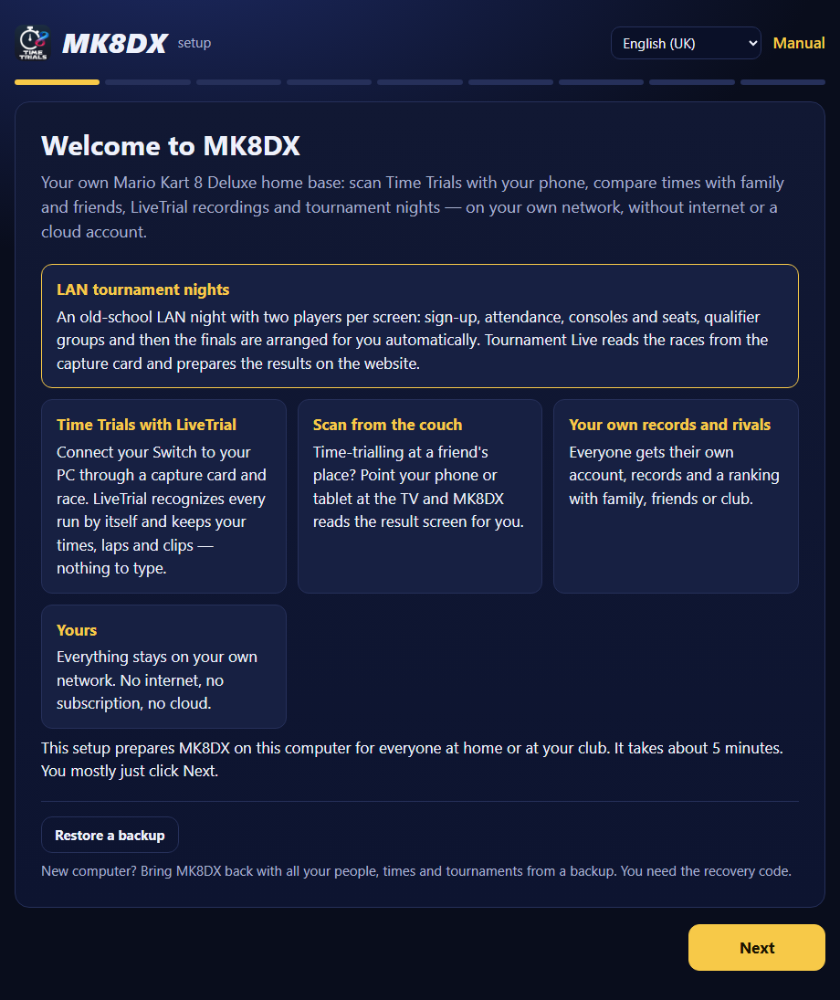
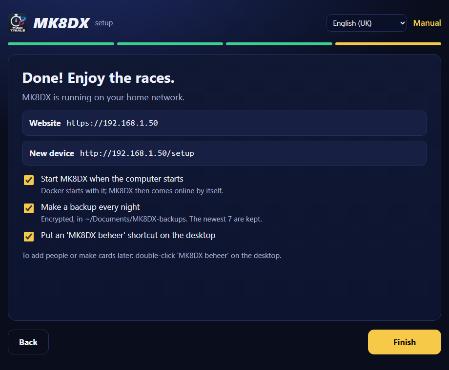

# MK8DX zu Hause oder in deinem Verein — Handbuch

*Dies ist eine maschinelle Übersetzung der [englischen Anleitung](../../A2_HOME_GUIDE_EN.md); maßgeblich ist die englische Fassung. Korrekturen sind willkommen über das Issue-Formular „Translation correction“.*

Dieses Handbuch führt dich Schritt für Schritt von einem leeren Computer bis zu einem gespielten Abend. Du brauchst keine IT-Kenntnisse. Lies die Kapitel der Reihe nach; jedes Kapitel baut auf dem vorherigen auf.

**Zuerst ehrlich gesagt:** Die Installation für zu Hause und den Verein gibt es seit Version 0.2.0. Windows 11 ist von Anfang bis Ende getestet, einschließlich eines Android-Handys im Netzwerk. Linux wurde nur in WSL 2 getestet, noch nicht auf einem eigenen Linux-PC oder einem Raspberry Pi. Die macOS-Pakete sind gebaut, aber noch nicht auf einem echten Mac getestet, und ein iPhone wurde noch nicht getestet. Wo etwas noch nicht getestet oder noch nicht gebaut ist, steht das beim jeweiligen Schritt.

**So liest du einen Schritt:** Nach **Aktion** steht, was du tust, nach **Du siehst**, was dann passieren sollte, und nach **Siehst du etwas anderes?**, was du in diesem Fall tust. Fett gedruckte Wörter sind Schaltflächen oder Texte, die du genau so auf dem Bildschirm siehst. Das Startfenster und einige Systemfenster sind auf Englisch; dort steht die deutsche Bedeutung beim ersten Vorkommen in Klammern.

## 1. Was ist MK8DX zu Hause oder in deinem Verein, und was brauchst du?

MK8DX ist eine Website für Mario Kart 8 Deluxe: Zeitfahren, LiveTrial-Aufnahmen und Turnierabende festhalten und vergleichen. Mit dieser Installation läuft die Website auf einem Computer in deinem eigenen Netzwerk. Handys, Tablets und andere Computer im selben Netzwerk öffnen die Website über diesen Computer. Nichts geht ins Internet.

Jeder meldet sich mit einer persönlichen **Anmeldekarte** an: einer Karte mit einem QR-Code. Ein QR-Code ist ein quadratischer Strichcode, den du mit der Kamera deines Handys oder Tablets scannst.

In diesem Handbuch heißt der Computer, auf dem MK8DX läuft, **der MK8DX-Computer**.

Was du brauchst:

- **Einen Computer, der eingeschaltet bleibt, solange gespielt wird:** Windows 11 mit einem Intel- oder AMD-Prozessor, Linux oder macOS. 8 GB Arbeitsspeicher werden empfohlen. Die Einrichtung prüft, dass mindestens 6 GB Speicherplatz frei sind.
- **Ein Heimnetzwerk:** das WLAN oder die Netzwerkkabel deines Routers. Ein Router ist das Gerät, das dein Netzwerk aufbaut (oft von deinem Internetanbieter). Alle Geräte müssen im selben Netzwerk sein. Benutze kein Gastnetzwerk: Es hält Geräte meistens voneinander getrennt.
- **Handys, Tablets oder andere Computer** für die Spieler, am besten mit einer Kamera zum Scannen von QR-Codes.
- **Ein Drucker** ist praktisch, um Anmeldekarten und den Wiederherstellungscode auszudrucken, aber nicht nötig.

Was du nicht brauchst:

- **Kein Internet beim Spielen.** Nur bei der Vorbereitung lädst du einmal Docker, Python und das MK8DX-Paket herunter (oder jemand gibt sie dir auf einem USB-Stick).
- **Kein Konto bei einer anderen Firma**, keine E-Mail-Adresse und keine Cloud.
- **Kein Abo.** MK8DX und Python sind kostenlos. Docker Desktop ist für die private Nutzung und kleine Organisationen kostenlos; die Bedingungen stehen auf der Website von Docker. Unter Linux benutzt du die kostenlose Docker Engine.

<!-- image: network-overview -->

## 2. Den Computer vorbereiten

MK8DX braucht zwei kostenlose Hilfsprogramme:

- **Docker** führt Programme in abgeschirmten „Containern“ aus. Darin laufen die MK8DX-Website und die Datenbank. Unter Windows und macOS heißt das Programm Docker Desktop.
- **Python** ist eine Programmiersprache. Das MK8DX-Installationsprogramm ist darin geschrieben. Du brauchst Python 3.12 bis 3.15.

Mach nur den Teil für deinen Computer (2A, 2B oder 2C) und überspring die anderen beiden.

## 2A. Windows 11 vorbereiten

1. **Aktion:** Prüfe, welchen Prozessor dein Computer hat: Start → **Settings** (Einstellungen) → **System** → **About** (Info), Zeile **System type** (Systemtyp). → **Du siehst:** „64-bit operating system, x64-based processor“ (64-Bit-Betriebssystem, x64-basierter Prozessor). → **Siehst du etwas anderes?** Steht dort ARM, passt das MK8DX-Paket für Windows nicht: Es gibt es nur für x64 (Intel und AMD).
2. **Aktion:** Installiere zuerst **WSL** (Windows-Subsystem für Linux). Das ist ein Teil von Windows, auf dem Docker läuft; ohne WSL lässt sich Docker Desktop nicht installieren. Klicke mit der rechten Maustaste auf die Start-Schaltfläche und wähle **Terminal (Admin)** (Terminal (Administrator)) oder **Windows PowerShell (Admin)** (Windows PowerShell (Administrator)). Klicke auf **Yes** (Ja), wenn Windows um Erlaubnis fragt. Tippe `wsl --install` und drücke die Eingabetaste. → **Du siehst:** Windows lädt WSL und Ubuntu herunter und installiert sie; das dauert ein paar Minuten. Am Ende steht dort, dass du den Computer neu starten musst. Starte den Computer neu. → **Siehst du etwas anderes?** Öffnet sich nach dem Neustart ein Fenster, das nach einem Benutzernamen und Passwort für Ubuntu fragt: Gib einen Namen und ein Passwort deiner Wahl ein (MK8DX braucht sie nicht) und schließ das Fenster dann. Steht dort, dass WSL schon installiert ist, tippe `wsl --update` und drücke die Eingabetaste. Ist von **Virtualisierung** die Rede („Virtual Machine Platform“ oder „virtualization“), dann ist die Virtualisierung im BIOS des Computers ausgeschaltet; schalte sie ein (Hersteller nennen sie oft Intel VT-x oder AMD-V) oder hol dir Hilfe.
3. **Aktion:** Lade **Docker Desktop** für Windows (x86_64 / AMD64) von docker.com herunter und öffne die heruntergeladene Datei. → **Du siehst:** das Docker-Installationsprogramm mit der Wahl, WSL 2 zu verwenden. WSL ist ein Teil von Windows, auf dem Docker läuft. Lass diese Option angehakt und klicke auf **OK**. → **Siehst du etwas anderes?** Fragt Windows, ob diese App Änderungen vornehmen darf, klicke auf **Yes** (Ja).
4. **Aktion:** Warte, bis die Installation fertig ist, und starte den Computer neu, wenn Docker darum bittet. → **Du siehst:** Nach dem Neustart öffnet sich Docker Desktop (oder öffne es selbst über das Startmenü). Beim ersten Mal bittet Docker dich, seine Bedingungen anzunehmen. → **Siehst du etwas anderes?** Bittet Docker dich, dich anzumelden oder ein Konto anzulegen: MK8DX braucht kein Docker-Konto, überspring das, wenn Docker es anbietet. Meldet Docker weiterhin, dass WSL fehlt oder aktualisiert werden muss, mach Schritt 2 noch einmal (`wsl --install` oder `wsl --update`) und starte neu.
5. **Aktion:** Warte im Fenster von Docker Desktop. → **Du siehst:** **Engine running** (Engine läuft) unten links. → **Siehst du etwas anderes?** „Engine starting“ (Engine startet) kann ein paar Minuten dauern. Hängt es oder erscheint ein Fehler, starte den Computer neu und öffne Docker Desktop erneut. Docker muss im normalen Linux-Container-Modus sein (nicht „Windows containers“).
6. **Aktion:** Geh auf python.org → **Downloads** und lade den **Python install manager** für Windows herunter (die Datei endet auf `.msix`). Das ist inzwischen der offizielle Weg, Python unter Windows zu installieren. Öffne die heruntergeladene Datei und klicke auf **Install** (Installieren). → **Du siehst:** Windows installiert den Python install manager; danach kannst du das Fenster schließen. → **Siehst du etwas anderes?** Du kannst ihn auch aus dem Microsoft Store installieren: Such nach „Python install manager“ und klicke auf **Install** (Installieren). Nimm eins von beiden, nicht beides.
7. **Aktion:** Klicke auf Start, tippe `PowerShell`, öffne **Windows PowerShell**, tippe `py install 3.15` und drücke die Eingabetaste. Damit wird Python selbst installiert (der install manager ist nur das Werkzeug, das Python holt). → **Du siehst:** beim ersten Mal ein paar Fragen zur Prüfung der Einstellungen; beantworte sie mit der Eingabetaste (die vorgeschlagene Wahl) oder `y`. Dann wird Python heruntergeladen und installiert. Eine Frage, ob ein Ordner zu deinem PATH hinzugefügt werden soll, kannst du mit `y` beantworten; nötig ist das nicht. → **Siehst du etwas anderes?** Installiere genau 3.15 wie oben; 3.12, 3.13 oder 3.14 funktionieren auch, eine neuere Version (3.16 oder später) noch nicht.
8. **Aktion:** Schließ PowerShell, öffne es wieder, tippe `python --version` und drücke die Eingabetaste. → **Du siehst:** `Python 3.15` gefolgt von einer Zahl, zum Beispiel `Python 3.15.2`. → **Siehst du etwas anderes?** Öffnet sich der Microsoft Store oder steht dort, dass python nicht gefunden wurde: Klicke auf Start, tippe **Manage app execution aliases** (App-Ausführungsaliase verwalten) und öffne es. Schalte **Python (default)** ein und **App Installer python.exe** und **python3.exe** aus. Hast du früher ein altes Python oder den „Python launcher“ installiert, entferne ihn über **Settings → Apps → Installed apps** (Einstellungen → Apps → Installierte Apps) und versuch es erneut.

<!-- image: docker-engine-running -->

<!-- image: python-install-manager -->

## 2B. Linux vorbereiten (Ubuntu oder Debian)

Linux wurde noch nicht von Anfang bis Ende mit MK8DX getestet. Die Schritte sind für Ubuntu 24.04 oder neuer geschrieben. Du tippst sie in ein **Terminal**: ein Fenster, in dem du Textbefehle eingibst (unter Ubuntu öffnest du es mit Strg+Alt+T). Schließ jeden Befehl mit der Eingabetaste ab. **sudo** vor einem Befehl bedeutet „als Administrator dieses Computers“: Linux fragt dann nach deinem Passwort, und beim Tippen siehst du keine Zeichen. Das ist normal.

1. **Aktion:** Tippe `python3 --version`. → **Du siehst:** `Python 3.12`, `3.13`, `3.14` oder `3.15`. → **Siehst du etwas anderes?** Eine niedrigere Zahl (Debian 12 hat zum Beispiel 3.11) ist zu alt; 3.16 oder höher wird noch nicht unterstützt. Du brauchst dann eine neuere Version deines Linux; Ubuntu 24.04 hat Python 3.12.
2. **Aktion:** Tippe `sudo apt update` und danach `sudo apt install docker.io docker-compose-v2 python3-venv unzip`. Beantworte die Frage, ob du fortfahren willst, mit Y (bzw. J bei deutscher Systemsprache) und der Eingabetaste. → **Du siehst:** Die Pakete werden heruntergeladen und installiert. → **Siehst du etwas anderes?** Findet apt ein Paket nicht, hat es auf deinem Linux einen anderen Namen (das kann bei Debian vorkommen). Mach weiter und prüfe in Schritt 5, ob Docker Compose funktioniert.
3. **Aktion:** Tippe `sudo systemctl enable --now docker`. Damit startet Docker jetzt und bei jedem Start des Computers. → **Du siehst:** keinen Fehler (manchmal eine Zeile, die mit „Created symlink“ beginnt).
4. **Aktion:** Tippe `sudo usermod -aG docker $USER`. Damit bekommt dein Benutzer das Recht, Docker zu benutzen. Melde dich danach ab und wieder an (oder starte neu): Das Recht gilt erst nach einer neuen Anmeldung. → **Du siehst:** keinen Fehler. → **Hinweis:** Wer in der Gruppe docker ist, hat praktisch Administratorrechte auf diesem Computer. Füge nur dich selbst hinzu.
5. **Aktion:** Prüfe mit `docker info` und danach mit `docker compose version`. → **Du siehst:** eine Liste mit Angaben ohne Fehler und „Docker Compose version“ mit einer Nummer. → **Siehst du etwas anderes?** „permission denied“ (Zugriff verweigert): Mach Schritt 4 und vergiss nicht, dich abzumelden. „Cannot connect to the Docker daemon“ (keine Verbindung zum Docker-Dienst): Mach Schritt 3.

Eine **Firewall** ist ein Schutz, der entscheidet, welche Verbindungen ein Computer hereinlässt. Ist auf deinem Linux die Firewall ufw oder firewalld aktiv, zeigt die Einrichtung in Kapitel 3, mit welchem Befehl du MK8DX durchlässt.

## 2C. macOS vorbereiten

**Hinweis:** macOS wurde noch nicht auf einem echten Mac getestet. Die folgenden Schritte richten sich danach, was die Einrichtung unter macOS erwartet.

1. **Aktion:** Wähle Apple-Menü → **About This Mac** (Über diesen Mac) und schau bei **Chip** oder **Processor** (Prozessor). → **Du siehst:** einen Apple-Chip (M1, M2 und neuer): Nimm das Paket `macos-arm64`. → **Siehst du etwas anderes?** Einen Intel-Prozessor: Nimm das Paket `macos-amd64`. Es braucht macOS 10.15 oder neuer und ein Docker Desktop, das deinen Mac noch unterstützt.
2. **Aktion:** Lade **Docker Desktop** für Mac mit dem passenden Chip von docker.com herunter, öffne die heruntergeladene Datei und zieh Docker nach **Applications** (Programme). → **Du siehst:** Docker in deinem Ordner Programme.
3. **Aktion:** Öffne Docker. Nimm die Bedingungen an; fragt macOS nach deinem Passwort, gib es ein. → **Du siehst:** nach einer Weile **Engine running** (Engine läuft) im Fenster von Docker Desktop. → **Siehst du etwas anderes?** Bittet Docker dich, dich anzumelden: MK8DX braucht kein Docker-Konto, überspring das, wenn Docker es anbietet.
4. **Aktion:** Lade das macOS-Installationsprogramm von Python 3.15 von python.org herunter und öffne es. Klicke dich mit **Continue** (Fortfahren) und **Install** (Installieren) durch die Schritte. → **Du siehst:** die Meldung, dass die Installation erfolgreich war.
5. **Aktion:** Öffne **Terminal** (Programme → Dienstprogramme → Terminal), tippe `python3 --version` und drücke die Eingabetaste. → **Du siehst:** `Python 3.12` bis `3.15`. → **Siehst du etwas anderes?** Eine niedrigere Zahl (zum Beispiel 3.9 von Apple selbst): Schließ das Terminal und öffne es wieder. Ist sie immer noch niedriger, installiere Python erneut von python.org.
6. **Aktion:** Tippe `docker info` im Terminal. → **Du siehst:** eine Liste mit Angaben ohne Fehler. → **Siehst du etwas anderes?** Starte Docker Desktop und warte auf Engine running.

## 3. MK8DX installieren

**Das Paket entpacken**

1. **Aktion:** Lade das MK8DX-Paket für zu Hause oder den Verein für dein System herunter: Windows, Linux oder macOS, und für Linux und macOS außerdem für deinen Prozessor (amd64 oder arm64). Um zu prüfen, ob der Download korrekt ist, vergleiche seinen SHA-256-Wert mit seiner Zeile in `SHA256SUMS.txt` aus demselben Release (Windows: `Get-FileHash <file> -Algorithm SHA256`; Linux: `sha256sum <file>`; macOS: `shasum -a 256 <file>`); siehe auch `docs/RELEASE_PACKAGES.md#check-a-download`. → **Du siehst:** eine ZIP-Datei in deinem Ordner Downloads. → **Siehst du etwas anderes?** Warnt der Browser, dass die Datei unsicher ist oder selten heruntergeladen wird: Wähle **Keep** (Beibehalten). Windows: Klicke danach mit der rechten Maustaste auf die ZIP-Datei → **Properties** (Eigenschaften), hake unten **Unblock** (Zulassen) an und klicke auf **OK**. Mach das vor dem Entpacken; sonst kann Windows (Smart App Control, Intelligente App-Steuerung) später `Start-MK8DX-LAN.cmd` blockieren. Schalte Smart App Control nicht aus: Es lässt sich danach nur mit einer Neuinstallation von Windows wieder einschalten.
2. **Aktion:** Entpacke die ZIP-Datei in einen dauerhaften Ordner, zum Beispiel einen Ordner MK8DX in Dokumente. Windows: Klicke mit der rechten Maustaste auf die ZIP-Datei → **Extract All** (Alle extrahieren). Wähle einen dauerhaften Ordner: MK8DX startet später von dort. Lass den aktiven Ordner an diesem Ort; wenn du ihn verschieben musst, nutze das Verfahren in Kapitel 11, statt ihn nur im Explorer zu verschieben. → **Du siehst:** einen Ordner mit unter anderem `Start-MK8DX-LAN.cmd`, `README-FIRST.txt` und den Ordnern `docs`, `images` und `tooling`. → **Siehst du etwas anderes?** Hast du die ZIP-Datei nur im Explorer geöffnet, entpacke sie wirklich: Ein Start aus der ZIP-Datei heraus funktioniert nicht. Linux ohne Dateimanager (ein Server oder WSL): `unzip ~/Downloads/mk8dx-a2-linux-amd64-<version>.zip -d ~/Documents/MK8DX` (mit deinem Dateinamen; `unzip` kommt aus Kapitel 2B, Schritt 2). Die ZIP enthält einen Ordner mit dem Paketnamen; öffne diesen Ordner, um MK8DX zu starten.

<!-- os: windows -->

**Unter Windows starten**

1. **Aktion:** Doppelklicke im entpackten Ordner auf **Start-MK8DX-LAN.cmd**. → **Du siehst:** ein Fenster mit dem MK8DX-Logo und einem 3-2-1-GO-Countdown mit Pieptönen ([so lässt du ihn weg](../../../guides/HOSTING.md#the-launcher-window-look-and-options)), dann Zeilen wie „MK8DX-Paket:“ und „Private Installation:“. Beim ersten Mal zeigt es auch „Die mitgelieferten Python-Pakete werden vorbereitet (einmalig, ohne Internet).“ und „Die mitgelieferten Docker-Images werden geladen. Das kann einige Minuten dauern.“ Das dauert ein paar Minuten. Dann zeigt es „MK8DX setup is open in your browser:“ (Die MK8DX-Einrichtung ist in deinem Browser geöffnet), und die Einrichtung öffnet sich in deinem Browser. → **Siehst du etwas anderes?** Siehe die Meldungen unten.
2. **Aktion:** Lass das schwarze Fenster offen, bis du in der Einrichtung auf **Fertigstellen** geklickt hast. Das Fenster sagt das auch: „Keep this window open until you click Finish.“ (Lass dieses Fenster offen, bis du auf Finish klickst.)

Meldungen im schwarzen Fenster unter Windows:

- **„Python 3.12 bis 3.15 fehlt. Installiere den Python install manager von python.org (oder aus dem Microsoft Store), führe aus: py install 3.15, öffne PowerShell erneut und versuche es noch einmal.“** Mach Kapitel 2A, Schritte 6 bis 8, und doppelklicke dann erneut auf Start-MK8DX-LAN.cmd.
- **„Docker Desktop fehlt oder läuft nicht. Starte Docker Desktop im Linux-Container-Modus, warte, bis "Engine running" angezeigt wird, und versuche es erneut.“** Starte Docker Desktop, warte auf Engine running und doppelklicke erneut.
- Unter einem Fehler steht **„Der gewählte Schritt wurde abgebrochen. Lies die Meldung oben, bevor du es erneut versuchst.“** Lies die Zeile darüber, behebe das Problem und drück eine Taste, um das Fenster zu schließen.

<!-- /os -->

<!-- os: linux macos -->

**Unter Linux und macOS starten**

1. **Aktion:** Öffne ein Terminal im entpackten Ordner. Linux: Klicke mit der rechten Maustaste in den Ordner und wähle „Im Terminal öffnen“, wenn dein Dateimanager das anbietet. Unter macOS und Linux geht auch das: Öffne das Terminal, tippe `cd ` (mit einem Leerzeichen dahinter), zieh den Ordner in das Fenster und drücke die Eingabetaste. → **Du siehst:** Das Terminal ist im Paketordner.
2. **Aktion:** Tippe `sh tooling/start-mk8dx.sh` und drücke die Eingabetaste. → **Du siehst:** das MK8DX-Logo und einen 3-2-1-GO-Countdown, dann „MK8DX-Paket:“, die Python-Nummer, „Docker Compose version“. Beim ersten Mal auch „Die mitgelieferten Docker-Images werden geladen. Das kann einige Minuten dauern.“ und „Die mitgelieferten Python-Pakete werden vorbereitet (einmalig, ohne Internet).“ Dann „Private Installation:“ und „MK8DX setup is open in your browser:“ (Die MK8DX-Einrichtung ist in deinem Browser geöffnet), und die Einrichtung öffnet sich in deinem Browser. → **Siehst du etwas anderes?** Öffnet sich kein Browser, kopiere die Adresse, die mit `http://127.0.0.1:` beginnt, aus dem Terminal in deinen Browser.
3. **Aktion:** Lass das Terminal offen, bis du auf **Fertigstellen** geklickt hast.

Meldungen im Terminal unter Linux und macOS:

- **„Python 3.12 bis 3.15 fehlt. Installiere es (Ubuntu/Debian: sudo apt install python3 python3-venv; macOS: python.org) und versuche es erneut.“** Mach Kapitel 2B oder 2C noch einmal.
- **„Docker läuft nicht oder dieser Benutzer darf es nicht verwenden (Linux: sudo systemctl start docker und tritt der Gruppe docker bei; macOS: starte Docker Desktop).“** Linux: Mach Kapitel 2B, Schritte 3 und 4. macOS: Starte Docker Desktop.
- **„Die private Python-Umgebung konnte nicht erstellt werden (Ubuntu/Debian: sudo apt install python3-venv).“** Installiere python3-venv wie in Kapitel 2B, Schritt 2.

<!-- /os -->

**Die Einrichtung im Browser**

Die Einrichtung ist eine Seite in deinem Browser, die nur auf dem MK8DX-Computer selbst funktioniert. Sie ist in der Sprache deines Browsers (eine der 15 Sprachen des Spiels; sonst auf Englisch). Oben rechts stehen das Sprachmenü, mit dem du eine andere Sprache wählst, und **Handbuch**: Es öffnet dieses Handbuch. Unten stehen **Zurück**, manchmal **Erweitert** und **Weiter**. Die Punkte oben zeigen, wie weit du bist.

1. **Willkommen bei MK8DX.** **Aktion:** Lies den Bildschirm und klicke auf **Weiter**. → **Du siehst:** „Kurzer Check“. Die Schaltfläche **Backup wiederherstellen** auf diesem Bildschirm ist nur für einen neuen Computer (Kapitel 10).
2. **Kurzer Check.** **Aktion:** Warte einen Moment. → **Du siehst:** drei grüne Haken bei **Docker Desktop läuft**, **Genug freier Speicherplatz** (mit der Anzahl GB) und **Windows, Linux oder macOS**. Klicke auf **Weiter**. → **Siehst du etwas anderes?** Ein Ausrufezeichen mit einer Erklärung, zum Beispiel „Starte Docker Desktop, warte auf ‚Engine running‘ und klicke auf Erneut versuchen.“ oder „Gib auf diesem Laufwerk mindestens 6 GB frei.“ Behebe das und klicke auf **Erneut versuchen**. Unter Linux heißt die erste Prüfung ebenfalls „Docker Desktop läuft“; dort geht es um die Docker Engine.
3. **Welche Art von Installation?** **Aktion:** Lass **Netzwerk zu Hause, im Verein oder beim LAN-Abend, kein Internet nötig** (empfohlen) ausgewählt und klicke auf **Weiter**. → **Du siehst:** „Dein Netzwerk“.
4. **Dein Netzwerk.** Eine **Netzwerkadresse** (IP-Adresse) ist die Nummer, über die Geräte diesen Computer in deinem Netzwerk finden, wie eine Hausnummer. **Aktion:** Lies die Adresse unter „Handys, Tablets und andere PCs erreichen MK8DX unter dieser Adresse:“ und schreib sie auf, zum Beispiel `https://192.168.1.50`. Klicke auf **Installieren**. → **Du siehst:** unter Windows „Dieses Netzwerk ist als Heimnetzwerk (privat) eingerichtet.“ oder „Windows behandelt dieses Netzwerk derzeit als öffentlich. Wenn du auf Installieren klickst, stellt MK8DX es auf privat und lässt nur MK8DX durch.“ Unter Linux und macOS wird hier kein Satz zum Netzwerk angezeigt. → **Siehst du etwas anderes?** Hat der Computer mehr als eine Verbindung (Kabel und WLAN), klicke auf **Erweitert** und wähle bei „Wähle eine andere Adresse dieses Computers:“ die Adresse des Netzwerks, in dem auch die Handys sind. Steht dort „Keine Netzwerkadresse gefunden.“, verbinde den Computer mit deinem Heimnetzwerk und klicke auf **Erneut versuchen**.
5. **Installation läuft.** **Aktion:** Warte und lass das Fenster offen. → **Du siehst:** „MK8DX wird eingerichtet. Lass dieses Fenster geöffnet.“ und nacheinander „Installation wird vorbereitet“, „Netzwerk wird freigegeben (Windows fragt nach Erlaubnis)“, „Datenbank und Website werden gestartet“, „Prüfen“ und schließlich „MK8DX läuft. Noch zwei kurze Schritte.“ Klicke auf **Weiter**. Unter Windows fragt ein Windows-Fenster einmal, ob Windows PowerShell Änderungen vornehmen darf: Klicke auf **Yes** (Ja). Damit markiert MK8DX dein Heimnetzwerk als privat und lässt nur MK8DX durch die Firewall (den Schutz von Windows). Wurde MK8DX auf diesem Computer und dieser Adresse schon einmal installiert, besteht diese Erlaubnis noch, und Windows fragt nicht erneut. → **Siehst du etwas anderes?** Ein roter Fehler: Klicke auf **Details**, um zu lesen, was schiefgegangen ist, behebe das und klicke auf **Erneut versuchen**. Hast du im Windows-Fenster auf Nein geklickt, steht dort, dass Windows die Änderung nicht erlaubt hat; klicke auf **Erneut versuchen** und dann auf **Yes** (Ja).
6. **Nur Linux: die Firewall.** **Aktion:** Klicke während oder nach der Installation auf **Details** und such die Zeile, die mit „Network:“ (Netzwerk) beginnt. → **Du siehst:** „not-needed“ (nicht nötig, also nichts zu tun) oder „manual:“ (manuell) gefolgt von einem Befehl wie `sudo ufw allow from 192.168.1.0/24 to 192.168.1.50 port 80,443 proto tcp`. → **Danach:** Tippe genau diesen Befehl (mit deiner Adresse, wie dort angezeigt) in ein Terminal. Ohne diesen Befehl können Handys die Website nicht öffnen.
7. **Dein Administratorkonto.** Der **Administrator** ist die Person, die Leute hinzufügt und Anmeldekarten erstellt; das bist du. **Aktion:** Gib bei **Dein Name** einen Namen ein, zum Beispiel „Papa“ oder „Vereinsteam“, und klicke auf **Weiter**. Der Name ist nur innerhalb dieser Installation sichtbar. → **Du siehst:** „Wer spielt mit?“
8. **Wer spielt mit?** **Aktion:** Tippe die Namen der Spieler bei **Namen (einer pro Zeile)** ein, jeden in eine eigene Zeile, und klicke auf **Hinzufügen**. Oder klicke gleich auf **Überspringen**: Das kannst du später genauso in MK8DX beheer machen (Kapitel 5). → **Du siehst:** die Namen unter „In dieser Installation:“, dich selbst mit „(Administrator)“ hinter deinem Namen. Klicke auf **Weiter**.
9. **Auf Handys und PCs anmelden.** **Aktion:** Du kannst hier schon Anmeldekarten erstellen (Kapitel 5 und 6 erklären, wie), oder klicke einfach auf **Weiter**. → **Du siehst:** „Fertig! Viel Spaß beim Rennen.“
10. **Fertig! Viel Spaß beim Rennen.** **Aktion:** Schreib die beiden Adressen auf: **Website** (zum Beispiel `https://192.168.1.50`) und **Neues Gerät** (zum Beispiel `http://192.168.1.50/setup`). Lass die drei Haken gesetzt: **MK8DX mit Windows starten**, **Jede Nacht ein Backup erstellen** und **Verknüpfung „MK8DX beheer“ auf dem Desktop anlegen**. Klicke auf **Fertigstellen**. → **Du siehst:** deinen Wiederherstellungscode (Kapitel 4). → **Unter Linux und macOS** heißt der erste Haken „MK8DX beim Start des Computers starten“. Unter macOS öffnet er dann Docker Desktop, wenn du dich anmeldest. Unter Linux kümmert sich `sudo systemctl enable --now docker` aus Kapitel 2B darum; hast du das noch nicht gemacht, zeigt die Einrichtung genau diesen Befehl nach Fertigstellen.
11. **Abschließen.** **Aktion:** Lies Kapitel 4 und bewahre den Wiederherstellungscode auf. Klicke dann auf **Schließen**. → **Du siehst:** „Du kannst dieses Fenster jetzt schließen.“ Schließ den Browser-Tab. Unter Windows wartet das schwarze Fenster auf einen Tastendruck; drück eine Taste, und es schließt sich. Tust du nichts, beendet sich die Einrichtungsseite nach 10 Minuten von selbst. MK8DX selbst läuft weiter.

<!-- image: windows-permission -->

## 4. Der Wiederherstellungscode und der Backup-Ordner

Ein **Backup** ist eine Reservekopie von allem in MK8DX: Leute, Zeiten, Turniere und Einstellungen. MK8DX erstellt jede Nacht um 03:00 Uhr ein Backup und behält die neuesten 7. Die Backups sind verschlüsselt: Ohne den Schlüssel lassen sie sich nicht lesen.

Der **Wiederherstellungscode** ist dieser Schlüssel. Er besteht aus fünf Gruppen von vier Buchstaben und Ziffern, zum Beispiel `ABCD-EFGH-JKLM-NPQR-STUV`. Du brauchst ihn nur, um ein Backup auf einem anderen Computer wiederherzustellen.

1. **Aktion:** Schau nach **Fertigstellen** auf die Karte **MK8DX-Wiederherstellungscode**. → **Du siehst:** den Code, den Satz „Ohne diesen Code lässt sich ein Backup nicht öffnen. Er wird nur einmal angezeigt.“ und darunter den Ordner, in den die Backups kommen.
2. **Aktion:** Schreib den Code auf Papier ab oder klicke auf **Karten drucken**, um diese Seite auszudrucken. Prüfe ihn Buchstabe für Buchstabe. → **Du siehst:** den Code auf Papier. → **Warum nur einmal?** MK8DX bewahrt den Code für das nächtliche Backup geschützt auf diesem Computer auf, zeigt ihn aber nie wieder an. Geht der Computer kaputt, bleibt nur das Papier.
3. **Aktion:** Bewahre das Papier an einem sicheren Ort auf, nicht neben dem Computer. Wer den Code und ein Backup hat, kann alles öffnen.

Wo die Backups liegen:

- **Windows:** im Ordner Dokumente, Ordner `MK8DX-backups` (auf dem Laufwerk: `C:\Users\<your name>\Documents\MK8DX-backups`).
- **Linux und macOS:** in deinem Benutzerordner, Ordner `Documents/MK8DX-backups` (also `~/Documents/MK8DX-backups`). Selbst auf einem Linux in einer anderen Sprache heißt dieser Ordner Documents.
- Die Einrichtung zeigt den genauen Ordner unter dem Wiederherstellungscode.

Kopiere den Ordner `MK8DX-backups` ab und zu auf einen USB-Stick oder ein anderes Laufwerk. Sonst liegen die Backups, wenn der Computer kaputtgeht, nur auf diesem kaputten Computer.

Entfernst du den Haken bei **Jede Nacht ein Backup erstellen** und klickst auf **Fertigstellen**, beendet MK8DX das nächtliche Backup; die schon erstellten Backups bleiben erhalten. Setzt du den Haken später wieder, laufen die Backups mit demselben Wiederherstellungscode weiter; er wird nicht noch einmal angezeigt. Hast du den Code nicht mehr, erstelle wie unten einen neuen.

**Ein neuer Wiederherstellungscode**

Erstelle einen neuen Code, wenn jemand anderes deinen gesehen haben könnte oder du den Zettel verloren hast. Das geht ab Version 0.2.7.

1. **Aktion:** Öffne MK8DX beheer, klicke auf **Weiter**, bis „Fertig! Viel Spaß beim Rennen.“ erscheint, setze den Haken bei **Einen neuen Wiederherstellungscode erstellen** und klicke auf **Fertigstellen**. → **Du siehst:** die Karte **MK8DX-Wiederherstellungscode** mit dem neuen Code, der nur einmal angezeigt wird, und den Satz, dass ältere Backups weiterhin den alten Code brauchen.
2. **Aktion:** Schreib den neuen Code auf wie in Schritt 2 oben. Bewahre den alten Zettel bei den älteren Backups auf: Sie werden nicht umgewandelt und lassen sich nur mit dem alten Code öffnen. Lösche diese alten Backups und den alten Zettel, sobald du sie nicht mehr brauchst. → **Du siehst:** die nächsten Backups verwenden den neuen Code.

## 5. Leute und Anmeldekarten (MK8DX beheer)

**MK8DX beheer** (Niederländisch für „MK8DX-Verwaltung“) ist dieselbe Seite wie die Einrichtung, aber für später: Leute hinzufügen und Anmeldekarten erstellen. Sie funktioniert nur auf dem MK8DX-Computer selbst. Die Desktop-Verknüpfung heißt in jeder Sprache „MK8DX beheer“; der Seitentitel ist **MK8DX-Administration**.

Ein **Konto** ist, wer sich anmeldet. Ein **Spieler** ist der Spieler in den Ranglisten, mit seinen Zeiten. Nach der Anmeldung wählt oder beansprucht jeder seinen eigenen Spieler auf der Website. Namen werden nie automatisch verknüpft.

**MK8DX beheer öffnen**

1. **Aktion (Windows):** Doppelklicke auf dem Desktop auf **MK8DX beheer**. Diese Verknüpfung startet dasselbe wie Start-MK8DX-LAN.cmd. → **Du siehst:** das Startfenster mit seinem kurzen Renn-Intro und dann im Browser die Seite mit „Administration“ oben und dem Titel **MK8DX-Administration**. → **Siehst du etwas anderes?** Keine Verknüpfung: Doppelklicke im MK8DX-Ordner auf Start-MK8DX-LAN.cmd.
2. **Aktion (Linux):** Starte **MK8DX beheer** vom Desktop oder aus dem App-Menü. Auf manchen Linux-Desktops musst du ein solches Symbol erst erlauben (klicke mit der rechten Maustaste darauf und wähle die Option, die das Starten erlaubt). Es geht auch mit `sh tooling/start-mk8dx.sh` im MK8DX-Ordner, wie in Kapitel 3. → **Du siehst:** ein Terminal und dann die Seite **MK8DX-Administration**.
3. **Aktion (macOS, nicht getestet):** Doppelklicke auf dem Desktop auf **MK8DX beheer.command** oder starte `sh tooling/start-mk8dx.sh` wie in Kapitel 3. → **Du siehst:** das Terminal und dann die Seite **MK8DX-Administration**.

- **127.0.0.1 mit einem Port selbst eingetippt?** Eine Seite **MK8DX lokaal beheer**, die nach einem einmaligen Verwaltungscode fragt, ist die technische Host-Seite. Die brauchst du nicht: Schließe sie und öffne MK8DX beheer wie oben mit der Verknüpfung.

**Leute hinzufügen**

1. **Aktion:** Tippe die Namen bei **Namen (einer pro Zeile)** ein und klicke auf **Hinzufügen**. → **Du siehst:** die Namen unter „In dieser Installation:“.
2. **Aktion:** Klicke auf **Weiter**. → **Du siehst:** „Auf Handys und PCs anmelden“ in zwei Schritten: **Schritt 1 · Gerät vorbereiten** mit der Karte **Gerät vorbereiten** (einmal pro Gerät, sie meldet dich noch nicht an) und **Schritt 2 · Als die richtige Person anmelden** mit einem Feld für jede Person mit der Schaltfläche **Karte erstellen**.

**Karten erstellen und drucken**

1. **Aktion:** Klicke neben einer Person auf **Karte erstellen**. → **Du siehst:** einen QR-Code mit „Gültig bis“ und einer Uhrzeit. Eine Karte funktioniert einmal und 15 Minuten lang. Lass die Person sie sofort scannen (Kapitel 6) oder drucke sie aus.
2. **Aktion:** Erstelle zuerst die Karten, die du willst, und klicke dann auf **Karten drucken**. → **Du siehst:** das Druckfenster deines Browsers mit jeder Karte auf dem Bildschirm, einschließlich der Karte „Gerät vorbereiten“.
3. **Aktion:** Erstelle auch eine Karte für dich selbst (der Name mit „(Administrator)“), wenn du dich auf deinem Handy anmelden willst.

**Eine Karte ersetzen oder widerrufen**

- **Neue Karte**: erstellt eine neue Karte für diese Person. Die vorherige Karte dieser Person auf diesem Bildschirm funktioniert dann nicht mehr.
- **Karte widerrufen**: Die Karte funktioniert sofort nicht mehr. Du siehst „Widerrufen: Diese Karte funktioniert nicht mehr.“ Nutze das, wenn eine Karte verloren gegangen ist oder bei der falschen Person gelandet ist.
- Du kannst nur eine Karte widerrufen, die noch auf diesem Bildschirm ist. Hast du MK8DX beheer schon geschlossen, läuft eine unbenutzte Karte nach 15 Minuten von selbst ab. Könnte sie schon benutzt worden sein, wähle unten **Überall abmelden**.

**Jemanden überall abmelden**

1. **Aktion:** Öffne MK8DX beheer. Auf dem ersten Bildschirm hat jede Person eine Schaltfläche **Überall abmelden**. Klicke darauf. → **Du siehst:** Die Schaltfläche ändert sich zu **Sicher? Nochmals klicken**.
2. **Aktion:** Klicke noch einmal. → **Du siehst:** „Auf allen Geräten abgemeldet. Mit einer neuen Karte kann sich diese Person wieder anmelden.“ Diese Person ist jetzt auf der Website und in der App abgemeldet, der Wechsel zu diesem Konto mit einem Tippen verschwindet, und offene Karten dieser Person funktionieren nicht mehr. → **Siehst du etwas anderes?** Neben deinem eigenen Namen zeigt der zweite Klick „Dich selbst meldest du über das Kontomenü auf der Website ab (‚Auf allen Geräten abmelden‘).“, und es wird niemand abgemeldet.

**Ein Handy oder Gerät für eine Person hinzufügen**

Der geführte Weg, das Handy, Tablet oder den PC einer Person in Betrieb zu nehmen, auch ein iPhone oder ein Gerät ohne die MK8DX-App.

1. **Aktion:** Öffne MK8DX beheer und klicke neben der Person auf **Handy oder Gerät hinzufügen**. → **Du siehst:** „Ein Handy oder Gerät für … hinzufügen“ mit dem Namen und **1 · Vertrauen** mit der Karte **Gerät vorbereiten** und ihrem kurzen Code.
2. **Aktion:** Auf dem Gerät mit der MK8DX-App (Android): Scanne den QR-Code in der App. Ohne die App (iPhone, iPad, anderes Handy oder PC): Scanne ihn mit der Kamera und folge der Seite, die sich öffnet, um das Zertifikat zu installieren (Kapitel 6). Prüfe, dass die Seite oder die App denselben Code zeigt. Wurde dieses Gerät schon vorbereitet, überspringe das. Klicke auf **Weiter**. → **Du siehst:** **2 · Anmeldekarte scannen** mit der persönlichen Karte dieser Person, „Persönlich für … Funktioniert einmal.“ und einen Countdown wie „Noch 14:59 gültig“.
3. **Aktion:** Scanne diese Karte mit demselben Gerät und nimm dort die Einladung an (Kapitel 6). → **Du siehst:** in MK8DX beheer von selbst innerhalb weniger Sekunden: **3 · Fertig** und „… ist angemeldet“. → **Siehst du etwas anderes?** „Diese Karte ist abgelaufen.“ oder „Diese Karte wurde widerrufen.“: Klicke auf **Neue Karte**; die alte Karte funktioniert nicht mehr, sobald du eine neue erstellst. „Diese Installation kann nicht melden, ob die Karte benutzt wurde“: Sieh auf dem Gerät nach und klicke auf **Hat geklappt**.
4. **Aktion:** Klicke auf **Weiteres Gerät** für ein zweites Gerät derselben Person oder auf **Zurück zu den Personen**.

**Eine Willkommenskarte drucken**

1. **Aktion:** Wähle in „Handy oder Gerät hinzufügen“ bei **Papierformat** **A6** oder **A4** und klicke auf **Willkommenskarte**. → **Du siehst:** eine Vorschau einer Seite, „Willkommen bei MK8DX, …!“, mit der Adresse und drei nummerierten Schritten: 1 Vertrauen (der QR-Code von „Gerät vorbereiten“ und der Prüfcode), 2 Anmeldekarte scannen (der persönliche QR-Code, markiert mit PERSÖNLICH, mit „Gültig bis“) und 3 Fertig.
2. **Aktion:** Klicke auf **Drucken** und danach auf **Zurück**. → **Du siehst:** das Druckfenster deines Browsers nur mit der Willkommenskarte.

- Die Anmeldekarte darauf funktioniert einmal und 15 Minuten lang ab dem Moment, in dem sie erstellt wurde, auch auf Papier. Eine länger gültige Karte kann MK8DX nicht erstellen, drucke sie also erst kurz bevor du sie übergibst. Ohne gültige Karte gedruckt (bei Schritt 1 oder nachdem sie abgelaufen ist), ist Schritt 2 ein leeres Feld: Die Person bekommt dann am Tag selbst eine neue Karte. Der Teil Vertrauen bleibt gültig, bis MK8DX an eine andere Adresse umzieht.

**MK8DX beheer schließen**

1. **Aktion:** Klicke auf **Weiter**, bis „Fertig! Viel Spaß beim Rennen.“ erscheint, lass die Haken gesetzt, klicke auf **Fertigstellen** und dann auf **Schließen**. → **Du siehst:** „Du kannst dieses Fenster jetzt schließen.“ MK8DX läuft weiter.

## 6. Ein Gerät vorbereiten und anmelden

Ein **Zertifikat** ist ein digitaler Identitätsnachweis. Damit weiß ein Handy sicher, dass es mit deinem MK8DX-Computer spricht und mit nichts anderem, und die Verbindung ist verschlüsselt (https). Weil MK8DX ohne Internet funktioniert, erstellt die Einrichtung ihr eigenes Zertifikat. Jedes Gerät muss einmal lernen, ihm zu vertrauen. Der **Fingerabdruck** ist ein kurzer Code, der genau zu diesem Zertifikat gehört; damit prüfst du, dass du das richtige Zertifikat installierst.

**Warum ein Zertifikat, auch zu Hause ohne Internet?**

- **Sicher wissen, dass es dein MK8DX ist.** In einem Heim- oder Vereinsnetzwerk kann jeder im selben WLAN vorgeben, dein MK8DX-Computer zu sein, zum Beispiel ein Gast mit einem Laptop. Ohne Zertifikat kann dein Handy den Unterschied nicht erkennen. Mit dem Zertifikat lehnt der Browser jeden anderen Computer ab.
- **Niemand hört mit.** Anmeldekarten, deine Anmeldesitzung und alles, was du eingibst, gehen verschlüsselt über das WLAN.
- **Warum MK8DX sein eigenes Zertifikat erstellt.** Websites im Internet verwenden Zertifikate von bekannten Ausstellern, die schon auf jedem Gerät hinterlegt sind. Diese stellen keine Zertifikate für eine Heimadresse wie `192.168.1.50` aus und funktionieren nicht ohne Internet. Deshalb erstellt MK8DX bei der Installation sein eigenes Zertifikat, und du sagst jedem Gerät einmal, dass es ihm vertrauen darf.
- **Was du mit der Installation erlaubst.** Das Zertifikat gilt nur für die privaten Netzwerkadressen von MK8DX, und sein geheimer Schlüssel bleibt geschützt auf dem MK8DX-Computer. Installiere nur das Zertifikat deines eigenen MK8DX (prüfe den Fingerabdruck) und entferne es von einem Gerät, wenn du diese Installation nicht mehr nutzt.

**Was funktioniert nicht, wenn du das Zertifikat nicht installierst?**

- Der Browser zeigt bei jedem Besuch eine ganzseitige Warnung wie „Dies ist keine sichere Verbindung“. Du kannst sie wegklicken, aber tu es nicht: Dann siehst du nicht mehr, ob du wirklich mit deinem MK8DX sprichst.
- Auch nach dem Wegklicken funktionieren **Browser-Benachrichtigungen** nicht: Der Browser erlaubt sie nur mit einem vertrauenswürdigen Zertifikat. Andere Browserfunktionen können sich auch verweigern.
- Was ohne installiertes Zertifikat funktioniert: die **Android-App**. Sie lernt das Zertifikat selbst über die Karte **Gerät vorbereiten** (Kapitel 7). Ein Browser auf demselben Gerät braucht das Zertifikat trotzdem.

**Der MK8DX-Computer selbst**

Auch der Computer, auf dem MK8DX läuft, muss MK8DX einmal vertrauen, sonst warnt sein Browser vor der Website.

1. **Aktion:** Öffne MK8DX beheer, klicke auf **Weiter**, bis „Auf Handys und PCs anmelden“ erscheint, und schau auf den Block **Dieser Computer** unter **Schritt 1**. → **Du siehst:** „Dieser Computer vertraut MK8DX bereits.“ Dann bist du fertig. → **Siehst du etwas anderes?** Wird die Schaltfläche **Diesen Computer vorbereiten** angezeigt, geh zu Schritt 2.
2. **Aktion:** Klicke auf **Diesen Computer vorbereiten**. → **Du siehst:** ein Windows-Fenster **Security Warning** (Sicherheitswarnung), das fragt, ob du das Zertifikat installieren willst, mit einem **thumbprint (sha1)** (Fingerabdruck (sha1)). Vergleiche ihn mit dem Fingerabdruck in MK8DX beheer; stimmen sie überein, klicke auf **Yes** (Ja). → **Du siehst:** „Dieser Computer vertraut MK8DX bereits.“ → **Siehst du etwas anderes?** Hast du auf **No** (Nein) geklickt oder unterscheiden sich die Fingerabdrücke: Klicke nicht auf Ja, schließ das Fenster und hol dir Hilfe. Unter Linux oder macOS steht statt der Schaltfläche dort, dass du die Adresse unter „Gerät vorbereiten“ im Browser dieses Computers öffnen sollst; folge dann auf diesem Computer den Schritten unten.

**Einmal pro Gerät: Gerät vorbereiten**

1. **Aktion:** Verbinde das Handy, Tablet oder den PC mit demselben WLAN oder Kabelnetzwerk wie den MK8DX-Computer. Benutze auf einem Handy keine mobilen Daten statt WLAN. → **Du siehst:** den Namen deines eigenen WLANs bei der Verbindung.
2. **Aktion:** Scanne mit der Kamera den QR-Code auf der Karte **Gerät vorbereiten** (in MK8DX beheer oder auf Papier) und tippe auf den Link, der erscheint. Ohne Kamera tippst du die Adresse **Neues Gerät** in den Browser, zum Beispiel `http://192.168.1.50/setup`. → **Du siehst:** die Seite **Dieses Gerät vorbereiten** mit „Mach das einmal pro Handy, Tablet oder PC. Scanne danach deine persönliche Anmeldekarte.“ → **Siehst du etwas anderes?** Öffnet sich die Seite nicht: Prüfe das Netzwerk und ob der MK8DX-Computer eingeschaltet ist (Kapitel 11).
3. **Aktion:** Vergleiche den Code unter „Prüfe zuerst diesen Code.“ mit dem **Fingerabdruck** auf der Karte „Gerät vorbereiten“ (vier Gruppen zu vier Zeichen). → **Du siehst:** genau denselben Code. → **Siehst du etwas anderes?** Ist der Code anders, installiere nichts. Du bist vielleicht in einem anderen Netzwerk oder unter einer anderen Adresse; prüfe das zuerst.
4. **Aktion:** Folge dem Teil für dein Gerät. Der Teil für das Gerät, das du gerade benutzt, ist schon geöffnet; für ein anderes Gerät öffnest du ihn unter „Ein anderes Gerät?“. Tippe auf **Zertifikat herunterladen** (bei iPhone und iPad: **Profil herunterladen**) und folge den Schritten unten. Die Datei heißt `MK8DX-<Prüfcode>-<Datum>.crt`. Wenn Chrome vor einem unsicheren Download warnt, wähle **Behalten** erst, nachdem der Code mit der Karte übereinstimmt. → **Du siehst:** unten „Fertig? Scanne deine persönliche Anmeldekarte oder öffne“ mit der Adresse der Website.

Die Schritte auf der Seite „Dieses Gerät vorbereiten“:

<!-- filter: device -->

- **Android:** Tippe auf die Schaltfläche, um das Zertifikat herunterzuladen. Öffne die Einstellungen und such nach „Zertifikat“ (oft: Sicherheit → Weitere Sicherheitseinstellungen → Verschlüsselung und Anmeldedaten → Zertifikat installieren → CA-Zertifikat). Wähle die heruntergeladene MK8DX-Datei und bestätige mit deiner PIN. Die Menünamen unterscheiden sich je nach Handymarke.
- **iPhone und iPad (mit dieser Installation noch nicht getestet):** Tippe auf die Schaltfläche, um das Profil herunterzuladen, und erlaube es. Öffne Einstellungen → Profil geladen → Installieren. Dann Einstellungen → Allgemein → Info → Zertifikatsvertrauenseinstellungen → MK8DX einschalten.
- **Windows:** Lade das Zertifikat herunter und öffne es. Wähle Zertifikat installieren → Aktueller Benutzer → Alle Zertifikate in folgendem Speicher speichern → Vertrauenswürdige Stammzertifizierungsstellen. Wähle nicht Zwischenzertifizierungsstellen. Starte den Browser neu.
- **Mac (macOS ist noch nicht von Anfang bis Ende getestet):** Lade das Zertifikat herunter und öffne es; die Schlüsselbundverwaltung öffnet sich. Öffne das MK8DX-Zertifikat → Vertrauen → Immer vertrauen.
- **Linux (dieser Weg ist noch nicht von Anfang bis Ende getestet):** Füge dasselbe Zertifikat dem vertrauenswürdigen Stammzertifikatsspeicher deiner Distribution oder deines Browsers hinzu. Die genauen Schritte unterscheiden sich je nach Distribution. Unter Ubuntu und Debian (getestet in WSL 2): Die heruntergeladene `MK8DX-*.crt` liegt im DER-Format vor, wandle sie also beim Installieren um: `sudo openssl x509 -inform DER -in ~/Downloads/MK8DX-*.crt -out /usr/local/share/ca-certificates/mk8dx.crt` und danach `sudo update-ca-certificates`. Firefox und Chrome unter Linux haben eventuell einen eigenen Speicher; importiere dieselbe Datei dort in den Zertifikatseinstellungen (Zertifizierungsstellen), wenn der Browser weiterhin warnt.

<!-- /filter -->

**Mit deiner persönlichen Karte anmelden**

1. **Aktion:** Scanne deine eigene Karte (die Karte mit deinem Namen) und tippe auf den Link. → **Du siehst:** **Dieser MK8DX-Installation beitreten** und „Prüfe zuerst, ob diese HTTPS-Adresse zu dem Host gehört, dem du vertraust. Die Einladung kann einmal verwendet werden.“ Die Adressleiste des Browsers muss die Adresse der Website zeigen, zum Beispiel `https://192.168.1.50`. → **Siehst du etwas anderes?** Eine Browserwarnung zum Zertifikat oder zu einer unsicheren Verbindung: Klick sie niemals weg. Mach zuerst „Gerät vorbereiten“ wie oben.
2. **Aktion:** Prüfe den Namen der Karte unter **Du meldest dich an als:**. Ist es dein Name, warte auf „Einladung bereit. Bestätige, um dich anzumelden.“ und tippe auf **Einladung annehmen**. Steht dort ein anderer Name, tippe nicht auf Annehmen: Die Karte bleibt für die richtige Person gültig. → **Du siehst:** „Du bist angemeldet als“ mit deinem Namen und **Weiter zu MK8DX**. Tippe darauf. → **Siehst du etwas anderes?** „Diese Einladung ist ungültig. Bitte den Administrator um einen neuen QR-Code.“ oder „Anmeldung fehlgeschlagen. Bitte den Administrator um eine neue Einladung.“: Die Karte wurde schon benutzt, ist abgelaufen oder wurde widerrufen. Lass den Administrator eine **Neue Karte** erstellen.
3. **Aktion:** Folge den Willkommensschritten auf der Website: ob du hier schon Zeiten oder Turniere hast und wie du heißen willst. So wählst oder beanspruchst du deinen eigenen Spieler. → **Du siehst:** deinen Namen und deine Zeiten. → **Siehst du etwas anderes?** Ist der Name auf deiner Karte (zum Beispiel „Papa“) nicht schon eingetragen: Das ist richtig. Der Name auf der Karte ist nur die Bezeichnung in der MK8DX-Administration; deinen Spielernamen wählst du hier selbst.

**Ein weiteres Gerät für dieselbe Person**

- Ein Spieler kann selbst eine Karte erstellen: Das Kontomenü auf der Website hat **Auch auf einem anderen Gerät anmelden**. Es öffnet **Auf einem anderen Gerät anmelden** mit einer Karte, die „Funktioniert einmal, gültig bis“ zu einer Uhrzeit. Scanne sie mit dem anderen Gerät. Zeig sie nur deinem eigenen Gerät: Wer sie scannt, ist in deinem Konto angemeldet.
- Administratoren haben diese Schaltfläche nicht. Sie erstellen sich in MK8DX beheer eine **Neue Karte**.
- Ein neues Gerät macht immer zuerst einmal „Gerät vorbereiten“.
- **Keine Kamera, oder Anmeldung auf dem MK8DX-Computer selbst?** Erstelle die Karte dieser Person in MK8DX beheer und klicke auf **Auf diesem Computer anmelden** (öffnet die Anmeldeseite im Browser des MK8DX-Computers) oder **Link kopieren**. Schick einen kopierten Link nur an die Person selbst, zum Beispiel in einer privaten Nachricht: Wer ihn öffnet, kann sich als diese Person anmelden. Er funktioniert einmal und 15 Minuten lang. Auf der Karte „Gerät vorbereiten“ kopiert **Adresse kopieren** die Adresse; sie ist nicht geheim.

**Diese Installation auf einem Gerät verlassen:** Entferne das Zertifikat wieder in denselben Einstellungen, in denen du es installiert hast.

## 7. Die Android-App und LiveTrial

**Die Android-App koppeln**

Verwende die aktuelle Android-App aus dem Release. Die A2-Einrichtung hat drei Schritte: **Verbinden**, **Diesem Gerät vertrauen** und **Anmelden**. Die App prüft beim Scannen der Karte „Gerät vorbereiten“ ihre eigene Verbindung. Für die Website im Browser muss auch Android selbst das Zertifikat als CA-Zertifikat vertrauen. Die App hilft bei der Installation. Die persönliche Anmeldekarte wird direkt in der App gescannt; Browserfreigabe und Gerätecode sind dafür nicht nötig.

1. **Aktion:** Öffne die App. Bei einer neuen Installation startet sie mit **Wähle deine Community**; sonst tippe oben in der App auf den Namen der Community und dann auf **Eine Community hinzufügen**. → **Du siehst:** **Wähle deine Community** mit den Feldern **Zu Hause oder im Verein** und **Online-Community**. Tippe unter **Zu Hause oder im Verein** auf **QR-Code scannen**.
2. **Aktion:** Tippe bei Bedarf auf **Kamera verwenden** und erlaube die Kamera. Scanne den QR-Code auf der Karte **Gerät vorbereiten**. → **Du siehst:** **Prüfe, ob das deine Installation ist** mit dem kurzen **Code** und der **Adresse**. Die längeren Fingerabdrücke stehen unter **Vollständige Fingerabdrücke**. → **Siehst du etwas anderes?** „Das ist nicht der QR-Code einer „Gerät vorbereiten“-Karte.“ : Du hast eine persönliche Karte gescannt. Scanne die Karte „Gerät vorbereiten“. Klappt das Scannen nicht: Klicke auf dem MK8DX-Computer in MK8DX beheer auf der Karte **Gerät vorbereiten** auf **Adresse kopieren**, schick diesen Link an das Handy (er ist nicht geheim), füge ihn bei **Oder den Setup-Link einfügen** ein und tippe auf **Weiter**. Nur die kurze Adresse „Neues Gerät“ (zum Beispiel `http://192.168.1.50/setup`) einzutippen reicht nicht: Die App braucht auch den Schlüssel-Fingerabdruck, der im QR-Code und im kopierten Link steckt, und meldet „Das ist nicht der QR-Code einer „Gerät vorbereiten“-Karte.“
3. **Aktion:** Vergleiche Adresse und 16-stelligen Installationscode mit der Karte **Gerät vorbereiten** und der Vorbereitungsseite. Unter **Vollständige Fingerabdrücke** findest du die längeren Zertifikat- und Schlüsselfingerabdrücke. Stimmen die Codes überein, tippe auf **Verbinden**. Bei unterschiedlichen Codes gehe zurück und verbinde dich nicht. → **Du siehst:** Codes stimmen überein. → **Siehst du etwas anderes?** Bei Abweichungen gehe zurück und bitte um Hilfe.
4. **Aktion:** Tippe im nächsten Schritt auf **Zertifikat speichern**, dann auf **Einstellungen öffnen** und installiere die gespeicherte `.crt`-Datei als CA-Zertifikat (Kapitel 6). Kehre zur App zurück und tippe bei Bedarf auf **Erneut prüfen**. Wenn das Handy der Installation vertraut, tippe auf **Anmeldekarte scannen**. Scanne deine persönliche Karte, prüfe den angezeigten Namen und bestätige. Die App zeigt die Anmeldung und **Fertig**. Ist die Karte abgelaufen oder benutzt, bitte um eine neue. Mit **Später** erscheinen offene Schritte beim nächsten Start wieder. → **Du siehst:** Das Telefon vertraut dem Zertifikat. → **Du siehst:** Die App zeigt deinen Namen und „Fertig“. → **Siehst du etwas anderes?** Bei Abweichungen gehe zurück und bitte um Hilfe.
5. **Aktion:** Poste eine Zeit in der App. → **Du siehst:** die Zeit auf der Website der Installation.

Entkoppeln: Tippe oben auf den Namen der Community → **Eine Community hinzufügen** → **Diese Installation vergessen**.

Verein und Zuhause in einer App: Die App kann mehrere Communities enthalten. Tippe oben auf den Namen der Community und dann auf **Community wechseln**; jede Community behält ihr eigenes Konto und ihre ungesendeten Zeiten. Deine eigenen Zeiten findest du unter deinem Namen → **Meine Zeiten**, auch wenn das Handy den MK8DX-Computer nicht erreichen kann.

**LiveTrial auf einem zweiten Windows-PC**

LiveTrial ist ein Windows-Programm, das deine Zeitfahren über eine Capture-Karte erkennt und festhält (ein Gerät, das das Bild deiner Switch an den PC schickt). Wie du LiveTrial selbst installierst, steht in Kapitel 6 von `docs/install/MK8DX_User_Guide_EN.txt`. Getestet auf einer Testinstallation mit LiveTrial 3.37.0. Die Schritte in Kürze:

1. Lass diesen PC zuerst der Installation vertrauen: Kapitel 6, Teil Windows. Prüfe, dass sich die Website im Browser ohne Warnung öffnet.
2. Sorge dafür, dass dein Konto auf der Website einen **Spieler** hat.
3. Öffne LiveTrial, klicke auf das Zahnrad (**Einstellungen**) und gib bei **Adresse der Community-Website** die Adresse der Website ein, zum Beispiel `https://192.168.1.50`.
4. Klicke auf **Anmelden** und wähle **Genehmigungsseite öffnen**. Bestätige das Gerät im Browser.
5. Sende Läufe mit **Jetzt senden** oder schalte in den Einstellungen **Neue Läufe automatisch senden** ein.

Gut zu wissen: Ohne Spieler endet die Anmeldung in LiveTrial mit einer Meldung, dass du zuerst deinen Spieler auf der Website einrichten sollst. Nachdem du die Adresse geändert hast, startet LiveTrial neu; tut es das nicht, beende es und öffne es erneut. Konten und wartende Läufe für einen anderen Server bleiben bei diesem Server. Wenn du diesen PC nicht mehr mit der Installation nutzt, entferne das MK8DX-Zertifikat wieder aus **Vertrauenswürdige Stammzertifizierungsstellen** (Kapitel 6).

## 8. Alltag

**Der MK8DX-Computer muss eingeschaltet sein.** Solange jemand spielen will, muss der MK8DX-Computer eingeschaltet, wach und mit dem Netzwerk verbunden sein. Schalte den Energiesparmodus während eines Spielabends am besten aus. Docker muss laufen; unter Windows und macOS startet Docker Desktop von selbst, wenn du dich anmeldest (Kapitel 10).

**Ein Handy oder Tablet für die ganze Familie**

- Jeder meldet sich einmal mit seiner eigenen Karte auf diesem Gerät an.
- **Website:** Danach wechselst du mit einem Tippen über das Kontomenü: Wähle **Konto wechseln** und dann die Person.
- **PIN:** Jeder kann auf der Website unter **Einstellungen** → **PIN zum Kontowechsel** eine 4-stellige PIN festlegen. Der Wechsel zu diesem Konto fragt dann zuerst nach dieser PIN.
- **Android-App:** Tippe oben auf deinen Namen → **Spieler wechseln** (oder **Einstellungen** → **Spieler auf diesem Handy**) und wähle die Person mit **Spieler wechseln**. Hat diese Person eine PIN, fragt die App **PIN erforderlich** und **PIN (4 Ziffern)**. Eine falsche PIN ergibt „Diese PIN stimmt nicht.“
- **Administratoren** stehen nur in dieser Liste, wenn sie eine PIN festgelegt haben (Einstellungen → PIN zum Kontowechsel). Ohne PIN melden sie sich neu mit einer Karte an. Für einen Administrator gilt es strenger: Nach der 5. falschen PIN verschwindet das Administratorkonto von diesem Gerät, ebenso nach 14 Tagen ohne Nutzung; dann ist wieder eine Karte nötig. In der Android-App stehen Administratoren (noch) nicht in der Liste.

**Abmelden**

- Auf der Website über das Kontomenü oben rechts: **Abmelden** (nur dieses Gerät) oder **Auf allen Geräten abmelden**.
- Jemand anderen überall abzumelden, macht der Administrator in MK8DX beheer mit **Überall abmelden** (Kapitel 5).

**Karte verloren oder Handy verloren**

- Verlorene Karte, die noch nicht benutzt wurde: **Karte widerrufen**, wenn sie noch auf dem Bildschirm in MK8DX beheer ist; sonst läuft sie nach 15 Minuten von selbst ab.
- Handy verloren, oder eine Karte könnte schon benutzt worden sein: Wähle in MK8DX beheer neben dieser Person **Überall abmelden** und klicke noch einmal. Gib der Person dann eine **Neue Karte**.

**Hell oder dunkel:** Auf einem neuen Gerät folgt die Website der Einstellung **System** dieses Geräts. Wähle nach der Anmeldung **Konto** → **Einstellungen** → **Darstellung** → **Dunkel** für das dunkle Aussehen; diese Wahl wird mit deinem Konto gespeichert.

**Ein Name für deine Community:** Ein Administrator kann der Installation auf der Website unter **Verwaltung** → **Installationseinstellungen** → **Community-Name** einen Namen geben, zum Beispiel „Club Noord“, und auf **Namen speichern** klicken. Die Apps zeigen dann diesen Namen statt der Webadresse. Lass das Feld leer und speichere, um den Namen wieder zu entfernen.

**Zeiten aus anderen Communitys:** Wer auch in einer anderen Community spielt (einem anderen Verein oder einer Website im Internet), kann seine Zeiten über die Android-App hierher mitnehmen. Ein Administrator wählt auf der Website unter **Verwaltung** → **Installationseinstellungen** → **Zeiten aus anderen Communitys**: **Aus** (die Standardeinstellung: solche Zeiten werden abgelehnt), **Mit Freigabe** (jede mitgenommene Zeit bleibt unsichtbar, bis ein Administrator unter **Verwaltung** → **Zeitfahren** daneben auf **Veröffentlichen** klickt) oder **Erlaubt**. Eine mitgenommene Zeit zeigt immer, woher sie stammt.

## 9. Ein Turnierabend

Dieses Kapitel ist nur ein Überblick. Die eigentlichen Schritte stehen in den unten genannten Handbüchern. Einen Turnierabend führst du auf der Website deiner Installation durch; der **Turnierleiter** (Director) ist die Person, die den Abend leitet.

- **Der Abend auf der Website:** Die Schritte 0 bis 10 (Teilnehmer und Anwesenheit, Konsolen, Gruppen und Plätze, Punkte, Finale und Abschluss) stehen in `docs/guides/TOURNAMENT_DIRECTORS.md` (im Repository auf GitHub; nicht im Paket) und in Kapitel 6 „Use Android, LiveTrial, the scanner, and Tournament“ (Android, LiveTrial, den Scanner und Tournament nutzen) von `docs/install/MK8DX_User_Guide_EN.txt` (im Paket).
- **Tournament Live:** ein Windows-Programm, das die Rennen von einer Capture-Karte liest. Siehe `docs/product/README_TOURNAMENT_LIVE_LAPTOP.md` im Repository.
- **Tournament Processor:** liest ein aufgenommenes Video (.mp4 oder .mkv) und macht daraus Excel-, CSV- und Ergebnisdateien. Siehe `docs/product/README_TOURNAMENT_PROCESSOR_FALLBACK_LAPTOP.md` und `docs/product/USING_MK8DX_TOURNAMENT_TOOLS.md` im Repository.
- **Excel oder CSV als Ausweichlösung:** Auf der Website kannst du Punkte auch von Hand eingeben oder aus einer Excel-/CSV-Datei importieren. Dafür brauchst du kein zusätzliches Programm.
- **Die Erkennung macht ein Ergebnis nie von selbst offiziell.** Der Turnierleiter prüft und bestätigt jedes Rennen.
- **Noch nicht getestet:** Die Verbindung der Tournament Tools mit einer Installation zu Hause oder im Verein ist noch nicht beschrieben oder getestet. Ergebnisdateien aus dem Processor oder aus Tournament Live kannst du über die Website importieren.

## 10. Backups, ein neuer Computer, eine neue Adresse, Neustarts und Updates

**Backups aufbewahren**

1. **Aktion:** Steck ab und zu einen USB-Stick in den MK8DX-Computer und kopiere den ganzen Ordner `MK8DX-backups` (Kapitel 4) darauf. → **Du siehst:** auf dem Stick einen Ordner `MK8DX-backups` mit Ordnern, die mit einem Datum beginnen, zum Beispiel `20261111-030000`.
2. **Aktion:** Bewahre den Stick und das Papier mit dem Wiederherstellungscode an verschiedenen Orten auf.

**Auf einem neuen Computer wiederherstellen**

Das funktioniert nur auf einem Computer, auf dem MK8DX noch nicht installiert ist.

1. **Aktion:** Bereite den neuen Computer wie in Kapitel 2 vor. → **Du siehst:** Docker läuft und Python funktioniert.
2. **Aktion:** Kopiere den Ordner `MK8DX-backups` von deinem USB-Stick in den Ordner Dokumente (Windows) oder `~/Documents` (Linux und macOS). Oder lass den USB-Stick eingesteckt. → **Du siehst:** den Ordner `MK8DX-backups` auf dem neuen Computer oder auf dem Stick.
3. **Aktion:** Entpacke das MK8DX-Paket und starte es wie in Kapitel 3. Klicke auf dem Willkommensbildschirm auf **Backup wiederherstellen**. → **Du siehst:** „Kurzer Check“ und dann **Backup wiederherstellen** mit „Wähle das Backup und gib den Wiederherstellungscode ein, den du bei der ersten Installation notiert hast.“
4. **Aktion:** Wähle das Backup (das neueste steht oben, mit Datum und Uhrzeit). → **Siehst du etwas anderes?** „In diesem Ordner ist kein MK8DX-Backup.“ (diese Meldung nennt den Windows-Ordner, auch unter Linux und macOS): Tippe den Ordner mit den Backups bei **Anderer Ordner (zum Beispiel ein USB-Stick):** ein und klicke auf **Suchen**. Dieses Feld erscheint auch, wenn du auf **Erweitert** klickst.
5. **Aktion:** Tippe deinen Code vom Papier bei **Wiederherstellungscode** ein. Leerzeichen, Kleinbuchstaben oder weggelassene Bindestriche spielen keine Rolle. Klicke auf **Weiter**. → **Du siehst:** „Dein Netzwerk“. Die Schaltfläche Weiter funktioniert erst, wenn der ganze Code eingegeben ist.
6. **Aktion:** Prüfe die Adresse wie in Kapitel 3 und klicke auf **Wiederherstellen**. → **Du siehst:** „Backup wird geöffnet und wiederhergestellt“ und dann „MK8DX läuft wieder, mit allem aus dem Backup.“ Unter Windows fragt Windows noch einmal um Erlaubnis: Klicke auf **Yes** (Ja). → **Siehst du etwas anderes?** „Dieser Wiederherstellungscode öffnet das Backup nicht. Prüfe den Code und versuche es erneut.“: Klicke zweimal auf **Zurück**, bis du wieder beim Wiederherstellungscode bist, korrigiere den Code (oder wähle ein anderes Backup) und versuch es erneut.
7. **Aktion:** Klicke dich mit **Weiter** durch MK8DX beheer, bis „Fertig! Viel Spaß beim Rennen.“ erscheint, und klicke auf **Fertigstellen**. → **Du siehst:** „Neue Backups verwenden denselben Wiederherstellungscode wie bisher.“ Dein Code auf Papier bleibt gültig.
8. **Nach der Wiederherstellung:** Alle Leute, alle Zeiten, Turniere und Einstellungen sind wieder da. Handys und PCs vertrauen MK8DX weiterhin. Hat der neue Computer eine andere Adresse, scannt jeder einmal die Karte **Gerät vorbereiten** und meldet sich erneut an; koppel Apps erneut (Kapitel 7).

**Eine andere Netzwerkadresse**

Dein Router gibt dem MK8DX-Computer seine Adresse. Meistens bleibt sie gleich, aber das ist nicht garantiert: Nach einem neuen Router, einem Stromausfall oder wenn der Computer lange aus war, oder in einem anderen Netzwerk (zum Beispiel im Verein) kann sich die Adresse ändern. Dann muss MK8DX umziehen, und alle scannen die Karte erneut. Eine feste Adresse verhindert das.

**Dem Computer eine feste Adresse geben (empfohlen, einmalig)**

Eine feste Adresse richtest du am besten im Router ein, mit einer **DHCP-Reservierung**: Der Router hält dann eine Adresse für diesen Computer frei und gibt sie nie einem anderen Gerät.

1. **Aktion:** Finde die Adresse und die physische Adresse des Computers. Windows: Öffne die **Eingabeaufforderung**, tippe `ipconfig /all` und drücke die Eingabetaste. Linux: Tippe `ip -br addr` und `ip -br link`. → **Du siehst:** für die Verbindung, die du benutzt (**WLAN** bzw. **Wi-Fi** oder **Ethernet**), eine **IPv4-Adresse** (zum Beispiel `192.168.1.50`) und eine **Physische Adresse** (auch MAC-Adresse genannt, zum Beispiel `3C-52-82-AB-CD-EF`). Kabel und WLAN haben jeweils ihre eigene physische Adresse: Nimm die der Verbindung, die der Computer wirklich benutzt (am besten ein Kabel).
2. **Aktion:** Öffne die Einstellungen deines Routers im Browser. Die Adresse und das Passwort stehen oft auf einem Aufkleber am Router (zum Beispiel `192.168.1.1` oder `192.168.0.1`).
3. **Aktion:** Such die Reservierung. Der Name unterscheidet sich je nach Marke, zum Beispiel „DHCP-Reservierung“, „Adressreservierung“, „Statische IP“, „Static lease“ oder „Diesem Netzwerkgerät immer die gleiche IPv4-Adresse zuweisen“. Sie steht meistens unter **LAN**, **Netzwerk**, **DHCP** oder **Heimnetz**, neben der Liste der verbundenen Geräte.
4. **Aktion:** Wähle den MK8DX-Computer in der Liste (oder gib seine physische Adresse ein), behalte seine **aktuelle** Adresse und speichere. → **Du siehst:** Der Computer steht in der Liste der Reservierungen.
5. **Aktion:** Starte den Computer neu und prüfe mit `ipconfig`, dass die Adresse gleich geblieben ist. Ist es die Adresse, die MK8DX schon benutzt, musst du nichts weiter tun. Hast du im Router eine andere Adresse gewählt, zieh MK8DX wie unten beschrieben um.

**Einen Adresskonflikt vermeiden**

Ein Adresskonflikt entsteht, wenn zwei Geräte dieselbe Adresse benutzen. Eines davon (manchmal der MK8DX-Computer) ist dann ab und zu oder ständig nicht erreichbar; Windows meldet manchmal „Es besteht ein IP-Adressenkonflikt“.

- Benutze eine Reservierung im Router, keine Adresse, die du selbst in den Netzwerkeinstellungen von Windows oder Linux eintippst. Der Router kennt eine eingetippte Adresse nicht: Er kann sie später einem Handy oder einer Konsole geben.
- Kommst du nicht an den Router heran (zum Beispiel im Verein) und muss es von Hand sein: Wähle eine Adresse außerhalb des Bereichs, den der Router vergibt (der „DHCP-Pool“; vergibt der Router `192.168.1.100` bis `192.168.1.199`, wähle zum Beispiel `192.168.1.50`) und prüfe zuerst, dass niemand sie benutzt: `ping 192.168.1.50` darf keine Antwort bekommen. Übernimm Subnetzmaske, Gateway und DNS, die der Router vergeben hat. Frag am besten die Person, die dieses Netzwerk verwaltet.
- Lass in einem Netzwerk nur ein Gerät Adressen vergeben. Zwei Router hintereinander (zum Beispiel das Modem deines Anbieters und dein eigener WLAN-Router) sind zwei Netzwerke: Bring den MK8DX-Computer und alle Handys in dasselbe Netzwerk oder schalte den zweiten Router in den **Access-Point-Modus**.
- Nach einem Konflikt: Gib dem anderen Gerät eine andere Adresse (oder dem MK8DX-Computer eine Reservierung) und öffne MK8DX beheer. Siehst du **Dieser Computer hat eine neue Netzwerkadresse**, folge den Schritten unten.

**Auf eine neue Adresse umziehen**

1. **Aktion:** Hat der Computer trotzdem eine andere Adresse bekommen, öffne **MK8DX beheer** (Kapitel 5). → **Du siehst:** **Dieser Computer hat eine neue Netzwerkadresse** mit „MK8DX lief unter“ der alten Adresse und darunter der neuen Adresse.
2. **Aktion:** Klicke auf **Verschieben**. Mit **Erweitert** kannst du bei Bedarf eine andere Adresse wählen. → **Du siehst:** „Umzug zur neuen Adresse (Windows fragt nach Erlaubnis)“; klicke im Windows-Fenster auf **Yes** (Ja). Dann „MK8DX läuft unter der neuen Adresse.“
3. **Aktion:** Klicke auf **Weiter** und mach weiter wie in MK8DX beheer. Lass Handys und PCs einmal die Karte **Gerät vorbereiten** scannen und sich erneut anmelden; koppel Apps erneut. Sie vertrauen MK8DX weiterhin; die Karte „Gerät vorbereiten“ hat jetzt die neue Adresse.

**Nach einem Neustart des Computers**

- **Windows:** Die Aufgabe „MK8DX start“ startet Docker Desktop, sobald du dich bei Windows anmeldest; MK8DX geht dann von selbst online. Es muss sich also jemand anmelden: Steht der Computer nach einem Windows-Update am Anmeldebildschirm, ist MK8DX erst nach der Anmeldung wieder erreichbar.
- **Linux:** Die Docker Engine startet beim Hochfahren des Computers (dank `sudo systemctl enable --now docker` aus Kapitel 2B), und MK8DX kommt von selbst mit.
- **macOS (nicht getestet):** Eine Anmeldeaufgabe öffnet Docker Desktop, wenn du dich anmeldest.

**Nächtliche Aufgaben**

- Um 03:00 Uhr erstellt MK8DX das Backup. Um 03:30 Uhr erneuert MK8DX bei Bedarf sein eigenes Zertifikat; davon merkst du nichts.
- **Windows:** War der Computer aus oder im Energiesparmodus, laufen verpasste Aufgaben so bald wie möglich danach. Das Backup wartet dann, bis Docker läuft.
- **Linux:** Die Aufgaben laufen unter deinem Benutzer. Eine verpasste Aufgabe läuft trotzdem, sobald du wieder angemeldet bist.
- **macOS (nicht getestet):** Eine verpasste Aufgabe läuft, sobald der Mac aus dem Ruhezustand aufwacht.

**Updates**

1. **Aktion:** Lade das neue MK8DX-Paket herunter und entpacke es in einen **neuen** Ordner, genau wie in Kapitel 3 (einschließlich Zulassen). Behalte den alten Ordner vorerst. Wähle einen dauerhaften Ordner statt Downloads: Backup-Aufgabe, Zertifikatserneuerung und Desktop-Verknüpfung zeigen später auf diesen Paketordner. Die ZIP-Datei enthält bereits einen Hauptordner; öffne ihn, um `Start-MK8DX-LAN.cmd` zu finden. → **Du siehst:** einen zweiten Ordner mit `Start-MK8DX-LAN.cmd`.
2. **Aktion:** Doppelklicke im **neuen** Ordner auf `Start-MK8DX-LAN.cmd`. → **Du siehst:** zuerst das Laden der Programme mit einer laufenden Uhr, dann im Browser **Eine neuere Version von MK8DX** mit der alten und der neuen Version. → **Siehst du etwas anderes?** Öffnet sich einfach MK8DX beheer, läuft diese Version schon. Steht dort, dass das Paket älter als die Installation ist, nimm das neueste Paket.
3. **Aktion:** Klicke auf **Aktualisieren**. → **Du siehst:** „Backup wird erstellt und geprüft“ und dann „Neue Version wird installiert und gestartet“, jeweils mit einer laufenden Uhr; nach ein paar Minuten **MK8DX wurde aktualisiert** mit der alten und der neuen Version. Alle Leute, Zeiten, Turniere und Anmeldungen bleiben erhalten; Handys müssen nichts erneut tun. Das automatische Backup, die Zertifikatserneuerung und die Verknüpfung **MK8DX beheer** sind schon in den neuen Ordner umgezogen. Das Backup von kurz davor liegt in Documents\MK8DX-backups mit `before-update` im Namen. Kommst du von einer Version vor 0.2.3, verschiebt das Update die Datenbank außerdem von MySQL 8.4 auf 9.7 LTS; dieses erste Update dauert etwas länger, und das kurz davor erstellte Backup ist dein Weg zurück. Das schwarze Startfenster meldet `OK  MK8DX update completed`. → **Siehst du etwas anderes?** Meldet das Startfenster `MK8DX update FAILED` mit einem Grund oder zeigt der Browser einen Fehler: Lies den Grund, behebe ihn (zum Beispiel Docker Desktop starten) und starte erneut aus dem neuen Ordner.
4. **Aktion:** Klicke auf **Schließen**. Willst du danach noch etwas anderes einrichten, klicke zuerst auf **Zu MK8DX beheer**. → **Du siehst:** Das Browserfenster schließt sich; drück im Startfenster eine Taste, um es zu schließen.
5. **Aktion:** Lösch dann den alten Ordner. → **Du siehst:** MK8DX funktioniert weiter.

**Den Paketordner nach einem erfolgreichen Update verschieben (Windows)**

Installationsdaten und Backups liegen außerhalb des Paketordners. Verschiebe den aktiven Ordner nicht nur mit dem Explorer: Zwei geplante Wartungsaufgaben und die Verknüpfung würden weiterhin auf den alten Ort zeigen. Wenn dein Paket `tooling\relocate_a2_package.ps1` enthält, verschiebe es damit auf demselben Laufwerk. Fehlt die Datei, bitte um Hilfe. Das Werkzeug prüft die Dateien und Verknüpfungen und versucht bei einem Fehler, den Umzug rückgängig zu machen.

1. **Aktion:** Schließe **MK8DX beheer** und das schwarze Startfenster. Öffne im Explorer den Ordner **direkt über** dem aktiven Paketordner, gib in die Adressleiste `powershell` ein und drücke Enter. Öffne PowerShell nicht innerhalb des zu verschiebenden Ordners. → **Du siehst:** PowerShell öffnet sich. → **Siehst du etwas anderes?** Bei Abweichungen gehe zurück und bitte um Hilfe.
2. **Aktion:** Gib `powershell.exe -NoProfile -ExecutionPolicy Bypass -File ".\PACKAGE-FOLDER-NAME\tooling\relocate_a2_package.ps1" -Destination "C:\MK8DX-A2"` ein. Ersetze `PACKAGE-FOLDER-NAME` durch den angezeigten Ordnernamen und wähle einen **noch nicht vorhandenen** Zielordner auf demselben Laufwerk; `C:\MK8DX-A2` ist nur ein Beispiel. Drücke Enter. Bei einem Fehler oder einer Meldung zur manuellen Wiederherstellung lass beide Ordner stehen und bitte um Hilfe. → **Du siehst:** Der neue Ordner wird bestätigt. → **Siehst du etwas anderes?** Bei Fehlern lass beide Ordner stehen und bitte um Hilfe.
3. **Aktion:** Öffne **MK8DX beheer** über die Desktop-Verknüpfung und prüfe deine bestehende Installation. Backup und Zertifikatserneuerung zeigen jetzt ebenfalls auf den neuen Ordner. Lass ihn dort stehen. → **Du siehst:** Die bestehende Installation öffnet sich.

Andere Installationswege (ein Computer, dein eigener Server, Webhosting) stehen in `docs/install/MK8DX_User_Guide_EN.txt`. Wie du MK8DX von diesem Computer entfernst, steht unter **MK8DX von diesem Computer entfernen** in Kapitel 12.

## 11. Fehlerbehebung

- **Ein Handy kann die Website nicht öffnen.** Ist das Handy im selben WLAN (nicht in den mobilen Daten und nicht in einem Gastnetzwerk)? Ist der MK8DX-Computer eingeschaltet, wach und angemeldet, und läuft Docker? Stimmt die Adresse mit **Website** aus Kapitel 3 überein? Linux: Hast du den Firewall-Befehl aus Kapitel 3 ausgeführt? Hat der Computer eine neue Adresse: siehe unten.
- **Der Browser warnt vor dem Zertifikat.** Klick die Warnung nicht weg. Mach „Gerät vorbereiten“ auf diesem Gerät (Kapitel 6) und prüfe den Fingerabdruck.
- **Eine Karte funktioniert nicht mehr.** Eine Karte funktioniert einmal und 15 Minuten lang und hört nach **Karte widerrufen**, **Neue Karte** oder **Überall abmelden** auf zu funktionieren. Erstelle in MK8DX beheer eine neue Karte.
- **„Dieser Wiederherstellungscode öffnet das Backup nicht.“** Prüfe den Code Buchstabe für Buchstabe; Groß- und Kleinschreibung, Leerzeichen und Bindestriche spielen keine Rolle. Der Code enthält nie die Buchstaben I und O oder die Ziffern 0 und 1. Wähle auch das richtige Backup: Ein Backup einer anderen Installation lässt sich mit deinem Code nicht öffnen.
- **„MK8DX is already installed on this computer; restore needs a computer without it“.** (MK8DX ist auf diesem Computer schon installiert; die Wiederherstellung braucht einen Computer ohne MK8DX.) Die Wiederherstellung funktioniert nur auf einem Computer ohne MK8DX. Bitte eine IT-Fachperson um Hilfe (Kapitel 12).
- **Docker läuft nicht.** Windows und macOS: Starte Docker Desktop, warte auf **Engine running** (Engine läuft) und klicke auf **Erneut versuchen**, oder starte MK8DX erneut. Linux: `sudo systemctl start docker`.
- **Der Computer hat eine neue Adresse.** Öffne MK8DX beheer und wähle **Verschieben** (Kapitel 10).
- **Windows: „Das Netzwerk ist 'DomainAuthenticated'; bitte dessen Administrator, TCP 80/443 zuzulassen“.** Der Computer ist in einem Firmennetzwerk, das MK8DX nicht selbst ändern darf. Bitte den Administrator dieses Netzwerks, eingehende Verbindungen auf den TCP-Ports 80 und 443 zuzulassen.
- **Windows: „Windows did not allow the change (the permission prompt was declined or failed)“.** (Windows hat die Änderung nicht erlaubt; die Berechtigungsabfrage wurde abgelehnt oder ist fehlgeschlagen.) Klicke auf **Erneut versuchen** und dann im Windows-Fenster auf **Yes** (Ja).
- **Linux: Handys kommen nicht hinein, und die Firewall ist aktiv.** Klicke beim Schritt **Installation läuft** auf **Details** und führe den Befehl nach „manual:“ aus, zum Beispiel `sudo ufw allow from 192.168.1.0/24 to 192.168.1.50 port 80,443 proto tcp`. Mit firewalld lautet er `sudo firewall-cmd --permanent --add-service=http --add-service=https && sudo firewall-cmd --reload`.
- **Die Android-App meldet „Das ist nicht der QR-Code einer „Gerät vorbereiten“-Karte.“** Scanne die Karte **Gerät vorbereiten**, keine persönliche Karte.

## 12. Für IT-Fachleute (optional)

Dieses Kapitel ist für die normale Nutzung nicht nötig.

**Wo die privaten Daten liegen**

- **Windows:** `%LOCALAPPDATA%\MK8DX\LAN` (Start-MK8DX-LAN.cmd übergibt diesen Ordner).
- **Linux:** `~/.local/share/mk8dx/LAN` (oder `$XDG_DATA_HOME/mk8dx/LAN`, wenn diese Variable gesetzt ist).
- **macOS:** `~/Library/Application Support/MK8DX/LAN`.
- Neben diesem Ordner liegt eine private Python-Umgebung `python-offline-<code>` mit den mitgelieferten Python-Paketen: unter Windows mit `Scripts\python.exe`, unter Linux und macOS mit `bin/python`. Benutze dieses Python für die Befehle unten.
- Gib diesen Ordner oder die Backups niemals weiter. Geheimnisse sind unter Windows mit DPAPI geschützt, unter macOS im Schlüsselbund und unter Linux mit `systemd-creds --user`, wo verfügbar, sonst nur durch Dateiberechtigungen.

**Befehle** (im Paketordner ausführen, mit dem Python von oben und `--state-dir`, das auf den privaten Datenordner zeigt):

- `tooling/install.py status --state-dir <folder>`: prüft, ob Profil, Zertifikate und Einstellungen übereinstimmen.
- `tooling/install.py check --state-dir <folder>`: status plus die Docker-Compose-Einstellungen und die Container.
- `tooling/auto_backup.py run --state-dir <folder>`: erstellt jetzt ein verschlüsseltes Backup mit dem gespeicherten Wiederherstellungscode, wie die nächtliche Aufgabe (mit `--backup-root <folder>` in einem anderen Ordner). Hinweis: `install.py backup` ist für andere Wege und erstellt kein A2-Backup.
- `tooling/install.py backup-new-code --state-dir <folder>`: erstellt einen neuen Wiederherstellungscode, wie **Einen neuen Wiederherstellungscode erstellen** in MK8DX beheer, und zeigt ihn einmal an. Ältere Backups behalten den alten Code.
- `tooling/install.py maintain-ca --qa-offline-candidate --state-dir <folder>`: erneuert das Zertifikat, wenn es fällig ist, und tut sonst nichts; `--force-ca-rotation` erneuert sofort.
- `tooling/install.py change-lan-address --lan-bind-address 192.168.1.51 --qa-offline-candidate --state-dir <folder>`: zieht auf eine neue Adresse um, wie **Verschieben**.
- `tooling/install.py stop --state-dir <folder>` und `tooling/install.py start --qa-offline-candidate --state-dir <folder>`: stoppen und starten.
- `tooling/install.py upgrade --backup-output <new folder> --qa-offline-candidate --state-dir <folder>`: erstellt und prüft zuerst ein Backup, wendet dann Datenbank-Updates an und startet die Container mit den Images neu, mit denen diese Installation eingerichtet wurde. Der Wechsel zu den Images eines neueren Pakets gehört noch nicht dazu, und dieser Weg ist für A2 nicht getestet.
- `tooling/setup_wizard.py --state-dir <folder>`: die Einrichtungsseite selbst; `--no-browser` öffnet keinen Browser.
- `--qa-offline-candidate` ist das interne Flag, mit dem ein A2-Paket seine eigenen Offline-Funktionen einschaltet; die Einrichtungsseite und die Startdatei übergeben es selbst.

**Geplante Aufgaben und Netzwerk**

- **Windows (Aufgabenplanung):** „MK8DX backup“ (03:00), „MK8DX certificate renewal“ (03:30) und „MK8DX start“ (bei der Anmeldung), alle drei für den angemeldeten Benutzer ohne Administratorrechte.
- **Linux:** systemd-Benutzer-Timer `mk8dx-mk8dx-backup.timer` und `mk8dx-mk8dx-certificate-renewal.timer` (mit Persistent=true). **MK8DX beheer** ist ein Eintrag im App-Menü (`~/.local/share/applications/mk8dx-beheer.desktop`) und, wenn der Ordner `~/Desktop` existiert, ein Symbol auf dem Desktop.
- **macOS:** LaunchAgents in `~/Library/LaunchAgents` mit Namen, die mit `nl.mariokart8.mk8dx-` beginnen.
- Die Website lauscht auf TCP 80 und 443 der gewählten Adresse. Die Verwaltungsseite lauscht nur auf `127.0.0.1` des MK8DX-Computers selbst.
- **Windows:** Die Firewall-Regel `MK8DX-A2-offline-<address>` erlaubt TCP 80 und 443 auf dieser Adresse, nur für das Profil Privat. Ein öffentliches Netzwerk wird als privat markiert; ein Domänennetzwerk wird nie geändert.
- **Linux:** MK8DX fragt selbst nie nach sudo. Mit einer aktiven ufw oder firewalld zeigt die Einrichtung den Befehl; ohne aktive Firewall ist nichts zu tun. **macOS:** Docker Desktop öffnet die Ports selbst.
- Schlägt eine Wiederherstellung auf halbem Weg fehl, wird die halb fertige Installation in einem Ordner neben den privaten Daten mit `.failed-` und einer Uhrzeit im Namen beiseitegelegt, damit du es erneut versuchen kannst.

**MK8DX von diesem Computer entfernen**

Eine Schaltfläche zum Entfernen gibt es noch nicht. Diese Schritte löschen die Datenbank, alle Konten und Zeiten sowie die Schlüssel dieser Installation. Erstelle zuerst ein Backup (`tooling/auto_backup.py run`, oben) und bewahre es zusammen mit dem Papier mit seinem Wiederherstellungscode auf, falls du noch etwas zurückhaben möchtest: Ein Backup lässt sich nur mit dem Wiederherstellungscode dieser Installation öffnen. Getestet unter Windows 11 und unter Linux in WSL 2 (beide mit 0.2.6) und erneut unter Windows 11 mit 0.2.7 (2026-11-16); die macOS-Zeilen sind noch nicht getestet. Arbeite im Paketordner, mit dem Python von oben und `<folder>` als privatem Datenordner.

- Beende die geplanten Aufgaben. Unter Windows, in PowerShell: `Unregister-ScheduledTask -TaskName 'MK8DX backup','MK8DX certificate renewal','MK8DX start' -Confirm:$false`. Unter Linux: `systemctl --user disable --now mk8dx-mk8dx-backup.timer mk8dx-mk8dx-certificate-renewal.timer`, danach `rm -f ~/.config/systemd/user/mk8dx-mk8dx-*.service ~/.config/systemd/user/mk8dx-mk8dx-*.timer` und `systemctl --user daemon-reload`. Unter macOS für jede Datei `~/Library/LaunchAgents/nl.mariokart8.mk8dx-<name>.plist`: `launchctl bootout gui/$(id -u) ~/Library/LaunchAgents/nl.mariokart8.mk8dx-<name>.plist`, danach lösche die Datei. (`install.py backup-unschedule` ist für die anderen Wege und berührt diese Aufgaben nicht.)
- Stoppe MK8DX: `tooling/install.py stop --state-dir <folder>`. Entferne danach die Container, das Netzwerk und die Volumes (die Datenbank und die Zertifikate): `docker compose --env-file <folder>/compose.env -f compose.yaml -f compose.offline-lan.yaml -f compose.images.yaml down -v`. Docker meldet die Container, das Netzwerk und vier Volumes als „Removed“.
- Entferne die Images, die sonst nichts auf diesem Computer benutzt, mit dem Python von oben, bevor du es im nächsten Schritt löschst: unter Windows `%LOCALAPPDATA%\MK8DX\python-offline-<code>\Scripts\python.exe tooling/remove_images.py`, unter Linux `~/.local/share/mk8dx/python-offline-<code>/bin/python tooling/remove_images.py` (unter macOS `bin/python` im selben Ordner `python-offline-<code>`). Mit `--dry-run` siehst du zuerst, was es tun würde. Es liest sie aus `PACKAGE_MANIFEST.json`, lässt jedes Image stehen, das ein anderer Container noch benutzt (eine andere MK8DX-Installation oder `mysql` bzw. `mailpit` eines anderen Programms), und sagt, welche. Images einer früheren MK8DX-Version (etwa `ghcr.io/fromthelake/mk8dx-api:v0.2.6-amd64` oder ein älteres `mysql`) stehen nicht in dieser Liste und bleiben: Finde sie mit `docker images`, prüfe mit `docker ps -a --filter ancestor=<image>`, dass kein Container eines benutzt, und entferne nur ein Image, das MK8DX mitgebracht hat, mit `docker image rm <image>`.
- Lösche den privaten Datenordner (behalte ihn, bis die vorigen Schritte erledigt sind), den Ordner `python-offline-<code>` daneben und den Paketordner. Lösche danach die Verknüpfung **MK8DX beheer**: unter Windows die auf dem Desktop; unter Linux `~/.local/share/applications/mk8dx-beheer.desktop` und `~/Desktop/mk8dx-beheer.desktop`.
- Entferne auf jedem Gerät das Zertifikat „MK8DX offline LAN root“ (Kapitel 6) und vergiss die Installation in der Android-App (Kapitel 7).
- Die Firewall-Regel `MK8DX-A2-offline-<address>` unter Windows lässt nur MK8DX auf TCP 80 und 443 durch. Installierst du MK8DX erneut auf derselben Adresse, behalte sie: Windows fragt dann nicht erneut nach Erlaubnis. Zum Entfernen in **Windows PowerShell (Admin)** (Windows PowerShell (Administrator)): `Remove-NetFirewallRule -Name 'MK8DX-A2-offline-<address>'`. Eine ufw- oder firewalld-Regel, die du unter Linux hinzugefügt hast (Kapitel 3), entfernst du mit demselben Werkzeug.
- Der Ordner `MK8DX-backups` in Dokumente bleibt; lösche ihn selbst, wenn du ihn nicht mehr brauchst.
