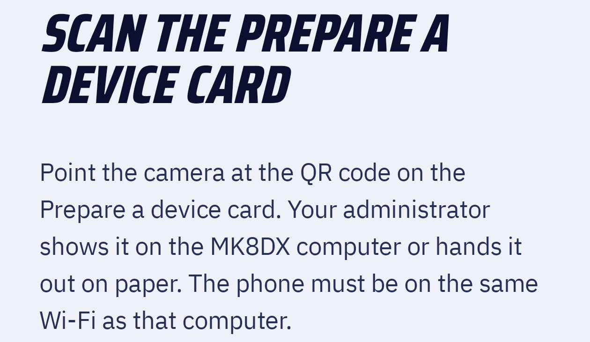
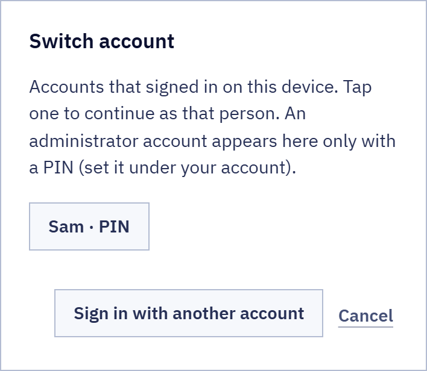

# MK8DX en casa o en tu club: manual

*Esta es una traducción automática de la [guía en inglés](../../A2_HOME_GUIDE_EN.md); la versión en inglés es la que manda. Las correcciones son bienvenidas mediante el formulario de incidencia «Translation correction».*

Este manual te lleva paso a paso desde un ordenador vacío hasta una noche de carreras jugada. No necesitas conocimientos de informática. Lee los capítulos en orden; cada capítulo se basa en el anterior.

**Primero, una nota sincera:** la instalación para casa y club está publicada desde la versión 0.2.0. Windows 11 se ha probado de principio a fin, incluido un móvil Android en la red. Linux solo se ha probado en WSL 2, todavía no en un PC Linux independiente ni en una Raspberry Pi. Los paquetes para macOS están compilados, pero aún no se han probado en un Mac real, y todavía no se ha probado un iPhone. Allí donde algo aún no está probado o compilado, el paso lo dice.

**Cómo leer un paso:** tras **Haz** viene lo que haces, tras **Verás** lo que debería pasar entonces, y tras **¿Ves otra cosa?** qué hacer en ese caso. Las palabras en negrita son botones o textos que ves exactamente así en la pantalla.

## 1. ¿Qué es MK8DX en casa o en tu club y qué necesitas?

MK8DX es una web para Mario Kart 8 Deluxe: guardar y comparar Contrarreloj, grabaciones de LiveTrial y noches de torneo. Con esta instalación la web funciona en un ordenador de tu propia red. Los móviles, tablets y otros ordenadores de la misma red abren la web a través de ese ordenador. Nada sale a internet.

Cada persona inicia sesión con una **tarjeta de acceso** personal: una tarjeta con un código QR. Un código QR es un código de barras cuadrado que escaneas con la cámara del móvil o la tablet.

En este manual, el ordenador en el que funciona MK8DX se llama **el ordenador MK8DX**.

Qué necesitas:

- **Un ordenador que siga encendido mientras se juega:** Windows 11 con un procesador Intel o AMD, Linux o macOS. Se recomiendan 8 GB de memoria. La configuración comprueba que haya al menos 6 GB de espacio libre en el disco.
- **Una red doméstica:** el wifi o los cables de red de tu router. Un router es el aparato que crea tu red (a menudo de tu proveedor de internet). Todos los dispositivos deben estar en la misma red. No uses una red de invitados: suele mantener los dispositivos separados.
- **Móviles, tablets u otros ordenadores** para los jugadores, preferiblemente con cámara para escanear códigos QR.
- **Una impresora** es práctica para imprimir las tarjetas de acceso y el código de recuperación, pero no es imprescindible.

Qué no necesitas:

- **No hace falta internet mientras se juega.** Solo durante la preparación descargas una vez Docker, Python y el paquete de MK8DX (o alguien te los da en una memoria USB).
- **Ninguna cuenta en otra empresa**, ni dirección de correo electrónico ni nube.
- **Ninguna suscripción.** MK8DX y Python son gratuitos. Docker Desktop es gratuito para uso personal y organizaciones pequeñas; las condiciones están en la web de Docker. En Linux usas el Docker Engine gratuito.

<!-- image: network-overview -->

## 2. Preparar el ordenador

MK8DX necesita dos programas auxiliares gratuitos:

- **Docker** ejecuta programas en «contenedores» aislados. La web y la base de datos de MK8DX funcionan dentro de ellos. En Windows y macOS el programa se llama Docker Desktop.
- **Python** es un lenguaje de programación. El instalador de MK8DX está escrito en él. Necesitas Python 3.12 a 3.15.

Haz solo la parte de tu ordenador (2A, 2B o 2C) y sáltate las otras dos.

## 2A. Preparar Windows 11

1. **Haz:** comprueba qué procesador tiene tu ordenador: Inicio → **Configuración** → **Sistema** → **Información**, línea **Tipo de sistema**. → **Verás:** «Sistema operativo de 64 bits, procesador x64». → **¿Ves otra cosa?** Si pone ARM, el paquete de MK8DX para Windows no sirve: solo existe para x64 (Intel y AMD).
2. **Haz:** instala primero **WSL** (Subsistema de Windows para Linux). Es una parte de Windows sobre la que funciona Docker; sin WSL, Docker Desktop no se puede instalar. Haz clic derecho en el botón Inicio y elige **Terminal (Administrador)** o **Windows PowerShell (Administrador)**. Haz clic en **Sí** cuando Windows pida permiso. Escribe `wsl --install` y pulsa Intro. → **Verás:** Windows descarga e instala WSL y Ubuntu; esto tarda unos minutos. Al final dice que tienes que reiniciar el ordenador. Reinicia el ordenador. → **¿Ves otra cosa?** Si después del reinicio se abre una ventana que pide un nombre de usuario y una contraseña para Ubuntu: introduce un nombre y una contraseña que elijas tú (MK8DX no los necesita) y cierra la ventana. Si dice que WSL ya está instalado, escribe `wsl --update` y pulsa Intro. Si menciona la **virtualización** («Plataforma de máquina virtual» o «virtualización»), la virtualización está desactivada en la BIOS del ordenador; actívala (los fabricantes suelen llamarla Intel VT-x o AMD-V) o pide ayuda.
3. **Haz:** descarga **Docker Desktop** para Windows (x86_64 / AMD64) desde docker.com y abre el archivo descargado. → **Verás:** el instalador de Docker con la opción de usar WSL 2. WSL es una parte de Windows sobre la que funciona Docker. Deja esa opción marcada y haz clic en **OK**. → **¿Ves otra cosa?** Si Windows pregunta si esta aplicación puede hacer cambios, haz clic en **Sí**.
4. **Haz:** espera a que termine la instalación y reinicia el ordenador si Docker te lo pide. → **Verás:** tras el reinicio se abre Docker Desktop (o ábrelo tú desde el menú Inicio). La primera vez, Docker te pide que aceptes sus condiciones. → **¿Ves otra cosa?** Si Docker te pide iniciar sesión o crear una cuenta: MK8DX no necesita una cuenta de Docker; sáltatelo si Docker lo ofrece. Si Docker sigue diciendo que falta WSL o que hay que actualizarlo, repite el paso 2 (`wsl --install` o `wsl --update`) y reinicia.
5. **Haz:** espera en la ventana de Docker Desktop. → **Verás:** **Engine running** (motor en marcha) abajo a la izquierda. → **¿Ves otra cosa?** «Engine starting» puede tardar unos minutos. Si se queda colgado o muestra un error, reinicia el ordenador y vuelve a abrir Docker Desktop. Docker debe estar en el modo normal de contenedores Linux (no «Windows containers»).
6. **Haz:** ve a python.org → **Downloads** y descarga el **Python install manager** (gestor de instalación de Python) para Windows (el archivo termina en `.msix`). Esta es ahora la forma oficial de instalar Python en Windows. Abre el archivo descargado y haz clic en **Install**. → **Verás:** Windows instala el Python install manager; después puedes cerrar la ventana. → **¿Ves otra cosa?** También puedes instalarlo desde Microsoft Store: busca «Python install manager» y haz clic en **Instalar**. Usa una de las dos vías, no ambas.
7. **Haz:** haz clic en Inicio, escribe `PowerShell`, abre **Windows PowerShell**, escribe `py install 3.15` y pulsa Intro. Esto instala Python propiamente dicho (el install manager es solo la herramienta que descarga Python). → **Verás:** la primera vez, unas preguntas para comprobar la configuración; respóndelas con Intro (la opción propuesta) o con `y`. Después se descarga e instala Python. Una pregunta sobre añadir una carpeta a tu PATH se puede responder con `y`; no es necesario. → **¿Ves otra cosa?** Instala exactamente la 3.15 como se indica; la 3.12, 3.13 o 3.14 también funcionan, una versión más nueva (3.16 o posterior) todavía no.
8. **Haz:** cierra PowerShell, vuelve a abrirlo, escribe `python --version` y pulsa Intro. → **Verás:** `Python 3.15` seguido de un número, por ejemplo `Python 3.15.2`. → **¿Ves otra cosa?** Si se abre Microsoft Store o dice que no se encontró python: haz clic en Inicio, escribe **Administrar alias de ejecución de aplicaciones** y ábrelo. Activa **Python (default)** y desactiva **App Installer python.exe** y **python3.exe**. Si en el pasado instalaste un Python antiguo o el «Python launcher», desinstálalo en **Configuración → Aplicaciones → Aplicaciones instaladas** y vuelve a intentarlo.

<!-- image: docker-engine-running -->

<!-- image: python-install-manager -->

## 2B. Preparar Linux (Ubuntu o Debian)

Linux todavía no se ha probado de principio a fin con MK8DX. Los pasos están escritos para Ubuntu 24.04 o posterior. Los escribes en un **terminal**: una ventana en la que das órdenes de texto (en Ubuntu lo abres con Ctrl+Alt+T). Termina cada orden con Intro. **sudo** delante de una orden significa «como administrador de este ordenador»: Linux te pide entonces tu contraseña, y no ves ningún carácter mientras la escribes. Es normal.

1. **Haz:** escribe `python3 --version`. → **Verás:** `Python 3.12`, `3.13`, `3.14` o `3.15`. → **¿Ves otra cosa?** Un número más bajo (Debian 12, por ejemplo, tiene la 3.11) es demasiado antiguo; la 3.16 o superior todavía no está soportada. Necesitas entonces una versión más nueva de tu Linux; Ubuntu 24.04 trae Python 3.12.
2. **Haz:** escribe `sudo apt update` y después `sudo apt install docker.io docker-compose-v2 python3-venv unzip`. Responde a la pregunta de si quieres continuar con Y e Intro. → **Verás:** los paquetes se descargan e instalan. → **¿Ves otra cosa?** Si apt no encuentra un paquete, en tu Linux tiene otro nombre (puede pasar en Debian). Continúa y comprueba en el paso 5 si Docker Compose funciona.
3. **Haz:** escribe `sudo systemctl enable --now docker`. Esto inicia Docker ahora y cada vez que arranca el ordenador. → **Verás:** ningún error (a veces una línea que empieza por «Created symlink»).
4. **Haz:** escribe `sudo usermod -aG docker $USER`. Esto da a tu usuario permiso para usar Docker. Después cierra la sesión y vuelve a iniciarla (o reinicia): el permiso solo funciona tras volver a iniciar sesión. → **Verás:** ningún error. → **Nota:** quien esté en el grupo docker tiene, en la práctica, derechos de administrador en este ordenador. Añádete solo a ti.
5. **Haz:** compruébalo con `docker info` y después con `docker compose version`. → **Verás:** una lista de datos sin errores, y «Docker Compose version» con un número. → **¿Ves otra cosa?** «permission denied»: haz el paso 4 y no olvides cerrar la sesión. «Cannot connect to the Docker daemon»: haz el paso 3.

Un **cortafuegos** es una protección que decide qué conexiones deja entrar un ordenador. Si en tu Linux está activo el cortafuegos ufw o firewalld, la configuración del capítulo 3 muestra qué orden deja pasar a MK8DX.

## 2C. Preparar macOS

**Nota:** macOS todavía no se ha probado en un Mac real. Los pasos siguientes siguen lo que la configuración espera en macOS.

1. **Haz:** elige menú Apple → **Acerca de este Mac** y mira **Chip** o **Procesador**. → **Verás:** un chip de Apple (M1, M2 y posteriores): toma el paquete `macos-arm64`. → **¿Ves otra cosa?** Un procesador Intel: toma el paquete `macos-amd64`. Necesita macOS 10.15 o posterior y un Docker Desktop que todavía sea compatible con tu Mac.
2. **Haz:** descarga **Docker Desktop** para Mac con el chip correspondiente desde docker.com, abre el archivo descargado y arrastra Docker a **Aplicaciones**. → **Verás:** Docker en tu carpeta Aplicaciones.
3. **Haz:** abre Docker. Acepta las condiciones; si macOS te pide la contraseña, introdúcela. → **Verás:** al cabo de un rato, **Engine running** en la ventana de Docker Desktop. → **¿Ves otra cosa?** Si Docker te pide iniciar sesión: MK8DX no necesita una cuenta de Docker; sáltatelo si Docker lo ofrece.
4. **Haz:** descarga desde python.org el instalador de Python 3.15 para macOS y ábrelo. Avanza por los pasos con **Continuar** e **Instalar**. → **Verás:** el mensaje de que la instalación se ha realizado correctamente.
5. **Haz:** abre **Terminal** (Aplicaciones → Utilidades → Terminal), escribe `python3 --version` y pulsa Intro. → **Verás:** `Python 3.12` a `3.15`. → **¿Ves otra cosa?** Un número más bajo (por ejemplo la 3.9 de la propia Apple): cierra Terminal y vuelve a abrirlo. Si sigue siendo más bajo, vuelve a instalar Python desde python.org.
6. **Haz:** escribe `docker info` en Terminal. → **Verás:** una lista de datos sin errores. → **¿Ves otra cosa?** Inicia Docker Desktop y espera a Engine running.

## 3. Instalar MK8DX

**Descomprimir el paquete**

1. **Haz:** descarga el paquete de MK8DX para casa o club de tu sistema: Windows, Linux o macOS, y para Linux y macOS también el de tu procesador (amd64 o arm64). Para comprobar que la descarga es correcta, compara su SHA-256 con su línea en `SHA256SUMS.txt` de la misma release (Windows: `Get-FileHash <file> -Algorithm SHA256`; Linux: `sha256sum <file>`; macOS: `shasum -a 256 <file>`); consulta también `docs/RELEASE_PACKAGES.md#check-a-download`. → **Verás:** un archivo zip en tu carpeta Descargas. → **¿Ves otra cosa?** Si el navegador avisa de que el archivo no es seguro o se descarga poco: elige **Conservar**. Windows: después haz clic derecho en el archivo zip → **Propiedades**, marca **Desbloquear** abajo y haz clic en **Aceptar**. Hazlo antes de descomprimir; si no, Windows (Control inteligente de aplicaciones) podría bloquear más tarde `Start-MK8DX-LAN.cmd`. No desactives el Control inteligente de aplicaciones: después solo se puede volver a activar con una instalación nueva de Windows.
2. **Haz:** descomprime el archivo zip en una carpeta permanente, por ejemplo una carpeta MK8DX en Documentos. Windows: haz clic derecho en el archivo zip → **Extraer todo**. Elige una carpeta que se quede: MK8DX se iniciará siempre desde esta carpeta más adelante, así que no la muevas ni la borres. → **Verás:** una carpeta con, entre otros, `Start-MK8DX-LAN.cmd`, `README-FIRST.txt` y las carpetas `docs`, `images` y `tooling`. → **¿Ves otra cosa?** Si solo abriste el archivo zip en el Explorador de archivos, extráelo de verdad: iniciarlo desde dentro del zip no funciona. Linux sin gestor de archivos (un servidor o WSL): `unzip ~/Downloads/mk8dx-a2-linux-amd64-<version>.zip -d ~/Documents/MK8DX` (con tu nombre de archivo; `unzip` viene del paso 2 del capítulo 2B).

<!-- os: windows -->

**Iniciar en Windows**

1. **Haz:** en la carpeta descomprimida, haz doble clic en **Start-MK8DX-LAN.cmd**. → **Verás:** una ventana con el logotipo de MK8DX y una cuenta atrás 3-2-1-GO con pitidos ([para quitarla](../../../guides/HOSTING.md#the-launcher-window-look-and-options)), y después líneas como «Paquete de MK8DX:» y «Instalación privada:». La primera vez también muestra «Preparando los paquetes de Python incluidos (una sola vez, sin internet).» y «Cargando las imágenes de Docker incluidas. Puede tardar varios minutos.» Eso tarda unos minutos. Después muestra «MK8DX setup is open in your browser:» y la configuración se abre en tu navegador. → **¿Ves otra cosa?** Consulta los mensajes de abajo.
2. **Haz:** deja abierta la ventana negra hasta que hayas hecho clic en **Finalizar** en la configuración. La ventana también lo dice: «Keep this window open until you click Finish.»

Mensajes de la ventana negra en Windows:

- **"Falta Python 3.12 a 3.15. Instala el Python install manager desde python.org (o desde Microsoft Store), ejecuta: py install 3.15, vuelve a abrir PowerShell e inténtalo de nuevo."** Haz los pasos 6 a 8 del capítulo 2A y vuelve a hacer doble clic en Start-MK8DX-LAN.cmd.
- **"Docker Desktop no está instalado o no está en marcha. Inicia Docker Desktop en modo de contenedores Linux, espera a que muestre "Engine running" y vuelve a intentarlo."** Inicia Docker Desktop, espera a Engine running y vuelve a hacer doble clic.
- Debajo de un error aparece **"El paso seleccionado se ha detenido. Lee el mensaje de arriba antes de volver a intentarlo."** Lee la línea de encima, soluciónalo y pulsa una tecla para cerrar la ventana.

<!-- /os -->

<!-- os: linux macos -->

**Iniciar en Linux y macOS**

1. **Haz:** abre un terminal en la carpeta descomprimida. Linux: haz clic derecho en la carpeta y elige «Abrir en un terminal» si tu gestor de archivos lo ofrece. En macOS y Linux también funciona así: abre Terminal, escribe `cd ` (con un espacio detrás), arrastra la carpeta a la ventana y pulsa Intro. → **Verás:** el terminal está en la carpeta del paquete.
2. **Haz:** escribe `sh tooling/start-mk8dx.sh` y pulsa Intro. → **Verás:** el logotipo de MK8DX y una cuenta atrás 3-2-1-GO, después «Paquete de MK8DX:», el número de Python y «Docker Compose version». La primera vez también «Cargando las imágenes de Docker incluidas. Puede tardar varios minutos.» y «Preparando los paquetes de Python incluidos (una sola vez, sin internet).» Después «Instalación privada:» y «MK8DX setup is open in your browser:», y la configuración se abre en tu navegador. → **¿Ves otra cosa?** Si no se abre ningún navegador, copia del terminal a tu navegador la dirección que empieza por `http://127.0.0.1:`.
3. **Haz:** deja el terminal abierto hasta que hayas hecho clic en **Finalizar**.

Mensajes del terminal en Linux y macOS:

- **"Falta Python 3.12 a 3.15. Instálalo (Ubuntu/Debian: sudo apt install python3 python3-venv; macOS: python.org) y vuelve a intentarlo."** Vuelve a hacer el capítulo 2B o 2C.
- **"Docker no está en marcha o este usuario no puede usarlo (Linux: sudo systemctl start docker y únete al grupo docker; macOS: inicia Docker Desktop)."** Linux: haz los pasos 3 y 4 del capítulo 2B. macOS: inicia Docker Desktop.
- **"No se ha podido crear el entorno privado de Python (Ubuntu/Debian: sudo apt install python3-venv)."** Instala python3-venv como en el paso 2 del capítulo 2B.

<!-- /os -->

**La configuración en el navegador**

La configuración es una página de tu navegador que solo funciona en el propio ordenador MK8DX. Está en el idioma de tu navegador (uno de los 15 idiomas del juego; si no, en inglés). Arriba a la derecha están el menú de idioma, para elegir otro idioma, y **Manual**: abre este manual. Abajo están **Atrás**, a veces **Avanzado**, y **Siguiente**. Los puntos de arriba muestran por dónde vas.

1. **Bienvenido a MK8DX.** **Haz:** lee la pantalla y haz clic en **Siguiente**. → **Verás:** «Comprobación rápida». El botón **Restaurar una copia de seguridad** de esta pantalla es solo para un ordenador nuevo (capítulo 10).
2. **Comprobación rápida.** **Haz:** espera un momento. → **Verás:** tres marcas verdes en **Docker Desktop está en marcha**, **Espacio libre en disco suficiente** (con el número de GB) y **Windows, Linux o macOS**. Haz clic en **Siguiente**. → **¿Ves otra cosa?** Un signo de exclamación con una explicación, por ejemplo «Inicia Docker Desktop, espera a que aparezca 'Engine running' y haz clic en Intentar de nuevo.» o «Libera al menos 6 GB en esta unidad.» Soluciónalo y haz clic en **Intentar de nuevo**. En Linux la primera comprobación también se llama «Docker Desktop está en marcha»; allí se refiere a Docker Engine.
3. **¿Qué tipo de instalación?** **Haz:** deja seleccionado **Red de casa, del club o de una noche LAN, sin necesidad de internet** (recomendado) y haz clic en **Siguiente**. → **Verás:** «Tu red».
4. **Tu red.** Una **dirección de red** (dirección IP) es el número con el que los dispositivos encuentran este ordenador en tu red, como el número de una casa. **Haz:** lee la dirección bajo «Los teléfonos, tabletas y otros PC acceden a MK8DX en esta dirección:» y apúntala, por ejemplo `https://192.168.1.50`. Haz clic en **Instalar**. → **Verás:** en Windows «Esta red está configurada como red doméstica (privada).» o «Ahora Windows trata esta red como pública. Al hacer clic en Instalar, MK8DX la marca como privada y solo permite MK8DX.» En Linux y macOS aquí no aparece ninguna frase sobre la red. → **¿Ves otra cosa?** Si el ordenador tiene más de una conexión (cable y wifi), haz clic en **Avanzado** y en «Elige otra dirección de este ordenador:» elige la dirección de la red en la que también están los móviles. Si dice «No se ha encontrado ninguna dirección de red.», conecta el ordenador a tu red doméstica y haz clic en **Intentar de nuevo**.
5. **Instalando.** **Haz:** espera y deja la ventana abierta. → **Verás:** «Se está preparando MK8DX. Mantén esta ventana abierta.» y, uno tras otro, «Preparando la instalación», «Permitiendo la red (Windows pide permiso)», «Iniciando la base de datos y el sitio web», «Comprobando» y por último «MK8DX está en marcha. Quedan dos pasos cortos.» Haz clic en **Siguiente**. En Windows, una ventana de Windows pregunta una vez si Windows PowerShell puede hacer cambios: haz clic en **Sí**. Con eso, MK8DX marca tu red doméstica como privada y solo deja pasar a MK8DX por el cortafuegos (la protección de Windows). Si MK8DX ya se instaló antes en este ordenador y en esta dirección, ese permiso sigue ahí y Windows no vuelve a preguntar. → **¿Ves otra cosa?** Un error en rojo: haz clic en **Detalles** para leer qué ha fallado, soluciónalo y haz clic en **Intentar de nuevo**. Si hiciste clic en No en la ventana de Windows, dice que Windows no permitió el cambio; haz clic en **Intentar de nuevo** y después en **Sí**.
6. **Solo Linux: el cortafuegos.** **Haz:** durante o después de la instalación, haz clic en **Detalles** y busca la línea que empieza por «Network:». → **Verás:** «not-needed» (no hay nada que hacer), o «manual:» seguido de una orden como `sudo ufw allow from 192.168.1.0/24 to 192.168.1.50 port 80,443 proto tcp`. → **Después haz:** escribe exactamente esa orden (con tu dirección, tal como aparece ahí) en un terminal. Sin esa orden, los móviles no pueden abrir la web.
7. **Tu cuenta de administrador.** El **administrador** es la persona que añade a la gente y hace las tarjetas de acceso; es decir, tú. **Haz:** introduce un nombre en **Tu nombre**, por ejemplo «Papá» o «Equipo del club», y haz clic en **Siguiente**. El nombre solo se ve dentro de esta instalación. → **Verás:** «¿Quién juega?»
8. **¿Quién juega?** **Haz:** escribe los nombres de los jugadores en **Nombres (uno por línea)**, cada uno en su propia línea, y haz clic en **Añadir**. O haz clic directamente en **Omitir**: puedes hacerlo más tarde exactamente igual en MK8DX beheer (capítulo 5). → **Verás:** los nombres bajo «En esta instalación:», tú con «(administrador)» detrás de tu nombre. Haz clic en **Siguiente**.
9. **Iniciar sesión en teléfonos y PC.** **Haz:** aquí ya puedes hacer tarjetas de acceso (los capítulos 5 y 6 explican cómo), o simplemente haz clic en **Siguiente**. → **Verás:** «¡Listo! Disfruta de las carreras.»
10. **¡Listo! Disfruta de las carreras.** **Haz:** apunta las dos direcciones: **Sitio web** (por ejemplo `https://192.168.1.50`) y **Nuevo dispositivo** (por ejemplo `http://192.168.1.50/setup`). Deja marcadas las tres casillas: **Iniciar MK8DX con Windows**, **Crear una copia de seguridad cada noche** y **Poner un acceso directo «MK8DX beheer» en el escritorio**. Haz clic en **Finalizar**. → **Verás:** tu código de recuperación (capítulo 4). → **En Linux y macOS** la primera casilla se llama «Iniciar MK8DX al arrancar el ordenador». En macOS abre entonces Docker Desktop cuando inicias sesión. En Linux se encarga de ello `sudo systemctl enable --now docker` del capítulo 2B; si todavía no lo has hecho, la configuración muestra exactamente esa orden tras Finalizar.
11. **Cerrar.** **Haz:** lee el capítulo 4 y guarda el código de recuperación. Después haz clic en **Cerrar**. → **Verás:** «Ya puedes cerrar esta ventana.» Cierra la pestaña del navegador. En Windows la ventana negra pide una tecla; pulsa una tecla y se cierra. Si no haces nada, la página de configuración se detiene sola al cabo de 10 minutos. MK8DX en sí sigue funcionando.

<!-- image: windows-permission -->

## 4. El código de recuperación y la carpeta de copias de seguridad

Una **copia de seguridad** es una copia de reserva de todo lo que hay en MK8DX: personas, tiempos, torneos y ajustes. MK8DX hace una copia de seguridad cada noche a las 03:00 y guarda las 7 más recientes. Las copias de seguridad están cifradas: sin la clave no se pueden leer.

El **código de recuperación** es esa clave. Son cinco grupos de cuatro letras y cifras, por ejemplo `ABCD-EFGH-JKLM-NPQR-STUV`. Solo lo necesitas para restaurar una copia de seguridad en otro ordenador.

1. **Haz:** después de **Finalizar**, mira la tarjeta **Código de recuperación de MK8DX**. → **Verás:** el código, la frase «Sin este código no se puede abrir una copia de seguridad. Solo se muestra una vez.» y, debajo, la carpeta a la que van las copias de seguridad.
2. **Haz:** copia el código en un papel o haz clic en **Imprimir tarjetas** para imprimir esta página. Compruébalo letra a letra. → **Verás:** el código en papel. → **¿Por qué solo una vez?** MK8DX guarda el código protegido en este ordenador para la copia nocturna, pero nunca vuelve a mostrarlo. Si el ordenador se estropea, solo te queda el papel.
3. **Haz:** guarda el papel en un lugar seguro, no al lado del ordenador. Quien tenga el código y una copia de seguridad puede abrirlo todo.

Dónde están las copias de seguridad:

- **Windows:** en la carpeta Documentos, carpeta `MK8DX-backups` (en el disco: `C:\Users\<your name>\Documents\MK8DX-backups`).
- **Linux y macOS:** en tu carpeta personal, carpeta `Documents/MK8DX-backups` (es decir, `~/Documents/MK8DX-backups`). Incluso en un Linux en otro idioma esa carpeta se llama Documents.
- La configuración muestra la carpeta exacta debajo del código de recuperación.

De vez en cuando, copia la carpeta `MK8DX-backups` a una memoria USB o a otro disco. Si no, cuando el ordenador se estropee, las copias de seguridad solo estarán en ese ordenador estropeado.

Si desmarcas **Crear una copia de seguridad cada noche** y haces clic en **Finalizar**, MK8DX deja de hacer la copia de seguridad nocturna; las copias ya hechas se conservan. Si más adelante la vuelves a marcar, las copias continúan con el mismo código de recuperación, que no se vuelve a mostrar. Si ya no tienes ese código, crea uno nuevo como se explica abajo.

**Un nuevo código de recuperación**

Crea un código nuevo si otra persona ha podido ver el tuyo o si perdiste el papel. Funciona a partir de la versión 0.2.7.

1. **Haz:** abre MK8DX beheer, haz clic en **Siguiente** hasta «¡Listo! Disfruta de las carreras.», marca **Crear un nuevo código de recuperación** y haz clic en **Finalizar**. → **Verás:** la tarjeta **Código de recuperación de MK8DX** con el código nuevo, que solo se muestra una vez, y la frase de que las copias anteriores siguen necesitando el código antiguo.
2. **Haz:** anota el código nuevo como en el paso 2 de arriba. Guarda el papel antiguo con las copias anteriores: no se convierten y solo se abren con el código antiguo. Borra esas copias antiguas y el papel antiguo cuando ya no los necesites. → **Verás:** las siguientes copias usan el código nuevo.

## 5. Personas y tarjetas de acceso (MK8DX beheer)

**MK8DX beheer** (en neerlandés, «administración de MK8DX») es la misma página que la configuración, pero para después: añadir personas y hacer tarjetas de acceso. Solo funciona en el propio ordenador MK8DX. El acceso directo del escritorio se llama «MK8DX beheer» en todos los idiomas; el título de la página es **Administración de MK8DX**.

Una **cuenta** es quien inicia sesión. Un **Jugador** es el jugador de las clasificaciones, con sus tiempos. Tras iniciar sesión, cada uno elige o reclama su propio Jugador en la web. Los nombres nunca se vinculan automáticamente.

**Abrir MK8DX beheer**

1. **Haz (Windows):** haz doble clic en **MK8DX beheer** en el escritorio. Ese acceso directo inicia lo mismo que Start-MK8DX-LAN.cmd. → **Verás:** la ventana de inicio con su breve intro de carrera y después, en el navegador, la página con «administración» arriba y el título **Administración de MK8DX**. → **¿Ves otra cosa?** Si no hay acceso directo: haz doble clic en Start-MK8DX-LAN.cmd en la carpeta MK8DX.
2. **Haz (Linux):** inicia **MK8DX beheer** desde el escritorio o desde el menú de aplicaciones. En algunos escritorios Linux primero tienes que permitir ese icono (haz clic derecho en él y elige la opción para permitir que se ejecute). También funciona con `sh tooling/start-mk8dx.sh` en la carpeta MK8DX, como en el capítulo 3. → **Verás:** un terminal y después la página **Administración de MK8DX**.
3. **Haz (macOS, sin probar):** haz doble clic en **MK8DX beheer.command** en el escritorio, o inicia `sh tooling/start-mk8dx.sh` como en el capítulo 3. → **Verás:** Terminal y después la página **Administración de MK8DX**.

**Añadir personas**

1. **Haz:** escribe los nombres en **Nombres (uno por línea)** y haz clic en **Añadir**. → **Verás:** los nombres bajo «En esta instalación:».
2. **Haz:** haz clic en **Siguiente**. → **Verás:** «Iniciar sesión en teléfonos y PC» en dos pasos: **Paso 1 · Preparar el dispositivo** con la tarjeta **Preparar un dispositivo** (una vez por dispositivo, todavía no inicia sesión) y **Paso 2 · Iniciar sesión como la persona correcta** con, para cada persona, un recuadro con el botón **Crear tarjeta**.

**Hacer e imprimir tarjetas**

1. **Haz:** haz clic en **Crear tarjeta** junto a una persona. → **Verás:** un código QR con «Válida hasta» y una hora. Una tarjeta funciona una sola vez y durante 15 minutos. Deja que la persona la escanee enseguida (capítulo 6), o imprímela.
2. **Haz:** haz primero las tarjetas que quieras y después haz clic en **Imprimir tarjetas**. → **Verás:** la ventana de impresión de tu navegador con todas las tarjetas de la pantalla, incluida la tarjeta «Preparar un dispositivo».
3. **Haz:** haz también una tarjeta para ti (el nombre con «(administrador)») si quieres iniciar sesión en tu móvil.

**Sustituir o revocar una tarjeta**

- **Tarjeta nueva**: hace una tarjeta nueva para esa persona. La tarjeta anterior de esa persona en esta pantalla deja entonces de funcionar.
- **Revocar tarjeta**: la tarjeta deja de funcionar al instante. Verás «Revocada: esta tarjeta ya no funciona.» Úsalo cuando una tarjeta se ha perdido o ha llegado a la persona equivocada.
- Solo puedes revocar una tarjeta que todavía esté en esta pantalla. Si ya cerraste MK8DX beheer, una tarjeta sin usar caduca sola a los 15 minutos. Si puede que ya se haya usado, elige **Cerrar sesión en todas partes**, más abajo.

**Cerrar la sesión de alguien en todas partes**

1. **Haz:** abre MK8DX beheer. En la primera pantalla cada persona tiene un botón **Cerrar sesión en todas partes**. Haz clic en él. → **Verás:** el botón cambia a **¿Seguro? Haz clic otra vez**.
2. **Haz:** haz clic una vez más. → **Verás:** «Sesión cerrada en todos los dispositivos. Con una tarjeta nueva, esta persona puede volver a iniciar sesión.» Esa persona tiene ahora la sesión cerrada en la web y en la app, desaparece el cambio con un toque a esa cuenta y las tarjetas abiertas de esa persona dejan de funcionar. → **¿Ves otra cosa?** Junto a tu propio nombre, el segundo clic muestra «Cierra tu propia sesión desde el menú de cuenta del sitio web («Cerrar sesión en todos los dispositivos»).» y no se cierra ninguna sesión.

**Cerrar MK8DX beheer**

1. **Haz:** haz clic en **Siguiente** hasta «¡Listo! Disfruta de las carreras.», deja las casillas marcadas, haz clic en **Finalizar** y después en **Cerrar**. → **Verás:** «Ya puedes cerrar esta ventana.» MK8DX sigue funcionando.

## 6. Preparar un dispositivo e iniciar sesión

Un **certificado** es una prueba digital de identidad. Con él, un móvil sabe con seguridad que está hablando con tu ordenador MK8DX y con nada más, y la conexión va cifrada (https). Como MK8DX funciona sin internet, la configuración crea su propio certificado. Cada dispositivo tiene que aprender una vez a confiar en él. La **huella digital** es un código corto que pertenece exactamente a este certificado; con ella compruebas que instalas el certificado correcto.

**¿Por qué un certificado, incluso en casa y sin internet?**

- **Saber con seguridad que es tu MK8DX.** En una red de casa o del club, cualquiera que esté en el mismo wifi puede hacerse pasar por tu ordenador MK8DX, por ejemplo un invitado con un portátil. Sin certificado, tu móvil no nota la diferencia. Con el certificado, el navegador rechaza cualquier otro ordenador.
- **Nadie escucha.** Las tarjetas de acceso, tu sesión y todo lo que introduces viajan cifrados por el wifi.
- **Por qué MK8DX crea su propio certificado.** Las webs de internet usan certificados de emisores conocidos que ya están en todos los dispositivos. Esos emisores no dan certificados para una dirección doméstica como `192.168.1.50` y no funcionan sin internet. Por eso MK8DX crea su propio certificado durante la instalación, y tú le dices una vez a cada dispositivo que puede confiar en él.
- **Qué permites al instalarlo.** El certificado está pensado solo para las direcciones de red privadas de MK8DX, y su clave secreta se queda protegida en el ordenador MK8DX. Instala solo el certificado de tu propio MK8DX (comprueba la huella digital) y quítalo de un dispositivo cuando ya no uses esa instalación.

**¿Qué no funciona si no instalas el certificado?**

- El navegador muestra en cada visita un aviso a pantalla completa, como «La conexión no es privada». Puedes saltártelo, pero no lo hagas: entonces ya no puedes ver si de verdad estás hablando con tu MK8DX.
- Incluso tras saltarte el aviso, las **notificaciones del navegador** no funcionan: el navegador solo las permite con un certificado de confianza. Otras funciones del navegador también pueden negarse.
- Lo que sí funciona sin certificado instalado: la **app de Android**. Aprende el certificado por sí sola a partir de la tarjeta **Preparar un dispositivo** (capítulo 7). Un navegador en el mismo dispositivo sigue necesitando el certificado.

**El propio ordenador MK8DX**

El ordenador en el que funciona MK8DX también tiene que confiar una vez en MK8DX; si no, su navegador avisa sobre la web.

1. **Haz:** abre MK8DX beheer, haz clic en **Siguiente** hasta «Iniciar sesión en teléfonos y PC» y mira el bloque **Este ordenador** bajo **Paso 1**. → **Verás:** «Este ordenador ya confía en MK8DX.» Entonces ya has terminado. → **¿Ves otra cosa?** Si muestra el botón **Preparar este ordenador**, ve al paso 2.
2. **Haz:** haz clic en **Preparar este ordenador**. → **Verás:** una ventana de Windows, **Advertencia de seguridad**, que pregunta si quieres instalar el certificado, con una **huella digital (sha1)**. Compárala con la huella digital de MK8DX beheer; si coinciden, haz clic en **Sí**. → **Verás:** «Este ordenador ya confía en MK8DX.» → **¿Ves otra cosa?** Si hiciste clic en **No** o las huellas digitales son distintas: no hagas clic en Sí, cierra la ventana y pide ayuda. En Linux o macOS, en lugar del botón pone que abras la dirección que aparece bajo «Preparar un dispositivo» en el navegador de este ordenador; después sigue en este ordenador los pasos de abajo.

**Una vez por dispositivo: Preparar un dispositivo**

1. **Haz:** conecta el móvil, la tablet o el PC al mismo wifi o red por cable que el ordenador MK8DX. En un móvil, no uses los datos móviles en lugar del wifi. → **Verás:** el nombre de tu propio wifi en la conexión.
2. **Haz:** escanea con la cámara el código QR de la tarjeta **Preparar un dispositivo** (en MK8DX beheer o en papel) y toca el enlace que aparece. Sin cámara, escribe en el navegador la dirección **Nuevo dispositivo**, por ejemplo `http://192.168.1.50/setup`. → **Verás:** la página **Preparar este dispositivo** con «Hazlo una vez por teléfono, tableta o PC. Después, escanea tu tarjeta personal de inicio de sesión.» → **¿Ves otra cosa?** Si la página no se abre: comprueba la red y que el ordenador MK8DX esté encendido (capítulo 11).
3. **Haz:** compara el código bajo «Comprueba primero este código.» con la **Huella digital** de la tarjeta «Preparar un dispositivo» (cuatro grupos de cuatro caracteres). → **Verás:** exactamente el mismo código. → **¿Ves otra cosa?** Si el código es distinto, no instales nada. Puede que estés en otra red o en otra dirección; compruébalo primero.
4. **Haz:** sigue la parte de tu dispositivo. La parte del dispositivo que estás usando ya está abierta; para otro dispositivo, ábrela en «¿Otro tipo de dispositivo?» Toca **Descargar certificado** (en iPhone y iPad: **Descargar perfil**) y sigue los pasos de abajo. → **Verás:** abajo «¿Listo? Escanea tu tarjeta personal de inicio de sesión o abre» con la dirección de la web.

Los pasos de la página «Preparar este dispositivo»:

<!-- filter: device -->

- **Android:** toca el botón para descargar el certificado. Abre Ajustes y busca «certificado» (a menudo: Seguridad → Más ajustes de seguridad → Cifrado y credenciales → Instalar un certificado → Certificado de CA). Elige el archivo de MK8DX descargado y confirma con tu PIN. Los nombres de los menús cambian según la marca del móvil.
- **iPhone y iPad (todavía sin probar con esta instalación):** toca el botón para descargar el perfil y permítelo. Abre Ajustes → Perfil descargado → Instalar. Después Ajustes → General → Información → Ajustes de confianza de certificados → activa MK8DX.
- **Windows:** descarga el certificado y ábrelo. Elige Instalar certificado → Usuario actual → Colocar todos los certificados en el siguiente almacén → Entidades de certificación raíz de confianza. No elijas Entidades de certificación intermedias. Reinicia el navegador.
- **Mac (macOS todavía no se ha probado de principio a fin):** descarga el certificado y ábrelo; se abre Acceso a Llaveros. Abre el certificado de MK8DX → Confiar → Confiar siempre.
- **Linux (esta vía todavía no se ha probado de principio a fin):** añade el mismo certificado al almacén raíz de confianza de tu distribución o de tu navegador. Los pasos exactos dependen de la distribución. En Ubuntu y Debian (probado en WSL 2): el `root.crt` descargado está en formato DER, así que conviértelo al instalarlo: `sudo openssl x509 -inform DER -in ~/Downloads/root.crt -out /usr/local/share/ca-certificates/mk8dx.crt` y después `sudo update-ca-certificates`. Firefox y Chrome en Linux pueden tener su propio almacén; importa allí el mismo archivo en los ajustes de certificados (Autoridades) si el navegador sigue mostrando una advertencia.

<!-- /filter -->

**Iniciar sesión con tu tarjeta personal**

1. **Haz:** escanea tu propia tarjeta (la que lleva tu nombre) y toca el enlace. → **Verás:** **Únete a esta instalación de MK8DX** y «Comprueba primero que esta dirección HTTPS pertenece al anfitrión en el que confías. La invitación solo se puede usar una vez.» La barra de direcciones del navegador debe mostrar la dirección de la web, por ejemplo `https://192.168.1.50`. → **¿Ves otra cosa?** Un aviso del navegador sobre el certificado o una conexión no segura: nunca te lo saltes. Haz primero «Preparar un dispositivo», más arriba.
2. **Haz:** comprueba el nombre de la tarjeta bajo **Inicias sesión como:**. Si es tu nombre, espera a «Invitación lista. Confirma para iniciar sesión.» y toca **Aceptar invitación**. Si muestra otro nombre, no toques aceptar: la tarjeta sigue siendo válida para la persona correcta. → **Verás:** «Has iniciado sesión como» con tu nombre, y **Continuar a MK8DX**. Tócalo. → **¿Ves otra cosa?** «Esta invitación no es válida. Pide al administrador un nuevo código QR.» o «No se pudo iniciar sesión. Pide al administrador una nueva invitación.»: la tarjeta ya se usó, caducó o se revocó. Pide al administrador una **Tarjeta nueva**.
3. **Haz:** sigue los pasos de bienvenida de la web: si ya tienes tiempos o torneos aquí y cómo quieres que te llamen. Así eliges o reclamas tu propio Jugador. → **Verás:** tu nombre y tus tiempos. → **¿Ves otra cosa?** Si el nombre de tu tarjeta (por ejemplo «Papá») no aparece ya rellenado: es correcto. El nombre de la tarjeta es solo la etiqueta en Administración de MK8DX; tu nombre de jugador lo eliges tú aquí.

**Otro dispositivo para la misma persona**

- Un jugador puede hacerse una tarjeta él mismo: el menú de cuenta de la web tiene **Iniciar sesión también en otro dispositivo**. Abre **Iniciar sesión en otro dispositivo** con una tarjeta que «Funciona una vez, válida hasta» una hora. Escanéala con el otro dispositivo. Muéstrala solo a tu propio dispositivo: quien la escanee inicia sesión en tu cuenta.
- Los administradores no tienen ese botón. Se hacen una **Tarjeta nueva** en MK8DX beheer.
- Un dispositivo nuevo siempre hace primero una vez «Preparar un dispositivo».
- **¿Sin cámara, o quieres iniciar sesión en el propio ordenador MK8DX?** Haz la tarjeta de esa persona en MK8DX beheer y haz clic en **Iniciar sesión en este ordenador** (abre la página de inicio de sesión en el navegador del ordenador MK8DX) o en **Copiar enlace**. Envía un enlace copiado solo a esa misma persona, por ejemplo en un mensaje privado: quien lo abra puede iniciar sesión como esa persona. Funciona una vez y durante 15 minutos. En la tarjeta «Preparar un dispositivo», **Copiar dirección** copia la dirección; no es secreta.

**Dejar esta instalación en un dispositivo:** vuelve a quitar el certificado en los mismos ajustes que usaste para instalarlo.

## 7. La app de Android y LiveTrial

**Vincular la app de Android**

Esto necesita la versión 2.95.0 de la app o posterior. La app no necesita el certificado en los ajustes de Android, pero el inicio de sesión pasa por el navegador del móvil. Así que primero haz el capítulo 6 en este móvil: «Preparar un dispositivo» e inicia sesión con tu tarjeta en el navegador.

1. **Haz:** abre la app. En una instalación nueva empieza en **Elige tu comunidad**; si no, toca el nombre de la comunidad arriba en la app y después **Añadir una comunidad**. → **Verás:** **Elige tu comunidad** con los paneles **EN CASA O EN EL CLUB** y **COMUNIDAD EN LÍNEA**. En **EN CASA O EN EL CLUB** toca **Escanear el código QR**.
2. **Haz:** si hace falta, toca **Usar la cámara** y permite la cámara. Escanea el código QR de la tarjeta **Preparar un dispositivo**. → **Verás:** **Comprueba que es tu instalación** con una **DIRECCIÓN** y una **HUELLA DE LA CLAVE (SHA-256)**. → **¿Ves otra cosa?** «Este no es el código QR de una tarjeta «Preparar un dispositivo».»: has escaneado una tarjeta personal. Escanea la tarjeta «Preparar un dispositivo». Si el escaneo falla: en el ordenador MK8DX, haz clic en **Copiar dirección** en la tarjeta **Preparar un dispositivo** de MK8DX beheer, envía ese enlace al móvil (no es secreto), pégalo en **O pega el enlace de configuración** y toca **Siguiente**. Escribir solo la dirección corta «Nuevo dispositivo» (por ejemplo `http://192.168.1.50/setup`) no basta: la app también necesita la huella de la clave que está en el código QR y en el enlace copiado, y dice «Este no es el código QR de una tarjeta «Preparar un dispositivo».».
3. **Haz:** compara la dirección con la dirección de la web, y la clave larga con la página «Preparar este dispositivo»: abre allí **Huellas digitales completas** y mira «SHA-256 de la clave pública raíz (SPKI)». Puedes abrir esa página en otro dispositivo, o en el propio ordenador MK8DX mediante la dirección «Nuevo dispositivo». → **Verás:** las dos exactamente iguales. Toca **Conectar** (si la app ya estaba configurada con otro servidor, confirma el cambio). → **¿Ves otra cosa?** Si son distintas, toca **Atrás** y no te conectes. «No se pudo obtener un certificado coincidente de»: comprueba la red y que el ordenador MK8DX esté encendido, y vuelve a intentarlo.
4. **Haz:** en **Ajustes**, en **Jugador en este móvil**, toca **Iniciar sesión**. La app te recuerda que en casa o en el club inicias sesión con tu tarjeta de acceso personal, no con el correo. Toca **Inicia sesión para sincronizar**. → **Verás:** el navegador abre la página de aprobación con «MK8DX Time Trials for Android solicita acceso a tu cuenta.» y el **Código del dispositivo**. Comprueba que es el mismo que el **Código del dispositivo** que muestra la app, aprueba solo si acabas de iniciar esto en tu móvil y toca **Aprobar dispositivo**. La página dice «Dispositivo aprobado. Vuelve a la app para terminar de iniciar sesión.» Vuelve a la app; muestra «Sesión iniciada como» con tu nombre. → **¿Ves otra cosa?** Si el navegador te pide iniciar sesión, inicia sesión primero con tu tarjeta (capítulo 6).
5. **Haz:** publica un tiempo en la app. → **Verás:** el tiempo en la web de la instalación.

Desvincular: toca el nombre de la comunidad arriba → **Añadir una comunidad** → **Olvidar esta instalación**.

Club y casa en una sola app: la app puede guardar varias comunidades. Toca el nombre de la comunidad arriba y después **Cambiar de comunidad**; cada comunidad conserva su propia cuenta y sus tiempos sin enviar. Tus propios tiempos están bajo tu nombre → **Mis tiempos**, también cuando el móvil no llega al ordenador MK8DX.

**LiveTrial en un segundo PC con Windows**

LiveTrial es un programa de Windows que reconoce y guarda tus Contrarreloj mediante una capturadora (un aparato que envía la imagen de tu Switch al PC). La instalación de LiveTrial en sí se describe en el capítulo 6 de `docs/install/MK8DX_User_Guide_EN.txt`. Probado en una instalación de prueba con LiveTrial 3.37.0. Los pasos, en resumen:

1. Primero haz que ese PC confíe en la instalación: capítulo 6, parte de Windows. Comprueba que la web se abre en el navegador sin aviso.
2. Asegúrate de que tu cuenta tiene un **Jugador** en la web.
3. Abre LiveTrial, haz clic en el engranaje (**Ajustes**) e introduce la dirección de la web en **Dirección del sitio web de la comunidad**, por ejemplo `https://192.168.1.50`.
4. Haz clic en **Iniciar sesión** y elige **Abrir la página de aprobación**. Aprueba el dispositivo en el navegador.
5. Envía las carreras con **Enviar ahora**, o activa **Enviar carreras nuevas automáticamente** en Ajustes.

Conviene saber: sin Jugador, el inicio de sesión de LiveTrial termina con un mensaje que te pide configurar primero tu Jugador en la web. Después de cambiar la dirección, LiveTrial se reinicia; si no lo hace, ciérralo y vuelve a abrirlo. Las cuentas y las carreras pendientes de otro servidor se quedan con ese servidor. Cuando dejes de usar este PC con la instalación, vuelve a quitar el certificado de MK8DX de **Entidades de certificación raíz de confianza** (capítulo 6).

## 8. El uso diario

**El ordenador MK8DX debe estar encendido.** Mientras alguien quiera jugar, el ordenador MK8DX debe estar encendido, despierto y conectado a la red. Mejor desactiva la suspensión durante una noche de juego. Docker debe estar en marcha; en Windows y macOS, Docker Desktop se inicia solo cuando inicias sesión (capítulo 10).

**Un móvil o una tablet para toda la familia**

- Cada uno inicia sesión una vez con su propia tarjeta en ese dispositivo.
- **Web:** después cambias con un toque desde el menú de cuenta: elige **Cambiar de cuenta** y luego la persona.
- **PIN:** cualquiera puede poner un PIN de 4 cifras en la web, en **Ajustes** → **PIN para cambiar de cuenta**. Entonces, cambiar a esa cuenta pide primero ese PIN.
- **App de Android:** toca tu nombre arriba → **Cambiar de Jugador** (o **Ajustes** → **Jugador en este móvil**) y elige a la persona con **Cambiar de Jugador**. Si esa persona tiene PIN, la app pide **Se necesita PIN** y **PIN (4 dígitos)**. Un PIN incorrecto da «Ese PIN no es correcto.»
- Los **administradores** solo aparecen en esa lista si han puesto un PIN (Ajustes → PIN para cambiar de cuenta). Sin PIN vuelven a iniciar sesión con una tarjeta. Para un administrador es más estricto: tras el 5.º PIN incorrecto la cuenta de administrador desaparece de ese dispositivo, y también tras 14 días sin uso; entonces vuelve a hacer falta una tarjeta. En la app de Android los administradores (todavía) no aparecen en la lista.

**Cerrar sesión**

- En la web, desde el menú de cuenta arriba a la derecha: **Cerrar sesión** (solo este dispositivo) o **Cerrar sesión en todos los dispositivos**.
- Cerrar la sesión de otra persona en todas partes lo hace el administrador en MK8DX beheer con **Cerrar sesión en todas partes** (capítulo 5).

**Tarjeta perdida o móvil perdido**

- Tarjeta perdida que todavía no se ha usado: **Revocar tarjeta** si todavía está en la pantalla de MK8DX beheer; si no, caduca sola a los 15 minutos.
- Móvil perdido, o una tarjeta que quizá ya se usó: en MK8DX beheer elige **Cerrar sesión en todas partes** junto a esa persona y vuelve a hacer clic. Después dale a la persona una **Tarjeta nueva**.

**Claro u oscuro:** en un dispositivo nuevo la web sigue el ajuste **Sistema** de ese dispositivo. Tras iniciar sesión, elige **Cuenta** → **Ajustes** → **Apariencia** → **Oscuro** para el aspecto oscuro; esa elección se guarda con tu cuenta.

**Un nombre para tu comunidad:** un administrador puede dar un nombre a la instalación, como «Club Noord», en la web en **Administración** → **Ajustes de la instalación** → **Nombre de la comunidad**, y hacer clic en **Guardar nombre**. Las apps muestran entonces ese nombre en lugar de la dirección web. Deja el campo vacío y guarda para volver a quitar el nombre.

**Tiempos de otras comunidades:** alguien que también juega en otra comunidad (otro club, o una web en internet) puede traer aquí sus tiempos desde la app de Android. Un administrador elige en la web en **Administración** → **Ajustes de la instalación** → **Tiempos de otras comunidades**: **Desactivado** (lo predeterminado: esos tiempos se rechazan), **Con aprobación** (cada tiempo traído queda oculto hasta que un administrador hace clic en **Publicar** junto a él en **Administración** → **Contrarreloj**) o **Permitido**. Un tiempo traído siempre muestra de dónde viene.

## 9. Una noche de torneo

Este capítulo es solo un resumen. Los pasos reales están en los manuales que se nombran abajo. Una noche de torneo se lleva desde la web de tu instalación; el **Director** es la persona que dirige la noche.

- **La noche en la web:** los pasos 0 a 10 (participantes y asistencia, consolas, grupos y asientos, puntuaciones, finales y cierre) están en `docs/guides/TOURNAMENT_DIRECTORS.md` (en el repositorio de GitHub; no en el paquete) y en el capítulo 6 «Use Android, LiveTrial, the scanner, and Tournament» de `docs/install/MK8DX_User_Guide_EN.txt` (en el paquete).
- **Tournament Live:** un programa de Windows que lee las carreras desde una capturadora. Consulta `docs/product/README_TOURNAMENT_LIVE_LAPTOP.md` en el repositorio.
- **Tournament Processor:** lee un vídeo grabado (.mp4 o .mkv) y lo convierte en archivos de Excel, CSV y de resultados. Consulta `docs/product/README_TOURNAMENT_PROCESSOR_FALLBACK_LAPTOP.md` y `docs/product/USING_MK8DX_TOURNAMENT_TOOLS.md` en el repositorio.
- **Excel o CSV como alternativa:** en la web también puedes introducir las puntuaciones a mano o importarlas desde un archivo Excel/CSV. Para eso no necesitas ningún programa adicional.
- **El reconocimiento nunca hace oficial un resultado por sí solo.** El Director revisa y confirma cada carrera.
- **Todavía sin probar:** conectar las Tournament Tools a una instalación de casa o de club todavía no está descrito ni probado. Puedes importar archivos de resultados del Processor o de Tournament Live a través de la web.

## 10. Copias de seguridad, un ordenador nuevo, una dirección nueva, reinicios y actualizaciones

**Guardar las copias de seguridad**

1. **Haz:** de vez en cuando, conecta una memoria USB al ordenador MK8DX y copia en ella toda la carpeta `MK8DX-backups` (capítulo 4). → **Verás:** en la memoria, una carpeta `MK8DX-backups` con carpetas que empiezan por una fecha, por ejemplo `20261111-030000`.
2. **Haz:** guarda la memoria y el papel con el código de recuperación en lugares distintos.

**Restaurar en un ordenador nuevo**

Esto solo funciona en un ordenador en el que MK8DX todavía no está instalado.

1. **Haz:** prepara el ordenador nuevo como en el capítulo 2. → **Verás:** Docker funciona y Python funciona.
2. **Haz:** copia la carpeta `MK8DX-backups` de tu memoria USB a la carpeta Documentos (Windows) o a `~/Documents` (Linux y macOS). O deja la memoria USB conectada. → **Verás:** la carpeta `MK8DX-backups` en el ordenador nuevo o en la memoria.
3. **Haz:** descomprime el paquete de MK8DX e inícialo como en el capítulo 3. En la pantalla de bienvenida, haz clic en **Restaurar una copia de seguridad**. → **Verás:** «Comprobación rápida» y después **Restaurar una copia de seguridad** con «Elige la copia de seguridad e introduce el código de recuperación que anotaste durante la primera instalación.»
4. **Haz:** elige la copia de seguridad (la más reciente está arriba, con fecha y hora). → **¿Ves otra cosa?** «No hay ninguna copia de seguridad de MK8DX en esta carpeta.» (ese mensaje nombra la carpeta de Windows, también en Linux y macOS): escribe la carpeta con las copias de seguridad en **Otra carpeta (por ejemplo, una memoria USB):** y haz clic en **Buscar**. Ese campo también aparece cuando haces clic en **Avanzado**.
5. **Haz:** escribe tu código del papel en **Código de recuperación**. Los espacios, las minúsculas o quitar los guiones no importan. Haz clic en **Siguiente**. → **Verás:** «Tu red». El botón Siguiente solo funciona cuando se ha introducido el código completo.
6. **Haz:** comprueba la dirección como en el capítulo 3 y haz clic en **Restaurar**. → **Verás:** «Abriendo y restaurando la copia de seguridad» y después «MK8DX vuelve a estar en marcha, con todo lo de la copia de seguridad.» En Windows, Windows vuelve a pedir permiso una vez: haz clic en **Sí**. → **¿Ves otra cosa?** «Este código de recuperación no abre la copia de seguridad. Comprueba el código e inténtalo de nuevo.»: haz clic dos veces en **Atrás** hasta volver al código de recuperación, corrige el código (o elige otra copia de seguridad) y vuelve a intentarlo.
7. **Haz:** haz clic en **Siguiente** por MK8DX beheer hasta «¡Listo! Disfruta de las carreras.» y haz clic en **Finalizar**. → **Verás:** «Las nuevas copias de seguridad usan el mismo código de recuperación que antes.» Tu código en papel sigue siendo válido.
8. **Después de restaurar:** vuelven todas las personas, todos los tiempos, torneos y ajustes. Los móviles y PC siguen confiando en MK8DX. Si el ordenador nuevo tiene otra dirección, cada uno escanea una vez la tarjeta **Preparar un dispositivo** y vuelve a iniciar sesión; vuelve a vincular las apps (capítulo 7).

**Otra dirección de red**

Tu router da al ordenador MK8DX su dirección. Normalmente no cambia, pero no está garantizado: tras un router nuevo, un corte de luz o cuando el ordenador ha estado apagado mucho tiempo, o en otra red (por ejemplo en el club), la dirección puede cambiar. Entonces MK8DX tiene que mudarse y todos vuelven a escanear la tarjeta. Una dirección fija lo evita.

**Dale al ordenador una dirección fija (recomendado, una vez)**

Una dirección fija se configura mejor en el router, con una **reserva DHCP**: el router guarda entonces una dirección para este ordenador y nunca se la da a otro dispositivo.

1. **Haz:** busca la dirección y la dirección física del ordenador. Windows: abre **Símbolo del sistema**, escribe `ipconfig /all` y pulsa Intro. Linux: escribe `ip -br addr` e `ip -br link`. → **Verás:** para la conexión que usas (**Wi-Fi** o **Ethernet**) una **Dirección IPv4** (por ejemplo `192.168.1.50`) y una **Dirección física** (también llamada dirección MAC, por ejemplo `3C-52-82-AB-CD-EF`). El cable y el wifi tienen cada uno su propia dirección física: toma la de la conexión que el ordenador usa de verdad (preferiblemente un cable).
2. **Haz:** abre los ajustes de tu router en el navegador. La dirección y la contraseña suelen estar en una pegatina en el router (por ejemplo `192.168.1.1` o `192.168.0.1`).
3. **Haz:** busca la reserva. El nombre cambia según la marca, por ejemplo «Reserva DHCP», «Reserva de direcciones», «IP estática», «Static lease» o «Asignar siempre a este dispositivo la misma dirección IPv4». Suele estar en **LAN**, **Red**, **DHCP** o **Red doméstica**, junto a la lista de dispositivos conectados.
4. **Haz:** elige el ordenador MK8DX en la lista (o introduce su dirección física), conserva su dirección **actual** y guarda. → **Verás:** el ordenador está en la lista de reservas.
5. **Haz:** reinicia el ordenador y comprueba con `ipconfig` que la dirección sigue siendo la misma. Si es la dirección que MK8DX ya usa, no hay nada más que hacer. Si elegiste otra dirección en el router, muda MK8DX como se explica abajo.

**Evitar un conflicto de direcciones**

Un conflicto de direcciones ocurre cuando dos dispositivos usan la misma dirección. Uno de ellos (a veces el ordenador MK8DX) queda entonces inalcanzable de vez en cuando o todo el tiempo; Windows a veces dice «Hay un conflicto de dirección IP».

- Usa una reserva en el router, no una dirección que escribas tú en los ajustes de red de Windows o Linux. El router no conoce una dirección escrita a mano: más adelante puede dársela a un móvil o a una consola.
- Si no puedes acceder al router (por ejemplo en el club) y tiene que ser a mano: elige una dirección fuera del rango que reparte el router (el «DHCP pool»; si el router reparte de `192.168.1.100` a `192.168.1.199`, elige por ejemplo `192.168.1.50`) y comprueba primero que nadie la usa: `ping 192.168.1.50` no debe recibir respuesta. Copia la máscara de subred, la puerta de enlace y el DNS que dio el router. Mejor pregunta a quien gestiona esa red.
- Deja que solo un dispositivo reparta direcciones en una red. Dos routers uno detrás del otro (por ejemplo el módem de tu proveedor y tu propio router wifi) son dos redes: pon el ordenador MK8DX y todos los móviles en la misma red, o cambia el segundo router a **modo punto de acceso**.
- Tras un conflicto: dale otra dirección al otro dispositivo (o una reserva al ordenador MK8DX) y abre MK8DX beheer. Si ves **Este ordenador tiene una nueva dirección de red**, sigue los pasos de abajo.

**Mudarse a una dirección nueva**

1. **Haz:** si el ordenador ha recibido otra dirección de todos modos, abre **MK8DX beheer** (capítulo 5). → **Verás:** **Este ordenador tiene una nueva dirección de red** con «MK8DX estaba en» la dirección antigua y la dirección nueva debajo.
2. **Haz:** haz clic en **Mover**. Con **Avanzado** puedes elegir otra dirección si hace falta. → **Verás:** «Moviendo a la nueva dirección (Windows pide permiso)»; haz clic en **Sí** en la ventana de Windows. Después «MK8DX funciona en la nueva dirección.»
3. **Haz:** haz clic en **Siguiente** y continúa como en MK8DX beheer. Haz que los móviles y PC escaneen una vez la tarjeta **Preparar un dispositivo** y vuelvan a iniciar sesión; vuelve a vincular las apps. Siguen confiando en MK8DX; la tarjeta «Preparar un dispositivo» tiene ahora la dirección nueva.

**Después de reiniciar el ordenador**

- **Windows:** la tarea «MK8DX start» inicia Docker Desktop en cuanto inicias sesión en Windows; MK8DX se pone en marcha solo. Así que alguien tiene que iniciar sesión: si tras una actualización de Windows el ordenador se queda en la pantalla de inicio de sesión, MK8DX no vuelve a estar accesible hasta que alguien inicia sesión.
- **Linux:** Docker Engine se inicia cuando arranca el ordenador (gracias a `sudo systemctl enable --now docker` del capítulo 2B), y MK8DX arranca con él.
- **macOS (sin probar):** una tarea de inicio de sesión abre Docker Desktop cuando inicias sesión.

**Tareas nocturnas**

- A las 03:00 MK8DX hace la copia de seguridad. A las 03:30 MK8DX renueva su propio certificado cuando hace falta; no lo notas.
- **Windows:** si el ordenador estaba apagado o en suspensión, las tareas perdidas se ejecutan lo antes posible después. La copia de seguridad espera entonces a que Docker esté en marcha.
- **Linux:** las tareas se ejecutan como tu usuario. Una tarea perdida se ejecuta en cuanto vuelves a iniciar sesión.
- **macOS (sin probar):** una tarea perdida se ejecuta en cuanto el Mac sale de la suspensión.

**Actualizaciones**

1. **Haz:** descarga el nuevo paquete de MK8DX y descomprímelo en una carpeta **nueva**, igual que en el capítulo 3 (incluido el desbloqueo). Conserva de momento la carpeta antigua. → **Verás:** una segunda carpeta con `Start-MK8DX-LAN.cmd`.
2. **Haz:** haz doble clic en `Start-MK8DX-LAN.cmd` en la carpeta **nueva**. → **Verás:** primero los programas cargándose con un reloj en marcha, después en el navegador **Una versión más reciente de MK8DX** con la versión antigua y la nueva. → **¿Ves otra cosa?** Si simplemente se abre MK8DX beheer, esta versión ya está en marcha. Si dice que el paquete es más antiguo que la instalación, usa el paquete más reciente.
3. **Haz:** haz clic en **Actualizar**. → **Verás:** «Creando y comprobando una copia de seguridad» y después «Instalando e iniciando la nueva versión», cada uno con un reloj en marcha; al cabo de unos minutos, **MK8DX está actualizado** con la versión antigua y la nueva. Se conservan todas las personas, tiempos, torneos e inicios de sesión; los móviles no tienen que hacer nada de nuevo. La copia de seguridad automática, la renovación del certificado y el acceso directo **MK8DX beheer** ya se han pasado a la carpeta nueva. La copia de seguridad de justo antes está en Documents\MK8DX-backups con `before-update` en su nombre. Si vienes de una versión anterior a la 0.2.3, la actualización también pasa la base de datos de MySQL 8.4 a 9.7 LTS; esa primera actualización tarda un poco más, y la copia de seguridad hecha justo antes es tu camino de vuelta. La ventana negra de inicio dice `OK  MK8DX update completed`. → **¿Ves otra cosa?** Si la ventana de inicio dice `MK8DX update FAILED` con un motivo, o el navegador muestra un error: lee el motivo, soluciónalo (por ejemplo, inicia Docker Desktop) y vuelve a empezar desde la carpeta nueva.
4. **Haz:** haz clic en **Cerrar**. Si quieres arreglar algo más después, haz clic primero en **Ir a MK8DX beheer**. → **Verás:** la ventana del navegador se cierra; pulsa una tecla en la ventana de inicio para cerrarla.
5. **Haz:** después borra la carpeta antigua. → **Verás:** MK8DX sigue funcionando.

Las demás vías de instalación (un ordenador, tu propio servidor, hosting web) están en `docs/install/MK8DX_User_Guide_EN.txt`. Para eliminar MK8DX de este ordenador, consulta **Eliminar MK8DX de este ordenador** en el capítulo 12.

## 11. Solución de problemas

- **Un móvil no puede abrir la web.** ¿Está el móvil en la misma red wifi (no con datos móviles ni en una red de invitados)? ¿Está el ordenador MK8DX encendido, despierto y con la sesión iniciada, y está Docker en marcha? ¿Coincide la dirección con **Sitio web** del capítulo 3? Linux: ¿ejecutaste la orden del cortafuegos del capítulo 3? ¿Tiene el ordenador una dirección nueva? Consulta más abajo.
- **El navegador avisa sobre el certificado.** No te saltes el aviso. Haz «Preparar un dispositivo» en ese dispositivo (capítulo 6) y comprueba la huella digital.
- **Una tarjeta ya no funciona.** Una tarjeta funciona una vez y durante 15 minutos, y deja de funcionar tras **Revocar tarjeta**, **Tarjeta nueva** o **Cerrar sesión en todas partes**. Haz una tarjeta nueva en MK8DX beheer.
- **«Este código de recuperación no abre la copia de seguridad.»** Comprueba el código letra a letra; las mayúsculas, minúsculas, espacios y guiones no importan. El código nunca contiene las letras I y O ni las cifras 0 y 1. Elige también la copia de seguridad correcta: una copia de seguridad de otra instalación no se abre con tu código.
- **«MK8DX is already installed on this computer; restore needs a computer without it».** (MK8DX ya está instalado en este ordenador; restaurar necesita un ordenador sin él.) Restaurar solo funciona en un ordenador sin MK8DX. Pide ayuda a alguien de informática (capítulo 12).
- **Docker no está en marcha.** Windows y macOS: inicia Docker Desktop, espera a **Engine running** y haz clic en **Intentar de nuevo**, o vuelve a iniciar MK8DX. Linux: `sudo systemctl start docker`.
- **El ordenador tiene una dirección nueva.** Abre MK8DX beheer y elige **Mover** (capítulo 10).
- **Windows: «La red es 'DomainAuthenticated'; pide a su administrador que permita TCP 80/443».** El ordenador está en una red de empresa que MK8DX no puede cambiar por sí solo. Pide al administrador de esa red que permita las conexiones entrantes en los puertos TCP 80 y 443.
- **Windows: «Windows did not allow the change (the permission prompt was declined or failed)».** (Windows no permitió el cambio.) Haz clic en **Intentar de nuevo** y después en **Sí** en la ventana de Windows.
- **Linux: los móviles no pueden entrar y el cortafuegos está activo.** Durante «Instalar», haz clic en **Detalles** y ejecuta la orden que aparece tras «manual:», por ejemplo `sudo ufw allow from 192.168.1.0/24 to 192.168.1.50 port 80,443 proto tcp`. Con firewalld es `sudo firewall-cmd --permanent --add-service=http --add-service=https && sudo firewall-cmd --reload`.
- **La app de Android dice «Este no es el código QR de una tarjeta «Preparar un dispositivo».»** Escanea la tarjeta **Preparar un dispositivo**, no una tarjeta personal.

## 12. Para gente de informática (opcional)

Este capítulo no hace falta para el uso normal.

**Dónde están los datos privados**

- **Windows:** `%LOCALAPPDATA%\MK8DX\LAN` (Start-MK8DX-LAN.cmd pasa esa carpeta).
- **Linux:** `~/.local/share/mk8dx/LAN` (o `$XDG_DATA_HOME/mk8dx/LAN` cuando esa variable está definida).
- **macOS:** `~/Library/Application Support/MK8DX/LAN`.
- Junto a esa carpeta hay un entorno privado de Python `python-offline-<code>` con los paquetes de Python incluidos: en Windows con `Scripts\python.exe`, en Linux y macOS con `bin/python`. Usa ese Python para las órdenes de abajo.
- Nunca compartas esta carpeta ni las copias de seguridad. Los secretos se protegen con DPAPI en Windows, en el Llavero en macOS y con `systemd-creds --user` en Linux donde esté disponible; si no, solo con los permisos de los archivos.

**Órdenes** (se ejecutan en la carpeta del paquete, con el Python de arriba y `--state-dir` apuntando a la carpeta de datos privados):

- `tooling/install.py status --state-dir <folder>`: comprueba que el perfil, los certificados y los ajustes concuerdan.
- `tooling/install.py check --state-dir <folder>`: status más los ajustes de Docker Compose y los contenedores.
- `tooling/auto_backup.py run --state-dir <folder>`: hace ahora una copia de seguridad cifrada con el código de recuperación guardado, como la tarea nocturna (con `--backup-root <folder>` en otra carpeta). Nota: `install.py backup` es para otras vías y no hace una copia de seguridad A2.
- `tooling/install.py backup-new-code --state-dir <folder>`: crea un nuevo código de recuperación, como **Crear un nuevo código de recuperación** en MK8DX beheer, y lo muestra una vez. Las copias anteriores conservan el código antiguo.
- `tooling/install.py maintain-ca --qa-offline-candidate --state-dir <folder>`: renueva el certificado cuando toca y, si no, no hace nada; `--force-ca-rotation` lo renueva al instante.
- `tooling/install.py change-lan-address --lan-bind-address 192.168.1.51 --qa-offline-candidate --state-dir <folder>`: se muda a una dirección nueva, como **Mover**.
- `tooling/install.py stop --state-dir <folder>` y `tooling/install.py start --qa-offline-candidate --state-dir <folder>`: detener e iniciar.
- `tooling/install.py upgrade --backup-output <new folder> --qa-offline-candidate --state-dir <folder>`: primero hace y verifica una copia de seguridad, después aplica las actualizaciones de la base de datos y reinicia los contenedores con las imágenes con las que se configuró esta instalación. Pasar a las imágenes de un paquete más nuevo todavía no forma parte de esto, y esta vía no está probada para A2.
- `tooling/setup_wizard.py --state-dir <folder>`: la propia página de configuración; `--no-browser` no abre ningún navegador.
- `--qa-offline-candidate` es la opción interna con la que un paquete A2 activa sus propias funciones sin conexión; la página de configuración y el archivo de inicio la pasan por sí mismos.

**Tareas programadas y red**

- **Windows (Programador de tareas):** «MK8DX backup» (03:00), «MK8DX certificate renewal» (03:30) y «MK8DX start» (al iniciar sesión), las tres para el usuario con la sesión iniciada, sin derechos de administrador.
- **Linux:** temporizadores de usuario de systemd `mk8dx-mk8dx-backup.timer` y `mk8dx-mk8dx-certificate-renewal.timer` (con Persistent=true). **MK8DX beheer** es una entrada del menú de aplicaciones (`~/.local/share/applications/mk8dx-beheer.desktop`) y, cuando existe la carpeta `~/Desktop`, un icono en el escritorio.
- **macOS:** LaunchAgents en `~/Library/LaunchAgents` con nombres que empiezan por `nl.mariokart8.mk8dx-`.
- La web escucha en TCP 80 y 443 de la dirección elegida. La página de administración solo escucha en `127.0.0.1` del propio ordenador MK8DX.
- **Windows:** la regla de cortafuegos `MK8DX-A2-offline-<address>` permite TCP 80 y 443 en esa dirección, solo para el perfil Privado. Una red pública se marca como privada; una red de dominio nunca se cambia.
- **Linux:** MK8DX nunca pide sudo por sí mismo. Con ufw o firewalld activos, la configuración muestra la orden; sin un cortafuegos activo no hay nada que hacer. **macOS:** Docker Desktop abre los puertos por sí mismo.
- Si una restauración falla a medias, la instalación a medio hacer se aparta en una carpeta junto a los datos privados con `.failed-` y una hora en su nombre, para que puedas volver a intentarlo.

**Eliminar MK8DX de este ordenador**

Todavía no hay un botón para eliminar. Estos pasos borran la base de datos, todas las cuentas y todos los tiempos, y las claves de esta instalación. Haz primero una copia de seguridad (`tooling/auto_backup.py run`, arriba) y guárdala con el papel que tiene su código de recuperación si es posible que quieras recuperar algo: una copia de seguridad solo se abre con el código de recuperación de esa instalación. Probado en Windows 11 y en Linux en WSL 2 (ambos con 0.2.6); las líneas de macOS todavía no se han probado. Trabaja en la carpeta del paquete, con el Python de arriba y `<folder>` como la carpeta de datos privados.

- Detén las tareas programadas. En Windows, en PowerShell: `Unregister-ScheduledTask -TaskName 'MK8DX backup','MK8DX certificate renewal','MK8DX start' -Confirm:$false`. En Linux: `systemctl --user disable --now mk8dx-mk8dx-backup.timer mk8dx-mk8dx-certificate-renewal.timer`, después `rm -f ~/.config/systemd/user/mk8dx-mk8dx-*.service ~/.config/systemd/user/mk8dx-mk8dx-*.timer` y `systemctl --user daemon-reload`. En macOS, para cada archivo `~/Library/LaunchAgents/nl.mariokart8.mk8dx-<name>.plist`: `launchctl bootout gui/$(id -u) ~/Library/LaunchAgents/nl.mariokart8.mk8dx-<name>.plist` y después borra el archivo. (`install.py backup-unschedule` es para otras vías y no toca estas tareas.)
- Detén MK8DX: `tooling/install.py stop --state-dir <folder>`. Después elimina los contenedores, la red y los volúmenes (la base de datos y los certificados): `docker compose --env-file <folder>/compose.env -f compose.yaml -f compose.offline-lan.yaml -f compose.images.yaml down -v`. Docker indica los contenedores, la red y cuatro volúmenes como «Removed» (eliminado).
- Borra la carpeta de datos privados (consérvala hasta que hayas hecho el paso anterior) y la carpeta `python-offline-<code>` que está junto a ella. Después borra el acceso directo **MK8DX beheer**: en Windows, el del escritorio; en Linux, `~/.local/share/applications/mk8dx-beheer.desktop` y `~/Desktop/mk8dx-beheer.desktop`.
- Elimina las imágenes que nada más usa en este ordenador: `python tooling/remove_images.py` (en Linux y macOS `python3`). Las lee de `PACKAGE_MANIFEST.json`, conserva cada imagen que otro contenedor todavía usa (otra instalación de MK8DX, o el `mysql` o `mailpit` de otro programa) y dice cuáles. Después borra la carpeta del paquete.
- En cada dispositivo, elimina el certificado «MK8DX offline LAN root» (capítulo 6) y olvida la instalación en la app de Android (capítulo 7).
- La regla de cortafuegos `MK8DX-A2-offline-<address>` en Windows solo deja pasar a MK8DX por TCP 80 y 443. Si vuelves a instalar MK8DX en la misma dirección, consérvala: así Windows no vuelve a pedir permiso. Para eliminarla, en **Windows PowerShell (Administrador)**: `Remove-NetFirewallRule -Name 'MK8DX-A2-offline-<address>'`. Una regla de ufw o firewalld que añadiste en Linux (capítulo 3) se elimina con la misma herramienta.
- La carpeta `MK8DX-backups` de Documentos se queda; bórrala tú cuando ya no la necesites.
