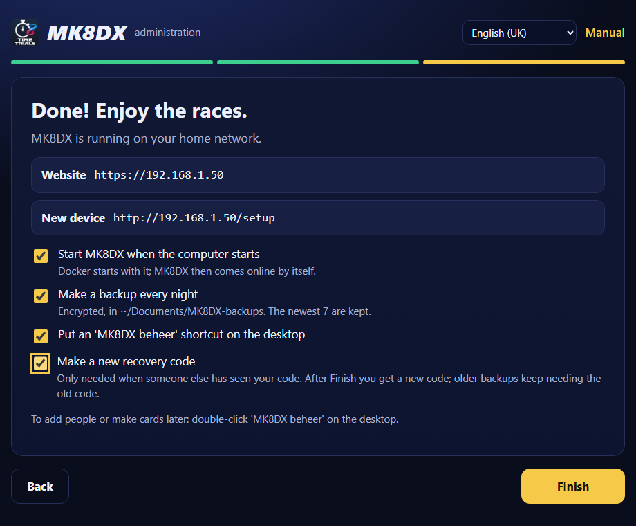
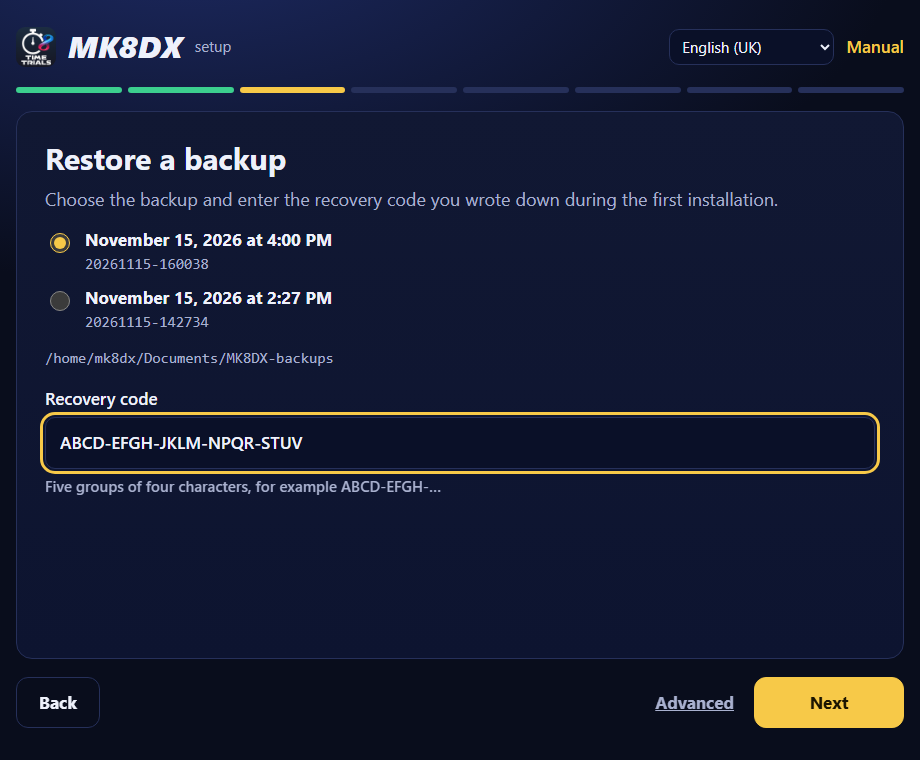

# MK8DX a casa o al tuo club — manuale

*Questa è una traduzione automatica della [guida inglese](../../A2_HOME_GUIDE_EN.md); fa fede la versione inglese. Le correzioni sono benvenute tramite il modulo di issue «Translation correction».*

Questo manuale ti accompagna passo dopo passo da un computer vuoto a una serata di gioco. Non ti serve alcuna conoscenza informatica. Leggi i capitoli in ordine; ogni capitolo si basa su quello precedente.

**Prima una nota onesta:** l'installazione per casa e club è rilasciata dalla versione 0.2.0. Windows 11 è testato dall'inizio alla fine, compreso un telefono Android in rete. Linux è stato testato solo in WSL 2, non ancora su un PC Linux separato o su un Raspberry Pi. I pacchetti per macOS sono compilati ma non ancora testati su un vero Mac, e un iPhone non è ancora stato testato. Ovunque qualcosa non sia ancora testato o compilato, il passaggio lo dice.

**Come leggere un passaggio:** dopo **Cosa fare** viene ciò che fai, dopo **Cosa vedi** ciò che dovrebbe succedere, e dopo **Vedi qualcos'altro?** cosa fare in quel caso. Le parole in grassetto sono pulsanti o testi che vedi esattamente così sullo schermo.

## 1. Che cos'è MK8DX a casa o al tuo club, e che cosa ti serve?

MK8DX è un sito web per Mario Kart 8 Deluxe: per conservare e confrontare i tempi di Prova a tempo, le registrazioni di LiveTrial e le serate di torneo. Con questa installazione il sito web gira su un computer nella tua rete. Telefoni, tablet e altri computer sulla stessa rete aprono il sito web attraverso quel computer. Nulla va su internet.

Ognuno accede con una **scheda di accesso** personale: una scheda con un codice QR. Un codice QR è un codice a barre quadrato che scansioni con la fotocamera del telefono o del tablet.

In questo manuale il computer su cui gira MK8DX si chiama **il computer MK8DX**.

Che cosa ti serve:

- **Un computer che resta acceso mentre si gioca:** Windows 11 con un processore Intel o AMD, Linux o macOS. Sono consigliati 8 GB di memoria. La configurazione controlla che ci siano almeno 6 GB di spazio libero su disco.
- **Una rete domestica:** il Wi-Fi o i cavi di rete del tuo router. Un router è la scatola che crea la tua rete (spesso fornita dal tuo provider internet). Tutti i dispositivi devono essere sulla stessa rete. Non usare una rete ospiti: di solito tiene separati i dispositivi.
- **Telefoni, tablet o altri computer** per i giocatori, preferibilmente con una fotocamera per scansionare i codici QR.
- **Una stampante** è comoda per stampare le schede di accesso e il codice di ripristino, ma non è obbligatoria.

Che cosa non ti serve:

- **Niente internet mentre giochi.** Solo durante la preparazione scarichi una volta Docker, Python e il pacchetto MK8DX (oppure qualcuno te li dà su una chiavetta USB).
- **Nessun account presso un'altra azienda**, nessun indirizzo email e nessun cloud.
- **Nessun abbonamento.** MK8DX e Python sono gratuiti. Docker Desktop è gratuito per uso personale e per piccole organizzazioni; le condizioni sono sul sito di Docker. Su Linux usi il Docker Engine gratuito.

<!-- image: network-overview -->

## 2. Preparare il computer

MK8DX ha bisogno di due programmi di supporto gratuiti:

- **Docker** esegue programmi in "container" isolati. Il sito web e il database di MK8DX girano lì dentro. Su Windows e macOS il programma si chiama Docker Desktop.
- **Python** è un linguaggio di programmazione. Il programma di installazione di MK8DX è scritto in Python. Ti serve Python dalla 3.12 alla 3.15.

Fai solo la parte per il tuo computer (2A, 2B o 2C) e salta le altre due.

## 2A. Preparare Windows 11

1. **Cosa fare:** controlla quale processore ha il tuo computer: Start → **Settings** (Impostazioni) → **System** (Sistema) → **About** (Informazioni), riga **System type** (Tipo di sistema). → **Cosa vedi:** "64-bit operating system, x64-based processor" (sistema operativo a 64 bit, processore basato su x64). → **Vedi qualcos'altro?** Se c'è scritto ARM, il pacchetto MK8DX per Windows non è adatto: esiste solo per x64 (Intel e AMD).
2. **Cosa fare:** installa prima **WSL** (Windows Subsystem for Linux). È una parte di Windows su cui gira Docker; senza WSL, Docker Desktop non si installa. Fai clic con il tasto destro sul pulsante Start e scegli **Terminal (Admin)** (Terminale (amministratore)) o **Windows PowerShell (Admin)**. Fai clic su **Yes** (Sì) quando Windows chiede l'autorizzazione. Digita `wsl --install` e premi Invio. → **Cosa vedi:** Windows scarica e installa WSL e Ubuntu; ci vogliono alcuni minuti. Alla fine dice che devi riavviare il computer. Riavvia il computer. → **Vedi qualcos'altro?** Se dopo il riavvio si apre una finestra che chiede un nome utente e una password per Ubuntu: inserisci un nome e una password a tua scelta (a MK8DX non servono) e poi chiudi la finestra. Se dice che WSL è già installato, digita `wsl --update` e premi Invio. Se parla di **virtualizzazione** ("Virtual Machine Platform" o "virtualization"), la virtualizzazione è disattivata nel BIOS del computer; attivala (i produttori la chiamano spesso Intel VT-x o AMD-V) oppure chiedi aiuto.
3. **Cosa fare:** scarica **Docker Desktop** per Windows (x86_64 / AMD64) da docker.com e apri il file scaricato. → **Cosa vedi:** il programma di installazione di Docker con la scelta di usare WSL 2. WSL è una parte di Windows su cui gira Docker. Lascia selezionata quella scelta e fai clic su **OK**. → **Vedi qualcos'altro?** Se Windows chiede se questa app può apportare modifiche, fai clic su **Yes** (Sì).
4. **Cosa fare:** attendi che l'installazione sia terminata e riavvia il computer se Docker lo chiede. → **Cosa vedi:** dopo il riavvio si apre Docker Desktop (oppure aprilo tu dal menu Start). La prima volta Docker ti chiede di accettare le sue condizioni. → **Vedi qualcos'altro?** Se Docker ti chiede di accedere o di creare un account: MK8DX non ha bisogno di un account Docker, saltalo se Docker lo permette. Se Docker dice ancora che WSL manca o deve essere aggiornato, ripeti il passaggio 2 (`wsl --install` o `wsl --update`) e riavvia.
5. **Cosa fare:** attendi nella finestra di Docker Desktop. → **Cosa vedi:** **Engine running** (motore in esecuzione) in basso a sinistra. → **Vedi qualcos'altro?** "Engine starting" (avvio del motore) può richiedere alcuni minuti. Se si blocca o mostra un errore, riavvia il computer e apri di nuovo Docker Desktop. Docker deve essere nella normale modalità container Linux (non "Windows containers").
6. **Cosa fare:** vai su python.org → **Downloads** e scarica il **Python install manager** (gestore di installazione di Python) per Windows (il file termina con `.msix`). Oggi questo è il modo ufficiale per installare Python su Windows. Apri il file scaricato e fai clic su **Install** (Installa). → **Cosa vedi:** Windows installa il Python install manager; poi puoi chiudere la finestra. → **Vedi qualcos'altro?** Puoi anche installarlo dal Microsoft Store: cerca "Python install manager" e fai clic su **Install** (Installa). Usa una delle due vie, non entrambe.
7. **Cosa fare:** fai clic su Start, digita `PowerShell`, apri **Windows PowerShell**, digita `py install 3.15` e premi Invio. Questo installa Python vero e proprio (l'install manager è solo lo strumento che scarica Python). → **Cosa vedi:** la prima volta alcune domande per verificare le impostazioni; rispondi con Invio (la scelta proposta) o con `y`. Poi Python viene scaricato e installato. A una domanda sull'aggiunta di una cartella al tuo PATH puoi rispondere `y`; non è obbligatorio. → **Vedi qualcos'altro?** Installa esattamente la 3.15 come sopra; anche la 3.12, la 3.13 o la 3.14 funzionano, una versione più recente (3.16 o successiva) non ancora.
8. **Cosa fare:** chiudi PowerShell, riaprilo, digita `python --version` e premi Invio. → **Cosa vedi:** `Python 3.15` seguito da un numero, per esempio `Python 3.15.2`. → **Vedi qualcos'altro?** Se si apre il Microsoft Store, o viene detto che python non è stato trovato: fai clic su Start, digita **Manage app execution aliases** (Gestisci alias di esecuzione app) e aprilo. Attiva **Python (default)** e disattiva **App Installer python.exe** e **python3.exe**. Se in passato hai installato un vecchio Python o il "Python launcher", rimuovilo tramite **Settings → Apps → Installed apps** (Impostazioni → App → App installate) e riprova.

<!-- image: docker-engine-running -->

<!-- image: python-install-manager -->

## 2B. Preparare Linux (Ubuntu o Debian)

Linux non è ancora stato testato dall'inizio alla fine con MK8DX. I passaggi sono scritti per Ubuntu 24.04 o più recente. Li digiti in un **terminale**: una finestra in cui dai comandi di testo (in Ubuntu lo apri con Ctrl+Alt+T). Termina ogni comando con Invio. **sudo** davanti a un comando significa "come amministratore di questo computer": Linux allora chiede la tua password, e mentre la digiti non vedi alcun carattere. È normale.

1. **Cosa fare:** digita `python3 --version`. → **Cosa vedi:** `Python 3.12`, `3.13`, `3.14` o `3.15`. → **Vedi qualcos'altro?** Un numero più basso (Debian 12, per esempio, ha la 3.11) è troppo vecchio; la 3.16 o superiore non è ancora supportata. Ti serve allora una versione più recente del tuo Linux; Ubuntu 24.04 ha Python 3.12.
2. **Cosa fare:** digita `sudo apt update` e poi `sudo apt install docker.io docker-compose-v2 python3-venv unzip`. Alla domanda se continuare rispondi con Y e Invio. → **Cosa vedi:** i pacchetti vengono scaricati e installati. → **Vedi qualcos'altro?** Se apt non trova un pacchetto, sul tuo Linux ha un altro nome (può succedere su Debian). Continua e verifica al passaggio 5 se Docker Compose funziona.
3. **Cosa fare:** digita `sudo systemctl enable --now docker`. Questo avvia Docker adesso e ogni volta che il computer si avvia. → **Cosa vedi:** nessun errore (a volte una riga che inizia con "Created symlink").
4. **Cosa fare:** digita `sudo usermod -aG docker $USER`. Questo dà al tuo utente il diritto di usare Docker. Poi esci e accedi di nuovo (o riavvia): il diritto vale solo dopo un nuovo accesso. → **Cosa vedi:** nessun errore. → **Nota:** chiunque sia nel gruppo docker ha di fatto diritti di amministratore su questo computer. Aggiungi solo te stesso.
5. **Cosa fare:** verifica con `docker info` e poi `docker compose version`. → **Cosa vedi:** un elenco di dettagli senza errori, e "Docker Compose version" con un numero. → **Vedi qualcos'altro?** "permission denied" (permesso negato): fai il passaggio 4 e non dimenticare di uscire. "Cannot connect to the Docker daemon" (impossibile connettersi al demone Docker): fai il passaggio 3.

Un **firewall** è una protezione che decide quali connessioni un computer lascia entrare. Se sul tuo Linux è attivo il firewall ufw o firewalld, la configurazione al capitolo 3 mostra quale comando lascia passare MK8DX.

## 2C. Preparare macOS

**Nota:** macOS non è ancora stato testato su un vero Mac. I passaggi qui sotto seguono ciò che la configurazione si aspetta su macOS.

1. **Cosa fare:** scegli menu Apple → **About This Mac** (Informazioni su questo Mac) e guarda **Chip** o **Processor** (Processore). → **Cosa vedi:** un chip Apple (M1, M2 e successivi): prendi il pacchetto `macos-arm64`. → **Vedi qualcos'altro?** Un processore Intel: prendi il pacchetto `macos-amd64`. Richiede macOS 10.15 o più recente e un Docker Desktop che supporti ancora il tuo Mac.
2. **Cosa fare:** scarica da docker.com **Docker Desktop** per Mac con il chip corrispondente, apri il file scaricato e trascina Docker in **Applications** (Applicazioni). → **Cosa vedi:** Docker nella tua cartella Applicazioni.
3. **Cosa fare:** apri Docker. Accetta le condizioni; se macOS chiede la tua password, inseriscila. → **Cosa vedi:** dopo un po' **Engine running** (motore in esecuzione) nella finestra di Docker Desktop. → **Vedi qualcos'altro?** Se Docker ti chiede di accedere: MK8DX non ha bisogno di un account Docker, saltalo se Docker lo permette.
4. **Cosa fare:** scarica da python.org il programma di installazione di Python 3.15 per macOS e aprilo. Procedi tra i passaggi con **Continue** (Continua) e **Install** (Installa). → **Cosa vedi:** il messaggio che l'installazione è riuscita.
5. **Cosa fare:** apri **Terminal** (Terminale) (Applicazioni → Utility → Terminale), digita `python3 --version` e premi Invio. → **Cosa vedi:** da `Python 3.12` a `3.15`. → **Vedi qualcos'altro?** Un numero più basso (per esempio la 3.9 di Apple stessa): chiudi il Terminale e riaprilo. Se è ancora più basso, installa di nuovo Python da python.org.
6. **Cosa fare:** digita `docker info` nel Terminale. → **Cosa vedi:** un elenco di dettagli senza errori. → **Vedi qualcos'altro?** Avvia Docker Desktop e attendi Engine running.

## 3. Installare MK8DX

**Estrarre il pacchetto**

1. **Cosa fare:** scarica il pacchetto MK8DX per casa o club per il tuo sistema: Windows, Linux o macOS, e per Linux e macOS anche per il tuo processore (amd64 o arm64). Per controllare che il download sia corretto, confronta il suo SHA-256 con la sua riga in `SHA256SUMS.txt` della stessa release (Windows: `Get-FileHash <file> -Algorithm SHA256`; Linux: `sha256sum <file>`; macOS: `shasum -a 256 <file>`); vedi anche `docs/RELEASE_PACKAGES.md#check-a-download`. → **Cosa vedi:** un file zip nella cartella Download. → **Vedi qualcos'altro?** Se il browser avvisa che il file non è sicuro o è scaricato raramente: scegli **Keep** (Mantieni). Windows: poi fai clic con il tasto destro sul file zip → **Properties** (Proprietà), seleziona **Unblock** (Annulla blocco) in basso e fai clic su **OK**. Fallo prima di estrarre; altrimenti Windows (Smart App Control) potrebbe in seguito bloccare `Start-MK8DX-LAN.cmd`. Non disattivare Smart App Control: dopo si può riattivare solo con una nuova installazione di Windows.
2. **Cosa fare:** estrai il file zip in una cartella permanente, per esempio una cartella MK8DX in Documenti. Windows: fai clic con il tasto destro sul file zip → **Extract All** (Estrai tutto). Scegli una cartella che resta: MK8DX in seguito si avvierà sempre da questa cartella, quindi non spostarla e non eliminarla. → **Cosa vedi:** una cartella che contiene, tra l'altro, `Start-MK8DX-LAN.cmd`, `README-FIRST.txt` e le cartelle `docs`, `images` e `tooling`. → **Vedi qualcos'altro?** Se hai solo aperto il file zip in Esplora file, estrailo davvero: l'avvio dall'interno del file zip non funziona. Linux senza file manager (un server o WSL): `unzip ~/Downloads/mk8dx-a2-linux-amd64-<version>.zip -d ~/Documents/MK8DX` (con il nome del tuo file; `unzip` viene dal passaggio 2 del capitolo 2B). Lo zip contiene una cartella con il nome del pacchetto; aprila per avviare MK8DX.

<!-- os: windows -->

**Avviare su Windows**

1. **Cosa fare:** nella cartella estratta, fai doppio clic su **Start-MK8DX-LAN.cmd**. → **Cosa vedi:** una finestra con il logo MK8DX e un conto alla rovescia 3-2-1-GO con segnali acustici ([per toglierlo](../../../guides/HOSTING.md#the-launcher-window-look-and-options)), poi righe come "Pacchetto MK8DX:" e "Installazione privata:". La prima volta mostra anche "Preparazione dei pacchetti Python inclusi (una sola volta, senza internet)." e "Caricamento delle immagini Docker incluse. Può richiedere diversi minuti." Ci vogliono alcuni minuti. Poi mostra "MK8DX setup is open in your browser:" (la configurazione di MK8DX è aperta nel browser) e la configurazione si apre nel browser. → **Vedi qualcos'altro?** Vedi i messaggi qui sotto.
2. **Cosa fare:** tieni aperta la finestra nera finché non hai fatto clic su **Fine** nella configurazione. Lo dice anche la finestra: "Keep this window open until you click Finish." (tieni aperta questa finestra finché non fai clic su Finish).

Messaggi nella finestra nera su Windows:

- **"Manca Python da 3.12 a 3.15. Installa il Python install manager da python.org (o dal Microsoft Store), esegui: py install 3.15, riapri PowerShell e riprova."** Fai i passaggi da 6 a 8 del capitolo 2A e poi fai di nuovo doppio clic su Start-MK8DX-LAN.cmd.
- **"Docker Desktop manca o non è in esecuzione. Avvia Docker Desktop in modalità container Linux, attendi che mostri "Engine running" e riprova."** Avvia Docker Desktop, attendi Engine running e fai di nuovo doppio clic.
- Sotto un errore compare **"Il passaggio selezionato si è interrotto. Leggi il messaggio qui sopra prima di riprovare."** Leggi la riga sopra, risolvi il problema e premi un tasto per chiudere la finestra.

<!-- /os -->

<!-- os: linux macos -->

**Avviare su Linux e macOS**

1. **Cosa fare:** apri un terminale nella cartella estratta. Linux: fai clic con il tasto destro nella cartella e scegli "Open in Terminal" (Apri nel terminale) se il tuo file manager lo offre. Su macOS e Linux funziona anche così: apri il Terminale, digita `cd ` (con uno spazio dopo), trascina la cartella nella finestra e premi Invio. → **Cosa vedi:** il terminale si trova nella cartella del pacchetto.
2. **Cosa fare:** digita `sh tooling/start-mk8dx.sh` e premi Invio. → **Cosa vedi:** il logo MK8DX e un conto alla rovescia 3-2-1-GO, poi "Pacchetto MK8DX:", il numero di Python, "Docker Compose version". La prima volta anche "Caricamento delle immagini Docker incluse. Può richiedere diversi minuti." e "Preparazione dei pacchetti Python inclusi (una sola volta, senza internet)." Poi "Installazione privata:" e "MK8DX setup is open in your browser:" (la configurazione di MK8DX è aperta nel browser), e la configurazione si apre nel browser. → **Vedi qualcos'altro?** Se non si apre nessun browser, copia dal terminale nel browser l'indirizzo che inizia con `http://127.0.0.1:`.
3. **Cosa fare:** tieni aperto il terminale finché non hai fatto clic su **Fine**.

Messaggi nel terminale su Linux e macOS:

- **"Manca Python da 3.12 a 3.15. Installalo (Ubuntu/Debian: sudo apt install python3 python3-venv; macOS: python.org) e riprova."** Ripeti il capitolo 2B o 2C.
- **"Docker non è in esecuzione o questo utente non può usarlo (Linux: sudo systemctl start docker ed entra nel gruppo docker; macOS: avvia Docker Desktop)."** Linux: fai i passaggi 3 e 4 del capitolo 2B. macOS: avvia Docker Desktop.
- **"Impossibile creare l'ambiente Python privato (Ubuntu/Debian: sudo apt install python3-venv)."** Installa python3-venv come al passaggio 2 del capitolo 2B.

<!-- /os -->

**La configurazione nel browser**

La configurazione è una pagina nel browser che funziona solo sul computer MK8DX stesso. È nella lingua del tuo browser (una delle 15 lingue del gioco; altrimenti in inglese). In alto a destra ci sono il menu della lingua, per scegliere un'altra lingua, e **Manuale**: apre questo manuale. In basso ci sono **Indietro**, a volte **Avanzate**, e **Avanti**. I puntini in alto mostrano a che punto sei.

1. **Benvenuto in MK8DX.** **Cosa fare:** leggi la schermata e fai clic su **Avanti**. → **Cosa vedi:** "Controllo rapido". Il pulsante **Ripristina un backup** in questa schermata serve solo per un nuovo computer (capitolo 10).
2. **Controllo rapido.** **Cosa fare:** attendi un momento. → **Cosa vedi:** tre spunte verdi accanto a **Docker Desktop è in esecuzione**, **Spazio libero su disco sufficiente** (con il numero di GB) e **Windows, Linux o macOS**. Fai clic su **Avanti**. → **Vedi qualcos'altro?** Un punto esclamativo con una spiegazione, per esempio "Avvia Docker Desktop, attendi 'Engine running' e fai clic su Riprova." oppure "Libera almeno 6 GB su questa unità." Risolvi e fai clic su **Riprova**. Su Linux anche il primo controllo si chiama "Docker Desktop è in esecuzione"; lì si riferisce a Docker Engine.
3. **Che tipo di installazione?** **Cosa fare:** lascia selezionato **Rete di casa, del club o di una serata LAN, senza bisogno di internet** (consigliato) e fai clic su **Avanti**. → **Cosa vedi:** "La tua rete".
4. **La tua rete.** Un **indirizzo di rete** (indirizzo IP) è il numero con cui i dispositivi trovano questo computer nella tua rete, come un numero civico. **Cosa fare:** leggi l'indirizzo sotto "Telefoni, tablet e altri PC raggiungono MK8DX a questo indirizzo:" e annotalo, per esempio `https://192.168.1.50`. Fai clic su **Installa**. → **Cosa vedi:** su Windows "Questa rete è impostata come rete di casa (privata)." oppure "Al momento Windows considera questa rete pubblica. Quando fai clic su Installa, MK8DX la imposta come privata e consente solo MK8DX." Su Linux e macOS qui non compare nessuna frase sulla rete. → **Vedi qualcos'altro?** Se il computer ha più di una connessione (cavo e Wi-Fi), fai clic su **Avanzate** e in "Scegli un altro indirizzo di questo computer:" scegli l'indirizzo della rete su cui si trovano anche i telefoni. Se dice "Nessun indirizzo di rete trovato.", collega il computer alla tua rete domestica e fai clic su **Riprova**.
5. **Installazione.** **Cosa fare:** attendi e tieni aperta la finestra. → **Cosa vedi:** "MK8DX è in fase di preparazione. Tieni aperta questa finestra." e uno dopo l'altro "Preparazione dell'installazione", "Autorizzazione della rete (Windows chiede il permesso)", "Avvio del database e del sito", "Verifica" e infine "MK8DX è in esecuzione. Mancano due brevi passaggi." Fai clic su **Avanti**. Su Windows una finestra di Windows chiede una volta se Windows PowerShell può apportare modifiche: fai clic su **Yes** (Sì). Con questo, MK8DX contrassegna la tua rete domestica come privata e lascia passare solo MK8DX attraverso il firewall (la protezione di Windows). Se MK8DX è già stato installato in precedenza su questo computer e su questo indirizzo, quel permesso c'è ancora e Windows non lo chiede di nuovo. → **Vedi qualcos'altro?** Un errore rosso: fai clic su **Dettagli** per leggere cosa è andato storto, risolvi e fai clic su **Riprova**. Se nella finestra di Windows hai fatto clic su No, dice che Windows non ha consentito la modifica; fai clic su **Riprova** e poi su **Yes**.
6. **Solo Linux: il firewall.** **Cosa fare:** durante o dopo l'installazione, fai clic su **Dettagli** e cerca la riga che inizia con "Network:". → **Cosa vedi:** "not-needed" (non necessario: niente da fare), oppure "manual:" (manuale) seguito da un comando come `sudo ufw allow from 192.168.1.0/24 to 192.168.1.50 port 80,443 proto tcp`. → **Quindi fai:** digita esattamente quel comando (con il tuo indirizzo, come mostrato lì) in un terminale. Senza quel comando i telefoni non possono aprire il sito web.
7. **Il tuo account amministratore.** L'**amministratore** è la persona che aggiunge le persone e crea le schede di accesso; cioè tu. **Cosa fare:** inserisci un nome in **Il tuo nome**, per esempio "Papà" o "Squadra del club", e fai clic su **Avanti**. Il nome è visibile solo all'interno di questa installazione. → **Cosa vedi:** "Chi gioca?"
8. **Chi gioca?** **Cosa fare:** digita i nomi dei giocatori in **Nomi (uno per riga)**, ognuno su una riga, e fai clic su **Aggiungi**. Oppure fai subito clic su **Salta**: puoi farlo più tardi esattamente allo stesso modo in MK8DX beheer (capitolo 5). → **Cosa vedi:** i nomi sotto "In questa installazione:", tu stesso con "(amministratore)" dopo il tuo nome. Fai clic su **Avanti**.
9. **Accedi su telefoni e PC.** **Cosa fare:** puoi già creare qui le schede di accesso (i capitoli 5 e 6 spiegano come), oppure fare semplicemente clic su **Avanti**. → **Cosa vedi:** "Fatto! Buone gare."
10. **Fatto! Buone gare.** **Cosa fare:** annota i due indirizzi: **Sito web** (per esempio `https://192.168.1.50`) e **Nuovo dispositivo** (per esempio `http://192.168.1.50/setup`). Lascia attive le tre spunte: **Avvia MK8DX con Windows**, **Crea un backup ogni notte** e **Metti un collegamento «MK8DX beheer» sul desktop**. Fai clic su **Fine**. → **Cosa vedi:** il tuo codice di ripristino (capitolo 4). → **Su Linux e macOS** la prima spunta si chiama "Avvia MK8DX all'avvio del computer". Su macOS apre poi Docker Desktop quando accedi. Su Linux se ne occupa `sudo systemctl enable --now docker` del capitolo 2B; se non l'hai ancora fatto, dopo Fine la configurazione mostra esattamente quel comando.
11. **Chiusura.** **Cosa fare:** leggi il capitolo 4 e conserva il codice di ripristino. Poi fai clic su **Chiudi**. → **Cosa vedi:** "Ora puoi chiudere questa finestra." Chiudi la scheda del browser. Su Windows la finestra nera chiede di premere un tasto; premi un tasto e si chiude. Se non fai nulla, la pagina di configurazione si ferma da sola dopo 10 minuti. MK8DX stesso continua a funzionare.

<!-- image: windows-permission -->

## 4. Il codice di ripristino e la cartella dei backup

Un **backup** è una copia di riserva di tutto ciò che c'è in MK8DX: persone, tempi, tornei e impostazioni. MK8DX fa un backup ogni notte alle 03:00 e conserva i 7 più recenti. I backup sono cifrati: senza la chiave non si possono leggere.

Il **codice di ripristino** è quella chiave. È composto da cinque gruppi di quattro lettere e cifre, per esempio `ABCD-EFGH-JKLM-NPQR-STUV`. Ti serve solo per ripristinare un backup su un altro computer.

1. **Cosa fare:** dopo **Fine**, guarda la scheda **Codice di ripristino MK8DX**. → **Cosa vedi:** il codice, la frase "Senza questo codice un backup non si può aprire. Viene mostrato una sola volta." e sotto la cartella in cui vanno i backup.
2. **Cosa fare:** ricopia il codice su carta oppure fai clic su **Stampa schede** per stampare questa pagina. Controllalo lettera per lettera. → **Cosa vedi:** il codice su carta. → **Perché una sola volta?** MK8DX conserva il codice protetto su questo computer per il backup notturno, ma non lo mostra mai più. Se il computer si rompe, resta solo la carta.
3. **Cosa fare:** conserva il foglio in un posto sicuro, non vicino al computer. Chi ha il codice e un backup può aprire tutto.

Dove si trovano i backup:

- **Windows:** nella cartella Documenti, cartella `MK8DX-backups` (sul disco: `C:\Users\<your name>\Documents\MK8DX-backups`).
- **Linux e macOS:** nella tua cartella home, cartella `Documents/MK8DX-backups` (quindi `~/Documents/MK8DX-backups`). Anche su un Linux in un'altra lingua quella cartella si chiama Documents.
- La configurazione mostra la cartella esatta sotto il codice di ripristino.

Di tanto in tanto copia la cartella `MK8DX-backups` su una chiavetta USB o su un'altra unità. Altrimenti, se il computer si rompe, i backup si trovano solo su quel computer rotto.

Se togli la spunta da **Crea un backup ogni notte** e fai clic su **Fine**, MK8DX interrompe il backup notturno; i backup già fatti restano. Se in seguito rimetti la spunta, i backup riprendono con lo stesso codice di ripristino, che non viene mostrato di nuovo. Se non hai più quel codice, creane uno nuovo come qui sotto.

**Un nuovo codice di ripristino**

Crea un nuovo codice se qualcun altro potrebbe aver visto il tuo o se hai perso il foglio. Funziona dalla versione 0.2.7.

1. **Cosa fare:** apri MK8DX beheer, fai clic su **Avanti** fino a «Fatto! Buone gare.», metti la spunta su **Crea un nuovo codice di ripristino** e fai clic su **Fine**. → **Cosa vedi:** la scheda **Codice di ripristino MK8DX** con il nuovo codice, mostrato una sola volta, e la frase che i backup precedenti richiedono ancora il vecchio codice.
2. **Cosa fare:** scrivi il nuovo codice come nel passo 2 qui sopra. Conserva il vecchio foglio con i backup precedenti: non vengono convertiti e si aprono solo con il vecchio codice. Elimina quei vecchi backup e il vecchio foglio quando non ti servono più. → **Cosa vedi:** i backup successivi usano il nuovo codice.

## 5. Persone e schede di accesso (MK8DX beheer)

**MK8DX beheer** (in olandese: amministrazione di MK8DX) è la stessa pagina della configurazione, ma per dopo: aggiungere persone e creare schede di accesso. Funziona solo sul computer MK8DX stesso. Il collegamento sul desktop si chiama "MK8DX beheer" in ogni lingua; il titolo della pagina è **Amministrazione MK8DX**.

Un **account** è chi accede. Un **Giocatore** è il giocatore nelle classifiche, con i suoi tempi. Dopo l'accesso, ognuno sceglie o rivendica il proprio Giocatore sul sito web. I nomi non vengono mai collegati automaticamente.

**Aprire MK8DX beheer**

1. **Cosa fare (Windows):** fai doppio clic su **MK8DX beheer** sul desktop. Quel collegamento avvia la stessa cosa di Start-MK8DX-LAN.cmd. → **Cosa vedi:** la finestra di avvio con la sua breve introduzione di gara e poi, nel browser, la pagina con "amministrazione" in alto e il titolo **Amministrazione MK8DX**. → **Vedi qualcos'altro?** Nessun collegamento: fai doppio clic su Start-MK8DX-LAN.cmd nella cartella MK8DX.
2. **Cosa fare (Linux):** avvia **MK8DX beheer** dal desktop o dal menu delle applicazioni. Su alcuni desktop Linux devi prima consentire un'icona del genere (fai clic con il tasto destro e scegli l'opzione per consentirne l'avvio). Funziona anche con `sh tooling/start-mk8dx.sh` nella cartella MK8DX, come al capitolo 3. → **Cosa vedi:** un terminale e poi la pagina **Amministrazione MK8DX**.
3. **Cosa fare (macOS, non testato):** fai doppio clic su **MK8DX beheer.command** sul desktop, oppure avvia `sh tooling/start-mk8dx.sh` come al capitolo 3. → **Cosa vedi:** il Terminale e poi la pagina **Amministrazione MK8DX**.

- **Hai digitato tu 127.0.0.1 con una porta?** Una pagina **MK8DX lokaal beheer** che chiede un codice di amministrazione monouso è la pagina tecnica dell'host. Non ti serve: chiudila e apri MK8DX beheer con il collegamento, come sopra.

**Aggiungere persone**

1. **Cosa fare:** digita i nomi in **Nomi (uno per riga)** e fai clic su **Aggiungi**. → **Cosa vedi:** i nomi sotto "In questa installazione:".
2. **Cosa fare:** fai clic su **Avanti**. → **Cosa vedi:** "Accedi su telefoni e PC" in due passaggi: **Passaggio 1 · Prepara il dispositivo** con la scheda **Prepara un dispositivo** (una volta per dispositivo, non ti fa ancora accedere) e **Passaggio 2 · Accedi come la persona giusta** con, per ogni persona, un riquadro con il pulsante **Crea scheda**.

**Creare e stampare le schede**

1. **Cosa fare:** fai clic su **Crea scheda** accanto a una persona. → **Cosa vedi:** un codice QR con "Valida fino a" e un orario. Una scheda funziona una sola volta e per 15 minuti. Fai scansionare subito la scheda alla persona (capitolo 6), oppure stampala.
2. **Cosa fare:** crea prima le schede che vuoi e poi fai clic su **Stampa schede**. → **Cosa vedi:** la finestra di stampa del browser con tutte le schede presenti sullo schermo, compresa la scheda "Prepara un dispositivo".
3. **Cosa fare:** crea una scheda anche per te (il nome con "(amministratore)") se vuoi accedere dal tuo telefono.

**Sostituire o revocare una scheda**

- **Nuova scheda**: crea una nuova scheda per quella persona. La scheda precedente della persona su questa schermata smette allora di funzionare.
- **Revoca scheda**: la scheda smette subito di funzionare. Vedi "Revocata: questa scheda non funziona più." Usalo quando una scheda è andata persa o è finita alla persona sbagliata.
- Puoi revocare solo una scheda che è ancora su questa schermata. Se hai già chiuso MK8DX beheer, una scheda non usata scade da sola dopo 15 minuti. Se potrebbe essere già stata usata, scegli **Disconnetti ovunque** qui sotto.

**Disconnettere qualcuno ovunque**

1. **Cosa fare:** apri MK8DX beheer. Nella prima schermata ogni persona ha un pulsante **Disconnetti ovunque**. Fai clic. → **Cosa vedi:** il pulsante diventa **Sicuro? Fai clic di nuovo**.
2. **Cosa fare:** fai clic ancora una volta. → **Cosa vedi:** "Disconnesso da tutti i dispositivi. Con una nuova scheda questa persona può accedere di nuovo." Quella persona è ora disconnessa sul sito web e nell'app, il cambio con un tocco a quell'account scompare e le schede aperte di quella persona smettono di funzionare. → **Vedi qualcos'altro?** Accanto al tuo nome il secondo clic mostra "Disconnetti te stesso dal menu account sul sito («Disconnetti da tutti i dispositivi»)." e non viene disconnesso nessuno.

**Aggiungere un telefono o dispositivo per una persona**

Il modo guidato per mettere in funzione il telefono, il tablet o il PC di qualcuno, anche un iPhone o un dispositivo senza l'app MK8DX.

1. **Cosa fare:** apri MK8DX beheer e fai clic su **Aggiungi un telefono o dispositivo** accanto alla persona. → **Cosa vedi:** "Aggiungi un telefono o dispositivo per …" con il nome, e **1 · Fiducia** con la scheda **Prepara un dispositivo** e il suo codice breve.
2. **Cosa fare:** sul dispositivo, con l'app MK8DX (Android): scansiona il codice QR nell'app. Senza l'app (iPhone, iPad, un altro telefono o un PC): scansionalo con la fotocamera e segui la pagina che si apre per installare il certificato (capitolo 6). Controlla che la pagina o l'app mostri lo stesso codice. Se questo dispositivo è già stato preparato, salta questo passaggio. Fai clic su **Avanti**. → **Cosa vedi:** **2 · Scansiona la carta di accesso** con la scheda personale di quella persona, "Personale per … Funziona una volta." e un conto alla rovescia come "Valida ancora per 14:59".
3. **Cosa fare:** scansiona quella scheda con lo stesso dispositivo e accetta lì l'invito (capitolo 6). → **Cosa vedi:** in MK8DX beheer, da solo entro pochi secondi: **3 · Fatto** e "… ha eseguito l'accesso". → **Vedi qualcos'altro?** "Questa scheda è scaduta." oppure "Questa scheda è stata revocata.": fai clic su **Nuova scheda**; la vecchia scheda smette di funzionare quando ne crei una nuova. "Questa installazione non può segnalare se la scheda è stata usata": controlla il dispositivo e fai clic su **Ha funzionato**.
4. **Cosa fare:** fai clic su **Un altro dispositivo** per un secondo dispositivo della stessa persona, oppure su **Torna alle persone**.

**Stampare una scheda di benvenuto**

1. **Cosa fare:** in Aggiungi un telefono o dispositivo, scegli **A6** o **A4** in **Formato carta** e fai clic su **Scheda di benvenuto**. → **Cosa vedi:** un'anteprima di una pagina, "Benvenuto in MK8DX, …!", con l'indirizzo e tre passaggi numerati: 1 Fiducia (il codice QR di Prepara un dispositivo e il codice di controllo), 2 Scansiona la carta di accesso (il codice QR personale, contrassegnato PERSONALE, con "Valida fino a") e 3 Fatto.
2. **Cosa fare:** fai clic su **Stampa** e poi su **Indietro**. → **Cosa vedi:** la finestra di stampa del browser con solo la scheda di benvenuto.

- La scheda di accesso stampata funziona una volta e per 15 minuti dal momento in cui è stata creata, anche su carta. MK8DX non può creare una scheda che duri di più, quindi stampala poco prima di consegnarla. Se viene stampata senza una scheda valida (al passaggio 1, o dopo la scadenza), il passaggio 2 è un riquadro vuoto: la persona riceve allora una nuova scheda il giorno stesso. La parte Fiducia resta valida finché MK8DX non si sposta a un altro indirizzo.

**Chiudere MK8DX beheer**

1. **Cosa fare:** fai clic su **Avanti** fino a "Fatto! Buone gare.", lascia attive le spunte, fai clic su **Fine** e poi su **Chiudi**. → **Cosa vedi:** "Ora puoi chiudere questa finestra." MK8DX continua a funzionare.

## 6. Preparare un dispositivo e accedere

Un **certificato** è una prova d'identità digitale. Grazie a esso un telefono sa con certezza che sta parlando con il tuo computer MK8DX e con nient'altro, e la connessione è cifrata (https). Poiché MK8DX funziona senza internet, la configurazione crea un proprio certificato. Ogni dispositivo deve imparare una volta a fidarsene. L'**impronta** (fingerprint) è un codice breve che appartiene esattamente a questo certificato; con essa controlli di installare il certificato giusto.

**Perché un certificato, anche a casa senza internet?**

- **Sapere con certezza che è il tuo MK8DX.** Su una rete di casa o del club, chiunque sia sullo stesso Wi-Fi può fingere di essere il tuo computer MK8DX, per esempio un ospite con un portatile. Senza certificato il tuo telefono non può accorgersi della differenza. Con il certificato il browser rifiuta qualsiasi altro computer.
- **Nessuno ascolta.** Le schede di accesso, la tua sessione e tutto ciò che inserisci viaggiano cifrati sul Wi-Fi.
- **Perché MK8DX crea un proprio certificato.** I siti web su internet usano certificati di emittenti note che sono già presenti in ogni dispositivo. Questi non rilasciano certificati per un indirizzo di casa come `192.168.1.50` e non funzionano senza internet. Per questo MK8DX crea un proprio certificato durante l'installazione, e tu dici una volta a ogni dispositivo che può fidarsene.
- **Che cosa consenti installandolo.** Il certificato è destinato solo agli indirizzi di rete privati di MK8DX, e la sua chiave segreta resta protetta sul computer MK8DX. Installa solo il certificato del tuo MK8DX (controlla l'impronta) e rimuovilo da un dispositivo quando non usi più quell'installazione.

**Che cosa non funziona se non installi il certificato?**

- A ogni visita il browser mostra un avviso a tutta pagina, come "Your connection is not private" (la connessione non è privata). Puoi ignorarlo, ma non farlo: non potresti più vedere se stai davvero parlando con il tuo MK8DX.
- Anche dopo averlo ignorato, le **notifiche del browser** non funzionano: il browser le consente solo con un certificato attendibile. Anche altre funzioni del browser potrebbero rifiutarsi.
- Che cosa funziona senza un certificato installato: l'**app Android**. Impara il certificato da sola dalla scheda **Prepara un dispositivo** (capitolo 7). Un browser sullo stesso dispositivo ha comunque bisogno del certificato.

**Il computer MK8DX stesso**

Anche il computer su cui gira MK8DX deve fidarsi una volta di MK8DX, altrimenti il suo browser avvisa riguardo al sito web.

1. **Cosa fare:** apri MK8DX beheer, fai clic su **Avanti** fino a "Accedi su telefoni e PC" e guarda il riquadro **Questo computer** sotto **Passaggio 1**. → **Cosa vedi:** "Questo computer si fida già di MK8DX." Allora hai finito. → **Vedi qualcos'altro?** Se mostra il pulsante **Prepara questo computer**, vai al passaggio 2.
2. **Cosa fare:** fai clic su **Prepara questo computer**. → **Cosa vedi:** una finestra di Windows, **Security Warning** (Avviso di sicurezza), che chiede se vuoi installare il certificato, con un'**identificazione personale (sha1)** (thumbprint). Confrontala con l'identificazione in MK8DX beheer; se corrispondono, fai clic su **Yes** (Sì). → **Cosa vedi:** "Questo computer si fida già di MK8DX." → **Vedi qualcos'altro?** Se hai fatto clic su **No** o le identificazioni sono diverse: non fare clic su Yes, chiudi la finestra e chiedi aiuto. Su Linux o macOS, al posto del pulsante c'è scritto di aprire l'indirizzo sotto "Prepara un dispositivo" nel browser di questo computer; segui poi i passaggi qui sotto su questo computer.

**Una volta per dispositivo: Prepara un dispositivo**

1. **Cosa fare:** collega il telefono, il tablet o il PC alla stessa rete Wi-Fi o via cavo del computer MK8DX. Su un telefono non usare i dati mobili al posto del Wi-Fi. → **Cosa vedi:** il nome del tuo Wi-Fi nella connessione.
2. **Cosa fare:** con la fotocamera, scansiona il codice QR sulla scheda **Prepara un dispositivo** (in MK8DX beheer o su carta) e tocca il link che compare. Senza fotocamera, digita nel browser l'indirizzo **Nuovo dispositivo**, per esempio `http://192.168.1.50/setup`. → **Cosa vedi:** la pagina **Prepara questo dispositivo** con "Fallo una volta per telefono, tablet o PC. Poi scansiona la tua scheda di accesso personale." → **Vedi qualcos'altro?** Se la pagina non si apre: controlla la rete e che il computer MK8DX sia acceso (capitolo 11).
3. **Cosa fare:** confronta il codice sotto "Controlla prima questo codice." con il **Impronta digitale** sulla scheda "Prepara un dispositivo" (quattro gruppi di quattro caratteri). → **Cosa vedi:** esattamente lo stesso codice. → **Vedi qualcos'altro?** Se il codice è diverso, non installare nulla. Potresti essere su un'altra rete o su un altro indirizzo; controlla prima questo.
4. **Cosa fare:** segui la parte per il tuo dispositivo. La parte per il dispositivo che stai usando è già aperta; per un altro dispositivo, aprila sotto "Un altro tipo di dispositivo?". Tocca **Scarica il certificato** (su iPhone e iPad: **Scarica il profilo**) e segui i passaggi qui sotto. Il file si chiama `MK8DX-<codice di verifica>-<data>.crt`. Se Chrome avvisa che il download non è sicuro, scegli **Conserva** solo dopo aver controllato che il codice corrisponda alla scheda. → **Cosa vedi:** in fondo "Fatto? Scansiona la tua scheda di accesso personale oppure apri" con l'indirizzo del sito web.

I passaggi nella pagina "Prepara questo dispositivo":

<!-- filter: device -->

- **Android:** tocca il pulsante per scaricare il certificato. Apri Impostazioni e cerca "certificato" (spesso: Sicurezza → Altre impostazioni di sicurezza → Crittografia e credenziali → Installa un certificato → Certificato CA). Scegli il file MK8DX scaricato e conferma con il tuo PIN. I nomi dei menu variano a seconda della marca del telefono.
- **iPhone e iPad (non ancora testati con questa installazione):** tocca il pulsante per scaricare il profilo e consentilo. Apri Impostazioni → Profilo scaricato → Installa. Poi Impostazioni → Generali → Info → Impostazioni attendibilità certificati → attiva MK8DX.
- **Windows:** scarica il certificato e aprilo. Scegli Installa certificato → Utente corrente → Colloca tutti i certificati nel seguente archivio → Autorità di certificazione radice attendibili. Non scegliere Autorità di certificazione intermedie. Riavvia il browser.
- **Mac (macOS non è ancora testato dall'inizio alla fine):** scarica il certificato e aprilo; si apre Accesso Portachiavi. Apri il certificato MK8DX → Fidati → Fidati sempre.
- **Linux (non ancora testato dall'inizio alla fine per questa via):** aggiungi lo stesso certificato all'archivio radice attendibile della tua distribuzione o del tuo browser. I passaggi esatti variano a seconda della distribuzione. Su Ubuntu e Debian (testato in WSL 2): il file `MK8DX-*.crt` scaricato è in formato DER, quindi convertilo mentre lo installi: `sudo openssl x509 -inform DER -in ~/Downloads/MK8DX-*.crt -out /usr/local/share/ca-certificates/mk8dx.crt` e poi `sudo update-ca-certificates`. Firefox e Chrome su Linux possono avere un proprio archivio; se il browser continua ad avvisare, importa lo stesso file lì nelle impostazioni dei certificati (Autorità).

<!-- /filter -->

**Accedere con la tua scheda personale**

1. **Cosa fare:** scansiona la tua scheda (quella con il tuo nome) e tocca il link. → **Cosa vedi:** **Unisciti a questa installazione di MK8DX** e "Controlla prima che questo indirizzo HTTPS appartenga all'host di cui ti fidi. L'invito si può usare una sola volta." La barra degli indirizzi del browser deve mostrare l'indirizzo del sito web, per esempio `https://192.168.1.50`. → **Vedi qualcos'altro?** Un avviso del browser sul certificato o su una connessione non sicura: non ignorarlo mai. Fai prima "Prepara un dispositivo" qui sopra.
2. **Cosa fare:** controlla il nome della scheda sotto **Accedi come:**. Se è il tuo nome, attendi "Invito pronto. Conferma per accedere." e tocca **Accetta l'invito**. Se mostra un altro nome, non toccare accetta: la scheda resta valida per la persona giusta. → **Cosa vedi:** "Hai effettuato l'accesso come" con il tuo nome, e **Continua su MK8DX**. Toccalo. → **Vedi qualcos'altro?** "Questo invito non è valido. Chiedi all'amministratore un nuovo codice QR." oppure "Accesso non riuscito. Chiedi all'amministratore un nuovo invito.": la scheda è già stata usata, è scaduta o è stata revocata. Fai creare all'amministratore una **Nuova scheda**.
3. **Cosa fare:** segui i passaggi di benvenuto sul sito web: se hai già tempi o tornei qui, e come vuoi essere chiamato. È così che scegli o rivendichi il tuo Giocatore. → **Cosa vedi:** il tuo nome e i tuoi tempi. → **Vedi qualcos'altro?** Se il nome sulla tua scheda (per esempio 'Papà') non è già compilato: è giusto così. Il nome sulla scheda è solo l'etichetta in Amministrazione MK8DX; il tuo nome da giocatore lo scegli tu qui.

**Un altro dispositivo per la stessa persona**

- Un giocatore può creare una scheda da solo: il menu dell'account sul sito web ha **Accedi anche su un altro dispositivo**. Apre **Accedi su un altro dispositivo** con una scheda che "funziona una volta, valida fino a" un orario. Scansionala con l'altro dispositivo. Mostrala solo al tuo dispositivo: chi la scansiona accede al tuo account.
- Gli amministratori non hanno quel pulsante. Creano per sé una **Nuova scheda** in MK8DX beheer.
- Un nuovo dispositivo fa sempre prima una volta "Prepara un dispositivo".
- **Nessuna fotocamera, o accesso sul computer MK8DX stesso?** Crea la scheda di quella persona in MK8DX beheer e fai clic su **Accedi su questo computer** (apre la pagina di accesso nel browser del computer MK8DX) oppure **Copia link**. Invia un link copiato solo alla persona stessa, per esempio in un messaggio privato: chi lo apre può accedere come quella persona. Funziona una volta e per 15 minuti. Sulla scheda "Prepara un dispositivo", **Copia indirizzo** copia l'indirizzo; non è segreto.

**Lasciare questa installazione su un dispositivo:** rimuovi di nuovo il certificato nelle stesse impostazioni che hai usato per installarlo.

## 7. L'app Android e LiveTrial

**Associare l'app Android**

Usa l'app Android attuale della versione pubblicata. La configurazione A2 ha tre passaggi: **Connetti**, **Considera attendibile l'installazione** e **Accedi**. L'app controlla la propria connessione quando scansioni la scheda Prepara un dispositivo. Per il sito nel browser anche Android deve considerare attendibile il certificato; l'app ti aiuta a installarlo. Scansiona la scheda personale direttamente nell'app, senza approvazione nel browser né codice dispositivo.

1. **Cosa fare:** apri l'app. Su una nuova installazione parte da **Scegli la tua community**; altrimenti tocca il nome della community in alto nell'app e poi **Aggiungi una community**. → **Cosa vedi:** **Scegli la tua community** con i riquadri **A casa o al club** e **Community online**. Sotto **A casa o al club** tocca **Scansiona il codice QR**.
2. **Cosa fare:** se necessario tocca **Usa la fotocamera** e consenti la fotocamera. Scansiona il codice QR sulla scheda **Prepara un dispositivo**. → **Cosa vedi:** **Controlla che sia la tua installazione** con un **Indirizzo** e un'**Impronta della chiave (SHA-256)**. → **Vedi qualcos'altro?** "Questo non è il codice QR di una scheda «Prepara un dispositivo».": hai scansionato una scheda personale. Scansiona la scheda "Prepara un dispositivo". Se la scansione non riesce: sul computer MK8DX fai clic su **Copia indirizzo** sulla scheda **Prepara un dispositivo** in MK8DX beheer, invia quel link al telefono (non è segreto), incollalo in **Oppure incolla il link di configurazione** e tocca **Avanti**. Digitare solo il breve indirizzo "Nuovo dispositivo" (per esempio `http://192.168.1.50/setup`) non basta: l'app ha bisogno anche dell'impronta della chiave che si trova nel codice QR e nel link copiato, e dice "Questo non è il codice QR di una scheda «Prepara un dispositivo»."
3. **Cosa fare:** confronta l'indirizzo e il codice dell'installazione di 16 caratteri con la scheda e la pagina **Prepara un dispositivo**. In **Impronte complete** trovi le impronte più lunghe del certificato e della chiave. Se i codici coincidono, tocca **Connetti**. Se sono diversi, torna indietro e non connetterti. → **Cosa vedi:** I codici coincidono. → **Vedi qualcos'altro?** Se qualcosa non coincide, torna indietro e chiedi aiuto.
4. **Cosa fare:** nel passaggio successivo dell'app tocca **Salva certificato**, poi **Apri impostazioni** e installa il file `.crt` come certificato CA (capitolo 6). Torna nell'app e tocca **Controlla di nuovo** se necessario. Quando il telefono considera attendibile l'installazione, tocca **Scansiona scheda di accesso**. Scansiona la tua scheda, controlla il nome e conferma. Vedrai l'accesso e **Fatto**. Se la scheda è scaduta o usata, chiedine una nuova. **Più tardi** ripropone i passaggi incompleti al prossimo avvio. → **Cosa vedi:** Il telefono considera attendibile il certificato. → **Cosa vedi:** L’app mostra il tuo nome e Fatto. → **Vedi qualcos'altro?** Se qualcosa non coincide, torna indietro e chiedi aiuto.
5. **Cosa fare:** pubblica un tempo nell'app. → **Cosa vedi:** il tempo sul sito web dell'installazione.

Dissociare: tocca il nome della community in alto → **Aggiungi una community** → **Dimentica questa installazione**.

Club e casa in un'unica app: l'app può contenere più community. Tocca il nome della community in alto e poi **Cambia community**; ogni community conserva il proprio account e i propri tempi non inviati. I tuoi tempi sono sotto il tuo nome → **I miei tempi**, anche quando il telefono non riesce a raggiungere il computer MK8DX.

**LiveTrial su un secondo PC Windows**

LiveTrial è un programma per Windows che riconosce e conserva le tue Prove a tempo tramite una scheda di acquisizione (un dispositivo che invia l'immagine della tua Switch al PC). L'installazione di LiveTrial stesso è descritta nel capitolo 6 di `docs/install/MK8DX_User_Guide_EN.txt`. Testato su un'installazione di prova con LiveTrial 3.37.0. I passaggi in breve:

1. Fai prima in modo che quel PC si fidi dell'installazione: capitolo 6, parte Windows. Controlla che il sito web si apra nel browser senza avvisi.
2. Assicurati che il tuo account abbia un **Giocatore** sul sito web.
3. Apri LiveTrial, fai clic sull'ingranaggio (**Impostazioni**) e inserisci l'indirizzo del sito web in **Indirizzo del sito della community**, per esempio `https://192.168.1.50`.
4. Fai clic su **Accedi** e scegli **Apri la pagina di approvazione**. Approva il dispositivo nel browser.
5. Invia i tempi con **Invia ora**, oppure attiva **Invia automaticamente i nuovi tempi** nelle Impostazioni.

Buono a sapersi: senza un Giocatore, l'accesso di LiveTrial termina con un messaggio che ti chiede di configurare prima il tuo Giocatore sul sito web. Dopo che hai cambiato l'indirizzo LiveTrial si riavvia; se non lo fa, chiudilo e riaprilo. Gli account e i tempi in attesa per un altro server restano con quel server. Quando smetti di usare questo PC con l'installazione, rimuovi di nuovo il certificato MK8DX da **Autorità di certificazione radice attendibili** (capitolo 6).

## 8. Uso quotidiano

**Il computer MK8DX deve essere acceso.** Finché qualcuno vuole giocare, il computer MK8DX deve essere acceso, attivo e collegato alla rete. Durante una serata di gioco è meglio disattivare la sospensione. Docker deve essere in esecuzione; su Windows e macOS Docker Desktop si avvia da solo quando accedi (capitolo 10).

**Un telefono o un tablet per tutta la famiglia**

- Ognuno accede una volta con la propria scheda su quel dispositivo.
- **Sito web:** dopo di che cambi con un tocco dal menu dell'account: scegli **Cambia account** e poi la persona.
- **PIN:** chiunque può impostare un PIN di 4 cifre sul sito web in **Impostazioni** → **PIN per cambiare account**. Il passaggio a quell'account chiede allora prima quel PIN.
- **App Android:** tocca il tuo nome in alto → **Cambia Giocatore** (oppure **Impostazioni** → **Giocatore su questo telefono**), e scegli la persona con **Cambia Giocatore**. Se quella persona ha un PIN, l'app chiede **PIN richiesto** e **PIN (4 cifre)**. Un PIN sbagliato dà "Questo PIN non è corretto."
- Gli **amministratori** sono in quell'elenco solo se hanno impostato un PIN (Impostazioni → PIN per cambiare account). Senza PIN accedono di nuovo con una scheda. Per un amministratore le regole sono più severe: dopo il 5° PIN sbagliato l'account amministratore scompare da quel dispositivo, e anche dopo 14 giorni senza utilizzo; poi serve di nuovo una scheda. Nell'app Android gli amministratori non sono (ancora) nell'elenco.

**Disconnettersi**

- Sul sito web dal menu dell'account in alto a destra: **Esci** (solo questo dispositivo) oppure **Disconnetti da tutti i dispositivi**.
- Disconnettere ovunque un'altra persona spetta all'amministratore in MK8DX beheer con **Disconnetti ovunque** (capitolo 5).

**Scheda persa o telefono perso**

- Scheda persa non ancora usata: **Revoca scheda** se è ancora sullo schermo in MK8DX beheer; altrimenti scade da sola dopo 15 minuti.
- Telefono perso, o una scheda potrebbe essere già stata usata: in MK8DX beheer scegli **Disconnetti ovunque** accanto a quella persona e fai di nuovo clic. Poi dai alla persona una **Nuova scheda**.

**Chiaro o scuro:** su un nuovo dispositivo il sito web segue l'impostazione **Sistema** di quel dispositivo. Dopo l'accesso, scegli **Account** → **Impostazioni** → **Aspetto** → **Scuro** per l'aspetto scuro; quella scelta viene salvata con il tuo account.

**Un nome per la tua community:** un amministratore può dare un nome all'installazione, come "Club Noord", sul sito web in **Amministrazione** → **Impostazioni dell'installazione** → **Nome della community**, e fare clic su **Salva nome**. Le app mostrano allora quel nome al posto dell'indirizzo web. Lascia il campo vuoto e salva per togliere di nuovo il nome.

**Tempi di altre community:** chi gioca anche in un'altra community (un altro club, o un sito su internet) può portare qui i propri tempi dall'app Android. Un amministratore sceglie sul sito web in **Amministrazione** → **Impostazioni dell'installazione** → **Tempi di altre community**: **Disattivato** (l'impostazione predefinita: tali tempi vengono rifiutati), **Con approvazione** (ogni tempo portato resta nascosto finché un amministratore non fa clic su **Pubblica** accanto a esso in **Amministrazione** → **Prova a tempo**) oppure **Consentito**. Un tempo portato mostra sempre da dove proviene.

## 9. Una serata di torneo

Questo capitolo è solo una panoramica. I passaggi veri e propri sono nei manuali indicati qui sotto. Una serata di torneo la gestisci sul sito web della tua installazione; il **Direttore** è la persona che guida la serata.

- **La serata sul sito web:** i passaggi da 0 a 10 (partecipanti e presenze, console, gruppi e posti, punteggi, finali e conclusione) sono in `docs/guides/TOURNAMENT_DIRECTORS.md` (nel repository su GitHub; non nel pacchetto) e nel capitolo 6 "Use Android, LiveTrial, the scanner, and Tournament" di `docs/install/MK8DX_User_Guide_EN.txt` (nel pacchetto).
- **Tournament Live:** un programma per Windows che legge le gare da una scheda di acquisizione. Vedi `docs/product/README_TOURNAMENT_LIVE_LAPTOP.md` nel repository.
- **Tournament Processor:** legge un video registrato (.mp4 o .mkv) e lo trasforma in file Excel, CSV e di risultati. Vedi `docs/product/README_TOURNAMENT_PROCESSOR_FALLBACK_LAPTOP.md` e `docs/product/USING_MK8DX_TOURNAMENT_TOOLS.md` nel repository.
- **Excel o CSV come alternativa:** sul sito web puoi anche inserire i punteggi a mano o importarli da un file Excel/CSV. Per questo non ti serve nessun programma aggiuntivo.
- **Il riconoscimento non rende mai ufficiale un risultato da solo.** Il Direttore controlla e conferma ogni gara.
- **Non ancora testato:** il collegamento dei Tournament Tools a un'installazione di casa o del club non è ancora descritto né testato. Puoi importare i file di risultati del Processor o di Tournament Live tramite il sito web.

## 10. Backup, un nuovo computer, un nuovo indirizzo, riavvii e aggiornamenti

**Conservare i backup**

1. **Cosa fare:** di tanto in tanto inserisci una chiavetta USB nel computer MK8DX e copiaci tutta la cartella `MK8DX-backups` (capitolo 4). → **Cosa vedi:** sulla chiavetta una cartella `MK8DX-backups` con cartelle che iniziano con una data, per esempio `20261111-030000`.
2. **Cosa fare:** conserva la chiavetta e il foglio con il codice di ripristino in posti diversi.

**Ripristinare su un nuovo computer**

Funziona solo su un computer su cui MK8DX non è ancora installato.

1. **Cosa fare:** prepara il nuovo computer come al capitolo 2. → **Cosa vedi:** Docker è in esecuzione e Python funziona.
2. **Cosa fare:** copia la cartella `MK8DX-backups` dalla chiavetta USB nella cartella Documenti (Windows) o in `~/Documents` (Linux e macOS). Oppure lascia inserita la chiavetta USB. → **Cosa vedi:** la cartella `MK8DX-backups` sul nuovo computer o sulla chiavetta.
3. **Cosa fare:** estrai il pacchetto MK8DX e avvialo come al capitolo 3. Nella schermata di benvenuto fai clic su **Ripristina un backup**. → **Cosa vedi:** "Controllo rapido" e poi **Ripristina un backup** con "Scegli il backup e inserisci il codice di ripristino che hai annotato durante la prima installazione."
4. **Cosa fare:** scegli il backup (il più recente è in cima, con data e ora). → **Vedi qualcos'altro?** "In questa cartella non c'è nessun backup MK8DX." (quel messaggio nomina la cartella di Windows, anche su Linux e macOS): digita la cartella con i backup in **Un'altra cartella (per esempio una chiavetta USB):** e fai clic su **Cerca**. Quel campo compare anche quando fai clic su **Avanzate**.
5. **Cosa fare:** digita il codice dal foglio in **Codice di ripristino**. Spazi, minuscole o l'omissione dei trattini non contano. Fai clic su **Avanti**. → **Cosa vedi:** "La tua rete". Il pulsante Avanti funziona solo quando è stato inserito tutto il codice.
6. **Cosa fare:** controlla l'indirizzo come al capitolo 3 e fai clic su **Ripristina**. → **Cosa vedi:** "Apertura e ripristino del backup" e poi "MK8DX è di nuovo in esecuzione, con tutto il contenuto del backup." Su Windows, Windows chiede ancora una volta l'autorizzazione: fai clic su **Yes** (Sì). → **Vedi qualcos'altro?** "Questo codice di ripristino non apre il backup. Controlla il codice e riprova.": fai clic due volte su **Indietro** finché non torni al codice di ripristino, correggi il codice (o scegli un altro backup) e riprova.
7. **Cosa fare:** fai clic su **Avanti** attraverso MK8DX beheer fino a "Fatto! Buone gare." e fai clic su **Fine**. → **Cosa vedi:** "I nuovi backup usano lo stesso codice di ripristino di prima." Il tuo codice su carta resta valido.
8. **Dopo il ripristino:** tutte le persone, tutti i tempi, i tornei e le impostazioni sono di nuovo presenti. Telefoni e PC continuano a fidarsi di MK8DX. Se il nuovo computer ha un indirizzo diverso, ognuno scansiona una volta la scheda **Prepara un dispositivo** e accede di nuovo; associa di nuovo le app (capitolo 7).

**Un altro indirizzo di rete**

Il tuo router assegna l'indirizzo al computer MK8DX. Di solito resta lo stesso, ma non è garantito: dopo un nuovo router, un'interruzione di corrente o quando il computer è rimasto spento a lungo, o su un'altra rete (per esempio al club), l'indirizzo può cambiare. Allora MK8DX deve spostarsi e tutti scansionano di nuovo la scheda. Un indirizzo fisso lo evita.

**Dare al computer un indirizzo fisso (consigliato, una volta)**

Un indirizzo fisso si imposta al meglio nel router, con una **prenotazione DHCP**: il router tiene allora un indirizzo per questo computer e non lo assegna mai a un altro dispositivo.

1. **Cosa fare:** trova l'indirizzo e l'indirizzo fisico del computer. Windows: apri il **Prompt dei comandi**, digita `ipconfig /all` e premi Invio. Linux: digita `ip -br addr` e `ip -br link`. → **Cosa vedi:** per la connessione che usi (**Wi-Fi** o **Ethernet**) un **Indirizzo IPv4** (per esempio `192.168.1.50`) e un **Indirizzo fisico** (detto anche indirizzo MAC, per esempio `3C-52-82-AB-CD-EF`). Cavo e Wi-Fi hanno ciascuno il proprio indirizzo fisico: prendi quello della connessione che il computer usa davvero (preferibilmente il cavo).
2. **Cosa fare:** apri le impostazioni del router nel browser. L'indirizzo e la password sono spesso su un'etichetta sul router (per esempio `192.168.1.1` o `192.168.0.1`).
3. **Cosa fare:** trova la prenotazione. Il nome varia secondo la marca, per esempio "DHCP reservation", "Address reservation", "Static IP", "Static lease" o "Always assign this device the same IPv4 address" (prenotazione DHCP, prenotazione indirizzo, IP statico, lease statico, assegna sempre a questo dispositivo lo stesso indirizzo IPv4). Di solito si trova sotto **LAN**, **Network** (Rete), **DHCP** o **Home network** (Rete domestica), accanto all'elenco dei dispositivi collegati.
4. **Cosa fare:** scegli il computer MK8DX nell'elenco (o inserisci il suo indirizzo fisico), mantieni il suo indirizzo **attuale** e salva. → **Cosa vedi:** il computer è nell'elenco delle prenotazioni.
5. **Cosa fare:** riavvia il computer e controlla con `ipconfig` che l'indirizzo sia rimasto lo stesso. Se è l'indirizzo che MK8DX usa già, non c'è altro da fare. Se nel router hai scelto un altro indirizzo, sposta MK8DX come descritto qui sotto.

**Evitare un conflitto di indirizzi**

Un conflitto di indirizzi si verifica quando due dispositivi usano lo stesso indirizzo. Uno dei due (a volte il computer MK8DX) è allora irraggiungibile di tanto in tanto o sempre; Windows a volte dice "There is an IP address conflict" (c'è un conflitto di indirizzi IP).

- Usa una prenotazione nel router, non un indirizzo che digiti tu nelle impostazioni di rete di Windows o Linux. Il router non conosce un indirizzo digitato a mano: in seguito può assegnarlo a un telefono o a una console.
- Se non puoi accedere al router (per esempio al club) e bisogna farlo a mano: scegli un indirizzo fuori dall'intervallo che il router distribuisce (il "DHCP pool"; se il router distribuisce da `192.168.1.100` a `192.168.1.199`, scegli per esempio `192.168.1.50`) e controlla prima che nessuno lo usi: `ping 192.168.1.50` non deve ricevere risposta. Copia la subnet mask, il gateway e il DNS assegnati dal router. Meglio chiedere a chi gestisce quella rete.
- Fai distribuire gli indirizzi da un solo dispositivo nella rete. Due router uno dietro l'altro (per esempio il modem del tuo provider e il tuo router Wi-Fi) sono due reti: metti il computer MK8DX e tutti i telefoni nella stessa rete, oppure passa il secondo router in **modalità access point**.
- Dopo un conflitto: dai all'altro dispositivo un altro indirizzo (o al computer MK8DX una prenotazione) e apri MK8DX beheer. Se vedi **Questo computer ha un nuovo indirizzo di rete**, segui i passaggi qui sotto.

**Spostarsi su un nuovo indirizzo**

1. **Cosa fare:** se il computer ha comunque ricevuto un altro indirizzo, apri **MK8DX beheer** (capitolo 5). → **Cosa vedi:** **Questo computer ha un nuovo indirizzo di rete** con "MK8DX era su" il vecchio indirizzo e sotto il nuovo indirizzo.
2. **Cosa fare:** fai clic su **Sposta**. Con **Avanzate** puoi scegliere un altro indirizzo, se necessario. → **Cosa vedi:** "Spostamento al nuovo indirizzo (Windows chiede il permesso)"; fai clic su **Yes** (Sì) nella finestra di Windows. Poi "MK8DX funziona sul nuovo indirizzo."
3. **Cosa fare:** fai clic su **Avanti** e continua come in MK8DX beheer. Fai scansionare una volta a telefoni e PC la scheda **Prepara un dispositivo** e fai accedere di nuovo; associa di nuovo le app. Continuano a fidarsi di MK8DX; la scheda "Prepara un dispositivo" ha ora il nuovo indirizzo.

**Dopo il riavvio del computer**

- **Windows:** l'attività "MK8DX start" avvia Docker Desktop non appena accedi a Windows; MK8DX torna poi online da solo. Quindi qualcuno deve accedere: se dopo un aggiornamento di Windows il computer resta alla schermata di accesso, MK8DX è di nuovo raggiungibile solo dopo l'accesso.
- **Linux:** Docker Engine si avvia all'accensione del computer (grazie a `sudo systemctl enable --now docker` del capitolo 2B), e MK8DX parte da solo insieme a lui.
- **macOS (non testato):** un'attività di accesso apre Docker Desktop quando accedi.

**Attività notturne**

- Alle 03:00 MK8DX fa il backup. Alle 03:30 MK8DX rinnova il proprio certificato quando necessario; non te ne accorgi.
- **Windows:** se il computer era spento o in sospensione, le attività perse vengono eseguite il prima possibile dopo. Il backup attende allora che Docker sia in esecuzione.
- **Linux:** le attività vengono eseguite come il tuo utente. Un'attività persa viene comunque eseguita non appena accedi di nuovo.
- **macOS (non testato):** un'attività persa viene eseguita non appena il Mac si risveglia dalla sospensione.

**Aggiornamenti**

1. **Cosa fare:** scarica il nuovo pacchetto MK8DX ed estrailo in una cartella **nuova**, proprio come al capitolo 3 (compreso lo sblocco). Per ora conserva la vecchia cartella. Scegli una cartella permanente, non Download: il backup programmato, il rinnovo del certificato e il collegamento sul desktop punteranno a questa cartella. Lo ZIP contiene già una cartella principale; aprila per trovare `Start-MK8DX-LAN.cmd`. → **Cosa vedi:** una seconda cartella con `Start-MK8DX-LAN.cmd`.
2. **Cosa fare:** fai doppio clic su `Start-MK8DX-LAN.cmd` nella cartella **nuova**. → **Cosa vedi:** prima il caricamento dei programmi con un orologio che scorre, poi nel browser **Una versione più recente di MK8DX** con la vecchia e la nuova versione. → **Vedi qualcos'altro?** Se si apre semplicemente MK8DX beheer, questa versione è già in esecuzione. Se dice che il pacchetto è più vecchio dell'installazione, usa il pacchetto più recente.
3. **Cosa fare:** fai clic su **Aggiorna**. → **Cosa vedi:** "Creazione e verifica di un backup" e poi "Installazione e avvio della nuova versione", ciascuno con un orologio che scorre; dopo alcuni minuti **MK8DX è aggiornato** con la vecchia e la nuova versione. Tutte le persone, i tempi, i tornei e gli accessi vengono conservati; i telefoni non devono rifare nulla. Il backup automatico, il rinnovo del certificato e il collegamento **MK8DX beheer** sono già passati alla nuova cartella. Il backup fatto subito prima si trova in Documents\MK8DX-backups con `before-update` nel nome. Se provieni da una versione precedente alla 0.2.3, l'aggiornamento sposta anche il database da MySQL 8.4 a 9.7 LTS; quel primo aggiornamento richiede un po' più di tempo, e il backup fatto subito prima è la tua via di ritorno. La finestra nera di avvio dice `OK  MK8DX update completed`. → **Vedi qualcos'altro?** Se la finestra di avvio dice `MK8DX update FAILED` con un motivo, o il browser mostra un errore: leggi il motivo, risolvi (per esempio avvia Docker Desktop) e riavvia dalla nuova cartella.
4. **Cosa fare:** fai clic su **Chiudi**. Se dopo vuoi sistemare qualcos'altro, fai prima clic su **Vai a MK8DX beheer**. → **Cosa vedi:** la finestra del browser si chiude; premi un tasto nella finestra di avvio per chiuderla.
5. **Cosa fare:** poi elimina la vecchia cartella. → **Cosa vedi:** MK8DX continua a funzionare.

**Spostare la cartella del pacchetto dopo un aggiornamento riuscito (Windows)**

I dati di installazione e i backup sono fuori dalla cartella del pacchetto. Non spostare la cartella attiva solo con Esplora file: le due attività di manutenzione e il collegamento punterebbero ancora alla vecchia posizione. Se il pacchetto contiene `tooling\relocate_a2_package.ps1`, usalo per spostare la cartella sulla stessa unità. Se manca, chiedi aiuto. Lo strumento verifica file e riferimenti e prova ad annullare lo spostamento in caso di errore.

1. **Cosa fare:** Chiudi **MK8DX beheer** e la finestra nera di avvio. In Esplora file, apri la cartella **subito sopra** quella del pacchetto attivo, digita `powershell` nella barra degli indirizzi e premi Invio. Non aprire PowerShell dentro la cartella da spostare. → **Cosa vedi:** Si apre PowerShell. → **Vedi qualcos'altro?** Se qualcosa non coincide, torna indietro e chiedi aiuto.
2. **Cosa fare:** Digita `powershell.exe -NoProfile -ExecutionPolicy Bypass -File ".\PACKAGE-FOLDER-NAME\tooling\relocate_a2_package.ps1" -Destination "C:\MK8DX-A2"`. Sostituisci `PACKAGE-FOLDER-NAME` con il nome della cartella e scegli una cartella di destinazione **non ancora esistente** sulla stessa unità; `C:\MK8DX-A2` è solo un esempio. Premi Invio. Se appare un errore o un messaggio di recupero manuale, lascia entrambe le cartelle al loro posto e chiedi aiuto. → **Cosa vedi:** La nuova cartella viene confermata. → **Vedi qualcos'altro?** Se compare un errore, lascia entrambe le cartelle dove sono e chiedi aiuto.
3. **Cosa fare:** Apri **MK8DX beheer** dal collegamento sul desktop e controlla la tua installazione. Anche le attività di backup e rinnovo del certificato puntano alla nuova cartella. Lasciala al suo posto. → **Cosa vedi:** Si apre l’installazione esistente.

Le altre vie di installazione (un computer, il tuo server, hosting web) sono in `docs/install/MK8DX_User_Guide_EN.txt`. Per rimuovere MK8DX da questo computer, vedi **Rimuovere MK8DX da questo computer** nel capitolo 12.

## 11. Risoluzione dei problemi

- **Un telefono non riesce ad aprire il sito web.** Il telefono è sulla stessa rete Wi-Fi (non sui dati mobili e non su una rete ospiti)? Il computer MK8DX è acceso, attivo e con un utente connesso, e Docker è in esecuzione? L'indirizzo corrisponde a **Sito web** del capitolo 3? Linux: hai eseguito il comando del firewall del capitolo 3? Il computer ha un nuovo indirizzo: vedi sotto.
- **Il browser avvisa riguardo al certificato.** Non ignorare l'avviso. Fai "Prepara un dispositivo" su quel dispositivo (capitolo 6) e controlla l'impronta.
- **Una scheda non funziona più.** Una scheda funziona una volta e per 15 minuti, e smette di funzionare dopo **Revoca scheda**, **Nuova scheda** o **Disconnetti ovunque**. Crea una nuova scheda in MK8DX beheer.
- **"Questo codice di ripristino non apre il backup."** Controlla il codice lettera per lettera; maiuscole, minuscole, spazi e trattini non contano. Il codice non contiene mai le lettere I e O né le cifre 0 e 1. Scegli anche il backup giusto: un backup di un'altra installazione non si apre con il tuo codice.
- **"MK8DX is already installed on this computer; restore needs a computer without it".** (MK8DX è già installato su questo computer; il ripristino richiede un computer senza MK8DX.) Il ripristino funziona solo su un computer senza MK8DX. Chiedi aiuto a un informatico (capitolo 12).
- **Docker non è in esecuzione.** Windows e macOS: avvia Docker Desktop, attendi **Engine running** e fai clic su **Riprova**, oppure avvia di nuovo MK8DX. Linux: `sudo systemctl start docker`.
- **Il computer ha un nuovo indirizzo.** Apri MK8DX beheer e scegli **Sposta** (capitolo 10).
- **Windows: "La rete è 'DomainAuthenticated'; chiedi al suo amministratore di consentire TCP 80/443".** Il computer è su una rete aziendale che MK8DX non può modificare da solo. Chiedi all'amministratore di quella rete di consentire le connessioni in entrata sulle porte TCP 80 e 443.
- **Windows: "Windows did not allow the change (the permission prompt was declined or failed)".** (Windows non ha consentito la modifica: la richiesta di autorizzazione è stata rifiutata o non è riuscita.) Fai clic su **Riprova** e poi su **Yes** (Sì) nella finestra di Windows.
- **Linux: i telefoni non riescono a entrare e il firewall è attivo.** Durante il passaggio **Installazione** fai clic su **Dettagli** ed esegui il comando dopo "manual:", per esempio `sudo ufw allow from 192.168.1.0/24 to 192.168.1.50 port 80,443 proto tcp`. Con firewalld è `sudo firewall-cmd --permanent --add-service=http --add-service=https && sudo firewall-cmd --reload`.
- **L'app Android dice "Questo non è il codice QR di una scheda «Prepara un dispositivo»."** Scansiona la scheda **Prepara un dispositivo**, non una scheda personale.

## 12. Per gli informatici (facoltativo)

Questo capitolo non serve per l'uso normale.

**Dove si trovano i dati privati**

- **Windows:** `%LOCALAPPDATA%\MK8DX\LAN` (Start-MK8DX-LAN.cmd passa quella cartella).
- **Linux:** `~/.local/share/mk8dx/LAN` (oppure `$XDG_DATA_HOME/mk8dx/LAN` quando quella variabile è impostata).
- **macOS:** `~/Library/Application Support/MK8DX/LAN`.
- Accanto a quella cartella c'è un ambiente Python privato `python-offline-<code>` con i pacchetti Python inclusi: su Windows con `Scripts\python.exe`, su Linux e macOS con `bin/python`. Usa quel Python per i comandi qui sotto.
- Non condividere mai questa cartella né i backup. I segreti sono protetti con DPAPI su Windows, nel Portachiavi su macOS e con `systemd-creds --user` su Linux dove disponibile, altrimenti solo dai permessi dei file.

**Comandi** (da eseguire nella cartella del pacchetto, con il Python indicato sopra e `--state-dir` che punta alla cartella dei dati privati):

- `tooling/install.py status --state-dir <folder>`: controlla che profilo, certificati e impostazioni siano coerenti.
- `tooling/install.py check --state-dir <folder>`: status più le impostazioni di Docker Compose e i container.
- `tooling/auto_backup.py run --state-dir <folder>`: crea subito un backup cifrato con il codice di ripristino memorizzato, come l'attività notturna (con `--backup-root <folder>` in un'altra cartella). Nota: `install.py backup` serve per le altre vie e non crea un backup A2.
- `tooling/install.py backup-new-code --state-dir <folder>`: crea un nuovo codice di ripristino, come **Crea un nuovo codice di ripristino** in MK8DX beheer, e lo mostra una volta. I backup precedenti mantengono il vecchio codice.
- `tooling/install.py maintain-ca --qa-offline-candidate --state-dir <folder>`: rinnova il certificato quando è in scadenza e altrimenti non fa nulla; `--force-ca-rotation` lo rinnova subito.
- `tooling/install.py change-lan-address --lan-bind-address 192.168.1.51 --qa-offline-candidate --state-dir <folder>`: sposta su un nuovo indirizzo, come **Sposta**.
- `tooling/install.py stop --state-dir <folder>` e `tooling/install.py start --qa-offline-candidate --state-dir <folder>`: arresto e avvio.
- `tooling/install.py upgrade --backup-output <new folder> --qa-offline-candidate --state-dir <folder>`: crea e verifica prima un backup, poi applica gli aggiornamenti del database e riavvia i container con le immagini con cui questa installazione è stata configurata. Il passaggio alle immagini di un pacchetto più recente non ne fa ancora parte, e questa via non è testata per A2.
- `tooling/setup_wizard.py --state-dir <folder>`: la pagina di configurazione stessa; `--no-browser` non apre nessun browser.
- `--qa-offline-candidate` è il flag interno con cui un pacchetto A2 attiva le proprie funzioni offline; la pagina di configurazione e il file di avvio lo passano da soli.

**Attività pianificate e rete**

- **Windows (Utilità di pianificazione):** "MK8DX backup" (03:00), "MK8DX certificate renewal" (03:30) e "MK8DX start" (all'accesso), tutte e tre per l'utente connesso senza diritti di amministratore.
- **Linux:** timer utente systemd `mk8dx-mk8dx-backup.timer` e `mk8dx-mk8dx-certificate-renewal.timer` (con Persistent=true). **MK8DX beheer** è una voce nel menu delle applicazioni (`~/.local/share/applications/mk8dx-beheer.desktop`) e, se la cartella `~/Desktop` esiste, un'icona sul desktop.
- **macOS:** LaunchAgents in `~/Library/LaunchAgents` con nomi che iniziano con `nl.mariokart8.mk8dx-`.
- Il sito web è in ascolto su TCP 80 e 443 dell'indirizzo scelto. La pagina di amministrazione è in ascolto solo su `127.0.0.1` del computer MK8DX stesso.
- **Windows:** la regola del firewall `MK8DX-A2-offline-<address>` consente TCP 80 e 443 su quell'indirizzo, solo per il profilo Privato. Una rete pubblica viene contrassegnata come privata; una rete di dominio non viene mai modificata.
- **Linux:** MK8DX non chiede mai sudo da solo. Con ufw o firewalld attivi la configurazione mostra il comando; senza un firewall attivo non c'è niente da fare. **macOS:** Docker Desktop apre le porte da solo.
- Se un ripristino fallisce a metà, l'installazione incompleta viene messa da parte in una cartella accanto ai dati privati con `.failed-` e un orario nel nome, così puoi riprovare.

**Rimuovere MK8DX da questo computer**

Non esiste ancora un pulsante per la rimozione. Questi passaggi eliminano il database, tutti gli account e i tempi e le chiavi di questa installazione. Prima crea un backup (`tooling/auto_backup.py run`, sopra) e conservalo insieme al foglio con il suo codice di ripristino, se potresti voler recuperare qualcosa: un backup si apre solo con il codice di ripristino di quell'installazione. Testato su Windows 11 e su Linux in WSL 2 (entrambi con 0.2.6) e di nuovo su Windows 11 con 0.2.7 (2026-11-16); le righe per macOS non sono ancora testate. Lavora nella cartella del pacchetto, con il Python indicato sopra e `<folder>` come cartella dei dati privati.

- Ferma le attività pianificate. Su Windows, in PowerShell: `Unregister-ScheduledTask -TaskName 'MK8DX backup','MK8DX certificate renewal','MK8DX start' -Confirm:$false`. Su Linux: `systemctl --user disable --now mk8dx-mk8dx-backup.timer mk8dx-mk8dx-certificate-renewal.timer`, poi `rm -f ~/.config/systemd/user/mk8dx-mk8dx-*.service ~/.config/systemd/user/mk8dx-mk8dx-*.timer` e `systemctl --user daemon-reload`. Su macOS, per ogni file `~/Library/LaunchAgents/nl.mariokart8.mk8dx-<name>.plist`: `launchctl bootout gui/$(id -u) ~/Library/LaunchAgents/nl.mariokart8.mk8dx-<name>.plist`, poi elimina il file. (`install.py backup-unschedule` serve per le altre vie e non tocca queste attività.)
- Ferma MK8DX: `tooling/install.py stop --state-dir <folder>`. Poi rimuovi i container, la rete e i volumi (il database e i certificati): `docker compose --env-file <folder>/compose.env -f compose.yaml -f compose.offline-lan.yaml -f compose.images.yaml down -v`. Docker segnala i container, la rete e quattro volumi come "Removed".
- Rimuovi le immagini che nient'altro su questo computer usa, con il Python indicato sopra, prima di eliminarlo nel passaggio successivo: su Windows `%LOCALAPPDATA%\MK8DX\python-offline-<code>\Scripts\python.exe tooling/remove_images.py`, su Linux `~/.local/share/mk8dx/python-offline-<code>/bin/python tooling/remove_images.py` (su macOS `bin/python` nella stessa cartella `python-offline-<code>`). Con `--dry-run` vedi prima che cosa farebbe. Le legge da `PACKAGE_MANIFEST.json`, conserva ogni immagine che un altro container usa ancora (un'altra installazione MK8DX, o il `mysql` o `mailpit` di un altro programma) e dice quali. Le immagini di una versione precedente di MK8DX (come `ghcr.io/fromthelake/mk8dx-api:v0.2.6-amd64` o un `mysql` più vecchio) non sono in quell'elenco e restano: trovale con `docker images`, verifica con `docker ps -a --filter ancestor=<image>` che nessun container ne usi una e rimuovi solo un'immagine portata da MK8DX con `docker image rm <image>`.
- Elimina la cartella dei dati privati (tienila finché i passaggi precedenti non sono conclusi), la cartella `python-offline-<code>` accanto e la cartella del pacchetto. Poi elimina il collegamento **MK8DX beheer**: su Windows quello sul desktop; su Linux `~/.local/share/applications/mk8dx-beheer.desktop` e `~/Desktop/mk8dx-beheer.desktop`.
- Su ogni dispositivo, rimuovi il certificato "MK8DX offline LAN root" (capitolo 6) e dimentica l'installazione nell'app Android (capitolo 7).
- La regola del firewall `MK8DX-A2-offline-<address>` su Windows lascia passare solo MK8DX su TCP 80 e 443. Se installi di nuovo MK8DX sullo stesso indirizzo, tienila: Windows allora non chiede di nuovo il permesso. Per rimuoverla, in **Windows PowerShell (Admin)**: `Remove-NetFirewallRule -Name 'MK8DX-A2-offline-<address>'`. Una regola ufw o firewalld che hai aggiunto su Linux (capitolo 3) la rimuovi con lo stesso strumento.
- La cartella `MK8DX-backups` in Documenti resta; eliminala tu quando non ti serve più.
