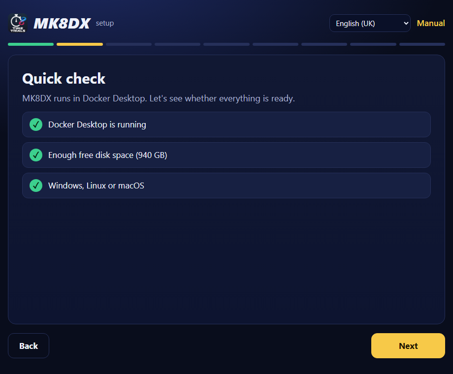
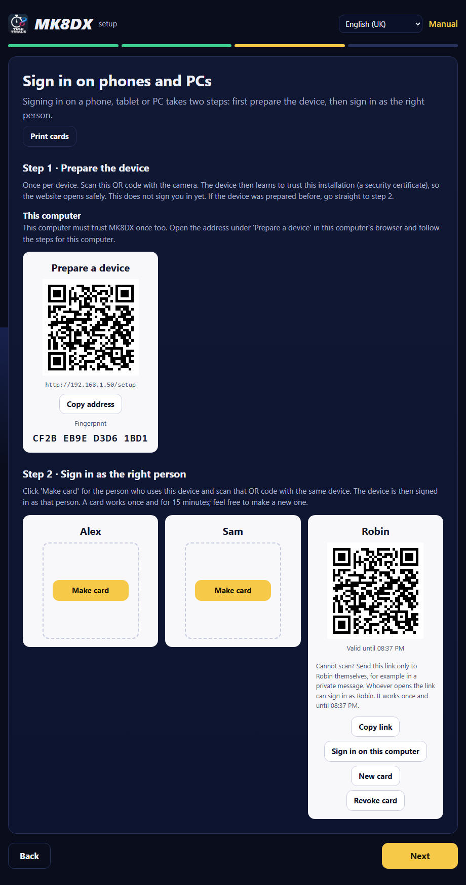
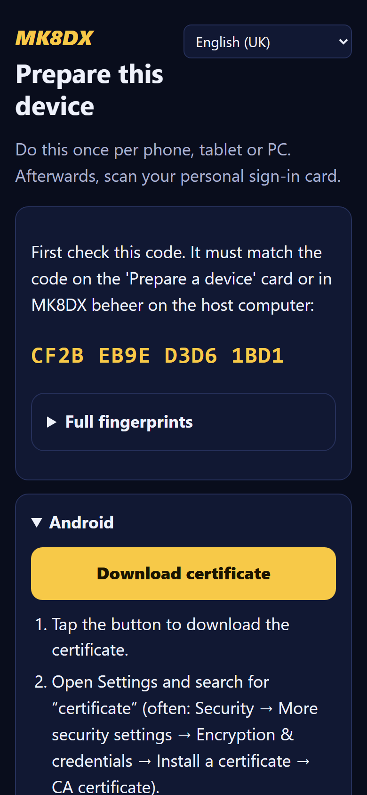

# 自宅やクラブで使う MK8DX — マニュアル

これは英語版ガイド（[A2_HOME_GUIDE_EN.md](../../A2_HOME_GUIDE_EN.md)）の機械翻訳です。内容は英語版が正となります。翻訳の誤りは「Translation correction」の Issue フォームからお知らせください。

このマニュアルでは、何も入っていないコンピューターから大会の夜を遊び終えるまでを、一歩ずつ説明します。IT の知識は必要ありません。章は順番に読んでください。各章は前の章を前提にしています。

**最初に正直にお伝えすること：** 自宅・クラブ向けのインストールは、バージョン 0.2.0 からリリースされています。Windows 11 では、ネットワーク上の Android スマートフォンも含めて最初から最後までテスト済みです。Linux は WSL 2 上でのみテストしており、別の Linux PC や Raspberry Pi ではまだテストしていません。macOS 用パッケージはビルドされていますが、実際の Mac ではまだテストしていません。iPhone もまだテストしていません。テストやビルドがまだのところでは、その手順にそう書いてあります。

**手順の読み方：** **操作** の後にはあなたが行うこと、**表示** の後にはその後に起こるはずのこと、**違う表示が出たら？** の後にはその場合にすることが書いてあります。太字の言葉は、画面上でそのとおりに表示されるボタンや文字です。

## 1. 自宅やクラブで使う MK8DX とは何か、何が必要か

MK8DX は『マリオカート8 デラックス』のためのウェブサイトです。タイムアタックの記録、LiveTrial の録画、大会の夜を保存して比べることができます。このインストールでは、ウェブサイトは自分のネットワーク内の 1 台のコンピューターで動きます。同じネットワーク上のスマートフォン、タブレット、他のコンピューターは、そのコンピューターを通してウェブサイトを開きます。インターネットには何も送られません。

全員が個人用の **サインインカード** でサインインします。これは QR コードが印刷されたカードです。QR コードとは、スマートフォンやタブレットのカメラで読み取る四角いバーコードです。

このマニュアルでは、MK8DX を動かすコンピューターを **MK8DX コンピューター** と呼びます。

必要なもの：

- **遊んでいる間ずっと電源が入っているコンピューター 1 台：** Intel または AMD のプロセッサーを搭載した Windows 11、Linux、または macOS。メモリは 8 GB を推奨します。セットアップでは、ディスクの空き容量が 6 GB 以上あるかを確認します。
- **家庭内ネットワーク：** ルーターの Wi-Fi またはネットワークケーブル。ルーターとは、ネットワークを作る機器です（多くはインターネット回線の事業者から提供されます）。すべての機器を同じネットワークにつないでください。ゲスト用ネットワークは使わないでください。通常、機器どうしを切り離してしまいます。
- **プレイヤー用のスマートフォン、タブレット、または他のコンピューター。** QR コードを読み取れるカメラ付きが望ましいです。
- **プリンター** はサインインカードと復元コードの印刷に便利ですが、必須ではありません。

不要なもの：

- **遊んでいる間のインターネット接続は不要です。** 準備のときに一度だけ Docker、Python、MK8DX パッケージをダウンロードします（または誰かに USB メモリで渡してもらいます）。
- **他社のアカウント、メールアドレス、クラウドは不要です。**
- **定額料金は不要です。** MK8DX と Python は無料です。Docker Desktop は個人利用と小規模な組織には無料です。条件は Docker のウェブサイトに載っています。Linux では無料の Docker Engine を使います。

<!-- image: network-overview -->

## 2. コンピューターの準備

MK8DX には、無料の補助プログラムが 2 つ必要です。

- **Docker** は、プログラムを保護された「コンテナー」の中で動かします。MK8DX のウェブサイトとデータベースはその中で動きます。Windows と macOS では、このプログラムは Docker Desktop という名前です。
- **Python** はプログラミング言語です。MK8DX のインストーラーは Python で書かれています。Python 3.12 から 3.15 が必要です。

自分のコンピューターに当てはまる部分（2A、2B、2C のいずれか）だけを行い、残りの 2 つは飛ばしてください。

## 2A. Windows 11 の準備

1. **操作：** コンピューターのプロセッサーを確認します。スタート → **Settings**（設定）→ **System**（システム）→ **About**（バージョン情報）の **System type**（システムの種類）の行を見ます。→ **表示：** 「64 ビット オペレーティング システム、x64 ベース プロセッサ」。→ **違う表示が出たら？** ARM と表示される場合、MK8DX の Windows パッケージは使えません。x64（Intel と AMD）用しかありません。
2. **操作：** 最初に **WSL**（Windows Subsystem for Linux）をインストールします。これは Docker が動く土台となる Windows の機能で、WSL がないと Docker Desktop をインストールできません。スタートボタンを右クリックし、**Terminal (Admin)**（ターミナル（管理者））または **Windows PowerShell (Admin)**（Windows PowerShell（管理者））を選びます。Windows が許可を求めたら **Yes**（はい）をクリックします。`wsl --install` と入力して Enter キーを押します。→ **表示：** Windows が WSL と Ubuntu をダウンロードしてインストールします。数分かかります。最後に、コンピューターを再起動する必要があると表示されます。コンピューターを再起動してください。→ **違う表示が出たら？** 再起動後に Ubuntu のユーザー名とパスワードを求めるウィンドウが開いた場合は、好きな名前とパスワードを入力して（MK8DX では使いません）、ウィンドウを閉じてください。WSL がすでにインストールされていると表示された場合は、`wsl --update` と入力して Enter キーを押します。**virtualization**（仮想化）について（「Virtual Machine Platform」や「virtualization」）表示された場合は、コンピューターの BIOS で仮想化がオフになっています。オンにするか（メーカーはよく Intel VT-x や AMD-V と呼んでいます）、誰かに手伝ってもらってください。
3. **操作：** docker.com から Windows 用（x86_64 / AMD64）の **Docker Desktop** をダウンロードし、ダウンロードしたファイルを開きます。→ **表示：** WSL 2 を使うかどうかの選択がある Docker のインストーラー。WSL は Docker が動く土台となる Windows の機能です。チェックを入れたままにして **OK** をクリックします。→ **違う表示が出たら？** このアプリがデバイスに変更を加えることを許可するか Windows に聞かれたら、**Yes**（はい）をクリックします。
4. **操作：** インストールが終わるまで待ち、Docker に求められたらコンピューターを再起動します。→ **表示：** 再起動後に Docker Desktop が開きます（開かない場合はスタートメニューから自分で開きます）。初回は利用条件への同意を求められます。→ **違う表示が出たら？** Docker からサインインやアカウント作成を求められても、MK8DX に Docker アカウントは不要です。スキップできる場合はスキップしてください。Docker がまだ WSL がない、または更新が必要と表示する場合は、手順 2 をもう一度行い（`wsl --install` または `wsl --update`）、再起動します。
5. **操作：** Docker Desktop のウィンドウで待ちます。→ **表示：** 左下に **Engine running**（エンジン稼働中）。→ **違う表示が出たら？** 「Engine starting」（エンジン起動中）は数分かかることがあります。止まったままになったりエラーが出たりした場合は、コンピューターを再起動して Docker Desktop をもう一度開きます。Docker は通常の Linux コンテナーモードにしておく必要があります（「Windows containers」ではありません）。
6. **操作：** python.org → **Downloads** に行き、Windows 用の **Python install manager** をダウンロードします（ファイル名は `.msix` で終わります）。これが現在、Windows に Python をインストールする公式の方法です。ダウンロードしたファイルを開き、**Install**（インストール）をクリックします。→ **表示：** Windows が Python install manager をインストールします。その後はウィンドウを閉じてかまいません。→ **違う表示が出たら？** Microsoft Store からもインストールできます。「Python install manager」を検索して **Install**（インストール）をクリックします。どちらか一方だけを使い、両方は使わないでください。
7. **操作：** スタートをクリックし、`PowerShell` と入力して **Windows PowerShell** を開き、`py install 3.15` と入力して Enter キーを押します。これで Python 本体がインストールされます（install manager は Python を取ってくるための道具にすぎません）。→ **表示：** 初回は設定を確認するための質問がいくつか出ます。Enter（提案された選択）か `y` で答えます。その後、Python がダウンロードされてインストールされます。PATH にフォルダーを追加するかという質問には `y` と答えてもかまいませんが、必須ではありません。→ **違う表示が出たら？** 上のとおり、ちょうど 3.15 をインストールしてください。3.12、3.13、3.14 でも動きますが、新しいバージョン（3.16 以降）はまだ動きません。
8. **操作：** PowerShell を閉じてもう一度開き、`python --version` と入力して Enter キーを押します。→ **表示：** `Python 3.15` の後に数字が続きます。たとえば `Python 3.15.2`。→ **違う表示が出たら？** Microsoft Store が開いたり、python が見つからないと表示されたりした場合：スタートをクリックし、**Manage app execution aliases**（アプリ実行エイリアスの管理）と入力して開きます。**Python (default)** をオンにし、**App Installer python.exe** と **python3.exe** をオフにします。以前に古い Python や「Python launcher」をインストールしたことがある場合は、**Settings → Apps → Installed apps**（設定 → アプリ → インストールされているアプリ）から削除して、もう一度試してください。

<!-- image: docker-engine-running -->

<!-- image: python-install-manager -->

## 2B. Linux（Ubuntu または Debian）の準備

Linux では、MK8DX をまだ最初から最後までテストしていません。手順は Ubuntu 24.04 以降を前提に書いています。手順は **ターミナル** に入力します。ターミナルとは、文字でコマンドを入力するウィンドウです（Ubuntu では Ctrl+Alt+T で開きます）。各コマンドの最後に Enter キーを押します。コマンドの前の **sudo** は「このコンピューターの管理者として」という意味です。Linux がパスワードを求めますが、入力中は文字が表示されません。これは正常です。

1. **操作：** `python3 --version` と入力します。→ **表示：** `Python 3.12`、`3.13`、`3.14`、または `3.15`。→ **違う表示が出たら？** それより小さい数字（たとえば Debian 12 は 3.11）は古すぎます。3.16 以上はまだ対応していません。その場合は、より新しいバージョンの Linux が必要です。Ubuntu 24.04 には Python 3.12 が入っています。
2. **操作：** `sudo apt update` と入力し、続けて `sudo apt install docker.io docker-compose-v2 python3-venv unzip` と入力します。続行するかという質問には Y と Enter で答えます。→ **表示：** パッケージがダウンロードされてインストールされます。→ **違う表示が出たら？** apt がパッケージを見つけられない場合、お使いの Linux では別の名前になっています（Debian で起こることがあります）。そのまま進み、手順 5 で Docker Compose が動くかを確認してください。
3. **操作：** `sudo systemctl enable --now docker` と入力します。これで Docker が今すぐ起動し、コンピューターの起動時にも毎回起動します。→ **表示：** エラーは出ません（「Created symlink」で始まる行が表示されることがあります）。
4. **操作：** `sudo usermod -aG docker $USER` と入力します。これで自分のユーザーに Docker を使う権限が付きます。その後、一度サインアウトして再度サインインします（または再起動します）。権限は再サインイン後に有効になります。→ **表示：** エラーは出ません。→ **注意：** docker グループに入っている人は、事実上このコンピューターの管理者権限を持ちます。追加するのは自分だけにしてください。
5. **操作：** `docker info` と、続けて `docker compose version` で確認します。→ **表示：** エラーのない詳細の一覧と、「Docker Compose version」と番号。→ **違う表示が出たら？** 「permission denied」の場合：手順 4 を行い、サインアウトを忘れないでください。「Cannot connect to the Docker daemon」の場合：手順 3 を行います。

**ファイアウォール** とは、コンピューターがどの接続を受け入れるかを決める保護機能です。お使いの Linux で ufw や firewalld のファイアウォールが有効な場合、第 3 章のセットアップで、MK8DX を通すためのコマンドが表示されます。

## 2C. macOS の準備

**注意：** macOS はまだ実際の Mac でテストしていません。以下の手順は、セットアップが macOS で想定している内容に沿っています。

1. **操作：** Apple メニュー → **About This Mac**（この Mac について）を選び、**Chip**（チップ）または **Processor**（プロセッサ）を見ます。→ **表示：** Apple のチップ（M1、M2 以降）の場合は、パッケージ `macos-arm64` を使います。→ **違う表示が出たら？** Intel プロセッサーの場合は、パッケージ `macos-amd64` を使います。macOS 10.15 以降と、その Mac にまだ対応している Docker Desktop が必要です。
2. **操作：** docker.com から、チップに合った Mac 用の **Docker Desktop** をダウンロードし、ダウンロードしたファイルを開いて Docker を **Applications**（アプリケーション）にドラッグします。→ **表示：** アプリケーションフォルダーに Docker があります。
3. **操作：** Docker を開きます。利用条件に同意し、macOS がパスワードを求めたら入力します。→ **表示：** しばらくすると、Docker Desktop のウィンドウに **Engine running**（エンジン稼働中）と表示されます。→ **違う表示が出たら？** Docker からサインインを求められても、MK8DX に Docker アカウントは不要です。スキップできる場合はスキップしてください。
4. **操作：** python.org から Python 3.15 の macOS 用インストーラーをダウンロードして開きます。**Continue**（続ける）と **Install**（インストール）で手順を進めます。→ **表示：** インストールが成功したというメッセージ。
5. **操作：** **Terminal**（ターミナル）を開き（アプリケーション → ユーティリティ → ターミナル）、`python3 --version` と入力して Enter キーを押します。→ **表示：** `Python 3.12` から `3.15`。→ **違う表示が出たら？** それより小さい数字（たとえば Apple 自身の 3.9）の場合：ターミナルを閉じてもう一度開きます。それでも小さい場合は、python.org から Python をもう一度インストールします。
6. **操作：** ターミナルで `docker info` と入力します。→ **表示：** エラーのない詳細の一覧。→ **違う表示が出たら？** Docker Desktop を起動し、Engine running になるまで待ちます。

## 3. MK8DX のインストール

**パッケージの展開**

1. **操作：** 自分のシステム用の、自宅・クラブ向け MK8DX パッケージをダウンロードします。Windows、Linux、macOS のいずれかで、Linux と macOS ではプロセッサー（amd64 または arm64）も選びます。ダウンロードが正しいか確かめるには、その SHA-256 を、同じリリースの `SHA256SUMS.txt` にある該当の行と比べます（Windows：`Get-FileHash <file> -Algorithm SHA256`、Linux：`sha256sum <file>`、macOS：`shasum -a 256 <file>`）。`docs/RELEASE_PACKAGES.md#check-a-download` も参照してください。→ **表示：** ダウンロードフォルダーに zip ファイルがあります。→ **違う表示が出たら？** ブラウザーが、このファイルは安全でない、またはあまりダウンロードされていないと警告した場合：**Keep**（保存）を選びます。Windows ではその後、zip ファイルを右クリック → **Properties**（プロパティ）を選び、下のほうにある **Unblock**（許可する）にチェックを入れて **OK** をクリックします。これは展開の前に行ってください。そうしないと、後で Windows（スマート アプリ コントロール）が `Start-MK8DX-LAN.cmd` をブロックすることがあります。スマート アプリ コントロールはオフにしないでください。一度オフにすると、Windows を新しくインストールし直さない限りオンに戻せません。
2. **操作：** zip ファイルを、ずっと使うフォルダーに展開します。たとえばドキュメントの中の MK8DX フォルダーです。Windows では zip ファイルを右クリック → **Extract All**（すべて展開）。今後も残るフォルダーを選んでください。MK8DX は以後いつもこのフォルダーから起動するので、移動したり削除したりしないでください。→ **表示：** `Start-MK8DX-LAN.cmd`、`README-FIRST.txt`、フォルダー `docs`、`images`、`tooling` などが入ったフォルダー。→ **違う表示が出たら？** エクスプローラーで zip ファイルを開いただけの場合は、きちんと展開してください。zip ファイルの中から起動しても動きません。ファイルマネージャーのない Linux（サーバーや WSL）では：`unzip ~/Downloads/mk8dx-a2-linux-amd64-<version>.zip -d ~/Documents/MK8DX`（ファイル名はお使いのものにします。`unzip` は第 2B 章の手順 2 で入ります）。

<!-- os: windows -->

**Windows での起動**

1. **操作：** 展開したフォルダーで **Start-MK8DX-LAN.cmd** をダブルクリックします。→ **表示：** MK8DX のロゴと、ビープ音付きの 3-2-1-GO のカウントダウンがあるウィンドウ（[省略するには](../../../guides/HOSTING.md#the-launcher-window-look-and-options)）。続いて「MK8DXパッケージ:」や「プライベートインストール:」などの行が表示されます。初回は「同梱のPythonパッケージを準備しています（初回のみ、インターネット不要）。」と「同梱のDockerイメージを読み込んでいます。数分かかることがあります。」も表示されます。これには数分かかります。その後「MK8DX setup is open in your browser:」（MK8DX のセットアップがブラウザーで開いています）と表示され、ブラウザーでセットアップが開きます。→ **違う表示が出たら？** 下のメッセージを参照してください。
2. **操作：** セットアップで **Finish**（完了）をクリックするまで、黒いウィンドウは開いたままにしておきます。ウィンドウにもそう書いてあります：「Keep this window open until you click Finish.」（Finish をクリックするまでこのウィンドウを開いたままにしてください）

Windows の黒いウィンドウに出るメッセージ：

- **"Python 3.12〜3.15がありません。python.org（またはMicrosoft Store）からPython install managerをインストールし、py install 3.15 を実行して、PowerShellを開き直してから、もう一度お試しください。"**第 2A 章の手順 6〜8 を行い、もう一度 Start-MK8DX-LAN.cmd をダブルクリックします。
- **"Docker Desktopがないか、起動していません。Docker DesktopをLinuxコンテナーモードで起動し、"Engine running" と表示されるまで待ってから、もう一度お試しください。"**Docker Desktop を起動し、Engine running になるまで待って、もう一度ダブルクリックします。
- エラーの下に **"選択したステップが停止しました。上のメッセージを読んでから、もう一度お試しください。"**と表示されます。その上の行を読んで原因を直し、キーを押してウィンドウを閉じます。

<!-- /os -->

<!-- os: linux macos -->

**Linux と macOS での起動**

1. **操作：** 展開したフォルダーでターミナルを開きます。Linux：ファイルマネージャーにあれば、フォルダー内で右クリックして「Open in Terminal」（端末で開く）を選びます。macOS と Linux では次の方法も使えます：ターミナルを開いて `cd ` と入力し（後ろに半角スペースを入れます）、フォルダーをウィンドウにドラッグして Enter キーを押します。→ **表示：** ターミナルがパッケージフォルダーに移動しています。
2. **操作：** `sh tooling/start-mk8dx.sh` と入力して Enter キーを押します。→ **表示：** MK8DX のロゴと 3-2-1-GO のカウントダウン、続いて「MK8DXパッケージ:」、Python のバージョン番号、「Docker Compose version」。初回は「同梱のDockerイメージを読み込んでいます。数分かかることがあります。」と「同梱のPythonパッケージを準備しています（初回のみ、インターネット不要）。」も表示されます。その後「プライベートインストール:」と「MK8DX setup is open in your browser:」と表示され、ブラウザーでセットアップが開きます。→ **違う表示が出たら？** ブラウザーが開かない場合は、ターミナルにある `http://127.0.0.1:` で始まるアドレスをブラウザーにコピーします。
3. **操作：** **Finish**（完了）をクリックするまで、ターミナルは開いたままにしておきます。

Linux と macOS のターミナルに出るメッセージ：

- **"Python 3.12〜3.15がありません。インストールしてから（Ubuntu/Debian: sudo apt install python3 python3-venv、macOS: python.org）、もう一度お試しください。"**第 2B 章または第 2C 章をもう一度行います。
- **"Dockerが起動していないか、このユーザーには使用権限がありません（Linux: sudo systemctl start docker を実行し、docker グループに参加してください。macOS: Docker Desktopを起動してください）。"**Linux：第 2B 章の手順 3 と 4 を行います。macOS：Docker Desktop を起動します。
- **"プライベートなPython環境を作成できませんでした（Ubuntu/Debian: sudo apt install python3-venv）。"**第 2B 章の手順 2 のとおり python3-venv をインストールします。

<!-- /os -->

**ブラウザーでのセットアップ**

セットアップは、MK8DX コンピューター自身でしか動かないブラウザーのページです。ブラウザーの言語（ゲームの 15 言語のいずれか。それ以外の場合は英語）で表示されます。右上には、別の言語を選ぶための言語メニューと **マニュアル** があり、**マニュアル** はこのマニュアルを開きます。下には **戻る**、場合によって **詳細設定**、そして **次へ** があります。上の点は、どこまで進んだかを示します。

1. **MK8DXへようこそ** **操作：** 画面を読み、**次へ** をクリックします。→ **表示：** 「簡単なチェック」。この画面の **バックアップを復元** ボタンは、新しいコンピューターのためだけのものです（第 10 章）。
2. **簡単なチェック** **操作：** 少し待ちます。→ **表示：** **Docker Desktopが起動しています**、**十分な空きディスク容量**（GB 数付き）、**Windows、Linux、またはmacOS** の 3 つに緑のチェック。**次へ** をクリックします。→ **違う表示が出たら？** 説明付きの感嘆符。たとえば「Docker Desktopを起動し、「Engine running」と表示されるまで待ってから「もう一度試す」をクリックしてください。」や「このドライブに6 GB以上の空き容量を確保してください。」原因を直して **もう一度試す** をクリックします。Linux でも最初のチェックは「Docker Desktopが起動しています」という名前ですが、Linux では Docker Engine のことです。
3. **どの種類のインストールですか？** **操作：** **自宅、クラブ、LANナイトのネットワーク。インターネット不要**（推奨）を選んだままにして、**次へ** をクリックします。→ **表示：** 「あなたのネットワーク」。
4. **あなたのネットワーク** **ネットワークアドレス**（IP アドレス）とは、ネットワーク内の機器がこのコンピューターを見つけるための番号で、住所の番地のようなものです。**操作：** 「スマートフォン、タブレット、ほかのPCは、このアドレスでMK8DXにアクセスします：」の下のアドレスを読んで書き留めます。たとえば `https://192.168.1.50`。**インストール** をクリックします。→ **表示：** Windows では「このネットワークはホーム（プライベート）ネットワークとして設定されています。」または「Windowsは現在このネットワークをパブリックとして扱っています。「インストール」をクリックすると、MK8DXがネットワークをプライベートに設定し、MK8DXだけを許可します。」Linux と macOS では、ここにネットワークについての文は表示されません。→ **違う表示が出たら？** コンピューターに接続が複数ある場合（ケーブルと Wi-Fi）は、**詳細設定** をクリックし、「このコンピューターの別のアドレスを選択：」で、スマートフォンもつながっているネットワークのアドレスを選びます。「ネットワークアドレスが見つかりません。」と表示された場合は、コンピューターを家庭内ネットワークにつないで **もう一度試す** をクリックします。
5. **インストール中** **操作：** ウィンドウを開いたまま待ちます。→ **表示：** 「MK8DXをセットアップしています。このウィンドウは開いたままにしてください。」と、順に「インストールを準備しています」、「ネットワークを許可しています（Windowsが許可を求めます）」、「データベースとWebサイトを起動しています」、「確認中」、最後に「MK8DXが動作しています。あと2つの簡単なステップです。」**次へ** をクリックします。Windows では、Windows PowerShell が変更を加えてよいかを Windows のウィンドウが一度だけ聞いてきます。**Yes**（はい）をクリックしてください。これで MK8DX が家庭内ネットワークをプライベートに設定し、ファイアウォール（Windows の保護機能）で MK8DX だけを通します。以前にこのコンピューターとアドレスで MK8DX をインストールしたことがある場合は、その許可が残っているため、Windows は再び聞いてきません。→ **違う表示が出たら？** 赤いエラーの場合：**詳細** をクリックして何が問題かを読み、直してから **もう一度試す** をクリックします。Windows のウィンドウで「いいえ」をクリックした場合は、Windows が変更を許可しなかったと表示されます。**もう一度試す** をクリックし、次に **Yes**（はい）をクリックします。
6. **Linux のみ：ファイアウォール。** **操作：** インストール中またはインストール後に **詳細** をクリックし、「Network:」で始まる行を探します。→ **表示：** 「not-needed」（何もする必要はありません）、または「manual:」の後に `sudo ufw allow from 192.168.1.0/24 to 192.168.1.50 port 80,443 proto tcp` のようなコマンド。→ **次に行うこと：** そのコマンドを（そこに表示されているとおり自分のアドレスで）そのままターミナルに入力します。このコマンドを実行しないと、スマートフォンからウェブサイトを開けません。
7. **あなたの管理者アカウント** **管理者** とは、人を追加したりサインインカードを作ったりする人のことで、それはあなたです。**操作：** **あなたの名前** に名前を入力します。たとえば「お父さん」や「クラブ運営」。**次へ** をクリックします。この名前はこのインストールの中でしか見えません。→ **表示：** 「誰がプレイしますか？」
8. **誰がプレイしますか？** **操作：** **名前（1行に1人）** にプレイヤーの名前を 1 行ずつ入力し、**追加** をクリックします。または、すぐに **スキップ** をクリックしてもかまいません。後から MK8DX beheer（第 5 章）でまったく同じ方法で行えます。→ **表示：** 「このインストールのメンバー：」の下に名前が並び、あなたの名前の後には「（管理者）」と付いています。**次へ** をクリックします。
9. **スマートフォンとPCでサインイン** **操作：** ここですでにサインインカードを作ることもできます（作り方は第 5 章と第 6 章で説明します）し、そのまま **次へ** をクリックしてもかまいません。→ **表示：** 「完了！レースを楽しんでください。」
10. **完了！レースを楽しんでください。** **操作：** 2 つのアドレスを書き留めます：**Webサイト**（たとえば `https://192.168.1.50`）と **新しいデバイス**（たとえば `http://192.168.1.50/setup`）。3 つのチェック **Windowsと一緒にMK8DXを起動する**、**毎晩バックアップを作成する**、**デスクトップに「MK8DX beheer」のショートカットを作成する** は入れたままにします。**完了** をクリックします。→ **表示：** あなたの復元コード（第 4 章）。→ **Linux と macOS では** 最初のチェックの名前は「コンピューターの起動時にMK8DXを起動する」です。macOS では、サインイン時に Docker Desktop が開くようになります。Linux では、第 2B 章の `sudo systemctl enable --now docker` がその役目を果たします。まだ実行していない場合は、**完了** の後にセットアップがそのコマンドをそのまま表示します。
11. **閉じる。** **操作：** 第 4 章を読み、復元コードを保管します。その後 **閉じる** をクリックします。→ **表示：** 「このウィンドウは閉じてかまいません。」ブラウザーのタブを閉じます。Windows では黒いウィンドウがキーを押すよう求めるので、キーを押すと閉じます。何もしなくても、セットアップのページは 10 分後に自動的に止まります。MK8DX 自体は動き続けます。

<!-- image: windows-permission -->

## 4. 復元コードとバックアップフォルダー

**バックアップ** とは、MK8DX にあるすべてのもの（人、タイム、大会、設定）の予備のコピーです。MK8DX は毎晩 03:00 にバックアップを作り、新しいものを 7 つ保管します。バックアップは暗号化されていて、鍵がないと読めません。

**復元コード** がその鍵です。4 文字の英数字が 5 組並んだもので、たとえば `ABCD-EFGH-JKLM-NPQR-STUV` です。このコードが必要なのは、別のコンピューターでバックアップを復元するときだけです。

1. **操作：** **完了** の後、**MK8DX 復元コード** のカードを見ます。→ **表示：** コードと、「このコードがないとバックアップを開けません。表示されるのは一度だけです。」という文、その下にバックアップの保存先フォルダー。
2. **操作：** コードを紙に書き写すか、**カードを印刷** をクリックしてこのページを印刷します。1 文字ずつ確認してください。→ **表示：** 紙に書かれたコード。→ **なぜ一度だけなのか？** MK8DX は毎晩のバックアップのためにこのコンピューター上でコードを保護して保管していますが、二度と表示しません。コンピューターが壊れたら、残るのは紙だけです。
3. **操作：** 紙は安全な場所に、コンピューターの近く以外に保管してください。コードとバックアップの両方を持っている人は、すべてを開けます。

バックアップの場所：

- **Windows：** ドキュメントフォルダーの中の `MK8DX-backups` フォルダー（ディスク上では `C:\Users\<your name>\Documents\MK8DX-backups`）。
- **Linux と macOS：** ホームフォルダーの中の `Documents/MK8DX-backups` フォルダー（つまり `~/Documents/MK8DX-backups`）。Linux を別の言語で使っていても、このフォルダー名は Documents です。
- セットアップでは、復元コードの下に正確なフォルダーが表示されます。

ときどき `MK8DX-backups` フォルダーを USB メモリや別のドライブにコピーしてください。そうしないと、コンピューターが壊れたとき、バックアップはその壊れたコンピューターの中にしかありません。

**毎晩バックアップを作成する** のチェックを外して **完了** をクリックすると、MK8DX は毎晩のバックアップを止めます。作成済みのバックアップは残ります。後でもう一度チェックすると、同じ復元コードでバックアップが再開され、コードは再表示されません。そのコードがもう手元にない場合は、下の手順で新しいコードを作成してください。

**新しい復元コード**

ほかの人にコードを見られたかもしれないとき、または紙をなくしたときは、新しいコードを作成してください。バージョン 0.2.7 から使えます。

1. **操作：** MK8DX beheer を開き、「完了！レースを楽しんでください。」が表示されるまで **次へ** をクリックし、**新しい復元コードを作成する** にチェックを入れて **完了** をクリックします。→ **表示：** 新しいコードが書かれた **MK8DX 復元コード** のカード（一度だけ表示されます）と、以前のバックアップには古いコードが引き続き必要だという文。
2. **操作：** 上の手順 2 と同じように新しいコードを書き留めます。古い紙は以前のバックアップと一緒に保管してください。以前のバックアップは変換されず、古いコードでしか開けません。不要になったら、古いバックアップと古い紙を処分してください。→ **表示：** 次回からのバックアップには新しいコードが使われます。

## 5. 人とサインインカード（MK8DX beheer）

**MK8DX beheer**（オランダ語で「MK8DX の管理」）は、セットアップと同じページですが、後から使うためのものです。人を追加したり、サインインカードを作ったりします。MK8DX コンピューター自身でしか動きません。デスクトップのショートカットはどの言語でも「MK8DX beheer」という名前です。ページタイトルは **MK8DX 管理** です。

**アカウント** とは、サインインする人のことです。**プレイヤー** とは、ランキングに載る、タイムを持ったプレイヤーのことです。サインイン後、各自がウェブサイトで自分のプレイヤーを選ぶか、自分のものとして申請します。名前が自動的に結び付けられることはありません。

**MK8DX beheer を開く**

1. **操作（Windows）：** デスクトップの **MK8DX beheer** をダブルクリックします。このショートカットは Start-MK8DX-LAN.cmd と同じものを起動します。→ **表示：** 短いレースの演出があるランチャーウィンドウ、続いてブラウザーで、上部に「管理」とあり、タイトルが **MK8DX 管理** のページ。→ **違う表示が出たら？** ショートカットがない場合：MK8DX フォルダーの Start-MK8DX-LAN.cmd をダブルクリックします。
2. **操作（Linux）：** デスクトップまたはアプリメニューから **MK8DX beheer** を起動します。一部の Linux デスクトップでは、最初にそのアイコンを許可する必要があります（右クリックして起動を許可するオプションを選びます）。第 3 章のとおり、MK8DX フォルダーで `sh tooling/start-mk8dx.sh` を実行しても起動できます。→ **表示：** ターミナル、続いて **MK8DX 管理** のページ。
3. **操作（macOS、未テスト）：** デスクトップの **MK8DX beheer.command** をダブルクリックするか、第 3 章のとおり `sh tooling/start-mk8dx.sh` を起動します。→ **表示：** ターミナル、続いて **MK8DX 管理** のページ。

**人を追加する**

1. **操作：** **名前（1行に1人）** に名前を入力し、**追加** をクリックします。→ **表示：** 「このインストールのメンバー：」の下に名前が並びます。
2. **操作：** **次へ** をクリックします。→ **表示：** 2 つのステップに分かれた「スマートフォンとPCでサインイン」。**ステップ1 · デバイスを準備** には **デバイスを準備** カード（機器ごとに一度だけ。これだけではまだサインインしません）、**ステップ2 · 正しい人としてサインイン** には、人ごとに **カードを作成** ボタンの付いた枠があります。

**カードを作って印刷する**

1. **操作：** 人の横にある **カードを作成** をクリックします。→ **表示：** QR コードと「有効期限」と時刻。カードは 1 回だけ、15 分間有効です。すぐにその人に読み取ってもらうか（第 6 章）、印刷します。
2. **操作：** 先に必要なカードをすべて作ってから、**カードを印刷** をクリックします。→ **表示：** 画面上のすべてのカード（「デバイスを準備」カードを含む）が載った、ブラウザーの印刷ウィンドウ。
3. **操作：** 自分のスマートフォンでもサインインしたい場合は、自分用のカード（「（管理者）」の付いた名前）も作ります。

**カードを作り直す・無効にする**

- **新しいカード**：その人の新しいカードを作ります。この画面にあったその人の以前のカードは使えなくなります。
- **カードを取り消す**：カードはすぐに使えなくなります。「取り消し済み：このカードはもう使えません。」と表示されます。カードをなくしたときや、間違った人に渡ったときに使います。
- 無効にできるのは、まだこの画面にあるカードだけです。すでに MK8DX beheer を閉じていた場合、未使用のカードは 15 分後に自動的に期限切れになります。すでに使われたかもしれない場合は、下の **すべての場所でサインアウト** を選んでください。

**誰かをすべての場所でサインアウトさせる**

1. **操作：** MK8DX beheer を開きます。最初の画面で、各人に **すべての場所でサインアウト**ボタンがあります。それをクリックします。→ **表示：** ボタンが **本当によろしいですか？もう一度クリック** に変わります。
2. **操作：** もう一度クリックします。→ **表示：** 「すべてのデバイスでサインアウトしました。新しいカードがあれば、この人は再びサインインできます。」その人はウェブサイトとアプリからサインアウトされ、そのアカウントへのワンタップ切り替えが消え、その人の有効なカードも使えなくなります。→ **違う表示が出たら？** 自分の名前の横では、2 回目のクリックで「自分自身は、Webサイトのアカウントメニュー（「すべてのデバイスでサインアウト」）からサインアウトします。」と表示され、何もサインアウトされません。

**MK8DX beheer を閉じる**

1. **操作：** 「完了！レースを楽しんでください。」まで **次へ** をクリックし、チェックは入れたままで **完了**、続いて **閉じる** をクリックします。→ **表示：** 「このウィンドウは閉じてかまいません。」MK8DX は動き続けます。

## 6. 機器の準備とサインイン

**証明書** とは、デジタルの身分証明書です。これがあれば、スマートフォンは自分が話している相手が確かにあなたの MK8DX コンピューターであり、他の何かではないことがわかります。また、接続も暗号化されます（https）。MK8DX はインターネットなしで動くので、セットアップが自前の証明書を作ります。各機器は一度だけ、それを信頼するよう設定する必要があります。**フィンガープリント** とは、まさにこの証明書に属する短いコードです。これを使って、正しい証明書をインストールしようとしているかを確かめます。

**自宅でインターネットなしでも、なぜ証明書が必要なのか？**

- **確かに自分の MK8DX だとわかる。** 自宅やクラブのネットワークでは、同じ Wi-Fi にいる誰でも（たとえばノート PC を持ったゲスト）、あなたの MK8DX コンピューターのふりをすることができます。証明書がなければ、スマートフォンは違いを見分けられません。証明書があれば、ブラウザーは他のコンピューターを拒否します。
- **誰にも盗み聞きされない。** サインインカード、サインイン中のセッション、入力したすべての内容が、Wi-Fi 上を暗号化されて送られます。
- **なぜ MK8DX が自前の証明書を作るのか。** インターネット上のウェブサイトは、すべての機器にあらかじめ登録されている有名な発行元の証明書を使います。そうした発行元は `192.168.1.50` のような家庭内のアドレスには証明書を発行せず、インターネットなしでは使えません。そのため MK8DX はインストール中に自前の証明書を作り、あなたが各機器に一度だけ、それを信頼してよいと設定します。
- **インストールすると何を許可するのか。** この証明書は MK8DX のプライベートネットワークアドレス専用で、その秘密鍵は MK8DX コンピューター上で保護されています。インストールするのは自分の MK8DX の証明書だけにして（フィンガープリントを確認してください）、そのインストールを使わなくなったら機器から削除してください。

**証明書をインストールしないと、何が使えないのか？**

- ブラウザーが、アクセスするたびに「この接続ではプライバシーが保護されません」のような全画面の警告を表示します。警告を閉じて先へ進むこともできますが、そうしないでください。本当に自分の MK8DX と話しているのかが、もうわからなくなります。
- 警告を閉じても、**ブラウザーの通知** は使えません。ブラウザーは信頼された証明書がある場合にしか通知を許可しません。他のブラウザー機能も拒否されることがあります。
- 証明書をインストールしなくても使えるもの：**Android アプリ**。アプリは **デバイスを準備** カードから自分で証明書を覚えます（第 7 章）。同じ機器のブラウザーには、やはり証明書が必要です。

**MK8DX コンピューター自身**

MK8DX が動いているコンピューターも、一度は MK8DX を信頼する必要があります。そうしないと、そのブラウザーがウェブサイトについて警告します。

1. **操作：** MK8DX beheer を開き、「スマートフォンとPCでサインイン」まで **次へ** をクリックし、**ステップ1** の下の **このコンピューター** の枠を見ます。→ **表示：** 「このコンピューターはすでにMK8DXを信頼しています。」それなら完了です。→ **違う表示が出たら？** **このコンピューターを準備** ボタンが表示されている場合は、手順 2 に進みます。
2. **操作：** **このコンピューターを準備** をクリックします。→ **表示：** 証明書をインストールするかを聞く Windows のウィンドウ **Security Warning**（セキュリティ警告）と、**thumbprint (sha1)**（拇印（sha1））。MK8DX beheer にある拇印と比べ、一致していれば **Yes**（はい）をクリックします。→ **表示：** 「このコンピューターはすでにMK8DXを信頼しています。」→ **違う表示が出たら？** **No**（いいえ）をクリックした場合や、拇印が一致しない場合：「はい」はクリックせず、ウィンドウを閉じて誰かに相談してください。Linux や macOS では、ボタンの代わりに、「デバイスを準備」の下にあるアドレスをこのコンピューターのブラウザーで開くよう表示されます。その場合は、このコンピューターで下の手順に従ってください。

**機器ごとに一度だけ：デバイスを準備**

1. **操作：** スマートフォン、タブレット、または PC を、MK8DX コンピューターと同じ Wi-Fi または有線ネットワークにつなぎます。スマートフォンでは、Wi-Fi の代わりにモバイルデータ通信を使わないでください。→ **表示：** 接続先に自宅の Wi-Fi の名前。
2. **操作：** カメラで **デバイスを準備** カード（MK8DX beheer の画面または紙）の QR コードを読み取り、表示されたリンクをタップします。カメラがない場合は、ブラウザーに **新しいデバイス** のアドレスを入力します。たとえば `http://192.168.1.50/setup`。→ **表示：** **このデバイスを準備** ページと、「スマートフォン、タブレット、PCごとに一度だけ行います。その後、個人のサインインカードをスキャンしてください。」→ **違う表示が出たら？** ページが開かない場合：ネットワークと、MK8DX コンピューターの電源が入っているかを確認します（第 11 章）。
3. **操作：** 「まずこのコードを確認してください。」の下のコードを、「デバイスを準備」カードの **フィンガープリント**（4 文字ずつ 4 組）と比べます。→ **表示：** まったく同じコード。→ **違う表示が出たら？** コードが違う場合は、何もインストールしないでください。別のネットワークや別のアドレスにつながっている可能性があります。まずそれを確認してください。
4. **操作：** 自分の機器向けの部分に従います。使っている機器向けの部分は最初から開いています。他の機器向けは「別の種類のデバイスですか？」の下で開きます。**証明書をダウンロード**（iPhone と iPad では **プロファイルをダウンロード**）をタップし、下の手順に従います。→ **表示：** 下部に「完了しましたか？個人のサインインカードをスキャンするか、こちらを開いてください：」とウェブサイトのアドレス。

「このデバイスを準備」ページの手順：

<!-- filter: device -->

- **Android：** ボタンをタップして証明書をダウンロードします。設定を開き、「証明書」を検索します（多くの場合：セキュリティ → その他のセキュリティ設定 → 暗号化と認証情報 → 証明書のインストール → CA 証明書）。ダウンロードした MK8DX のファイルを選び、PIN で確定します。メニューの名前はスマートフォンのメーカーによって異なります。
- **iPhone と iPad（このインストールではまだ未テスト）：** ボタンをタップしてプロファイルをダウンロードし、許可します。設定 → プロファイルがダウンロード済み → インストール を開きます。その後、設定 → 一般 → 情報 → 証明書信頼設定 → MK8DX をオンにします。
- **Windows：** 証明書をダウンロードして開きます。証明書のインストール → 現在のユーザー → 証明書をすべて次のストアに配置する → 信頼されたルート証明機関 を選びます。中間証明機関は選ばないでください。ブラウザーを再起動します。
- **Mac（macOS はまだ最初から最後までテストしていません）：** 証明書をダウンロードして開くと、キーチェーンアクセスが開きます。MK8DX の証明書を開き → 信頼 → 常に信頼 を選びます。
- **Linux（この経路はまだ最初から最後までテストしていません）：** 同じ証明書を、お使いのディストリビューションまたはブラウザーの信頼されたルート証明書ストアに追加します。正確な手順はディストリビューションによって異なります。Ubuntu と Debian（WSL 2 でテスト済み）では、ダウンロードした `root.crt` は DER 形式なので、インストールするときに変換します：`sudo openssl x509 -inform DER -in ~/Downloads/root.crt -out /usr/local/share/ca-certificates/mk8dx.crt` を実行し、続けて `sudo update-ca-certificates` を実行します。Linux の Firefox と Chrome は独自のストアを使う場合があります。ブラウザーがまだ警告する場合は、証明書の設定（認証局）で同じファイルをそこにもインポートしてください。

<!-- /filter -->

**個人のカードでサインインする**

1. **操作：** 自分のカード（自分の名前が書かれたカード）を読み取り、リンクをタップします。→ **表示：** **このMK8DXインストールに参加** と、「まず、このHTTPSアドレスが信頼するホストのものか確認してください。この招待は1回だけ使えます。」ブラウザーのアドレスバーには、ウェブサイトのアドレス（たとえば `https://192.168.1.50`）が表示されている必要があります。→ **違う表示が出たら？** 証明書や安全でない接続についてのブラウザーの警告：決して閉じて先へ進まないでください。まず上の「デバイスを準備」を行ってください。
2. **操作：** **サインインするユーザー：** の下にあるカードの名前を確認します。自分の名前であれば、「招待の準備ができました。確認してサインインしてください。」と表示されるのを待ち、**招待を受け入れる** をタップします。別の名前が表示されている場合は、受け入れをタップしないでください。カードは正しい人のために有効なまま残ります。→ **表示：** 「次のユーザーとしてサインインしています：」とあなたの名前、そして **MK8DXへ進む**。それをタップします。→ **違う表示が出たら？** 「この招待は無効です。管理者に新しいQRコードを依頼してください。」または「サインインに失敗しました。管理者に新しい招待を依頼してください。」：カードはすでに使われたか、期限切れか、無効化されています。管理者に **新しいカード** を作ってもらってください。
3. **操作：** ウェブサイトの最初の案内に従います。ここにすでにタイムや大会の記録があるか、どう呼ばれたいかを答えます。こうして自分のプレイヤーを選ぶか、申請します。→ **表示：** あなたの名前とタイム。→ **違う表示が出たら？** カードの名前（たとえば「お父さん」）があらかじめ入力されていなくても、それで正しいです。カードの名前は「MK8DX 管理」の中のラベルにすぎません。プレイヤー名はここで自分で決めます。

**同じ人の別の機器**

- プレイヤーは自分でカードを作れます。ウェブサイトのアカウントメニューに **別のデバイスでもサインイン** があります。これを押すと **別のデバイスでサインイン** が開き、「1 回のみ有効、有効期限」と時刻の付いたカードが表示されます。それを別の機器で読み取ります。見せるのは自分の機器だけにしてください。読み取った人は誰でもあなたのアカウントにサインインできます。
- 管理者にはこのボタンはありません。管理者は MK8DX beheer で自分用の **新しいカード** を作ります。
- 新しい機器では、必ず最初に一度「デバイスを準備」を行います。
- **カメラがない場合や、MK8DX コンピューター自身でサインインする場合は？** MK8DX beheer でその人のカードを作り、**このコンピューターでサインイン**（MK8DX コンピューターのブラウザーでサインインページを開きます）または **リンクをコピー** をクリックします。コピーしたリンクは本人にだけ、たとえば個別のメッセージで送ってください。開いた人は誰でもその人としてサインインできます。リンクは 1 回だけ、15 分間有効です。「デバイスを準備」カードの **アドレスをコピー** はアドレスをコピーします。これは秘密ではありません。

**機器でこのインストールの利用をやめるとき：** インストールに使ったのと同じ設定画面で、証明書を削除します。

## 7. Android アプリと LiveTrial

**Android アプリの接続**

アプリのバージョン 2.95.0 以降が必要です。アプリには Android の設定での証明書は不要ですが、サインインはスマートフォンのブラウザーを通して行います。そのため、まずこのスマートフォンで第 6 章を行ってください。「デバイスを準備」を行い、ブラウザーで自分のカードを使ってサインインします。

1. **操作：** アプリを開きます。新しくインストールした場合は **コミュニティを選択** から始まります。そうでない場合は、アプリ上部のコミュニティ名をタップし、続いて **コミュニティを追加** をタップします。→ **表示：** **自宅またはクラブ** と **オンラインコミュニティ** のパネルがある **コミュニティを選択**。**自宅またはクラブ** の下の **QR コードをスキャン** をタップします。
2. **操作：** 必要なら **カメラを使う** をタップし、カメラを許可します。**デバイスを準備** カードの QR コードを読み取ります。→ **表示：** **アドレス** と **鍵のフィンガープリント (SHA-256)** が表示された **自分のインストールか確認してください**。→ **違う表示が出たら？** 「これは「デバイスを準備」カードの QR コードではありません。」：個人のカードを読み取っています。「デバイスを準備」カードを読み取ってください。読み取りがうまくいかない場合：MK8DX コンピューターで、MK8DX beheer の **デバイスを準備** カードにある **アドレスをコピー** をクリックし、そのリンクをスマートフォンに送り（秘密ではありません）、**またはセットアップリンクを貼り付け** に貼り付けて **次へ** をタップします。短い「新しいデバイス」のアドレス（たとえば `http://192.168.1.50/setup`）を入力するだけでは足りません。アプリには、QR コードとコピーしたリンクに含まれる鍵のフィンガープリントも必要で、それがないと「これは「デバイスを準備」カードの QR コードではありません。」と表示されます。バージョン 0.2.6 では、**アドレスをコピー** はまだ短いアドレスしかコピーしません。その場合はカードを読み取ってください。
3. **操作：** アドレスをウェブサイトのアドレスと、長い鍵を「このデバイスを準備」ページと比べます。そのページで **完全なフィンガープリント**を開き、「ルート公開鍵の SHA-256（SPKI）」を見ます。そのページは別の機器でも、「新しいデバイス」のアドレスを使って MK8DX コンピューター自身でも開けます。→ **表示：** 両方がまったく同じ。**接続** をタップします（アプリがすでに別のサーバーに設定されていた場合は、変更を確定します）。→ **違う表示が出たら？** 違っていたら **戻る** をタップし、接続しないでください。「…から一致する証明書を取得できませんでした」：ネットワークと MK8DX コンピューターの電源が入っているかを確認し、もう一度試します。
4. **操作：** **設定** の **このスマートフォンのプレイヤー** で **サインイン** をタップします。アプリは、自宅やクラブではメールではなく個人のサインインカードでサインインすることを案内します。**サインインして同期** をタップします。→ **表示：** ブラウザーが承認ページを開き、「MK8DX Time Trials for Androidがあなたのアカウントへのアクセスを求めています。」と **デバイスコード** が表示されます。それがアプリに表示されている **デバイスコード** と同じであることを確認し、今まさに自分のスマートフォンでこの操作を始めた場合にだけ承認して、**デバイスを承認** をタップします。ページに「デバイスを承認しました。アプリに戻ってサインインを完了してください。」と表示されます。アプリに戻ると、「次のユーザーとしてサインインしています：」とあなたの名前が表示されます。→ **違う表示が出たら？** ブラウザーがサインインを求めた場合は、まずカードでサインインします（第 6 章）。
5. **操作：** アプリでタイムを投稿します。→ **表示：** インストールのウェブサイトにそのタイムが表示されます。

接続の解除：上部のコミュニティ名をタップ → **コミュニティを追加** → **このインストールを削除**。

クラブと自宅を 1 つのアプリで：アプリには複数のコミュニティを登録できます。上部のコミュニティ名をタップし、**コミュニティを切り替え** をタップします。各コミュニティは、それぞれのアカウントと未送信のタイムを保持します。自分のタイムは、スマートフォンが MK8DX コンピューターにつながらないときでも、自分の名前 → **自分のタイム** にあります。

**2 台目の Windows PC での LiveTrial**

LiveTrial は、キャプチャーカード（Switch の映像を PC に送る機器）を通してタイムアタックを認識して保存する Windows プログラムです。LiveTrial 自体のインストールは、`docs/install/MK8DX_User_Guide_EN.txt` の第 6 章に書いてあります。LiveTrial 3.37.0 を使ったテスト用インストールでテスト済みです。手順の概要：

1. まず、その PC にインストールを信頼させます：第 6 章の Windows の部分。ブラウザーでウェブサイトが警告なしに開くことを確認します。
2. 自分のアカウントにウェブサイト上の **プレイヤー** があることを確認します。
3. LiveTrial を開き、歯車（**設定**）をクリックして、**コミュニティWebサイトのアドレス** にウェブサイトのアドレスを入力します。たとえば `https://192.168.1.50`。
4. **サインイン** をクリックし、**承認ページを開く** を選びます。ブラウザーで機器を承認します。
5. **今すぐ送信** で記録を送るか、設定で **新しい記録を自動で送信** をオンにします。

知っておくと便利なこと：プレイヤーがないと、LiveTrial のサインインは、まずウェブサイトでプレイヤーを設定するようにというメッセージで終わります。アドレスを変更すると LiveTrial は再起動します。再起動しない場合は、終了してからもう一度開きます。別のサーバーのアカウントと送信待ちの記録は、そのサーバー側に残ります。この PC でこのインストールを使わなくなったら、MK8DX の証明書を **信頼されたルート証明機関** から再び削除してください（第 6 章）。

## 8. 日常の使い方

**MK8DX コンピューターの電源は入れておく必要があります。** 誰かが遊びたい間は、MK8DX コンピューターの電源を入れ、スリープさせずに、ネットワークにつないでおく必要があります。大会の夜はスリープをオフにしておくのがおすすめです。Docker が動いている必要があります。Windows と macOS では、サインインすると Docker Desktop が自動的に起動します（第 10 章）。

**家族みんなで 1 台のスマートフォンやタブレットを使う**

- その機器で、全員が一度ずつ自分のカードでサインインします。
- **ウェブサイト：** その後は、アカウントメニューからワンタップで切り替えます。**アカウントを切り替え** を選び、人を選びます。
- **PIN：** 誰でも、ウェブサイトの **設定** → **アカウント切り替え用の PIN** で 4 桁の PIN を設定できます。そのアカウントに切り替えるときは、まずその PIN を求められます。
- **Android アプリ：** 上部の自分の名前 → **プレイヤーを切り替え**（または **設定** → **このスマートフォンのプレイヤー**）をタップし、**プレイヤーを切り替え** で人を選びます。その人に PIN がある場合、アプリは **PIN が必要です** と **PIN（4桁）** を表示します。PIN が間違っていると「その PIN は正しくありません。」と表示されます。
- **管理者** がその一覧に出るのは、PIN を設定している場合だけです（設定 → アカウント切り替え用の PIN）。PIN がない場合は、カードで改めてサインインします。管理者にはより厳しい決まりがあります。5 回目に PIN を間違えると、その機器から管理者アカウントが消えます。14 日間使わなかった場合も同じです。その後は再びカードが必要です。Android アプリでは、管理者は（まだ）一覧に出ません。

**サインアウト**

- ウェブサイトの右上のアカウントメニューから：**サインアウト**（この機器のみ）または **すべてのデバイスでサインアウト**。
- 他の人をすべての場所でサインアウトさせるのは、管理者が MK8DX beheer の **すべての場所でサインアウト** で行います（第 5 章）。

**カードやスマートフォンをなくしたとき**

- まだ使われていないカードをなくした場合：MK8DX beheer の画面にまだあれば **カードを取り消す**。なければ 15 分後に自動的に期限切れになります。
- スマートフォンをなくした場合や、カードがすでに使われたかもしれない場合：MK8DX beheer でその人の横の **すべての場所でサインアウト** を選び、もう一度クリックします。その後、その人に **新しいカード** を渡します。

**ライトかダークか：** 新しい機器では、ウェブサイトはその機器の **システム** の設定に従います。サインイン後、ダークな見た目にするには **アカウント** → **設定** → **表示** → **ダーク** を選びます。この選択はアカウントに保存されます。

**コミュニティの名前：** 管理者は、ウェブサイトの **管理** → **インストール設定** → **コミュニティ名** で、インストールに「Club Noord」のような名前を付け、**名前を保存** をクリックできます。するとアプリには、ウェブアドレスの代わりにその名前が表示されます。名前をなくすには、欄を空にして保存します。

**他のコミュニティからのタイム：** 別のコミュニティ（別のクラブや、インターネット上のサイト）でも遊んでいる人は、Android アプリから自分のタイムをここへ持ってくることができます。管理者はウェブサイトの **管理** → **インストール設定** → **他のコミュニティからのタイム** で選びます：**オフ**（既定：そうしたタイムは拒否されます）、**承認制**（持ち込まれたタイムは、管理者が **管理** → **タイムアタック** でその横の **公開** をクリックするまで表示されません）、または **許可**。持ち込まれたタイムには、必ずどこから来たかが表示されます。

## 9. 大会の夜

この章は概要だけです。実際の手順は、下に挙げるマニュアルにあります。大会の夜は、インストールのウェブサイトで運営します。**ディレクター** とは、その夜を取り仕切る人です。

- **ウェブサイトでの大会の夜：** ステップ 0〜10（参加者と出欠、本体（Switch）、グループと席、得点、決勝、締めくくり）は、`docs/guides/TOURNAMENT_DIRECTORS.md`（GitHub のリポジトリ内。パッケージには含まれません）と、`docs/install/MK8DX_User_Guide_EN.txt`（パッケージ内）の第 6 章「Use Android, LiveTrial, the scanner, and Tournament」にあります。
- **Tournament Live：** キャプチャーカードからレースを読み取る Windows プログラムです。リポジトリの `docs/product/README_TOURNAMENT_LIVE_LAPTOP.md` を参照してください。
- **Tournament Processor：** 録画したビデオ（.mp4 または .mkv）を読み取り、Excel、CSV、結果ファイルに変換します。リポジトリの `docs/product/README_TOURNAMENT_PROCESSOR_FALLBACK_LAPTOP.md` と `docs/product/USING_MK8DX_TOURNAMENT_TOOLS.md` を参照してください。
- **予備手段としての Excel や CSV：** ウェブサイトでは、得点を手で入力したり、Excel/CSV ファイルから取り込んだりすることもできます。そのために追加のプログラムは必要ありません。
- **認識だけで結果が公式になることは決してありません。** ディレクターがすべてのレースを確認して確定します。
- **まだテストしていないこと：** Tournament Tools を自宅やクラブのインストールに接続する方法は、まだ説明もテストもしていません。Processor や Tournament Live の結果ファイルは、ウェブサイトから取り込めます。

## 10. バックアップ、新しいコンピューター、新しいアドレス、再起動、アップデート

**バックアップを保管する**

1. **操作：** ときどき MK8DX コンピューターに USB メモリを挿し、`MK8DX-backups` フォルダー（第 4 章）を丸ごとコピーします。→ **表示：** USB メモリに `MK8DX-backups` フォルダーがあり、その中に日付で始まるフォルダーがあります。たとえば `20261111-030000`。
2. **操作：** USB メモリと復元コードを書いた紙は、別々の場所に保管します。

**新しいコンピューターに復元する**

これは、MK8DX がまだインストールされていないコンピューターでしか使えません。

1. **操作：** 第 2 章のとおり新しいコンピューターを準備します。→ **表示：** Docker が動き、Python が使えます。
2. **操作：** USB メモリの `MK8DX-backups` フォルダーを、ドキュメントフォルダー（Windows）または `~/Documents`（Linux と macOS）にコピーします。USB メモリを挿したままにしておいてもかまいません。→ **表示：** 新しいコンピューターまたは USB メモリにある `MK8DX-backups` フォルダー。
3. **操作：** 第 3 章のとおり MK8DX パッケージを展開して起動します。ようこそ画面で **バックアップを復元**をクリックします。→ **表示：** 「簡単なチェック」、続いて **バックアップを復元** と「バックアップを選び、最初のインストール時に書き留めた復元コードを入力してください。」
4. **操作：** バックアップを選びます（日付と時刻付きで、新しいものが一番上にあります）。→ **違う表示が出たら？** 「このフォルダーにはMK8DXのバックアップがありません。」（このメッセージは、Linux や macOS でも Windows のフォルダー名を表示します）：**別のフォルダー（USBメモリなど）：** にバックアップのあるフォルダーを入力し、**検索** をクリックします。この欄は **詳細設定** をクリックしたときにも表示されます。
5. **操作：** **復元コード** に紙のコードを入力します。スペース、小文字、ハイフンの省略は問題になりません。**次へ** をクリックします。→ **表示：** 「あなたのネットワーク」。**次へ** ボタンは、コード全体を入力するまで使えません。
6. **操作：** 第 3 章のとおりアドレスを確認し、**復元** をクリックします。→ **表示：** 「バックアップを開いて復元しています」、続いて「MK8DXが、バックアップのすべての内容とともに再び動作しています。」Windows では、Windows がもう一度許可を求めます。**Yes**（はい）をクリックします。→ **違う表示が出たら？** 「この復元コードではバックアップを開けません。コードを確認してもう一度お試しください。」：復元コードの画面に戻るまで **戻る** を 2 回クリックし、コードを直して（または別のバックアップを選んで）もう一度試します。
7. **操作：** 「完了！レースを楽しんでください。」まで MK8DX beheer を **次へ** で進め、**完了** をクリックします。→ **表示：** 「新しいバックアップにも以前と同じ復元コードを使います。」紙のコードは引き続き有効です。
8. **復元の後：** 全員、すべてのタイム、大会、設定が戻っています。スマートフォンや PC は引き続き MK8DX を信頼します。新しいコンピューターのアドレスが違う場合は、全員が **デバイスを準備** カードを一度読み取って再度サインインし、アプリも接続し直します（第 7 章）。

**別のネットワークアドレス**

MK8DX コンピューターのアドレスはルーターが割り当てます。通常は同じままですが、保証はありません。ルーターを新しくしたとき、停電の後、コンピューターの電源を長い間切っていたとき、別のネットワーク（たとえばクラブ）では、アドレスが変わることがあります。その場合は MK8DX を移動する必要があり、全員がもう一度カードを読み取ります。固定アドレスにすれば、これを防げます。

**コンピューターに固定アドレスを割り当てる（推奨、一度だけ）**

固定アドレスは、ルーターの **DHCP 予約** で設定するのが一番です。ルーターがこのコンピューター用に 1 つのアドレスを確保し、他の機器には決して割り当てなくなります。

1. **操作：** コンピューターのアドレスと物理アドレスを調べます。Windows：**Command Prompt**（コマンド プロンプト）を開き、`ipconfig /all` と入力して Enter キーを押します。Linux：`ip -br addr` と `ip -br link` と入力します。→ **表示：** 使っている接続（**Wi-Fi** または **Ethernet**）について、**IPv4 Address**（IPv4 アドレス、たとえば `192.168.1.50`）と **Physical Address**（物理アドレス、MAC アドレスとも呼ばれます、たとえば `3C-52-82-AB-CD-EF`）。ケーブルと Wi-Fi にはそれぞれ別の物理アドレスがあります。コンピューターが実際に使っている接続（できればケーブル）のものを使ってください。
2. **操作：** ブラウザーでルーターの設定を開きます。アドレスとパスワードは、ルーターに貼られたシールに書いてあることが多いです（たとえば `192.168.1.1` や `192.168.0.1`）。
3. **操作：** 予約の設定を探します。名前はメーカーによって異なり、たとえば「DHCP 予約」「アドレス予約」「固定 IP」「Static lease」「この機器に常に同じ IPv4 アドレスを割り当てる」などです。たいていは **LAN**、**ネットワーク**、**DHCP**、**ホームネットワーク** の下、接続中の機器の一覧の近くにあります。
4. **操作：** 一覧から MK8DX コンピューターを選び（またはその物理アドレスを入力し）、**現在の** アドレスのままにして保存します。→ **表示：** 予約の一覧にコンピューターが入っています。
5. **操作：** コンピューターを再起動し、`ipconfig` でアドレスが変わっていないことを確認します。MK8DX がすでに使っているアドレスなら、他にすることはありません。ルーターで別のアドレスを選んだ場合は、下のとおり MK8DX を移動します。

**アドレスの競合を避ける**

アドレスの競合とは、2 台の機器が同じアドレスを使っている状態です。そのうち 1 台（MK8DX コンピューターのこともあります）が、ときどき、またはずっとつながらなくなります。Windows が「IP アドレスの競合があります」と表示することもあります。

- Windows や Linux のネットワーク設定で自分で入力したアドレスではなく、ルーターの予約を使ってください。ルーターは手入力されたアドレスを知らないので、後でそのアドレスをスマートフォンやゲーム機に割り当ててしまうことがあります。
- ルーターの設定ができず（たとえばクラブで）、手動で設定するしかない場合：ルーターが割り当てる範囲（「DHCP プール」）の外のアドレスを選びます（ルーターが `192.168.1.100` から `192.168.1.199` を割り当てるなら、たとえば `192.168.1.50`）。さらに、まず誰も使っていないことを確認します：`ping 192.168.1.50` に応答がないはずです。サブネットマスク、ゲートウェイ、DNS は、ルーターが割り当てていた値をそのまま写してください。できれば、そのネットワークを管理している人に相談してください。
- 1 つのネットワークでアドレスを割り当てる機器は 1 台だけにしてください。ルーターが 2 台つながっている場合（たとえば回線事業者のモデムと自分の Wi-Fi ルーター）は、ネットワークが 2 つあることになります。MK8DX コンピューターとすべてのスマートフォンを同じネットワークにつなぐか、2 台目のルーターを **アクセスポイントモード** に切り替えてください。
- 競合が起きた後：もう一方の機器に別のアドレスを割り当て（または MK8DX コンピューターに予約を設定し）、MK8DX beheer を開きます。**このコンピューターのネットワークアドレスが変わりました** と表示されたら、下の手順に従います。

**新しいアドレスへ移動する**

1. **操作：** それでもコンピューターのアドレスが変わってしまった場合は、**MK8DX beheer**（第 5 章）を開きます。→ **表示：** **このコンピューターのネットワークアドレスが変わりました** と、古いアドレスを示す「MK8DXは…にありましたが」、その下に新しいアドレス。
2. **操作：** **移動** をクリックします。必要なら **詳細設定** で別のアドレスを選べます。→ **表示：** 「新しいアドレスに移動しています（Windowsが許可を求めます）」。Windows のウィンドウで **Yes**（はい）をクリックします。続いて「MK8DXは新しいアドレスで動作しています。」
3. **操作：** **次へ** をクリックし、MK8DX beheer のとおり進めます。スマートフォンや PC に **デバイスを準備** カードを一度読み取ってもらい、再度サインインしてもらいます。アプリも接続し直します。機器は引き続き MK8DX を信頼します。「デバイスを準備」カードには新しいアドレスが載っています。

**コンピューターの再起動後**

- **Windows：** 「MK8DX start」タスクが、Windows にサインインするとすぐに Docker Desktop を起動し、MK8DX も自動的にオンラインになります。つまり、誰かがサインインする必要があります。Windows Update の後にコンピューターがサインイン画面のままになっていると、サインインするまで MK8DX にはつながりません。
- **Linux：** Docker Engine はコンピューターの起動時に起動し（第 2B 章の `sudo systemctl enable --now docker` のおかげです）、MK8DX も自動的に起動します。
- **macOS（未テスト）：** サインイン時のタスクが、サインインしたときに Docker Desktop を開きます。

**夜間の処理**

- 03:00 に MK8DX がバックアップを作ります。03:30 に、必要であれば MK8DX が自前の証明書を更新します。これに気付くことはありません。
- **Windows：** コンピューターの電源が切れていたりスリープしていたりした場合、実行されなかった処理はその後できるだけ早く実行されます。その場合、バックアップは Docker が動くまで待ちます。
- **Linux：** 処理はあなたのユーザーとして実行されます。実行されなかった処理は、再びサインインしたときにすぐ実行されます。
- **macOS（未テスト）：** 実行されなかった処理は、Mac がスリープから復帰したときにすぐ実行されます。

**アップデート**

1. **操作：** 新しい MK8DX パッケージをダウンロードし、第 3 章と同じように（ブロックの解除も含めて）**新しい** フォルダーに展開します。古いフォルダーは今のところ残しておきます。→ **表示：** `Start-MK8DX-LAN.cmd` の入った 2 つ目のフォルダー。
2. **操作：** **新しい** フォルダーの `Start-MK8DX-LAN.cmd` をダブルクリックします。→ **表示：** まず、時計が進む中でプログラムが読み込まれ、その後ブラウザーに、古いバージョンと新しいバージョンが書かれた **MK8DXの新しいバージョン**。→ **違う表示が出たら？** MK8DX beheer がそのまま開いた場合は、このバージョンがすでに動いています。パッケージがインストールより古いと表示された場合は、最新のパッケージを使ってください。
3. **操作：** **アップデート** をクリックします。→ **表示：** 「バックアップを作成して確認しています」、続いて「新しいバージョンをインストールして起動しています」。それぞれ時計が進みます。数分後に、古いバージョンと新しいバージョンが書かれた **MK8DXをアップデートしました**。人、タイム、大会、サインインはすべて保持され、スマートフォンでもう一度何かをする必要はありません。自動バックアップ、証明書の更新、**MK8DX beheer** のショートカットは、すでに新しいフォルダーに移っています。直前のバックアップは Documents\MK8DX-backups にあり、名前に `before-update` が付いています。0.2.3 より前のバージョンからアップデートする場合は、データベースも MySQL 8.4 から 9.7 LTS に移行されます。この最初のアップデートは少し時間がかかり、その直前に作られたバックアップが元に戻すための手段になります。黒い起動ウィンドウには `OK  MK8DX update completed` と表示されます。→ **違う表示が出たら？** 起動ウィンドウに理由付きで `MK8DX update FAILED` と表示された場合や、ブラウザーにエラーが表示された場合：理由を読んで直し（たとえば Docker Desktop を起動する）、新しいフォルダーからもう一度起動します。
4. **操作：** **閉じる** をクリックします。その後に他の設定もしたい場合は、先に **MK8DX beheerへ** をクリックします。→ **表示：** ブラウザーのウィンドウが閉じます。起動ウィンドウでキーを押すと閉じます。
5. **操作：** その後、古いフォルダーを削除します。→ **表示：** MK8DX は動き続けます。

その他のインストール方法（1 台のコンピューター、自分のサーバー、ウェブホスティング）は、`docs/install/MK8DX_User_Guide_EN.txt` にあります。このコンピューターから MK8DX を削除するには、第 12 章の **このコンピューターから MK8DX を削除する** を参照してください。

## 11. 困ったときは

- **スマートフォンでウェブサイトが開けない。** スマートフォンは同じ Wi-Fi ネットワークにつながっていますか（モバイルデータ通信やゲスト用ネットワークではありませんか）？MK8DX コンピューターは電源が入っていて、スリープしておらず、サインインされていて、Docker は動いていますか？アドレスは第 3 章の **Webサイト**と一致していますか？Linux：第 3 章のファイアウォールのコマンドを実行しましたか？コンピューターのアドレスが変わっていませんか：下を参照してください。
- **ブラウザーが証明書について警告する。** 警告を閉じて先へ進まないでください。その機器で 「デバイスを準備」を行い（第 6 章）、フィンガープリントを確認してください。
- **カードが使えなくなった。** カードは 1 回だけ、15 分間有効で、**カードを取り消す**、**新しいカード**、**すべての場所でサインアウト** の後は使えなくなります。MK8DX beheer で新しいカードを作ってください。
- **「この復元コードではバックアップを開けません。」**コードを 1 文字ずつ確認してください。大文字・小文字、スペース、ハイフンは問題になりません。コードに I と O の文字、0 と 1 の数字が含まれることはありません。正しいバックアップを選んでいるかも確認してください。別のインストールのバックアップは、あなたのコードでは開けません。
- **"MK8DX is already installed on this computer; restore needs a computer without it".**（このコンピューターにはすでに MK8DX がインストールされています。復元には MK8DX のないコンピューターが必要です。）復元は MK8DX のないコンピューターでしか使えません。IT に詳しい人に相談してください（第 12 章）。
- **Docker が動いていない。** Windows と macOS：Docker Desktop を起動し、**Engine running**（エンジン稼働中）になるまで待って **もう一度試す** をクリックするか、MK8DX をもう一度起動します。Linux：`sudo systemctl start docker`。
- **コンピューターのアドレスが変わった。** MK8DX beheer を開き、**移動**を選びます（第 10 章）。
- **Windows："ネットワークは 'DomainAuthenticated' です。そのネットワークの管理者に TCP 80/443 の許可を依頼してください".**コンピューターが、MK8DX が自分で変更してはいけない会社のネットワークにつながっています。そのネットワークの管理者に、TCP ポート 80 と 443 への着信接続を許可するよう依頼してください。
- **Windows："Windows did not allow the change (the permission prompt was declined or failed)".**（Windows が変更を許可しませんでした（許可の確認が拒否されたか失敗しました）。）**もう一度試す** をクリックし、Windows のウィンドウで **Yes**（はい）をクリックします。
- **Linux：スマートフォンからつながらず、ファイアウォールが有効になっている。** **インストール** の途中で **詳細** をクリックし、「manual:」の後のコマンドを実行します。たとえば `sudo ufw allow from 192.168.1.0/24 to 192.168.1.50 port 80,443 proto tcp`。firewalld の場合は `sudo firewall-cmd --permanent --add-service=http --add-service=https && sudo firewall-cmd --reload` です。
- **Android アプリに「これは「デバイスを準備」カードの QR コードではありません。」と表示される。** 個人のカードではなく、**デバイスを準備** カードを読み取ってください。

## 12. IT に詳しい人向け（任意）

この章は、普段の利用には必要ありません。

**個人データの場所**

- **Windows：** `%LOCALAPPDATA%\MK8DX\LAN`（Start-MK8DX-LAN.cmd がこのフォルダーを渡します）。
- **Linux：** `~/.local/share/mk8dx/LAN`（その変数が設定されている場合は `$XDG_DATA_HOME/mk8dx/LAN`）。
- **macOS：** `~/Library/Application Support/MK8DX/LAN`。
- このフォルダーの隣に、同梱の Python パッケージが入った専用の Python 環境 `python-offline-<code>` があります。Windows では `Scripts\python.exe`、Linux と macOS では `bin/python` です。下のコマンドにはその Python を使ってください。
- このフォルダーやバックアップは決して共有しないでください。秘密情報は、Windows では DPAPI、macOS ではキーチェーン、Linux では使える場合は `systemd-creds --user` で保護されています。それ以外の場合はファイルのアクセス権だけで保護されています。

**コマンド**（パッケージフォルダーで、上の Python を使い、`--state-dir` に個人データのフォルダーを指定して実行します）：

- `tooling/install.py status --state-dir <folder>`：プロファイル、証明書、設定が一致しているかを確認します。
- `tooling/install.py check --state-dir <folder>`：status に加えて、Docker Compose の設定とコンテナーを確認します。
- `tooling/auto_backup.py run --state-dir <folder>`：夜間の処理と同じように、保存済みの復元コードを使って、暗号化されたバックアップを今すぐ作ります（`--backup-root <folder>` で別のフォルダーに作成）。注意：`install.py backup` は他のインストール方法用で、A2 のバックアップは作りません。
- `tooling/install.py backup-new-code --state-dir <folder>`：MK8DX beheer の **新しい復元コードを作成する** と同じく新しい復元コードを作成し、一度だけ表示します。以前のバックアップは古いコードのままです。
- `tooling/install.py maintain-ca --qa-offline-candidate --state-dir <folder>`：期限が来ていれば証明書を更新し、そうでなければ何もしません。`--force-ca-rotation` ですぐに更新します。
- `tooling/install.py change-lan-address --lan-bind-address 192.168.1.51 --qa-offline-candidate --state-dir <folder>`：**移動** と同じように、新しいアドレスへ移動します。
- `tooling/install.py stop --state-dir <folder>` と `tooling/install.py start --qa-offline-candidate --state-dir <folder>`：停止と起動。
- `tooling/install.py upgrade --backup-output <new folder> --qa-offline-candidate --state-dir <folder>`：まずバックアップを作って検証し、その後データベースの更新を適用して、このインストールのセットアップ時のイメージでコンテナーを再起動します。新しいパッケージのイメージへの切り替えはまだ含まれておらず、この方法は A2 ではテストしていません。
- `tooling/setup_wizard.py --state-dir <folder>`：セットアップのページそのもの。`--no-browser` を付けるとブラウザーを開きません。
- `--qa-offline-candidate` は、A2 パッケージが自身のオフライン機能をオンにするための内部フラグです。セットアップのページと起動ファイルは、これを自動的に渡します。

**スケジュールされた処理とネットワーク**

- **Windows（タスク スケジューラ）：** 「MK8DX backup」（03:00）、「MK8DX certificate renewal」（03:30）、「MK8DX start」（サインイン時）。3 つとも、サインインしているユーザーとして管理者権限なしで実行されます。
- **Linux：** systemd のユーザータイマー `mk8dx-mk8dx-backup.timer` と `mk8dx-mk8dx-certificate-renewal.timer`（Persistent=true 付き）。**MK8DX beheer** は、アプリメニューの項目（`~/.local/share/applications/mk8dx-beheer.desktop`）になり、`~/Desktop` フォルダーがある場合はデスクトップのアイコンにもなります。
- **macOS：** `~/Library/LaunchAgents` にある、名前が `nl.mariokart8.mk8dx-` で始まる LaunchAgent。
- ウェブサイトは、選んだアドレスの TCP 80 と 443 で待ち受けます。管理ページは、MK8DX コンピューター自身の `127.0.0.1` でのみ待ち受けます。
- **Windows：** ファイアウォールの規則 `MK8DX-A2-offline-<address>` が、そのアドレスの TCP 80 と 443 を、プライベートプロファイルに対してのみ許可します。パブリックネットワークはプライベートに設定されます。ドメインネットワークは決して変更されません。
- **Linux：** MK8DX が自分から sudo を求めることはありません。ufw や firewalld が有効な場合は、セットアップがコマンドを表示します。有効なファイアウォールがなければ、何もする必要はありません。**macOS：** Docker Desktop が自分でポートを開きます。
- 復元が途中で失敗した場合、途中まで作られたインストールは、個人データの隣にある、名前に `.failed-` と時刻の付いたフォルダーに移されるので、もう一度試すことができます。

**このコンピューターから MK8DX を削除する**

削除ボタンはまだありません。以下の手順では、データベース、すべてのアカウントとタイム、そしてこのインストールの鍵が削除されます。何かを取り戻したくなる可能性があるなら、先にバックアップを作成し（上記の `tooling/auto_backup.py run`）、その復元コードを書いた紙と一緒に保管してください。バックアップは、そのインストールの復元コードでしか開けません。Windows 11 と、WSL 2 上の Linux でテスト済みです（どちらも 0.2.6）。macOS の手順はまだテストしていません。パッケージフォルダーで、上記の Python を使って作業します。`<folder>` は個人データのフォルダーです。

- スケジュールされた処理を止めます。Windows では PowerShell で：`Unregister-ScheduledTask -TaskName 'MK8DX backup','MK8DX certificate renewal','MK8DX start' -Confirm:$false`。Linux では：`systemctl --user disable --now mk8dx-mk8dx-backup.timer mk8dx-mk8dx-certificate-renewal.timer` を実行し、続けて `rm -f ~/.config/systemd/user/mk8dx-mk8dx-*.service ~/.config/systemd/user/mk8dx-mk8dx-*.timer` と `systemctl --user daemon-reload` を実行します。macOS では、各ファイル `~/Library/LaunchAgents/nl.mariokart8.mk8dx-<name>.plist` について：`launchctl bootout gui/$(id -u) ~/Library/LaunchAgents/nl.mariokart8.mk8dx-<name>.plist` を実行してから、そのファイルを削除します。（`install.py backup-unschedule` は他のインストール方法用で、これらの処理には影響しません。）
- MK8DX を停止します：`tooling/install.py stop --state-dir <folder>`。続けて、コンテナー、ネットワーク、ボリューム（データベースと証明書）を削除します：`docker compose --env-file <folder>/compose.env -f compose.yaml -f compose.offline-lan.yaml -f compose.images.yaml down -v`。Docker は、コンテナー、ネットワーク、4 つのボリュームを「Removed」（削除済み）と報告します。
- 個人データのフォルダー（前の手順が終わるまでは残しておきます）と、その隣にある `python-offline-<code>` フォルダーを削除します。続けて **MK8DX beheer** のショートカットを削除します：Windows ではデスクトップにあるもの、Linux では `~/.local/share/applications/mk8dx-beheer.desktop` と `~/Desktop/mk8dx-beheer.desktop` です。
- 他のインストールがイメージを使っていなければ、イメージを削除します。パッケージフォルダーの `PACKAGE_MANIFEST.json` の `images` に一覧があります。たとえば `docker image rm ghcr.io/fromthelake/mk8dx-api:v0.2.6-amd64 ghcr.io/fromthelake/mk8dx-web:v0.2.6-amd64`。このコンピューターの他のプログラムがまだ `mysql` と `mailpit` を使っている場合は、それらは残します。その後、パッケージフォルダーを削除します。
- すべてのデバイスで「MK8DX offline LAN root」証明書を削除し（第 6 章）、Android アプリでインストールを削除します（第 7 章）。
- Windows のファイアウォール規則 `MK8DX-A2-offline-<address>` は、TCP 80 と 443 で MK8DX だけを通します。同じアドレスに MK8DX を再びインストールする場合は、残しておいてください。そうすれば Windows は再び許可を求めません。削除するには、**Windows PowerShell (Admin)** で：`Remove-NetFirewallRule -Name 'MK8DX-A2-offline-<address>'`。Linux で追加した ufw や firewalld の規則（第 3 章）は、同じツールで削除します。
- ドキュメントにある `MK8DX-backups` フォルダーは残ります。不要になったら自分で削除してください。
