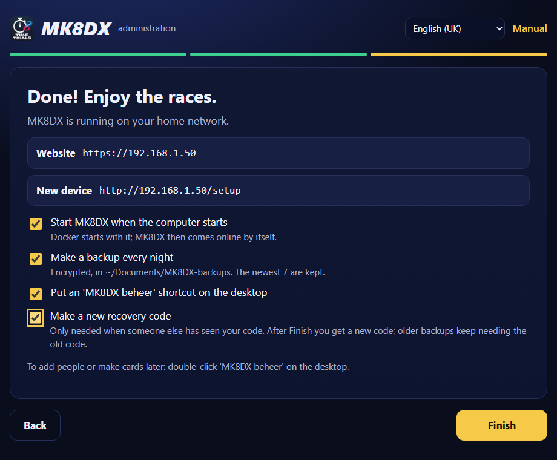
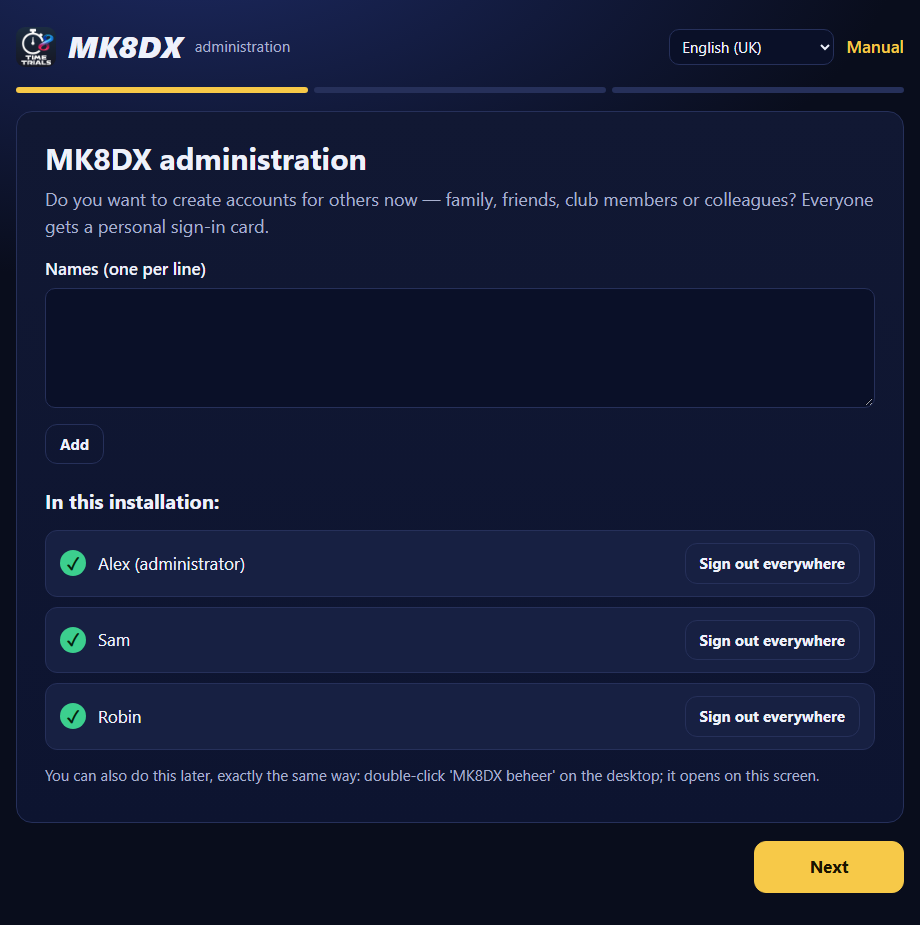
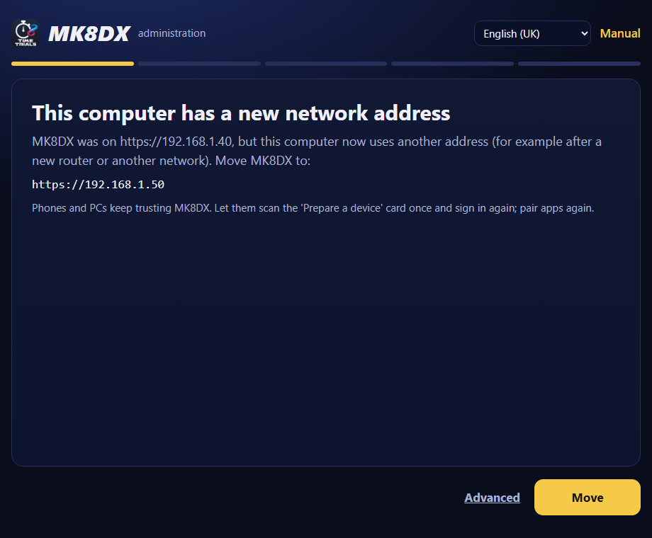

# MK8DX em casa ou no teu clube — manual

*Esta é uma tradução automática do [manual em inglês](../../A2_HOME_GUIDE_EN.md); a versão inglesa é a que prevalece. As correções são bem-vindas através do formulário de issue «Translation correction».*

Este manual leva-te passo a passo de um computador vazio até uma noite de jogo. Não precisas de nenhum conhecimento de informática. Lê os capítulos por ordem; cada capítulo baseia-se no anterior.

**Primeiro, uma nota honesta:** a instalação para casa e para clubes está disponível desde a versão 0.2.0. O Windows 11 foi testado de ponta a ponta, incluindo um telemóvel Android na rede. O Linux só foi testado no WSL 2, ainda não num PC Linux separado nem num Raspberry Pi. Os pacotes para macOS estão compilados, mas ainda não foram testados num Mac real, e um iPhone ainda não foi testado. Sempre que algo ainda não foi testado ou ainda não existe, o passo indica-o.

**Como ler um passo:** depois de **Faz** vem o que tens de fazer, depois de **Vês** o que deve acontecer a seguir, e depois de **Vês outra coisa?** o que fazer nesse caso. As palavras a negrito são botões ou textos que vês exatamente assim no ecrã.

## 1. O que é o MK8DX em casa ou no teu clube, e de que precisas?

O MK8DX é um site para o Mario Kart 8 Deluxe: guardar e comparar tempos de Contrarrelógio, gravações do LiveTrial e noites de torneio. Com esta instalação, o site funciona num computador da tua própria rede. Telemóveis, tablets e outros computadores da mesma rede abrem o site através desse computador. Nada vai para a internet.

Cada pessoa inicia sessão com um **cartão de início de sessão** pessoal: um cartão com um código QR. Um código QR é um código de barras quadrado que lês com a câmara do teu telemóvel ou tablet.

Neste manual, o computador onde o MK8DX funciona chama-se **o computador MK8DX**.

Do que precisas:

- **Um computador que fica ligado enquanto se joga:** Windows 11 com um processador Intel ou AMD, Linux ou macOS. Recomendam-se 8 GB de memória. A configuração verifica se há pelo menos 6 GB de espaço livre em disco.
- **Uma rede doméstica:** o Wi-Fi ou os cabos de rede do teu router. Um router é a caixa que cria a tua rede (muitas vezes do teu fornecedor de internet). Todos os dispositivos têm de estar na mesma rede. Não uses uma rede de convidados: normalmente mantém os dispositivos separados.
- **Telemóveis, tablets ou outros computadores** para os jogadores, de preferência com câmara para ler códigos QR.
- **Uma impressora** dá jeito para imprimir os cartões de início de sessão e o código de recuperação, mas não é obrigatória.

Do que não precisas:

- **Não precisas de internet enquanto jogas.** Só durante a preparação transferes uma vez o Docker, o Python e o pacote MK8DX (ou alguém tos dá numa pen USB).
- **Não precisas de conta noutra empresa**, nem de endereço de e-mail, nem de nuvem.
- **Não precisas de subscrição.** O MK8DX e o Python são gratuitos. O Docker Desktop é gratuito para uso pessoal e para pequenas organizações; as condições estão no site do Docker. No Linux usas o Docker Engine, que é gratuito.

<!-- image: network-overview -->

## 2. Preparar o computador

O MK8DX precisa de dois programas auxiliares gratuitos:

- O **Docker** executa programas em «contentores» isolados. O site e a base de dados do MK8DX funcionam dentro deles. No Windows e no macOS o programa chama-se Docker Desktop.
- O **Python** é uma linguagem de programação. O instalador do MK8DX está escrito nela. Precisas do Python 3.12 a 3.15.

Faz apenas a parte para o teu computador (2A, 2B ou 2C) e salta as outras duas.

## 2A. Preparar o Windows 11

1. **Faz:** verifica que processador tem o teu computador: Iniciar → **Settings** (Definições) → **System** (Sistema) → **About** (Acerca de), linha **System type** (Tipo de sistema). → **Vês:** «64-bit operating system, x64-based processor» (sistema operativo de 64 bits, processador baseado em x64). → **Vês outra coisa?** Se disser ARM, o pacote MK8DX para Windows não serve: só existe para x64 (Intel e AMD).
2. **Faz:** instala primeiro o **WSL** (Windows Subsystem for Linux, o subsistema Windows para Linux). É uma parte do Windows sobre a qual o Docker funciona; sem o WSL, o Docker Desktop não se instala. Clica com o botão direito no botão Iniciar e escolhe **Terminal (Admin)** (Terminal (Administrador)) ou **Windows PowerShell (Admin)** (Windows PowerShell (Administrador)). Clica em **Yes** (Sim) quando o Windows pedir autorização. Escreve `wsl --install` e carrega em Enter. → **Vês:** o Windows transfere e instala o WSL e o Ubuntu; isto demora alguns minutos. No fim diz que tens de reiniciar o computador. Reinicia o computador. → **Vês outra coisa?** Se, depois de reiniciar, abrir uma janela a pedir um nome de utilizador e uma palavra-passe para o Ubuntu: introduz um nome e uma palavra-passe à tua escolha (o MK8DX não precisa deles) e fecha a janela. Se disser que o WSL já está instalado, escreve `wsl --update` e carrega em Enter. Se mencionar **virtualization** (virtualização) («Virtual Machine Platform» ou «virtualization»), a virtualização está desativada na BIOS do computador; ativa-a (os fabricantes chamam-lhe muitas vezes Intel VT-x ou AMD-V) ou pede ajuda.
3. **Faz:** transfere o **Docker Desktop** para Windows (x86_64 / AMD64) a partir de docker.com e abre o ficheiro transferido. → **Vês:** o instalador do Docker com a opção de usar o WSL 2. O WSL é uma parte do Windows sobre a qual o Docker funciona. Deixa essa opção marcada e clica em **OK**. → **Vês outra coisa?** Se o Windows perguntar se esta aplicação pode fazer alterações, clica em **Yes** (Sim).
4. **Faz:** espera até a instalação terminar e reinicia o computador se o Docker o pedir. → **Vês:** depois de reiniciar, o Docker Desktop abre (ou abre-o tu a partir do menu Iniciar). Da primeira vez, o Docker pede-te que aceites as condições. → **Vês outra coisa?** Se o Docker te pedir para iniciar sessão ou criar uma conta: o MK8DX não precisa de uma conta Docker; salta esse passo se o Docker o permitir. Se o Docker continuar a dizer que falta o WSL ou que tem de ser atualizado, repete o passo 2 (`wsl --install` ou `wsl --update`) e reinicia.
5. **Faz:** espera na janela do Docker Desktop. → **Vês:** **Engine running** (motor em execução) no canto inferior esquerdo. → **Vês outra coisa?** «Engine starting» (motor a arrancar) pode demorar alguns minutos. Se ficar parado ou mostrar um erro, reinicia o computador e abre de novo o Docker Desktop. O Docker tem de estar no modo normal de contentores Linux (não em «Windows containers»).
6. **Faz:** vai a python.org → **Downloads** e transfere o **Python install manager** (gestor de instalação do Python) para Windows (o ficheiro termina em `.msix`). Esta é agora a forma oficial de instalar o Python no Windows. Abre o ficheiro transferido e clica em **Install** (Instalar). → **Vês:** o Windows instala o Python install manager; depois podes fechar a janela. → **Vês outra coisa?** Também o podes instalar a partir da Microsoft Store: pesquisa «Python install manager» e clica em **Install** (Instalar). Usa uma das duas formas, não as duas.
7. **Faz:** clica em Iniciar, escreve `PowerShell`, abre o **Windows PowerShell**, escreve `py install 3.15` e carrega em Enter. Isto instala o próprio Python (o install manager é só a ferramenta que vai buscar o Python). → **Vês:** da primeira vez, algumas perguntas para verificar as definições; responde com Enter (a opção sugerida) ou `y`. Depois o Python é transferido e instalado. Uma pergunta sobre adicionar uma pasta ao teu PATH pode ser respondida com `y`; não é obrigatório. → **Vês outra coisa?** Instala exatamente a 3.15, como acima; a 3.12, 3.13 ou 3.14 também funcionam, uma versão mais recente (3.16 ou posterior) ainda não.
8. **Faz:** fecha o PowerShell, abre-o de novo, escreve `python --version` e carrega em Enter. → **Vês:** `Python 3.15` seguido de um número, por exemplo `Python 3.15.2`. → **Vês outra coisa?** Se abrir a Microsoft Store, ou se disser que o python não foi encontrado: clica em Iniciar, escreve **Manage app execution aliases** (Gerir aliases de execução de aplicações) e abre-o. Ativa **Python (default)** (Python (predefinido)) e desativa **App Installer python.exe** e **python3.exe**. Se no passado instalaste um Python antigo ou o «Python launcher», remove-o através de **Settings → Apps → Installed apps** (Definições → Aplicações → Aplicações instaladas) e tenta de novo.

<!-- image: docker-engine-running -->

<!-- image: python-install-manager -->

## 2B. Preparar o Linux (Ubuntu ou Debian)

O Linux ainda não foi testado de ponta a ponta com o MK8DX. Os passos foram escritos para o Ubuntu 24.04 ou mais recente. Escreve-os num **terminal**: uma janela onde dás comandos de texto (no Ubuntu abres-o com Ctrl+Alt+T). Termina cada comando com Enter. **sudo** antes de um comando significa «como administrador deste computador»: o Linux pede então a tua palavra-passe, e não vês nenhum carácter enquanto escreves. Isso é normal.

1. **Faz:** escreve `python3 --version`. → **Vês:** `Python 3.12`, `3.13`, `3.14` ou `3.15`. → **Vês outra coisa?** Um número mais baixo (o Debian 12, por exemplo, tem a 3.11) é demasiado antigo; a 3.16 ou superior ainda não é suportada. Nesse caso precisas de uma versão mais recente do teu Linux; o Ubuntu 24.04 tem o Python 3.12.
2. **Faz:** escreve `sudo apt update` e depois `sudo apt install docker.io docker-compose-v2 python3-venv unzip`. Responde à pergunta se queres continuar com Y e Enter. → **Vês:** os pacotes são transferidos e instalados. → **Vês outra coisa?** Se o apt não encontrar um pacote, ele tem outro nome no teu Linux (pode acontecer no Debian). Continua e verifica no passo 5 se o Docker Compose funciona.
3. **Faz:** escreve `sudo systemctl enable --now docker`. Isto arranca o Docker agora e sempre que o computador arrancar. → **Vês:** nenhum erro (por vezes uma linha que começa com «Created symlink»).
4. **Faz:** escreve `sudo usermod -aG docker $USER`. Isto dá ao teu utilizador o direito de usar o Docker. Depois termina a sessão e volta a iniciá-la (ou reinicia): o direito só funciona depois de voltares a iniciar sessão. → **Vês:** nenhum erro. → **Nota:** quem estiver no grupo docker tem, na prática, direitos de administrador neste computador. Adiciona apenas a ti próprio.
5. **Faz:** verifica com `docker info` e depois `docker compose version`. → **Vês:** uma lista de dados sem erro, e «Docker Compose version» com um número. → **Vês outra coisa?** «permission denied» (permissão negada): faz o passo 4 e não te esqueças de terminar a sessão. «Cannot connect to the Docker daemon» (não é possível ligar ao serviço Docker): faz o passo 3.

Uma **firewall** é uma proteção que decide que ligações um computador deixa entrar. Se a firewall ufw ou firewalld estiver ativa no teu Linux, a configuração no capítulo 3 mostra que comando deixa passar o MK8DX.

## 2C. Preparar o macOS

**Nota:** o macOS ainda não foi testado num Mac real. Os passos abaixo seguem o que a configuração espera no macOS.

1. **Faz:** escolhe menu Apple → **About This Mac** (Acerca deste Mac) e vê **Chip** ou **Processor** (Processador). → **Vês:** um chip Apple (M1, M2 e posteriores): usa o pacote `macos-arm64`. → **Vês outra coisa?** Um processador Intel: usa o pacote `macos-amd64`. Precisa do macOS 10.15 ou mais recente e de um Docker Desktop que ainda suporte o teu Mac.
2. **Faz:** transfere o **Docker Desktop** para Mac com o chip correspondente a partir de docker.com, abre o ficheiro transferido e arrasta o Docker para **Applications** (Aplicações). → **Vês:** o Docker na tua pasta Aplicações.
3. **Faz:** abre o Docker. Aceita as condições; se o macOS pedir a tua palavra-passe, introdu-la. → **Vês:** passado um bocado, **Engine running** (motor em execução) na janela do Docker Desktop. → **Vês outra coisa?** Se o Docker te pedir para iniciar sessão: o MK8DX não precisa de uma conta Docker; salta esse passo se o Docker o permitir.
4. **Faz:** transfere o instalador para macOS do Python 3.15 a partir de python.org e abre-o. Avança pelos passos com **Continue** (Continuar) e **Install** (Instalar). → **Vês:** a mensagem de que a instalação foi bem-sucedida.
5. **Faz:** abre o **Terminal** (Aplicações → Utilitários → Terminal), escreve `python3 --version` e carrega em Enter. → **Vês:** `Python 3.12` a `3.15`. → **Vês outra coisa?** Um número mais baixo (por exemplo a 3.9 da própria Apple): fecha o Terminal e abre-o de novo. Se continuar mais baixo, instala de novo o Python a partir de python.org.
6. **Faz:** escreve `docker info` no Terminal. → **Vês:** uma lista de dados sem erro. → **Vês outra coisa?** Arranca o Docker Desktop e espera por Engine running.

## 3. Instalar o MK8DX

**Descompactar o pacote**

1. **Faz:** transfere o pacote MK8DX para casa ou clube para o teu sistema: Windows, Linux ou macOS, e para Linux e macOS também para o teu processador (amd64 ou arm64). Para verificar se a transferência está correta, compara o seu SHA-256 com a respetiva linha em `SHA256SUMS.txt` da mesma versão (Windows: `Get-FileHash <file> -Algorithm SHA256`; Linux: `sha256sum <file>`; macOS: `shasum -a 256 <file>`); vê também `docs/RELEASE_PACKAGES.md#check-a-download`. → **Vês:** um ficheiro zip na tua pasta Transferências. → **Vês outra coisa?** Se o navegador avisar que o ficheiro não é seguro ou é raramente transferido: escolhe **Keep** (Manter). Windows: depois clica com o botão direito no ficheiro zip → **Properties** (Propriedades), marca **Unblock** (Desbloquear) em baixo e clica em **OK**. Faz isto antes de descompactar; caso contrário, o Windows (Smart App Control, o Controlo Inteligente de Aplicações) pode bloquear mais tarde o `Start-MK8DX-LAN.cmd`. Não desligues o Smart App Control: depois só o podes voltar a ligar com uma nova instalação do Windows.
2. **Faz:** descompacta o ficheiro zip para uma pasta permanente, por exemplo uma pasta MK8DX em Documentos. Windows: clica com o botão direito no ficheiro zip → **Extract All** (Extrair Tudo). Escolhe uma pasta que fique: mais tarde o MK8DX arranca sempre a partir desta pasta, por isso não a movas nem a elimines. → **Vês:** uma pasta com, entre outros, `Start-MK8DX-LAN.cmd`, `README-FIRST.txt` e as pastas `docs`, `images` e `tooling`. → **Vês outra coisa?** Se apenas abriste o ficheiro zip no Explorador de Ficheiros, extrai-o mesmo: arrancar a partir de dentro do ficheiro zip não funciona. Linux sem gestor de ficheiros (um servidor ou WSL): `unzip ~/Downloads/mk8dx-a2-linux-amd64-<version>.zip -d ~/Documents/MK8DX` (com o nome do teu ficheiro; o `unzip` vem do passo 2 do capítulo 2B).

<!-- os: windows -->

**Arrancar no Windows**

1. **Faz:** na pasta descompactada, faz duplo clique em **Start-MK8DX-LAN.cmd**. → **Vês:** uma janela com o logótipo do MK8DX e uma contagem decrescente 3-2-1-GO com bips ([para a omitir](../../../guides/HOSTING.md#the-launcher-window-look-and-options)), depois linhas como «Pacote MK8DX:» e «Instalação privada:». Da primeira vez mostra também «A preparar os pacotes Python incluídos (uma única vez, sem internet).» e «A carregar as imagens Docker incluídas. Isto pode demorar vários minutos.» Isso demora alguns minutos. Depois mostra «MK8DX setup is open in your browser:» (a configuração do MK8DX está aberta no teu navegador) e a configuração abre-se no teu navegador. → **Vês outra coisa?** Vê as mensagens abaixo.
2. **Faz:** mantém a janela preta aberta até teres clicado em **Concluir** na configuração. A própria janela também o diz: «Keep this window open until you click Finish.» (mantém esta janela aberta até clicares em Finish).

Mensagens na janela preta no Windows:

- **"Falta o Python 3.12 a 3.15. Instala o Python install manager a partir de python.org (ou da Microsoft Store), executa: py install 3.15, volta a abrir o PowerShell e tenta novamente."** Faz os passos 6 a 8 do capítulo 2A e depois faz de novo duplo clique em Start-MK8DX-LAN.cmd.
- **"O Docker Desktop não está instalado ou não está em execução. Inicia o Docker Desktop no modo de contentores Linux, espera até mostrar "Engine running" e tenta novamente."** Arranca o Docker Desktop, espera por Engine running e faz de novo duplo clique.
- Por baixo de um erro aparece **"O passo selecionado parou. Lê a mensagem acima antes de tentar novamente."** Lê a linha acima, corrige isso e carrega numa tecla para fechar a janela.

<!-- /os -->

<!-- os: linux macos -->

**Arrancar no Linux e no macOS**

1. **Faz:** abre um terminal na pasta descompactada. Linux: clica com o botão direito na pasta e escolhe «Open in Terminal» (Abrir no Terminal) se o teu gestor de ficheiros o oferecer. No macOS e no Linux também funciona assim: abre o Terminal, escreve `cd ` (com um espaço a seguir), arrasta a pasta para a janela e carrega em Enter. → **Vês:** o terminal está na pasta do pacote.
2. **Faz:** escreve `sh tooling/start-mk8dx.sh` e carrega em Enter. → **Vês:** o logótipo do MK8DX e uma contagem decrescente 3-2-1-GO, depois «Pacote MK8DX:», o número do Python e «Docker Compose version». Da primeira vez também «A carregar as imagens Docker incluídas. Isto pode demorar vários minutos.» e «A preparar os pacotes Python incluídos (uma única vez, sem internet).» Depois «Instalação privada:» e «MK8DX setup is open in your browser:» (a configuração do MK8DX está aberta no teu navegador), e a configuração abre-se no teu navegador. → **Vês outra coisa?** Se não abrir nenhum navegador, copia do terminal para o teu navegador o endereço que começa por `http://127.0.0.1:`.
3. **Faz:** mantém o terminal aberto até teres clicado em **Concluir**.

Mensagens no terminal no Linux e no macOS:

- **"Falta o Python 3.12 a 3.15. Instala-o (Ubuntu/Debian: sudo apt install python3 python3-venv; macOS: python.org) e tenta novamente."** Faz de novo o capítulo 2B ou 2C.
- **"O Docker não está em execução ou este utilizador não o pode usar (Linux: sudo systemctl start docker e junta-te ao grupo docker; macOS: inicia o Docker Desktop)."** Linux: faz os passos 3 e 4 do capítulo 2B. macOS: arranca o Docker Desktop.
- **"Não foi possível criar o ambiente Python privado (Ubuntu/Debian: sudo apt install python3-venv)."** Instala o python3-venv como no passo 2 do capítulo 2B.

<!-- /os -->

**A configuração no navegador**

A configuração é uma página no teu navegador que só funciona no próprio computador MK8DX. Está no idioma do teu navegador (um dos 15 idiomas do jogo; caso contrário, em inglês). No canto superior direito estão o menu de idiomas, para escolheres outro idioma, e **Manual**: abre este manual. Em baixo estão **Voltar**, por vezes **Avançado**, e **Seguinte**. Os pontos no topo mostram em que ponto estás.

1. **Bem-vindo ao MK8DX.** **Faz:** lê o ecrã e clica em **Seguinte**. → **Vês:** «Verificação rápida». O botão **Restaurar uma cópia de segurança** neste ecrã é só para um computador novo (capítulo 10).
2. **Verificação rápida.** **Faz:** espera um momento. → **Vês:** três visto verdes em **O Docker Desktop está em execução**, **Espaço livre suficiente no disco** (com o número de GB) e **Windows, Linux ou macOS**. Clica em **Seguinte**. → **Vês outra coisa?** Um ponto de exclamação com uma explicação, por exemplo «Inicia o Docker Desktop, espera por «Engine running» e clica em Tentar novamente.» ou «Liberta pelo menos 6 GB nesta unidade.» Corrige isso e clica em **Tentar novamente**. No Linux a primeira verificação também se chama «O Docker Desktop está em execução»; aí trata-se do Docker Engine.
3. **Que tipo de instalação?** **Faz:** deixa selecionado **Rede de casa, do clube ou de noite LAN, sem necessidade de internet** (recomendado) e clica em **Seguinte**. → **Vês:** «A tua rede».
4. **A tua rede.** Um **endereço de rede** (endereço IP) é o número pelo qual os dispositivos encontram este computador na tua rede, como um número de porta numa rua. **Faz:** lê o endereço por baixo de «Telemóveis, tablets e outros PCs acedem ao MK8DX neste endereço:» e aponta-o, por exemplo `https://192.168.1.50`. Clica em **Instalar**. → **Vês:** no Windows «Esta rede está configurada como rede doméstica (privada).» ou «Neste momento, o Windows trata esta rede como pública. Quando clicares em Instalar, o MK8DX marca-a como privada e só deixa passar o MK8DX.» No Linux e no macOS não aparece aqui nenhuma frase sobre a rede. → **Vês outra coisa?** Se o computador tiver mais do que uma ligação (cabo e Wi-Fi), clica em **Avançado** e, em «Escolhe outro endereço deste computador:», escolhe o endereço da rede em que os telemóveis também estão. Se disser «Nenhum endereço de rede encontrado.», liga o computador à tua rede doméstica e clica em **Tentar novamente**.
5. **A instalar.** **Faz:** espera e mantém a janela aberta. → **Vês:** «O MK8DX está a ser preparado. Mantém esta janela aberta.» e, um após o outro, «A preparar a instalação», «A permitir a rede (o Windows pede autorização)», «A iniciar a base de dados e o site», «A verificar» e por fim «O MK8DX está em execução. Faltam dois passos curtos.» Clica em **Seguinte**. No Windows, uma janela do Windows pergunta uma vez se o Windows PowerShell pode fazer alterações: clica em **Yes** (Sim). Com isso, o MK8DX marca a tua rede doméstica como privada e deixa passar só o MK8DX pela firewall (a proteção do Windows). Se o MK8DX já tiver sido instalado antes neste computador e neste endereço, essa autorização ainda existe e o Windows não volta a perguntar. → **Vês outra coisa?** Um erro a vermelho: clica em **Detalhes** para ler o que correu mal, corrige-o e clica em **Tentar novamente**. Se clicaste em No (Não) na janela do Windows, aparece que o Windows não permitiu a alteração; clica em **Tentar novamente** e depois em **Yes**.
6. **Só no Linux: a firewall.** **Faz:** durante ou depois da instalação, clica em **Detalhes** e procura a linha que começa por «Network:» (rede). → **Vês:** «not-needed» (não é preciso fazer nada), ou «manual:» seguido de um comando como `sudo ufw allow from 192.168.1.0/24 to 192.168.1.50 port 80,443 proto tcp`. → **Depois faz:** escreve exatamente esse comando (com o teu endereço, como aparece aí) num terminal. Sem esse comando, os telemóveis não conseguem abrir o site.
7. **A tua conta de administrador.** O **administrador** é a pessoa que adiciona pessoas e faz cartões de início de sessão; és tu. **Faz:** introduz um nome em **O teu nome**, por exemplo «Pai» ou «Equipa do clube», e clica em **Seguinte**. O nome só é visível dentro desta instalação. → **Vês:** «Quem joga?»
8. **Quem joga?** **Faz:** escreve os nomes dos jogadores em **Nomes (um por linha)**, cada um na sua linha, e clica em **Adicionar**. Ou clica logo em **Saltar**: podes fazê-lo mais tarde, exatamente da mesma forma, no MK8DX beheer (capítulo 5). → **Vês:** os nomes por baixo de «Nesta instalação:», tu próprio com «(administrador)» a seguir ao teu nome. Clica em **Seguinte**.
9. **Iniciar sessão em telemóveis e PCs.** **Faz:** já podes fazer aqui cartões de início de sessão (os capítulos 5 e 6 explicam como), ou simplesmente clicar em **Seguinte**. → **Vês:** «Concluído! Boas corridas.»
10. **Concluído! Boas corridas.** **Faz:** aponta os dois endereços: **Site** (por exemplo `https://192.168.1.50`) e **Novo dispositivo** (por exemplo `http://192.168.1.50/setup`). Deixa marcadas as três opções: **Iniciar o MK8DX com o Windows**, **Fazer uma cópia de segurança todas as noites** e **Criar um atalho «MK8DX beheer» no ambiente de trabalho**. Clica em **Concluir**. → **Vês:** o teu código de recuperação (capítulo 4). → **No Linux e no macOS** a primeira opção chama-se «Iniciar o MK8DX quando o computador arranca». No macOS abre então o Docker Desktop quando inicias sessão. No Linux, é o `sudo systemctl enable --now docker` do capítulo 2B que trata disso; se ainda não o fizeste, a configuração mostra exatamente esse comando depois de Concluir.
11. **Fechar.** **Faz:** lê o capítulo 4 e guarda o código de recuperação. Depois clica em **Fechar**. → **Vês:** «Já podes fechar esta janela.» Fecha o separador do navegador. No Windows, a janela preta pede uma tecla; carrega numa tecla e ela fecha-se. Se não fizeres nada, a página de configuração para sozinha ao fim de 10 minutos. O próprio MK8DX continua a funcionar.

<!-- image: windows-permission -->

## 4. O código de recuperação e a pasta das cópias de segurança

Uma **cópia de segurança** é uma cópia de reserva de tudo o que está no MK8DX: pessoas, tempos, torneios e definições. O MK8DX faz uma cópia de segurança todas as noites às 03:00 e guarda as 7 mais recentes. As cópias de segurança estão encriptadas: sem a chave não podem ser lidas.

O **código de recuperação** é essa chave. São cinco grupos de quatro letras e algarismos, por exemplo `ABCD-EFGH-JKLM-NPQR-STUV`. Só precisas dele para restaurar uma cópia de segurança noutro computador.

1. **Faz:** depois de **Concluir**, olha para o cartão **Código de recuperação do MK8DX**. → **Vês:** o código, a frase «Sem este código não é possível abrir uma cópia de segurança. Só é mostrado uma vez.» e, por baixo, a pasta para onde vão as cópias de segurança.
2. **Faz:** copia o código para papel ou clica em **Imprimir cartões** para imprimir esta página. Verifica-o letra a letra. → **Vês:** o código em papel. → **Porquê só uma vez?** O MK8DX guarda o código protegido neste computador para a cópia de segurança noturna, mas nunca mais o mostra. Se o computador avariar, só resta o papel.
3. **Faz:** guarda o papel num local seguro, não ao lado do computador. Quem tiver o código e uma cópia de segurança pode abrir tudo.

Onde estão as cópias de segurança:

- **Windows:** na pasta Documentos, pasta `MK8DX-backups` (no disco: `C:\Users\<your name>\Documents\MK8DX-backups`).
- **Linux e macOS:** na tua pasta pessoal, pasta `Documents/MK8DX-backups` (portanto `~/Documents/MK8DX-backups`). Mesmo num Linux noutro idioma, essa pasta chama-se Documents.
- A configuração mostra a pasta exata por baixo do código de recuperação.

De vez em quando, copia a pasta `MK8DX-backups` para uma pen USB ou outro disco. Caso contrário, se o computador avariar, as cópias de segurança ficam apenas nesse computador avariado.

Se desmarcares **Fazer uma cópia de segurança todas as noites** e clicares em **Concluir**, o MK8DX deixa de fazer a cópia de segurança noturna; as cópias já feitas ficam. Se mais tarde voltares a marcar, as cópias continuam com o mesmo código de recuperação, que não volta a ser mostrado. Se já não tiveres esse código, cria um novo como abaixo.

**Um novo código de recuperação**

Cria um código novo se outra pessoa pode ter visto o teu ou se perdeste o papel. Funciona a partir da versão 0.2.7.

1. **Faz:** abre o MK8DX beheer, clica em **Seguinte** até «Concluído! Boas corridas.», marca **Criar um novo código de recuperação** e clica em **Concluir**. → **Vês:** o cartão **Código de recuperação do MK8DX** com o código novo, mostrado só uma vez, e a frase de que as cópias anteriores continuam a precisar do código antigo.
2. **Faz:** escreve o código novo como no passo 2 acima. Guarda o papel antigo com as cópias anteriores: não são convertidas e só abrem com o código antigo. Apaga essas cópias antigas e o papel antigo quando já não precisares deles. → **Vês:** as cópias seguintes usam o código novo.

## 5. Pessoas e cartões de início de sessão (MK8DX beheer)

O **MK8DX beheer** (em neerlandês, «administração do MK8DX») é a mesma página que a configuração, mas para mais tarde: adicionar pessoas e fazer cartões de início de sessão. Só funciona no próprio computador MK8DX. O atalho no ambiente de trabalho chama-se «MK8DX beheer» em todos os idiomas; o título da página é **Administração do MK8DX**.

Uma **conta** é quem inicia sessão. Um **Jogador** é o jogador nas classificações, com os seus tempos. Depois de iniciar sessão, cada pessoa escolhe ou reivindica o seu próprio Jogador no site. Os nomes nunca são associados automaticamente.

**Abrir o MK8DX beheer**

1. **Faz (Windows):** faz duplo clique em **MK8DX beheer** no ambiente de trabalho. Esse atalho arranca o mesmo que o Start-MK8DX-LAN.cmd. → **Vês:** a janela de arranque com a sua curta introdução de corrida e depois, no navegador, a página com «administração» no topo e o título **Administração do MK8DX**. → **Vês outra coisa?** Não há atalho: faz duplo clique em Start-MK8DX-LAN.cmd na pasta MK8DX.
2. **Faz (Linux):** arranca o **MK8DX beheer** a partir do ambiente de trabalho ou do menu de aplicações. Em alguns ambientes de trabalho Linux, tens primeiro de permitir um ícone destes (clica com o botão direito e escolhe a opção que permite iniciá-lo). Também funciona com `sh tooling/start-mk8dx.sh` na pasta MK8DX, como no capítulo 3. → **Vês:** um terminal e depois a página **Administração do MK8DX**.
3. **Faz (macOS, não testado):** faz duplo clique em **MK8DX beheer.command** no ambiente de trabalho, ou arranca `sh tooling/start-mk8dx.sh` como no capítulo 3. → **Vês:** o Terminal e depois a página **Administração do MK8DX**.

**Adicionar pessoas**

1. **Faz:** escreve os nomes em **Nomes (um por linha)** e clica em **Adicionar**. → **Vês:** os nomes por baixo de «Nesta instalação:».
2. **Faz:** clica em **Seguinte**. → **Vês:** «Iniciar sessão em telemóveis e PCs» em dois passos: **Passo 1 · Preparar o dispositivo** com o cartão **Preparar um dispositivo** (uma vez por dispositivo, ainda não te inicia sessão) e **Passo 2 · Iniciar sessão como a pessoa certa** com, para cada pessoa, uma caixa com o botão **Criar cartão**.

**Fazer e imprimir cartões**

1. **Faz:** clica em **Criar cartão** ao lado de uma pessoa. → **Vês:** um código QR com «Válido até» e uma hora. Um cartão funciona uma vez e durante 15 minutos. Deixa a pessoa lê-lo logo (capítulo 6), ou imprime-o.
2. **Faz:** faz primeiro os cartões que queres e depois clica em **Imprimir cartões**. → **Vês:** a janela de impressão do teu navegador com todos os cartões do ecrã, incluindo o cartão Preparar um dispositivo.
3. **Faz:** faz também um cartão para ti (o nome com «(administrador)») se quiseres iniciar sessão no teu telemóvel.

**Substituir ou revogar um cartão**

- **Novo cartão**: faz um cartão novo para essa pessoa. O cartão anterior dessa pessoa neste ecrã deixa então de funcionar.
- **Revogar cartão**: o cartão deixa de funcionar de imediato. Vês «Revogado: este cartão já não funciona.» Usa isto quando um cartão se perde ou foi parar à pessoa errada.
- Só podes revogar um cartão que ainda esteja neste ecrã. Se já fechaste o MK8DX beheer, um cartão não usado expira sozinho ao fim de 15 minutos. Se pode já ter sido usado, escolhe **Terminar sessão em todo o lado**, abaixo.

**Terminar a sessão de alguém em todo o lado**

1. **Faz:** abre o MK8DX beheer. No primeiro ecrã, cada pessoa tem um botão **Terminar sessão em todo o lado**. Clica nele. → **Vês:** o botão muda para **Tens a certeza? Clica outra vez**.
2. **Faz:** clica mais uma vez. → **Vês:** «Sessão terminada em todos os dispositivos. Com um novo cartão, esta pessoa pode voltar a iniciar sessão.» Essa pessoa tem agora a sessão terminada no site e na aplicação, a mudança com um toque para essa conta desaparece e os cartões abertos dessa pessoa deixam de funcionar. → **Vês outra coisa?** Ao lado do teu próprio nome, o segundo clique mostra «Para terminares a tua própria sessão, usa o menu de conta no site («Terminar sessão em todos os dispositivos»).» e não é terminada nenhuma sessão.

**Fechar o MK8DX beheer**

1. **Faz:** clica em **Seguinte** até «Concluído! Boas corridas.», deixa as opções marcadas, clica em **Concluir** e depois em **Fechar**. → **Vês:** «Já podes fechar esta janela.» O MK8DX continua a funcionar.

## 6. Preparar um dispositivo e iniciar sessão

Um **certificado** é uma prova digital de identidade. Com ele, um telemóvel sabe com certeza que está a falar com o teu computador MK8DX e com mais nenhum, e a ligação é encriptada (https). Como o MK8DX funciona sem internet, a configuração cria o seu próprio certificado. Cada dispositivo tem de aprender uma vez a confiar nele. A **impressão digital** é um código curto que pertence exatamente a este certificado; com ela verificas que estás a instalar o certificado certo.

**Porquê um certificado, mesmo em casa sem internet?**

- **Saber com certeza que é o teu MK8DX.** Numa rede de casa ou de clube, qualquer pessoa no mesmo Wi-Fi pode fazer-se passar pelo teu computador MK8DX, por exemplo um convidado com um portátil. Sem certificado, o teu telemóvel não consegue ver a diferença. Com o certificado, o navegador recusa qualquer outro computador.
- **Ninguém está à escuta.** Os cartões de início de sessão, a tua sessão e tudo o que introduzes viajam encriptados pelo Wi-Fi.
- **Porque é que o MK8DX cria o seu próprio certificado.** Os sites na internet usam certificados de emissores conhecidos que já estão em todos os dispositivos. Esses emissores não passam certificados para um endereço doméstico como `192.168.1.50` e não funcionam sem internet. Por isso, o MK8DX cria o seu próprio certificado durante a instalação, e tu dizes uma vez a cada dispositivo que pode confiar nele.
- **O que permites ao instalá-lo.** O certificado destina-se apenas aos endereços de rede privados do MK8DX, e a sua chave secreta fica protegida no computador MK8DX. Instala apenas o certificado do teu próprio MK8DX (verifica a impressão digital) e remove-o de um dispositivo quando deixares de usar essa instalação.

**O que não funciona se não instalares o certificado?**

- O navegador mostra em cada visita um aviso de página inteira, como «Your connection is not private» (a tua ligação não é privada). Podes fechá-lo, mas não o faças: assim deixas de conseguir ver se estás mesmo a falar com o teu MK8DX.
- Mesmo depois de fechares o aviso, as **notificações do navegador** não funcionam: o navegador só as permite com um certificado de confiança. Outras funções do navegador também podem recusar-se.
- O que funciona sem certificado instalado: a **aplicação Android**. Ela aprende o certificado sozinha a partir do cartão **Preparar um dispositivo** (capítulo 7). Um navegador no mesmo dispositivo continua a precisar do certificado.

**O próprio computador MK8DX**

O computador onde o MK8DX funciona também tem de confiar uma vez no MK8DX; caso contrário, o seu navegador avisa sobre o site.

1. **Faz:** abre o MK8DX beheer, clica em **Seguinte** até «Iniciar sessão em telemóveis e PCs» e olha para o bloco **Este computador** por baixo de **Passo 1**. → **Vês:** «Este computador já confia no MK8DX.» Então está feito. → **Vês outra coisa?** Se aparecer o botão **Preparar este computador**, vai para o passo 2.
2. **Faz:** clica em **Preparar este computador**. → **Vês:** uma janela do Windows, **Security Warning** (Aviso de Segurança), a perguntar se queres instalar o certificado, com um **thumbprint (sha1)** (thumbprint/impressão digital, sha1). Compara-o com o thumbprint no MK8DX beheer; se forem iguais, clica em **Yes** (Sim). → **Vês:** «Este computador já confia no MK8DX.» → **Vês outra coisa?** Se clicaste em **No** (Não) ou se os thumbprints forem diferentes: não cliques em Yes, fecha a janela e pede ajuda. No Linux ou no macOS, em vez do botão, aparece a indicação para abrir o endereço por baixo de Preparar um dispositivo no navegador deste computador; depois segue os passos abaixo neste computador.

**Uma vez por dispositivo: Preparar um dispositivo**

1. **Faz:** liga o telemóvel, tablet ou PC ao mesmo Wi-Fi ou à mesma rede com cabo que o computador MK8DX. Num telemóvel, não uses dados móveis em vez de Wi-Fi. → **Vês:** o nome do teu próprio Wi-Fi na ligação.
2. **Faz:** com a câmara, lê o código QR do cartão **Preparar um dispositivo** (no MK8DX beheer ou em papel) e toca na ligação que aparece. Sem câmara, escreve no navegador o endereço **Novo dispositivo**, por exemplo `http://192.168.1.50/setup`. → **Vês:** a página **Preparar este dispositivo** com «Faz isto uma vez por telemóvel, tablet ou PC. Depois, lê o teu cartão pessoal de início de sessão.» → **Vês outra coisa?** Se a página não abrir: verifica a rede e se o computador MK8DX está ligado (capítulo 11).
3. **Faz:** compara o código por baixo de «Verifica primeiro este código.» com a **Impressão digital** no cartão Preparar um dispositivo (quatro grupos de quatro caracteres). → **Vês:** exatamente o mesmo código. → **Vês outra coisa?** Se o código for diferente, não instales nada. Podes estar noutra rede ou noutro endereço; verifica isso primeiro.
4. **Faz:** segue a parte para o teu dispositivo. A parte para o dispositivo que estás a usar já está aberta; para outro dispositivo, abre-a em «Outro tipo de dispositivo?» Toca em **Transferir certificado** (iPhone e iPad: **Transferir perfil**) e segue os passos abaixo. → **Vês:** em baixo, «Já está? Lê o teu cartão pessoal de início de sessão ou abre» com o endereço do site.

Os passos na página Preparar este dispositivo:

<!-- filter: device -->

- **Android:** toca no botão para transferir o certificado. Abre as Settings (Definições) e pesquisa «certificate» («certificado»; muitas vezes: Security → More security settings → Encryption & credentials → Install a certificate → CA certificate, ou seja Segurança → Mais definições de segurança → Encriptação e credenciais → Instalar um certificado → Certificado da AC). Escolhe o ficheiro MK8DX transferido e confirma com o teu PIN. Os nomes dos menus variam conforme a marca do telemóvel.
- **iPhone e iPad (ainda não testados com esta instalação):** toca no botão para transferir o perfil e permite-o. Abre Settings → Profile downloaded → Install (Definições → Perfil transferido → Instalar). Depois Settings → General → About → Certificate Trust Settings (Definições → Geral → Informações → Definições de confiança de certificados) → ativa o MK8DX.
- **Windows:** transfere o certificado e abre-o. Escolhe Install Certificate → Current User → Place all certificates in the following store → Trusted Root Certification Authorities (Instalar Certificado → Utilizador Atual → Colocar todos os certificados no seguinte arquivo → Autoridades de Certificação de Raiz Fidedigna). Não escolhas Intermediate Certification Authorities (Autoridades de Certificação Intermédias). Reinicia o navegador.
- **Mac (o macOS ainda não foi testado de ponta a ponta):** transfere o certificado e abre-o; abre-se o Keychain Access (Acesso a Porta-chaves). Abre o certificado MK8DX → Trust → Always Trust (Confiança → Confiar sempre).
- **Linux (esta via ainda não foi testada de ponta a ponta):** adiciona o mesmo certificado ao arquivo de raízes de confiança da tua distribuição ou do teu navegador. Os passos exatos variam conforme a distribuição. No Ubuntu e no Debian (testado no WSL 2): o `root.crt` transferido está em formato DER, por isso converte-o ao instalá-lo: `sudo openssl x509 -inform DER -in ~/Downloads/root.crt -out /usr/local/share/ca-certificates/mk8dx.crt` e depois `sudo update-ca-certificates`. O Firefox e o Chrome no Linux podem ter o seu próprio arquivo; importa lá o mesmo ficheiro nas definições de certificados (Autoridades) se o navegador continuar a avisar.

<!-- /filter -->

**Iniciar sessão com o teu cartão pessoal**

1. **Faz:** lê o teu próprio cartão (o cartão com o teu nome) e toca na ligação. → **Vês:** **Junta-te a esta instalação do MK8DX** e «Verifica primeiro se este endereço HTTPS pertence ao anfitrião em que confias. O convite só pode ser usado uma vez.» A barra de endereço do navegador tem de mostrar o endereço do site, por exemplo `https://192.168.1.50`. → **Vês outra coisa?** Um aviso do navegador sobre o certificado ou uma ligação não segura: nunca o feches. Faz primeiro o Preparar um dispositivo acima.
2. **Faz:** verifica o nome do cartão por baixo de **Vais iniciar sessão como:**. Se for o teu nome, espera por «Convite pronto. Confirma para iniciar sessão.» e toca em **Aceitar convite**. Se aparecer outro nome, não toques em aceitar: o cartão continua válido para a pessoa certa. → **Vês:** «Tens sessão iniciada como» com o teu nome, e **Continuar para o MK8DX**. Toca nele. → **Vês outra coisa?** «Este convite é inválido. Pede um novo código QR ao administrador.» ou «Não foi possível iniciar sessão. Pede um novo convite ao administrador.»: o cartão já foi usado, expirou ou foi revogado. Pede ao administrador que faça um **Novo cartão**.
3. **Faz:** segue os passos de boas-vindas no site: se já tens tempos ou torneios aqui, e como queres ser chamado. É assim que escolhes ou reivindicas o teu próprio Jogador. → **Vês:** o teu nome e os teus tempos. → **Vês outra coisa?** Se o nome do teu cartão (por exemplo «Pai») não estiver já preenchido: está certo. O nome no cartão é apenas a etiqueta na administração do MK8DX; o teu nome de jogador escolhes tu aqui.

**Outro dispositivo para a mesma pessoa**

- Um jogador pode fazer um cartão sozinho: o menu da conta no site tem **Iniciar sessão também noutro dispositivo**. Abre **Iniciar sessão noutro dispositivo** com um cartão que «Funciona uma vez, válido até» uma hora. Lê-o com o outro dispositivo. Mostra-o apenas ao teu próprio dispositivo: quem o ler fica com sessão iniciada na tua conta.
- Os administradores não têm esse botão. Fazem um **Novo cartão** para si próprios no MK8DX beheer.
- Um dispositivo novo faz sempre primeiro, uma vez, o Preparar um dispositivo.
- **Sem câmara, ou a iniciar sessão no próprio computador MK8DX?** Faz o cartão dessa pessoa no MK8DX beheer e clica em **Iniciar sessão neste computador** (abre a página de início de sessão no navegador do computador MK8DX) ou em **Copiar ligação**. Envia uma ligação copiada apenas à própria pessoa, por exemplo numa mensagem privada: quem a abrir pode iniciar sessão como essa pessoa. Funciona uma vez e durante 15 minutos. No cartão Preparar um dispositivo, **Copiar endereço** copia o endereço; esse não é secreto.

**Deixar esta instalação num dispositivo:** remove de novo o certificado nas mesmas definições que usaste para o instalar.

## 7. A aplicação Android e o LiveTrial

**Emparelhar a aplicação Android**

Isto precisa da versão 2.95.0 da aplicação ou mais recente. A aplicação não precisa do certificado nas definições do Android, mas o início de sessão passa pelo navegador do telemóvel. Por isso, faz primeiro o capítulo 6 neste telemóvel: Preparar um dispositivo e inicia sessão com o teu cartão no navegador.

1. **Faz:** abre a aplicação. Numa instalação nova, começa em **Escolhe a tua comunidade**; caso contrário, toca no nome da comunidade no topo da aplicação e depois em **Adicionar uma comunidade**. → **Vês:** **Escolhe a tua comunidade** com os painéis **Em casa ou no clube** e **Comunidade online**. Em **Em casa ou no clube** toca em **Ler o código QR**.
2. **Faz:** se for preciso, toca em **Usar a câmara** e permite a câmara. Lê o código QR do cartão **Preparar um dispositivo**. → **Vês:** **Confirma que esta é a tua instalação** com um **Endereço** e uma **Impressão digital da chave (SHA-256)**. → **Vês outra coisa?** «Este não é o código QR de um cartão «Preparar um dispositivo».»: leste um cartão pessoal. Lê o cartão Preparar um dispositivo. Se a leitura falhar: no computador MK8DX, clica em **Copiar endereço** no cartão **Preparar um dispositivo** no MK8DX beheer, envia essa ligação para o telemóvel (não é secreta), cola-a em **Ou cola a ligação de configuração** e toca em **Seguinte**. Escrever apenas o endereço curto Novo dispositivo (por exemplo `http://192.168.1.50/setup`) não chega: a aplicação precisa também da impressão digital da chave que está no código QR e na ligação copiada, e diz «Este não é o código QR de um cartão «Preparar um dispositivo».».
3. **Faz:** compara o endereço com o endereço do site, e a chave longa com a página Preparar este dispositivo: abre aí **Impressões digitais completas** e olha para «SHA-256 da chave pública de raiz (SPKI)». Podes abrir essa página noutro dispositivo, ou no próprio computador MK8DX através do endereço Novo dispositivo. → **Vês:** os dois exatamente iguais. Toca em **Ligar** (se a aplicação já estava configurada para outro servidor, confirma a mudança). → **Vês outra coisa?** Se forem diferentes, toca em **Voltar** e não ligues. «Não foi possível obter um certificado correspondente de»: verifica a rede e se o computador MK8DX está ligado, e tenta de novo.
4. **Faz:** em **Definições**, em **Jogador neste telemóvel**, toca em **Iniciar sessão**. A aplicação lembra-te de que, em casa ou no clube, inicias sessão com o teu cartão pessoal de início de sessão, não com e-mail. Toca em **Inicia sessão para sincronizar**. → **Vês:** o navegador abre a página de aprovação com «MK8DX Time Trials for Android pede acesso à tua conta.» e o **Código do dispositivo**. Verifica se é igual ao **Código do dispositivo** que a aplicação mostra, aprova só se acabaste de iniciar isto no teu telemóvel e toca em **Aprovar dispositivo**. A página diz «Dispositivo aprovado. Volta à app para concluir o início de sessão.» Volta à aplicação; ela mostra «Tens sessão iniciada como» com o teu nome. → **Vês outra coisa?** Se o navegador te pedir para iniciar sessão, inicia primeiro sessão com o teu cartão (capítulo 6).
5. **Faz:** publica um tempo na aplicação. → **Vês:** o tempo no site da instalação.

Desemparelhar: toca no nome da comunidade no topo → **Adicionar uma comunidade** → **Esquecer esta instalação**.

Clube e casa numa só aplicação: a aplicação pode ter várias comunidades. Toca no nome da comunidade no topo e depois em **Mudar de comunidade**; cada comunidade guarda a sua própria conta e os seus tempos por enviar. Os teus próprios tempos estão no teu nome → **Meus tempos**, também quando o telemóvel não consegue chegar ao computador MK8DX.

**LiveTrial num segundo PC Windows**

O LiveTrial é um programa para Windows que reconhece e guarda os teus tempos de Contrarrelógio através de uma placa de captura (uma caixa que envia a imagem da tua Switch para o PC). A instalação do próprio LiveTrial está descrita no capítulo 6 de `docs/install/MK8DX_User_Guide_EN.txt`. Testado numa instalação de teste com o LiveTrial 3.37.0. Os passos, em resumo:

1. Primeiro, faz com que esse PC confie na instalação: capítulo 6, parte Windows. Verifica se o site abre no navegador sem aviso.
2. Garante que a tua conta tem um **Jogador** no site.
3. Abre o LiveTrial, clica na roda dentada (**Definições**) e introduz o endereço do site em **Endereço do site da comunidade**, por exemplo `https://192.168.1.50`.
4. Clica em **Iniciar sessão** e escolhe **Abrir a página de aprovação**. Aprova o dispositivo no navegador.
5. Envia tentativas com **Enviar agora**, ou ativa **Enviar novas tentativas automaticamente** nas Definições.

É bom saber: sem um Jogador, o início de sessão do LiveTrial termina com uma mensagem a pedir que configures primeiro o teu Jogador no site. Depois de mudares o endereço, o LiveTrial reinicia; se não o fizer, sai e abre-o de novo. As contas e as tentativas em espera para outro servidor ficam com esse servidor. Quando deixares de usar este PC com a instalação, remove de novo o certificado MK8DX de **Trusted Root Certification Authorities** (Autoridades de Certificação de Raiz Fidedigna; capítulo 6).

## 8. Utilização diária

**O computador MK8DX tem de estar ligado.** Enquanto alguém quiser jogar, o computador MK8DX tem de estar ligado, acordado e ligado à rede. De preferência desativa a suspensão durante uma noite de jogo. O Docker tem de estar em execução; no Windows e no macOS o Docker Desktop arranca sozinho quando inicias sessão (capítulo 10).

**Um telemóvel ou tablet para toda a família**

- Cada pessoa inicia sessão uma vez com o seu próprio cartão nesse dispositivo.
- **Site:** depois disso, mudas com um toque a partir do menu da conta: escolhe **Mudar de conta** e depois a pessoa.
- **PIN:** qualquer pessoa pode definir um PIN de 4 algarismos no site em **Definições** → **PIN para mudar de conta**. Mudar para essa conta pede então primeiro esse PIN.
- **Aplicação Android:** toca no teu nome no topo → **Mudar de Jogador** (ou **Definições** → **Jogador neste telemóvel**), e escolhe a pessoa com **Mudar de Jogador**. Se essa pessoa tiver um PIN, a aplicação pede **PIN necessário** e **PIN (4 dígitos)**. Um PIN errado dá «Esse PIN não está correto.»
- Os **administradores** só estão nessa lista quando definiram um PIN (Definições → PIN para mudar de conta). Sem PIN, iniciam sessão de novo com um cartão. Para um administrador as regras são mais rigorosas: depois do 5.º PIN errado, a conta de administrador desaparece desse dispositivo, e também ao fim de 14 dias sem uso; nessa altura volta a ser preciso um cartão. Na aplicação Android os administradores (ainda) não estão na lista.

**Terminar sessão**

- No site, a partir do menu da conta no canto superior direito: **Terminar sessão** (só neste dispositivo) ou **Terminar sessão em todos os dispositivos**.
- Terminar a sessão de outra pessoa em todo o lado é feito pelo administrador no MK8DX beheer com **Terminar sessão em todo o lado** (capítulo 5).

**Cartão perdido ou telemóvel perdido**

- Cartão perdido que ainda não foi usado: **Revogar cartão** se ainda estiver no ecrã do MK8DX beheer; caso contrário, expira sozinho ao fim de 15 minutos.
- Telemóvel perdido, ou um cartão que pode já ter sido usado: no MK8DX beheer escolhe **Terminar sessão em todo o lado** ao lado dessa pessoa e clica de novo. Depois dá à pessoa um **Novo cartão**.

**Claro ou escuro:** num dispositivo novo, o site segue a definição **Sistema** desse dispositivo. Depois de iniciares sessão, escolhe **Conta** → **Definições** → **Aspeto** → **Escuro** para o aspeto escuro; essa escolha fica guardada na tua conta.

**Um nome para a tua comunidade:** um administrador pode dar um nome à instalação, como «Clube Norte», no site em **Administração** → **Definições da instalação** → **Nome da comunidade**, e clicar em **Guardar nome**. As aplicações mostram então esse nome em vez do endereço web. Deixa o campo vazio e guarda para voltar a remover o nome.

**Tempos de outras comunidades:** alguém que também jogue noutra comunidade (outro clube, ou um site na internet) pode trazer para aqui os seus tempos a partir da aplicação Android. Um administrador escolhe no site em **Administração** → **Definições da instalação** → **Tempos de outras comunidades**: **Desligado** (o padrão: esses tempos são recusados), **Com aprovação** (cada tempo trazido fica escondido até um administrador clicar em **Publicar** ao lado dele em **Administração** → **Contrarrelógio**) ou **Permitido**. Um tempo trazido mostra sempre de onde veio.

## 9. Uma noite de torneio

Este capítulo é só uma visão geral. Os passos reais estão nos manuais indicados abaixo. Uma noite de torneio é gerida no site da tua instalação; o **Diretor** é a pessoa que dirige a noite.

- **A noite no site:** os passos 0 a 10 (participantes e presenças, consolas, grupos e lugares, pontuações, finais e conclusão) estão em `docs/guides/TOURNAMENT_DIRECTORS.md` (no repositório no GitHub; não está no pacote) e no capítulo 6 «Use Android, LiveTrial, the scanner, and Tournament» (usar o Android, o LiveTrial, o leitor e o Torneio) de `docs/install/MK8DX_User_Guide_EN.txt` (no pacote).
- **Tournament Live:** um programa para Windows que lê as corridas a partir de uma placa de captura. Vê `docs/product/README_TOURNAMENT_LIVE_LAPTOP.md` no repositório.
- **Tournament Processor:** lê um vídeo gravado (.mp4 ou .mkv) e transforma-o em ficheiros Excel, CSV e de resultados. Vê `docs/product/README_TOURNAMENT_PROCESSOR_FALLBACK_LAPTOP.md` e `docs/product/USING_MK8DX_TOURNAMENT_TOOLS.md` no repositório.
- **Excel ou CSV como alternativa:** no site também podes introduzir pontuações à mão ou importá-las de um ficheiro Excel/CSV. Para isso não precisas de nenhum programa extra.
- **O reconhecimento nunca torna um resultado oficial sozinho.** O Diretor verifica e confirma cada corrida.
- **Ainda não testado:** ligar as Tournament Tools a uma instalação de casa ou de clube ainda não está descrito nem testado. Podes importar ficheiros de resultados do Processor ou do Tournament Live através do site.

## 10. Cópias de segurança, um computador novo, um endereço novo, reinícios e atualizações

**Guardar as cópias de segurança**

1. **Faz:** de vez em quando, liga uma pen USB ao computador MK8DX e copia para lá a pasta `MK8DX-backups` completa (capítulo 4). → **Vês:** na pen, uma pasta `MK8DX-backups` com pastas que começam por uma data, por exemplo `20261111-030000`.
2. **Faz:** guarda a pen e o papel com o código de recuperação em locais diferentes.

**Restaurar num computador novo**

Isto só funciona num computador onde o MK8DX ainda não está instalado.

1. **Faz:** prepara o computador novo como no capítulo 2. → **Vês:** o Docker funciona e o Python funciona.
2. **Faz:** copia a pasta `MK8DX-backups` da tua pen USB para a pasta Documentos (Windows) ou `~/Documents` (Linux e macOS). Ou deixa a pen USB ligada. → **Vês:** a pasta `MK8DX-backups` no computador novo ou na pen.
3. **Faz:** descompacta o pacote MK8DX e arranca-o como no capítulo 3. No ecrã de boas-vindas clica em **Restaurar uma cópia de segurança**. → **Vês:** «Verificação rápida» e depois **Restaurar uma cópia de segurança** com «Escolhe a cópia de segurança e introduz o código de recuperação que anotaste durante a primeira instalação.»
4. **Faz:** escolhe a cópia de segurança (a mais recente está no topo, com data e hora). → **Vês outra coisa?** «Não há nenhuma cópia de segurança do MK8DX nesta pasta.» (essa mensagem indica a pasta do Windows, também no Linux e no macOS): escreve a pasta com as cópias de segurança em **Outra pasta (por exemplo, uma pen USB):** e clica em **Pesquisar**. Esse campo também aparece quando clicas em **Avançado**.
5. **Faz:** escreve o teu código do papel em **Código de recuperação**. Espaços, minúsculas ou omitir os hífenes não importam. Clica em **Seguinte**. → **Vês:** «A tua rede». O botão Seguinte só funciona quando o código inteiro estiver introduzido.
6. **Faz:** verifica o endereço como no capítulo 3 e clica em **Restaurar**. → **Vês:** «A abrir e a restaurar a cópia de segurança» e depois «O MK8DX está novamente em execução, com tudo o que estava na cópia de segurança.» No Windows, o Windows pede de novo autorização uma vez: clica em **Yes** (Sim). → **Vês outra coisa?** «Este código de recuperação não abre a cópia de segurança. Verifica o código e tenta novamente.»: clica duas vezes em **Voltar** até voltares ao código de recuperação, corrige o código (ou escolhe outra cópia de segurança) e tenta de novo.
7. **Faz:** clica em **Seguinte** ao longo do MK8DX beheer até «Concluído! Boas corridas.» e clica em **Concluir**. → **Vês:** «As novas cópias de segurança usam o mesmo código de recuperação de antes.» O teu código em papel continua válido.
8. **Depois de restaurar:** todas as pessoas, todos os tempos, torneios e definições estão de volta. Os telemóveis e PCs continuam a confiar no MK8DX. Se o computador novo tiver outro endereço, cada pessoa lê uma vez o cartão **Preparar um dispositivo** e inicia sessão de novo; emparelha de novo as aplicações (capítulo 7).

**Outro endereço de rede**

O teu router dá ao computador MK8DX o seu endereço. Normalmente mantém-se igual, mas isso não é garantido: depois de um router novo, de uma falha de energia ou quando o computador esteve desligado muito tempo, ou noutra rede (por exemplo no clube), o endereço pode mudar. Nesse caso, o MK8DX tem de mudar de endereço e todos leem de novo o cartão. Um endereço fixo evita isso.

**Dar ao computador um endereço fixo (recomendado, uma vez)**

Um endereço fixo é melhor tratado no router, com uma **reserva DHCP**: o router guarda então um endereço para este computador e nunca o dá a outro dispositivo.

1. **Faz:** descobre o endereço e o endereço físico do computador. Windows: abre a **Command Prompt** (Linha de Comandos), escreve `ipconfig /all` e carrega em Enter. Linux: escreve `ip -br addr` e `ip -br link`. → **Vês:** para a ligação que usas (**Wi-Fi** ou **Ethernet**) um **IPv4 Address** (endereço IPv4, por exemplo `192.168.1.50`) e um **Physical Address** (endereço físico, também chamado endereço MAC, por exemplo `3C-52-82-AB-CD-EF`). O cabo e o Wi-Fi têm cada um o seu endereço físico: usa o da ligação que o computador usa de facto (de preferência um cabo).
2. **Faz:** abre as definições do teu router no navegador. O endereço e a palavra-passe estão muitas vezes num autocolante no router (por exemplo `192.168.1.1` ou `192.168.0.1`).
3. **Faz:** procura a reserva. O nome varia conforme a marca, por exemplo «DHCP reservation» (reserva DHCP), «Address reservation» (reserva de endereço), «Static IP» (IP estático), «Static lease» (concessão estática) ou «Always assign this device the same IPv4 address» (atribuir sempre a este dispositivo o mesmo endereço IPv4). Normalmente está em **LAN**, **Network** (rede), **DHCP** ou **Home network** (rede doméstica), ao lado da lista de dispositivos ligados.
4. **Faz:** escolhe o computador MK8DX na lista (ou introduz o seu endereço físico), mantém o seu endereço **atual** e guarda. → **Vês:** o computador está na lista de reservas.
5. **Faz:** reinicia o computador e verifica com `ipconfig` que o endereço se manteve. Se for o endereço que o MK8DX já usa, não há mais nada a fazer. Se escolheste outro endereço no router, muda o MK8DX de endereço como abaixo.

**Evitar um conflito de endereços**

Um conflito de endereços acontece quando dois dispositivos usam o mesmo endereço. Um deles (por vezes o computador MK8DX) fica então inacessível de vez em quando ou o tempo todo; o Windows diz por vezes «There is an IP address conflict» (há um conflito de endereços IP).

- Usa uma reserva no router, não um endereço que escreves tu nas definições de rede do Windows ou do Linux. O router não conhece um endereço escrito à mão: mais tarde pode dá-lo a um telemóvel ou a uma consola.
- Se não conseguires aceder ao router (por exemplo no clube) e tiver de ser manual: escolhe um endereço fora da gama que o router distribui (o «DHCP pool»; se o router distribuir de `192.168.1.100` a `192.168.1.199`, escolhe por exemplo `192.168.1.50`) e verifica primeiro que ninguém o usa: `ping 192.168.1.50` não pode receber resposta. Copia a máscara de sub-rede, o gateway e o DNS que o router deu. De preferência, pergunta a quem gere essa rede.
- Deixa apenas um dispositivo distribuir endereços numa rede. Dois routers um atrás do outro (por exemplo o modem do teu fornecedor e o teu próprio router Wi-Fi) são duas redes: põe o computador MK8DX e todos os telemóveis na mesma rede, ou muda o segundo router para **modo de ponto de acesso**.
- Depois de um conflito: dá outro endereço ao outro dispositivo (ou uma reserva ao computador MK8DX) e abre o MK8DX beheer. Se vires **Este computador tem um novo endereço de rede**, segue os passos abaixo.

**Mudar para um novo endereço**

1. **Faz:** se o computador tiver mesmo assim recebido outro endereço, abre o **MK8DX beheer** (capítulo 5). → **Vês:** **Este computador tem um novo endereço de rede** com «O MK8DX estava em» o endereço antigo e o endereço novo por baixo.
2. **Faz:** clica em **Mover**. Com **Avançado** podes escolher outro endereço, se for preciso. → **Vês:** «A mudar para o novo endereço (o Windows pede autorização)»; clica em **Yes** (Sim) na janela do Windows. Depois «O MK8DX está a funcionar no novo endereço.»
3. **Faz:** clica em **Seguinte** e continua como no MK8DX beheer. Pede aos telemóveis e PCs que leiam uma vez o cartão **Preparar um dispositivo** e iniciem sessão de novo; emparelha de novo as aplicações. Continuam a confiar no MK8DX; o cartão Preparar um dispositivo tem agora o endereço novo.

**Depois de o computador reiniciar**

- **Windows:** a tarefa «MK8DX start» arranca o Docker Desktop assim que inicias sessão no Windows; o MK8DX fica então disponível sozinho. Por isso, alguém tem de iniciar sessão: se o computador ficar no ecrã de início de sessão depois de uma atualização do Windows, o MK8DX só volta a estar acessível depois de alguém iniciar sessão.
- **Linux:** o Docker Engine arranca quando o computador arranca (graças ao `sudo systemctl enable --now docker` do capítulo 2B), e o MK8DX vem atrás sozinho.
- **macOS (não testado):** uma tarefa de início de sessão abre o Docker Desktop quando inicias sessão.

**Tarefas noturnas**

- Às 03:00 o MK8DX faz a cópia de segurança. Às 03:30 o MK8DX renova o seu próprio certificado quando é preciso; não dás por isso.
- **Windows:** se o computador estava desligado ou em suspensão, as tarefas perdidas são executadas o mais depressa possível a seguir. A cópia de segurança espera então até o Docker estar em execução.
- **Linux:** as tarefas são executadas como o teu utilizador. Uma tarefa perdida é executada assim que voltares a iniciar sessão.
- **macOS (não testado):** uma tarefa perdida é executada assim que o Mac sai da suspensão.

**Atualizações**

1. **Faz:** transfere o novo pacote MK8DX e descompacta-o para uma pasta **nova**, tal como no capítulo 3 (incluindo o desbloqueio). Mantém por agora a pasta antiga. → **Vês:** uma segunda pasta com `Start-MK8DX-LAN.cmd`.
2. **Faz:** faz duplo clique em `Start-MK8DX-LAN.cmd` na pasta **nova**. → **Vês:** primeiro os programas a carregar com um relógio a correr, depois, no navegador, **Uma versão mais recente do MK8DX** com a versão antiga e a nova. → **Vês outra coisa?** Se o MK8DX beheer simplesmente abrir, esta versão já está em execução. Se disser que o pacote é mais antigo do que a instalação, usa o pacote mais recente.
3. **Faz:** clica em **Atualizar**. → **Vês:** «A criar e a verificar uma cópia de segurança» e depois «A instalar e a iniciar a nova versão», cada um com um relógio a correr; após alguns minutos, **O MK8DX foi atualizado** com a versão antiga e a nova. Todas as pessoas, tempos, torneios e inícios de sessão são mantidos; os telemóveis não precisam de fazer nada de novo. A cópia de segurança automática, a renovação do certificado e o atalho **MK8DX beheer** já passaram para a pasta nova. A cópia de segurança feita mesmo antes está em Documents\MK8DX-backups com `before-update` no nome. Vindo de uma versão anterior à 0.2.3, a atualização também passa a base de dados do MySQL 8.4 para o 9.7 LTS; essa primeira atualização demora um pouco mais, e a cópia de segurança feita mesmo antes é o teu caminho de volta. A janela preta de arranque diz `OK  MK8DX update completed`. → **Vês outra coisa?** Se a janela de arranque disser `MK8DX update FAILED` com um motivo, ou se o navegador mostrar um erro: lê o motivo, corrige-o (por exemplo, arranca o Docker Desktop) e arranca de novo a partir da pasta nova.
4. **Faz:** clica em **Fechar**. Se depois quiseres tratar de mais alguma coisa, clica primeiro em **Ir para o MK8DX beheer**. → **Vês:** a janela do navegador fecha-se; carrega numa tecla na janela de arranque para a fechar.
5. **Faz:** depois elimina a pasta antiga. → **Vês:** o MK8DX continua a funcionar.

Outras vias de instalação (um computador, o teu próprio servidor, alojamento web) estão em `docs/install/MK8DX_User_Guide_EN.txt`. Para remover o MK8DX deste computador, vê **Remover o MK8DX deste computador** no capítulo 12.

## 11. Resolução de problemas

- **Um telemóvel não consegue abrir o site.** O telemóvel está na mesma rede Wi-Fi (não em dados móveis nem numa rede de convidados)? O computador MK8DX está ligado, acordado e com sessão iniciada, e o Docker está em execução? O endereço corresponde a **Site** do capítulo 3? Linux: executaste o comando da firewall do capítulo 3? O computador tem um endereço novo: vê abaixo.
- **O navegador avisa sobre o certificado.** Não feches o aviso. Faz o Preparar um dispositivo nesse dispositivo (capítulo 6) e verifica a impressão digital.
- **Um cartão já não funciona.** Um cartão funciona uma vez e durante 15 minutos, e deixa de funcionar depois de **Revogar cartão**, **Novo cartão** ou **Terminar sessão em todo o lado**. Faz um cartão novo no MK8DX beheer.
- **«This recovery code does not open the backup.»** (Este código de recuperação não abre a cópia de segurança.) Verifica o código letra a letra; maiúsculas, minúsculas, espaços e hífenes não importam. O código nunca contém as letras I e O nem os algarismos 0 e 1. Escolhe também a cópia de segurança certa: uma cópia de segurança de outra instalação não abre com o teu código.
- **«MK8DX is already installed on this computer; restore needs a computer without it».** (O MK8DX já está instalado neste computador; o restauro precisa de um computador sem ele.) O restauro só funciona num computador sem MK8DX. Pede ajuda a um informático (capítulo 12).
- **O Docker não está em execução.** Windows e macOS: arranca o Docker Desktop, espera por **Engine running** e clica em **Tentar novamente**, ou arranca de novo o MK8DX. Linux: `sudo systemctl start docker`.
- **O computador tem um endereço novo.** Abre o MK8DX beheer e escolhe **Mover** (capítulo 10).
- **Windows: «A rede é 'DomainAuthenticated'; pede ao respetivo administrador que permita TCP 80/443».** O computador está numa rede empresarial que o MK8DX não pode alterar sozinho. Pede ao administrador dessa rede que permita ligações de entrada nas portas TCP 80 e 443.
- **Windows: «Windows did not allow the change (the permission prompt was declined or failed)».** (O Windows não permitiu a alteração; o pedido de autorização foi recusado ou falhou.) Clica em **Tentar novamente** e depois em **Yes** (Sim) na janela do Windows.
- **Linux: os telemóveis não conseguem entrar e a firewall está ativa.** Durante a instalação (**Instalar**), clica em **Detalhes** e executa o comando a seguir a «manual:», por exemplo `sudo ufw allow from 192.168.1.0/24 to 192.168.1.50 port 80,443 proto tcp`. Com o firewalld é `sudo firewall-cmd --permanent --add-service=http --add-service=https && sudo firewall-cmd --reload`.
- **A aplicação Android diz «Este não é o código QR de um cartão «Preparar um dispositivo».»** Lê o cartão **Preparar um dispositivo**, não um cartão pessoal.

## 12. Para informáticos (opcional)

Este capítulo não é necessário para a utilização normal.

**Onde estão os dados privados**

- **Windows:** `%LOCALAPPDATA%\MK8DX\LAN` (o Start-MK8DX-LAN.cmd passa essa pasta).
- **Linux:** `~/.local/share/mk8dx/LAN` (ou `$XDG_DATA_HOME/mk8dx/LAN` quando essa variável está definida).
- **macOS:** `~/Library/Application Support/MK8DX/LAN`.
- Ao lado dessa pasta há um ambiente Python privado `python-offline-<code>` com os pacotes Python incluídos: no Windows com `Scripts\python.exe`, no Linux e no macOS com `bin/python`. Usa esse Python para os comandos abaixo.
- Nunca partilhes esta pasta nem as cópias de segurança. Os segredos são protegidos com DPAPI no Windows, no Keychain (Porta-chaves) no macOS e com `systemd-creds --user` no Linux onde disponível; caso contrário, apenas pelas permissões dos ficheiros.

**Comandos** (executa-os na pasta do pacote, com o Python acima e `--state-dir` a apontar para a pasta de dados privados):

- `tooling/install.py status --state-dir <folder>`: verifica se o perfil, os certificados e as definições estão de acordo.
- `tooling/install.py check --state-dir <folder>`: o status mais as definições do Docker Compose e os contentores.
- `tooling/auto_backup.py run --state-dir <folder>`: faz agora uma cópia de segurança encriptada com o código de recuperação guardado, como a tarefa noturna (com `--backup-root <folder>` noutra pasta). Nota: `install.py backup` é para outras vias e não faz uma cópia de segurança A2.
- `tooling/install.py backup-new-code --state-dir <folder>`: cria um novo código de recuperação, como **Criar um novo código de recuperação** no MK8DX beheer, e mostra-o uma vez. As cópias anteriores mantêm o código antigo.
- `tooling/install.py maintain-ca --qa-offline-candidate --state-dir <folder>`: renova o certificado quando chega a altura e, caso contrário, não faz nada; `--force-ca-rotation` renova de imediato.
- `tooling/install.py change-lan-address --lan-bind-address 192.168.1.51 --qa-offline-candidate --state-dir <folder>`: muda para um endereço novo, como **Mover**.
- `tooling/install.py stop --state-dir <folder>` e `tooling/install.py start --qa-offline-candidate --state-dir <folder>`: parar e arrancar.
- `tooling/install.py upgrade --backup-output <new folder> --qa-offline-candidate --state-dir <folder>`: faz e verifica primeiro uma cópia de segurança, depois aplica as atualizações da base de dados e reinicia os contentores com as imagens com que esta instalação foi configurada. Mudar para as imagens de um pacote mais recente ainda não faz parte disto, e esta via não foi testada para A2.
- `tooling/setup_wizard.py --state-dir <folder>`: a própria página de configuração; `--no-browser` não abre nenhum navegador.
- `--qa-offline-candidate` é a opção interna com a qual um pacote A2 ativa as suas próprias funções offline; a página de configuração e o ficheiro de arranque passam-na sozinhos.

**Tarefas agendadas e rede**

- **Windows (Task Scheduler, o Agendador de Tarefas):** «MK8DX backup» (03:00), «MK8DX certificate renewal» (03:30) e «MK8DX start» (ao iniciar sessão), as três para o utilizador com sessão iniciada, sem direitos de administrador.
- **Linux:** temporizadores de utilizador systemd `mk8dx-mk8dx-backup.timer` e `mk8dx-mk8dx-certificate-renewal.timer` (com Persistent=true). O **MK8DX beheer** é uma entrada no menu de aplicações (`~/.local/share/applications/mk8dx-beheer.desktop`) e, quando a pasta `~/Desktop` existe, um ícone no ambiente de trabalho.
- **macOS:** LaunchAgents em `~/Library/LaunchAgents` com nomes que começam por `nl.mariokart8.mk8dx-`.
- O site escuta em TCP 80 e 443 do endereço escolhido. A página de administração escuta apenas em `127.0.0.1` do próprio computador MK8DX.
- **Windows:** a regra de firewall `MK8DX-A2-offline-<address>` permite TCP 80 e 443 nesse endereço, apenas para o perfil Private (Privado). Uma rede pública é marcada como privada; uma rede de domínio nunca é alterada.
- **Linux:** o MK8DX nunca pede sudo por si próprio. Com o ufw ou o firewalld ativos, a configuração mostra o comando; sem firewall ativa, não há nada a fazer. **macOS:** o Docker Desktop abre as portas sozinho.
- Se um restauro falhar a meio, a instalação feita a meio é posta de parte numa pasta ao lado dos dados privados, com `.failed-` e uma hora no nome, para que possas tentar de novo.

**Remover o MK8DX deste computador**

Ainda não há um botão para remover. Estes passos eliminam a base de dados, todas as contas e tempos, e as chaves desta instalação. Faz primeiro uma cópia de segurança (`tooling/auto_backup.py run`, acima) e guarda-a junto com o papel que tem o respetivo código de recuperação, se quiseres poder recuperar alguma coisa: uma cópia de segurança só abre com o código de recuperação dessa instalação. Testado no Windows 11 e no Linux no WSL 2 (ambos com a 0.2.6); as linhas do macOS ainda não foram testadas. Trabalha na pasta do pacote, com o Python acima e sendo `<folder>` a pasta de dados privados.

- Para as tarefas agendadas. No Windows, no PowerShell: `Unregister-ScheduledTask -TaskName 'MK8DX backup','MK8DX certificate renewal','MK8DX start' -Confirm:$false`. No Linux: `systemctl --user disable --now mk8dx-mk8dx-backup.timer mk8dx-mk8dx-certificate-renewal.timer`, depois `rm -f ~/.config/systemd/user/mk8dx-mk8dx-*.service ~/.config/systemd/user/mk8dx-mk8dx-*.timer` e `systemctl --user daemon-reload`. No macOS, para cada ficheiro `~/Library/LaunchAgents/nl.mariokart8.mk8dx-<name>.plist`: `launchctl bootout gui/$(id -u) ~/Library/LaunchAgents/nl.mariokart8.mk8dx-<name>.plist`, e depois elimina o ficheiro. (O `install.py backup-unschedule` é para as outras vias e não mexe nestas tarefas.)
- Para o MK8DX: `tooling/install.py stop --state-dir <folder>`. Depois remove os contentores, a rede e os volumes (a base de dados e os certificados): `docker compose --env-file <folder>/compose.env -f compose.yaml -f compose.offline-lan.yaml -f compose.images.yaml down -v`. O Docker indica os contentores, a rede e quatro volumes como «Removed» (removidos).
- Elimina a pasta de dados privados (mantém-na até o passo anterior estar concluído) e a pasta `python-offline-<code>` ao lado dela. Depois elimina o atalho **MK8DX beheer**: no Windows, o do ambiente de trabalho; no Linux, `~/.local/share/applications/mk8dx-beheer.desktop` e `~/Desktop/mk8dx-beheer.desktop`.
- Remove as imagens que mais nada usa neste computador: `python tooling/remove_images.py` (no Linux e no macOS `python3`). Lê-as do `PACKAGE_MANIFEST.json`, mantém cada imagem que outro contentor ainda usa (outra instalação do MK8DX, ou o `mysql` ou o `mailpit` de outro programa) e diz quais. Depois elimina a pasta do pacote.
- Em cada dispositivo, remove o certificado «MK8DX offline LAN root» (capítulo 6) e esquece a instalação na aplicação Android (capítulo 7).
- A regra de firewall `MK8DX-A2-offline-<address>` no Windows deixa passar só o MK8DX em TCP 80 e 443. Se voltares a instalar o MK8DX no mesmo endereço, mantém-na: assim o Windows não volta a pedir autorização. Para a remover, no **Windows PowerShell (Admin)**: `Remove-NetFirewallRule -Name 'MK8DX-A2-offline-<address>'`. Uma regra do ufw ou do firewalld que tenhas adicionado no Linux (capítulo 3) remove-se com a mesma ferramenta.
- A pasta `MK8DX-backups` em Documentos fica; elimina-a tu próprio quando já não precisares dela.
