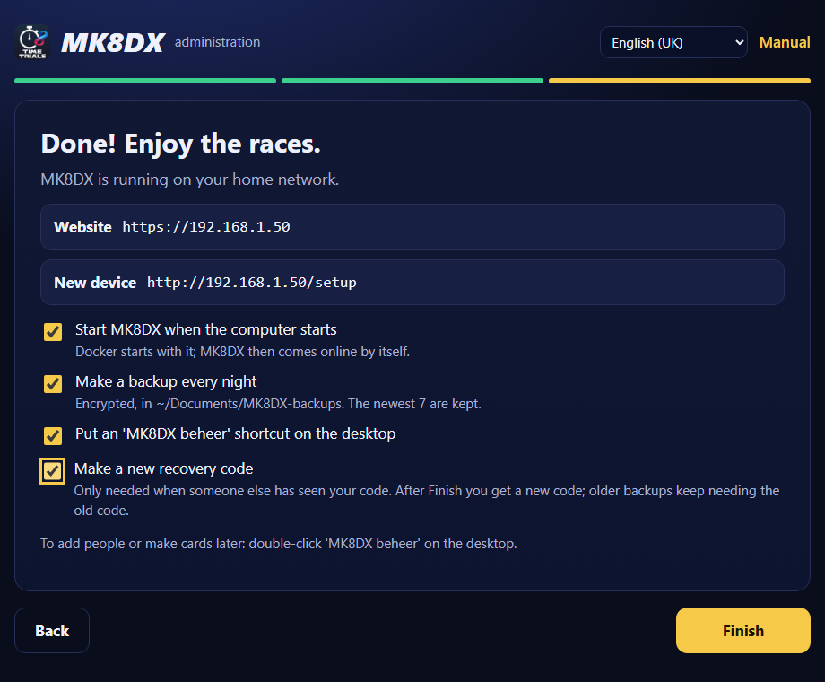
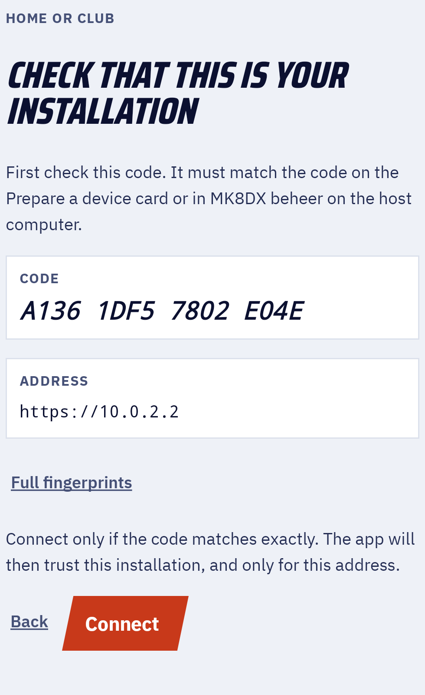

# MK8DX дома или в вашем клубе — руководство

*Это машинный перевод [английского руководства](../../A2_HOME_GUIDE_EN.md); основной считается английская версия. Исправления приветствуются через форму issue «Translation correction».*

Это руководство шаг за шагом ведёт вас от пустого компьютера до сыгранного вечера. Знания в области ИТ не нужны. Читайте главы по порядку; каждая глава опирается на предыдущую.

**Сначала честно:** установка для дома и клуба выпущена начиная с версии 0.2.0. Windows 11 проверена от начала до конца, включая телефон на Android в сети. Linux проверялся только в WSL 2, ещё не на отдельном Linux-компьютере и не на Raspberry Pi. Пакеты для macOS собраны, но ещё не проверены на настоящем Mac, а iPhone пока не тестировался. Там, где что-то ещё не проверено или не собрано, об этом сказано в самом шаге.

**Как читать шаг:** после **Сделайте** идёт то, что вы делаете, после **Вы увидите** — что должно произойти, а после **Видите что-то другое?** — что делать в этом случае. Слова, выделенные жирным, — это кнопки или тексты, которые вы видите на экране именно так.

## 1. Что такое MK8DX дома или в клубе и что вам нужно?

MK8DX — это сайт для Mario Kart 8 Deluxe: хранение и сравнение результатов гонок на время, записей LiveTrial и турнирных вечеров. С этой установкой сайт работает на одном компьютере в вашей собственной сети. Телефоны, планшеты и другие компьютеры в той же сети открывают сайт через этот компьютер. Ничего не уходит в интернет.

Каждый входит с личной **карточкой входа**: карточкой с QR-кодом. QR-код — это квадратный штрихкод, который вы сканируете камерой телефона или планшета.

В этом руководстве компьютер, на котором работает MK8DX, называется **компьютер MK8DX**.

Что вам нужно:

- **Один компьютер, который остаётся включённым, пока люди играют:** Windows 11 с процессором Intel или AMD, Linux или macOS. Рекомендуется 8 ГБ памяти. Программа установки проверяет, что свободно не меньше 6 ГБ на диске.
- **Домашняя сеть:** Wi-Fi или сетевые кабели вашего роутера. Роутер — это коробочка, которая создаёт вашу сеть (часто от вашего интернет-провайдера). Все устройства должны быть в одной сети. Не используйте гостевую сеть: обычно она изолирует устройства друг от друга.
- **Телефоны, планшеты или другие компьютеры** для игроков, желательно с камерой для сканирования QR-кодов.
- **Принтер** удобен для печати карточек входа и кода восстановления, но не обязателен.

Что вам не нужно:

- **Интернет во время игры не нужен.** Только при подготовке вы один раз скачиваете Docker, Python и пакет MK8DX (или кто-то даёт их вам на USB-флешке).
- **Никакого аккаунта в другой компании**, никакого адреса электронной почты и никакого облака.
- **Никакой подписки.** MK8DX и Python бесплатны. Docker Desktop бесплатен для личного использования и небольших организаций; условия указаны на сайте Docker. В Linux вы используете бесплатный Docker Engine.

<!-- image: network-overview -->

## 2. Подготовка компьютера

MK8DX нужны две бесплатные вспомогательные программы:

- **Docker** запускает программы в изолированных «контейнерах». В них работают сайт и база данных MK8DX. В Windows и macOS программа называется Docker Desktop.
- **Python** — это язык программирования. На нём написан установщик MK8DX. Вам нужен Python от 3.12 до 3.15.

Выполните только часть для вашего компьютера (2A, 2B или 2C), а две другие пропустите.

## 2A. Подготовка Windows 11

1. **Сделайте:** проверьте, какой процессор у вашего компьютера: Пуск → **Settings** (Параметры) → **System** (Система) → **About** (О системе), строка **System type** (Тип системы). → **Вы увидите:** «64-bit operating system, x64-based processor» («64-разрядная операционная система, процессор x64»). → **Видите что-то другое?** Если там написано ARM, Windows-пакет MK8DX не подходит: он существует только для x64 (Intel и AMD).
2. **Сделайте:** сначала установите **WSL** (подсистема Windows для Linux). Это часть Windows, на которой работает Docker; без WSL Docker Desktop не установится. Щёлкните правой кнопкой мыши по кнопке «Пуск» и выберите **Terminal (Admin)** (Терминал (администратор)) или **Windows PowerShell (Admin)** (Windows PowerShell (администратор)). Нажмите **Yes** (Да), когда Windows попросит разрешение. Введите `wsl --install` и нажмите Enter. → **Вы увидите:** Windows скачивает и устанавливает WSL и Ubuntu; это занимает несколько минут. В конце говорится, что нужно перезагрузить компьютер. Перезагрузите компьютер. → **Видите что-то другое?** Если после перезагрузки открывается окно с запросом имени пользователя и пароля для Ubuntu: введите любое имя и пароль (MK8DX они не нужны), а затем закройте окно. Если сказано, что WSL уже установлена, введите `wsl --update` и нажмите Enter. Если упоминается **виртуализация** («Virtual Machine Platform» или «virtualization»), значит, виртуализация выключена в BIOS компьютера; включите её (производители часто называют её Intel VT-x или AMD-V) или попросите помощи.
3. **Сделайте:** скачайте **Docker Desktop** для Windows (x86_64 / AMD64) с docker.com и откройте скачанный файл. → **Вы увидите:** установщик Docker с вариантом использовать WSL 2. WSL — это часть Windows, на которой работает Docker. Оставьте этот вариант отмеченным и нажмите **OK**. → **Видите что-то другое?** Если Windows спрашивает, разрешить ли этому приложению вносить изменения, нажмите **Yes** (Да).
4. **Сделайте:** дождитесь окончания установки и перезагрузите компьютер, если Docker об этом попросит. → **Вы увидите:** после перезагрузки открывается Docker Desktop (или откройте его сами из меню «Пуск»). В первый раз Docker попросит принять его условия. → **Видите что-то другое?** Если Docker предлагает войти или создать аккаунт: MK8DX аккаунт Docker не нужен, пропустите это, если Docker позволяет. Если Docker всё ещё сообщает, что WSL отсутствует или её нужно обновить, повторите шаг 2 (`wsl --install` или `wsl --update`) и перезагрузитесь.
5. **Сделайте:** подождите в окне Docker Desktop. → **Вы увидите:** **Engine running** (движок работает) внизу слева. → **Видите что-то другое?** «Engine starting» (движок запускается) может длиться несколько минут. Если всё зависло или показана ошибка, перезагрузите компьютер и снова откройте Docker Desktop. Docker должен быть в обычном режиме Linux-контейнеров (не «Windows containers»).
6. **Сделайте:** зайдите на python.org → **Downloads** и скачайте **Python install manager** (менеджер установки Python) для Windows (файл заканчивается на `.msix`). Сейчас это официальный способ установки Python в Windows. Откройте скачанный файл и нажмите **Install** (Установить). → **Вы увидите:** Windows устанавливает менеджер установки Python; затем окно можно закрыть. → **Видите что-то другое?** Его можно установить и из Microsoft Store: найдите «Python install manager» и нажмите **Install** (Установить). Используйте один из двух способов, а не оба.
7. **Сделайте:** нажмите «Пуск», введите `PowerShell`, откройте **Windows PowerShell**, введите `py install 3.15` и нажмите Enter. Так устанавливается сам Python (менеджер установки — лишь инструмент, который его загружает). → **Вы увидите:** в первый раз несколько вопросов для проверки настроек; отвечайте на них клавишей Enter (предложенный вариант) или `y`. Затем Python скачивается и устанавливается. На вопрос о добавлении папки в PATH можно ответить `y`; это не обязательно. → **Видите что-то другое?** Установите именно 3.15, как указано выше; 3.12, 3.13 или 3.14 тоже работают, более новая версия (3.16 или позже) — пока нет.
8. **Сделайте:** закройте PowerShell, откройте его снова, введите `python --version` и нажмите Enter. → **Вы увидите:** `Python 3.15` и затем число, например `Python 3.15.2`. → **Видите что-то другое?** Если открывается Microsoft Store или сказано, что python не найден: нажмите «Пуск», введите **Manage app execution aliases** (Псевдонимы выполнения приложений) и откройте этот пункт. Включите **Python (default)** и выключите **App Installer python.exe** и **python3.exe**. Если вы раньше устанавливали старый Python или «Python launcher», удалите его через **Settings → Apps → Installed apps** (Параметры → Приложения → Установленные приложения) и попробуйте снова.

<!-- image: docker-engine-running -->

<!-- image: python-install-manager -->

## 2B. Подготовка Linux (Ubuntu или Debian)

Linux ещё не проверялся с MK8DX от начала до конца. Шаги написаны для Ubuntu 24.04 или новее. Вы вводите их в **терминале**: окне, где отдают текстовые команды (в Ubuntu он открывается сочетанием Ctrl+Alt+T). Завершайте каждую команду нажатием Enter. **sudo** перед командой означает «от имени администратора этого компьютера»: Linux тогда спрашивает ваш пароль, и при вводе вы не видите символов. Это нормально.

1. **Сделайте:** введите `python3 --version`. → **Вы увидите:** `Python 3.12`, `3.13`, `3.14` или `3.15`. → **Видите что-то другое?** Меньший номер (например, в Debian 12 — 3.11) слишком старый; 3.16 и выше пока не поддерживаются. Тогда вам нужна более новая версия вашего Linux; в Ubuntu 24.04 есть Python 3.12.
2. **Сделайте:** введите `sudo apt update`, а затем `sudo apt install docker.io docker-compose-v2 python3-venv unzip`. На вопрос, продолжать ли, ответьте Y и Enter. → **Вы увидите:** пакеты скачиваются и устанавливаются. → **Видите что-то другое?** Если apt не находит пакет, в вашем Linux он называется иначе (такое бывает в Debian). Продолжайте и на шаге 5 проверьте, работает ли Docker Compose.
3. **Сделайте:** введите `sudo systemctl enable --now docker`. Это запускает Docker сейчас и при каждом запуске компьютера. → **Вы увидите:** никакой ошибки (иногда строку, начинающуюся с «Created symlink»).
4. **Сделайте:** введите `sudo usermod -aG docker $USER`. Это даёт вашему пользователю право пользоваться Docker. Затем выйдите из системы и войдите снова (или перезагрузитесь): право начинает действовать только после повторного входа. → **Вы увидите:** никакой ошибки. → **Примечание:** любой участник группы docker фактически имеет права администратора на этом компьютере. Добавляйте только себя.
5. **Сделайте:** проверьте командой `docker info`, а затем `docker compose version`. → **Вы увидите:** список сведений без ошибки и «Docker Compose version» с номером. → **Видите что-то другое?** «permission denied» (доступ запрещён): выполните шаг 4 и не забудьте выйти из системы. «Cannot connect to the Docker daemon» (не удаётся подключиться к службе Docker): выполните шаг 3.

**Брандмауэр** — это защита, которая решает, какие подключения компьютер пропускает. Если в вашем Linux активен брандмауэр ufw или firewalld, программа установки в главе 3 покажет, какая команда пропускает MK8DX.

## 2C. Подготовка macOS

**Примечание:** macOS ещё не проверялась на настоящем Mac. Шаги ниже описывают то, чего программа установки ожидает в macOS.

1. **Сделайте:** выберите меню Apple → **About This Mac** (Об этом Mac) и посмотрите на **Chip** (Чип) или **Processor** (Процессор). → **Вы увидите:** чип Apple (M1, M2 и новее): возьмите пакет `macos-arm64`. → **Видите что-то другое?** Процессор Intel: возьмите пакет `macos-amd64`. Ему нужна macOS 10.15 или новее и Docker Desktop, который ещё поддерживает ваш Mac.
2. **Сделайте:** скачайте **Docker Desktop** для Mac с подходящим чипом с docker.com, откройте скачанный файл и перетащите Docker в **Applications** (Программы). → **Вы увидите:** Docker в папке «Программы».
3. **Сделайте:** откройте Docker. Примите условия; если macOS спросит пароль, введите его. → **Вы увидите:** через некоторое время **Engine running** (движок работает) в окне Docker Desktop. → **Видите что-то другое?** Если Docker предлагает войти: MK8DX аккаунт Docker не нужен, пропустите это, если Docker позволяет.
4. **Сделайте:** скачайте установщик Python 3.15 для macOS с python.org и откройте его. Пройдите шаги кнопками **Continue** (Продолжить) и **Install** (Установить). → **Вы увидите:** сообщение об успешной установке.
5. **Сделайте:** откройте **Terminal** (Терминал) (Applications → Utilities → Terminal, то есть Программы → Утилиты → Терминал), введите `python3 --version` и нажмите Enter. → **Вы увидите:** от `Python 3.12` до `3.15`. → **Видите что-то другое?** Меньший номер (например, 3.9 от самой Apple): закройте Терминал и откройте снова. Если номер всё ещё меньше, установите Python с python.org ещё раз.
6. **Сделайте:** введите `docker info` в Терминале. → **Вы увидите:** список сведений без ошибки. → **Видите что-то другое?** Запустите Docker Desktop и дождитесь Engine running.

## 3. Установка MK8DX

**Распаковка пакета**

1. **Сделайте:** скачайте пакет MK8DX для дома или клуба для вашей системы: Windows, Linux или macOS, а для Linux и macOS ещё и для вашего процессора (amd64 или arm64). Чтобы проверить, что файл скачан правильно, сравните его SHA-256 с его строкой в `SHA256SUMS.txt` из того же релиза (Windows: `Get-FileHash <file> -Algorithm SHA256`; Linux: `sha256sum <file>`; macOS: `shasum -a 256 <file>`); см. также `docs/RELEASE_PACKAGES.md#check-a-download`. → **Вы увидите:** zip-файл в папке «Загрузки». → **Видите что-то другое?** Если браузер предупреждает, что файл небезопасен или редко скачивается: выберите **Keep** (Сохранить). Windows: затем щёлкните zip-файл правой кнопкой → **Properties** (Свойства), отметьте внизу **Unblock** (Разблокировать) и нажмите **OK**. Сделайте это до распаковки; иначе Windows (Smart App Control, интеллектуальное управление приложениями) может позже заблокировать `Start-MK8DX-LAN.cmd`. Не отключайте Smart App Control: потом её можно снова включить только переустановкой Windows.
2. **Сделайте:** распакуйте zip-файл в постоянную папку, например в папку MK8DX в «Документах». Windows: щёлкните zip-файл правой кнопкой → **Extract All** (Извлечь все). Выберите постоянную папку: позже MK8DX будет запускаться из неё. Пока папка используется, оставьте её на месте; если её нужно перенести, следуйте процедуре из главы 11, а не просто перемещайте её в Проводнике. → **Вы увидите:** папку, в которой среди прочего есть `Start-MK8DX-LAN.cmd`, `README-FIRST.txt` и папки `docs`, `images` и `tooling`. → **Видите что-то другое?** Если вы только открыли zip-файл в Проводнике, действительно извлеките его: запуск изнутри zip-файла не работает. Linux без файлового менеджера (сервер или WSL): `unzip ~/Downloads/mk8dx-a2-linux-amd64-<version>.zip -d ~/Documents/MK8DX` (с вашим именем файла; `unzip` устанавливается в шаге 2 главы 2B). В zip-файле есть одна папка с именем пакета; откройте её, чтобы запустить MK8DX.

<!-- os: windows -->

**Запуск в Windows**

1. **Сделайте:** в распакованной папке дважды щёлкните **Start-MK8DX-LAN.cmd**. → **Вы увидите:** окно с логотипом MK8DX и обратным отсчётом 3-2-1-GO со звуковыми сигналами ([как его отключить](../../../guides/HOSTING.md#the-launcher-window-look-and-options)), затем строки вроде «Пакет MK8DX:» и «Частная установка:». В первый раз также показывается «Подготовка прилагаемых пакетов Python (один раз, без интернета).» и «Загрузка прилагаемых образов Docker. Это может занять несколько минут.» Это займёт несколько минут. Затем появится «MK8DX setup is open in your browser:» (установка MK8DX открыта в вашем браузере), и программа установки откроется в браузере. → **Видите что-то другое?** См. сообщения ниже.
2. **Сделайте:** не закрывайте чёрное окно, пока не нажмёте **Готово** в программе установки. В окне об этом тоже сказано: «Keep this window open until you click Finish.» (не закрывайте это окно, пока не нажмёте Finish).

Сообщения в чёрном окне в Windows:

- **«Нет Python версии от 3.12 до 3.15. Установите Python install manager с python.org (или из Microsoft Store), выполните: py install 3.15, заново откройте PowerShell и повторите попытку.»** Выполните шаги 6–8 главы 2A, а затем снова дважды щёлкните Start-MK8DX-LAN.cmd.
- **«Docker Desktop не установлен или не запущен. Запустите Docker Desktop в режиме Linux-контейнеров, дождитесь надписи "Engine running" и повторите попытку.»** Запустите Docker Desktop, дождитесь Engine running и снова дважды щёлкните файл.
- Под ошибкой показано **«Выбранный шаг остановлен. Прочитайте сообщение выше, прежде чем повторить попытку.»** Прочитайте строку над ним, устраните причину и нажмите любую клавишу, чтобы закрыть окно.

<!-- /os -->

<!-- os: linux macos -->

**Запуск в Linux и macOS**

1. **Сделайте:** откройте терминал в распакованной папке. Linux: щёлкните правой кнопкой в папке и выберите «Open in Terminal» (Открыть в терминале), если ваш файловый менеджер это предлагает. В macOS и Linux работает и так: откройте Терминал, введите `cd ` (с пробелом после), перетащите папку в окно и нажмите Enter. → **Вы увидите:** терминал находится в папке пакета.
2. **Сделайте:** введите `sh tooling/start-mk8dx.sh` и нажмите Enter. → **Вы увидите:** логотип MK8DX и обратный отсчёт 3-2-1-GO, затем «Пакет MK8DX:», номер Python, «Docker Compose version». В первый раз также «Загрузка прилагаемых образов Docker. Это может занять несколько минут.» и «Подготовка прилагаемых пакетов Python (один раз, без интернета).» Затем «Частная установка:» и «MK8DX setup is open in your browser:», и программа установки откроется в браузере. → **Видите что-то другое?** Если браузер не открылся, скопируйте из терминала адрес, начинающийся с `http://127.0.0.1:`, в браузер.
3. **Сделайте:** не закрывайте терминал, пока не нажмёте **Готово**.

Сообщения в терминале в Linux и macOS:

- **«Нет Python версии от 3.12 до 3.15. Установите его (Ubuntu/Debian: sudo apt install python3 python3-venv; macOS: python.org) и повторите попытку.»** Выполните главу 2B или 2C ещё раз.
- **«Docker не запущен или этому пользователю нельзя его использовать (Linux: sudo systemctl start docker и вступите в группу docker; macOS: запустите Docker Desktop).»** Linux: выполните шаги 3 и 4 главы 2B. macOS: запустите Docker Desktop.
- **«Не удалось создать частное окружение Python (Ubuntu/Debian: sudo apt install python3-venv).»** Установите python3-venv, как в шаге 2 главы 2B.

<!-- /os -->

**Программа установки в браузере**

Программа установки — это страница в браузере, которая работает только на самом компьютере MK8DX. Она на языке вашего браузера (одном из 15 языков игры; иначе — на английском). Вверху справа находятся меню языков, чтобы выбрать другой язык, и **Руководство**: оно открывает это руководство. Внизу — **Назад**, иногда **Дополнительно** и **Далее**. Точки вверху показывают, насколько далеко вы продвинулись.

1. **Добро пожаловать в MK8DX.** **Сделайте:** прочитайте экран и нажмите **Далее**. → **Вы увидите:** «Быстрая проверка». Кнопка **Восстановить резервную копию** на этом экране нужна только для нового компьютера (глава 10).
2. **Быстрая проверка.** **Сделайте:** немного подождите. → **Вы увидите:** три зелёные галочки у **Docker Desktop запущен**, **Достаточно свободного места на диске** (с количеством ГБ) и **Windows, Linux или macOS**. Нажмите **Далее**. → **Видите что-то другое?** Восклицательный знак с пояснением, например «Запустите Docker Desktop, дождитесь статуса «Engine running» и нажмите «Попробовать снова».» или «Освободите на этом диске не менее 6 ГБ.» Устраните причину и нажмите **Попробовать снова**. В Linux первая проверка тоже называется «Docker Desktop запущен»; там речь идёт о Docker Engine.
3. **Какой тип установки?** **Сделайте:** оставьте выбранным **Сеть дома, в клубе или на LAN-вечере, интернет не нужен** (рекомендуется) и нажмите **Далее**. → **Вы увидите:** «Ваша сеть».
4. **Ваша сеть.** **Сетевой адрес** (IP-адрес) — это номер, по которому устройства находят этот компьютер в вашей сети, как номер дома. **Сделайте:** прочитайте адрес под «Телефоны, планшеты и другие ПК подключаются к MK8DX по этому адресу:» и запишите его, например `https://192.168.1.50`. Нажмите **Установить**. → **Вы увидите:** в Windows «Эта сеть настроена как домашняя (частная).» или «Сейчас Windows считает эту сеть общедоступной. Когда вы нажмёте «Установить», MK8DX отметит её как частную и разрешит только MK8DX.» В Linux и macOS фраза о сети здесь не показывается. → **Видите что-то другое?** Если у компьютера несколько подключений (кабель и Wi-Fi), нажмите **Дополнительно** и в пункте «Выберите другой адрес этого компьютера:» выберите адрес той сети, в которой находятся и телефоны. Если написано «Сетевой адрес не найден.», подключите компьютер к домашней сети и нажмите **Попробовать снова**.
5. **Установка.** **Сделайте:** подождите и не закрывайте окно. → **Вы увидите:** «MK8DX настраивается. Не закрывайте это окно.» и по очереди «Подготовка установки», «Разрешаем доступ к сети (Windows запросит разрешение)», «Запуск базы данных и сайта», «Проверка» и наконец «MK8DX работает. Осталось два коротких шага.» Нажмите **Далее**. В Windows окно Windows один раз спросит, может ли Windows PowerShell вносить изменения: нажмите **Yes** (Да). Так MK8DX помечает вашу домашнюю сеть как частную и пропускает через брандмауэр (защиту Windows) только MK8DX. Если MK8DX уже устанавливался на этом компьютере с этим адресом, это разрешение сохранилось, и Windows больше не спрашивает. → **Видите что-то другое?** Красная ошибка: нажмите **Детали**, чтобы прочитать, что пошло не так, устраните причину и нажмите **Попробовать снова**. Если в окне Windows вы нажали No (Нет), будет сказано, что Windows не разрешила изменение; нажмите **Попробовать снова**, а затем **Yes**.
6. **Только Linux: брандмауэр.** **Сделайте:** во время или после установки нажмите **Детали** и найдите строку, начинающуюся с «Network:». → **Вы увидите:** «not-needed» (ничего делать не нужно) или «manual:» и за ним команду вроде `sudo ufw allow from 192.168.1.0/24 to 192.168.1.50 port 80,443 proto tcp`. → **Затем сделайте:** введите в терминале именно эту команду (с вашим адресом, как он там показан). Без этой команды телефоны не смогут открыть сайт.
7. **Ваш аккаунт администратора.** **Администратор** — это человек, который добавляет людей и создаёт карточки входа; это вы. **Сделайте:** введите имя в поле **Ваше имя**, например «Папа» или «Команда клуба», и нажмите **Далее**. Имя видно только внутри этой установки. → **Вы увидите:** «Кто играет?»
8. **Кто играет?** **Сделайте:** введите имена игроков в поле **Имена (по одному в строке)**, каждое на своей строке, и нажмите **Добавить**. Или сразу нажмите **Пропустить**: это можно сделать позже точно так же в MK8DX beheer (глава 5). → **Вы увидите:** имена под «В этой установке:», себя — с «(администратор)» после имени. Нажмите **Далее**.
9. **Вход на телефонах и ПК.** **Сделайте:** здесь уже можно создать карточки входа (как — объясняют главы 5 и 6) или просто нажать **Далее**. → **Вы увидите:** «Готово! Приятных гонок.»
10. **Готово! Приятных гонок.** **Сделайте:** запишите два адреса: **Сайт** (например `https://192.168.1.50`) и **Новое устройство** (например `http://192.168.1.50/setup`). Оставьте три галочки включёнными: **Запускать MK8DX вместе с Windows**, **Создавать резервную копию каждую ночь** и **Создать ярлык «MK8DX beheer» на рабочем столе**. Нажмите **Готово**. → **Вы увидите:** свой код восстановления (глава 4). → **В Linux и macOS** первая галочка называется «Запускать MK8DX при включении компьютера». В macOS она затем открывает Docker Desktop при входе в систему. В Linux об этом заботится `sudo systemctl enable --now docker` из главы 2B; если вы этого ещё не сделали, программа установки после «Готово» покажет именно эту команду.
11. **Завершение.** **Сделайте:** прочитайте главу 4 и сохраните код восстановления. Затем нажмите **Закрыть**. → **Вы увидите:** «Теперь это окно можно закрыть.» Закройте вкладку браузера. В Windows чёрное окно попросит нажать клавишу; нажмите любую, и оно закроется. Если ничего не делать, страница установки сама остановится через 10 минут. Сам MK8DX продолжает работать.

<!-- image: windows-permission -->

## 4. Код восстановления и папка резервных копий

**Резервная копия** — это запасная копия всего, что есть в MK8DX: людей, времён, турниров и настроек. MK8DX делает резервную копию каждую ночь в 03:00 и хранит 7 самых новых. Резервные копии зашифрованы: без ключа их нельзя прочитать.

**Код восстановления** — это и есть ключ. Это пять групп по четыре буквы и цифры, например `ABCD-EFGH-JKLM-NPQR-STUV`. Он нужен только для восстановления резервной копии на другом компьютере.

1. **Сделайте:** после **Готово** посмотрите на карточку **Код восстановления MK8DX**. → **Вы увидите:** код, фразу «Без этого кода резервную копию не открыть. Он показывается только один раз.» и под ней папку, куда попадают резервные копии.
2. **Сделайте:** перепишите код на бумагу или нажмите **Распечатать карточки**, чтобы распечатать эту страницу. Проверьте его буква за буквой. → **Вы увидите:** код на бумаге. → **Почему только один раз?** MK8DX хранит код в защищённом виде на этом компьютере для ночных резервных копий, но больше никогда его не показывает. Если компьютер сломается, останется только бумага.
3. **Сделайте:** храните бумагу в надёжном месте, не рядом с компьютером. Тот, у кого есть код и резервная копия, может открыть всё.

Где находятся резервные копии:

- **Windows:** в папке «Документы», папка `MK8DX-backups` (на диске: `C:\Users\<your name>\Documents\MK8DX-backups`).
- **Linux и macOS:** в вашей домашней папке, папка `Documents/MK8DX-backups` (то есть `~/Documents/MK8DX-backups`). Даже в Linux на другом языке эта папка называется Documents.
- Программа установки показывает точную папку под кодом восстановления.

Время от времени копируйте папку `MK8DX-backups` на USB-флешку или другой диск. Иначе, если компьютер сломается, резервные копии останутся только на этом сломанном компьютере.

Если снять галочку **Создавать резервную копию каждую ночь** и нажать **Готово**, MK8DX прекратит ночное резервное копирование; уже созданные копии останутся. Если позже снова поставить галочку, копии продолжат создаваться с тем же кодом восстановления, и он больше не показывается. Если этого кода у вас больше нет, создайте новый, как описано ниже.

**Новый код восстановления**

Создайте новый код, если ваш код мог увидеть кто-то другой или если вы потеряли бумагу. Это работает начиная с версии 0.2.7.

1. **Сделайте:** откройте MK8DX beheer, нажимайте **Далее**, пока не появится «Готово! Приятных гонок.», поставьте галочку **Создать новый код восстановления** и нажмите **Готово**. → **Вы увидите:** карточку **Код восстановления MK8DX** с новым кодом, который показывается только один раз, и фразу о том, что более ранним копиям по-прежнему нужен старый код.
2. **Сделайте:** запишите новый код, как в шаге 2 выше. Храните старую бумагу вместе с более ранними копиями: они не преобразуются и открываются только старым кодом. Удалите эти старые копии и старую бумагу, когда они станут не нужны. → **Вы увидите:** следующие копии используют новый код.

## 5. Люди и карточки входа (MK8DX beheer)

**MK8DX beheer** (по-нидерландски «администрирование MK8DX») — это та же страница, что и программа установки, но для дальнейшей работы: добавления людей и создания карточек входа. Она работает только на самом компьютере MK8DX. Ярлык на рабочем столе на всех языках называется «MK8DX beheer»; заголовок страницы — **Администрирование MK8DX**.

**Аккаунт** — это тот, кто входит. **Игрок** — это игрок в рейтингах, со своими временами. После входа каждый выбирает или заявляет своего игрока на сайте. Имена никогда не связываются автоматически.

**Открытие MK8DX beheer**

1. **Сделайте (Windows):** дважды щёлкните **MK8DX beheer** на рабочем столе. Этот ярлык запускает то же, что и Start-MK8DX-LAN.cmd. → **Вы увидите:** окно запуска с коротким гоночным вступлением, а затем в браузере страницу со словом «администрирование» вверху и заголовком **Администрирование MK8DX**. → **Видите что-то другое?** Ярлыка нет: дважды щёлкните Start-MK8DX-LAN.cmd в папке MK8DX.
2. **Сделайте (Linux):** запустите **MK8DX beheer** с рабочего стола или из меню приложений. В некоторых средах рабочего стола Linux такой значок сначала нужно разрешить (щёлкните его правой кнопкой и выберите пункт, разрешающий запуск). Работает и `sh tooling/start-mk8dx.sh` в папке MK8DX, как в главе 3. → **Вы увидите:** терминал, а затем страницу **Администрирование MK8DX**.
3. **Сделайте (macOS, не проверено):** дважды щёлкните **MK8DX beheer.command** на рабочем столе или запустите `sh tooling/start-mk8dx.sh`, как в главе 3. → **Вы увидите:** Терминал, а затем страницу **Администрирование MK8DX**.

- **Сами ввели 127.0.0.1 с портом?** Страница **MK8DX lokaal beheer**, которая запрашивает одноразовый код администратора, — это техническая страница хоста. Она вам не нужна: закройте её и откройте MK8DX beheer ярлыком, как описано выше.

**Добавление людей**

1. **Сделайте:** введите имена в поле **Имена (по одному в строке)** и нажмите **Добавить**. → **Вы увидите:** имена под «В этой установке:».
2. **Сделайте:** нажмите **Далее**. → **Вы увидите:** «Вход на телефонах и ПК» в два шага: **Шаг 1 · Подготовьте устройство** с карточкой **Подготовить устройство** (один раз на устройство, это ещё не выполняет вход) и **Шаг 2 · Войдите как нужный человек**, где для каждого человека есть блок с кнопкой **Создать карточку**.

**Создание и печать карточек**

1. **Сделайте:** нажмите **Создать карточку** рядом с человеком. → **Вы увидите:** QR-код с «Действует до» и временем. Карточка срабатывает один раз и действует 15 минут. Пусть человек отсканирует её сразу (глава 6), или распечатайте её.
2. **Сделайте:** сначала создайте нужные карточки, а затем нажмите **Распечатать карточки**. → **Вы увидите:** окно печати вашего браузера со всеми карточками на экране, включая карточку «Подготовить устройство».
3. **Сделайте:** создайте карточку и для себя (имя с «(администратор)»), если хотите входить на своём телефоне.

**Замена или отзыв карточки**

- **Новая карточка**: создаёт для этого человека новую карточку. Предыдущая карточка этого человека на этом экране тогда перестаёт работать.
- **Отозвать карточку**: карточка сразу перестаёт работать. Вы увидите «Отозвана: эта карточка больше не работает.» Используйте это, если карточка потеряна или попала не тому человеку.
- Отозвать можно только карточку, которая ещё есть на этом экране. Если вы уже закрыли MK8DX beheer, неиспользованная карточка сама истекает через 15 минут. Если ею, возможно, уже воспользовались, выберите ниже **Выйти везде**.

**Выход человека на всех устройствах**

1. **Сделайте:** откройте MK8DX beheer. На первом экране у каждого человека есть кнопка **Выйти везде**. Нажмите её. → **Вы увидите:** кнопка меняется на **Уверены? Нажмите ещё раз**.
2. **Сделайте:** нажмите ещё раз. → **Вы увидите:** «Выполнен выход на всех устройствах. С новой карточкой этот человек сможет войти снова.» Теперь этот человек вышел на сайте и в приложении, быстрое переключение на этот аккаунт одним нажатием исчезает, а открытые карточки этого человека перестают работать. → **Видите что-то другое?** Рядом с вашим собственным именем второе нажатие показывает «Сами вы выходите через меню аккаунта на сайте («Выйти на всех устройствах»).», и выход ни для кого не выполняется.

**Добавление телефона или устройства для одного человека**

Пошаговый способ подключить телефон, планшет или ПК человека, в том числе iPhone или устройство без приложения MK8DX.

1. **Сделайте:** откройте MK8DX beheer и нажмите **Добавить телефон или устройство** рядом с человеком. → **Вы увидите:** «Добавить телефон или устройство для …» с именем и **1 · Доверие** с карточкой **Подготовить устройство** и её коротким кодом.
2. **Сделайте:** на устройстве с приложением MK8DX (Android): отсканируйте QR-код в приложении. Без приложения (iPhone, iPad, другой телефон или ПК): отсканируйте его камерой и следуйте открывшейся странице, чтобы установить сертификат (глава 6). Проверьте, что страница или приложение показывает тот же код. Если это устройство уже подготовлено, пропустите этот шаг. Нажмите **Далее**. → **Вы увидите:** **2 · Сканировать карту входа** с личной карточкой этого человека, «Личная для … Срабатывает один раз.» и обратный отсчёт вида «Действует ещё 14:59».
3. **Сделайте:** отсканируйте эту карточку тем же устройством и примите там приглашение (глава 6). → **Вы увидите:** в MK8DX beheer сам по себе в течение нескольких секунд: **3 · Готово** и «Вход выполнен: …». → **Видите что-то другое?** «Срок действия этой карточки истёк.» или «Эта карточка отозвана.»: нажмите **Новая карточка**; старая карточка перестаёт работать, когда вы создаёте новую. «Эта установка не может сообщить, была ли использована карточка»: проверьте устройство и нажмите **Получилось**.
4. **Сделайте:** нажмите **Ещё одно устройство** для второго устройства того же человека или **Назад к людям**.

**Печать приветственной карточки**

1. **Сделайте:** в окне «Добавить телефон или устройство» выберите **A6** или **A4** в поле **Размер бумаги** и нажмите **Приветственная карточка**. → **Вы увидите:** предпросмотр одной страницы, «Добро пожаловать в MK8DX, …!», с адресом и тремя пронумерованными шагами: 1 Доверие (QR-код «Подготовить устройство» и проверочный код), 2 Сканировать карту входа (личный QR-код с пометкой ЛИЧНАЯ и «Действует до») и 3 Готово.
2. **Сделайте:** нажмите **Распечатать**, а затем **Назад**. → **Вы увидите:** окно печати браузера только с приветственной карточкой.

- Карточка входа на ней срабатывает один раз и действует 15 минут с момента создания, в том числе на бумаге. Более долгую карточку MK8DX создать не может, поэтому печатайте её непосредственно перед тем, как отдать. Если напечатать без действующей карточки (на шаге 1 или после истечения срока), шаг 2 будет пустым полем: тогда человек получает новую карточку в тот же день. Часть «Доверие» остаётся действительной, пока MK8DX не переедет на другой адрес.

**Закрытие MK8DX beheer**

1. **Сделайте:** нажимайте **Далее** до «Готово! Приятных гонок.», оставьте галочки включёнными, нажмите **Готово**, а затем **Закрыть**. → **Вы увидите:** «Теперь это окно можно закрыть.» MK8DX продолжает работать.

## 6. Подготовка устройства и вход

**Сертификат** — это цифровое удостоверение личности. С ним телефон точно знает, что общается с вашим компьютером MK8DX, а не с чем-то другим, и соединение шифруется (https). Поскольку MK8DX работает без интернета, программа установки создаёт собственный сертификат. Каждое устройство должно один раз научиться ему доверять. **Отпечаток** — это короткий код, который принадлежит именно этому сертификату; с его помощью вы проверяете, что устанавливаете правильный сертификат.

**Зачем сертификат, даже дома без интернета?**

- **Точно знать, что это ваш MK8DX.** В домашней или клубной сети любой, кто подключён к тому же Wi-Fi, может выдать себя за ваш компьютер MK8DX, например гость с ноутбуком. Без сертификата ваш телефон не отличит одно от другого. С сертификатом браузер отказывает любому другому компьютеру.
- **Никто не подслушивает.** Карточки входа, ваш сеанс входа и всё, что вы вводите, передаются по Wi-Fi в зашифрованном виде.
- **Почему MK8DX создаёт собственный сертификат.** Сайты в интернете используют сертификаты известных издателей, которые уже есть в каждом устройстве. Они не выдают сертификаты для домашнего адреса вроде `192.168.1.50` и не работают без интернета. Поэтому MK8DX создаёт собственный сертификат при установке, а вы один раз сообщаете каждому устройству, что ему можно доверять.
- **Что вы разрешаете, устанавливая его.** Сертификат предназначен только для частных сетевых адресов MK8DX, а его секретный ключ остаётся защищённым на компьютере MK8DX. Устанавливайте только сертификат своего MK8DX (проверьте отпечаток) и удаляйте его с устройства, когда больше не пользуетесь этой установкой.

**Что не работает, если не установить сертификат?**

- Браузер при каждом посещении показывает полностраничное предупреждение, например «Your connection is not private» («Подключение не защищено»). Его можно закрыть, но не делайте этого: тогда вы уже не сможете увидеть, действительно ли вы общаетесь со своим MK8DX.
- Даже после того как вы его закрыли, **уведомления браузера** не работают: браузер разрешает их только с доверенным сертификатом. Другие функции браузера тоже могут отказывать.
- Что работает без установленного сертификата: **приложение для Android**. Оно само узнаёт сертификат из карточки **Подготовить устройство** (глава 7). Браузеру на том же устройстве сертификат всё равно нужен.

**Сам компьютер MK8DX**

Компьютер, на котором работает MK8DX, тоже должен один раз начать доверять MK8DX, иначе его браузер предупреждает о сайте.

1. **Сделайте:** откройте MK8DX beheer, нажимайте **Далее** до «Вход на телефонах и ПК» и посмотрите на блок **Этот компьютер** под **Шаг 1**. → **Вы увидите:** «Этот компьютер уже доверяет MK8DX.» Тогда всё готово. → **Видите что-то другое?** Если показана кнопка **Подготовить этот компьютер**, перейдите к шагу 2.
2. **Сделайте:** нажмите **Подготовить этот компьютер**. → **Вы увидите:** окно Windows **Security Warning** (Предупреждение системы безопасности) с вопросом, хотите ли вы установить сертификат, и с **thumbprint (sha1)** (отпечаток, sha1). Сравните его с отпечатком в MK8DX beheer; если они совпадают, нажмите **Yes** (Да). → **Вы увидите:** «Этот компьютер уже доверяет MK8DX.» → **Видите что-то другое?** Если вы нажали **No** (Нет) или отпечатки различаются: не нажимайте Yes, закройте окно и попросите помощи. В Linux или macOS вместо кнопки написано, что нужно открыть адрес из «Подготовить устройство» в браузере этого компьютера; затем выполните шаги ниже на этом компьютере.

**Один раз на устройство: Подготовить устройство**

1. **Сделайте:** подключите телефон, планшет или компьютер к той же сети Wi-Fi или проводной сети, что и компьютер MK8DX. На телефоне не используйте мобильный интернет вместо Wi-Fi. → **Вы увидите:** название своей сети Wi-Fi в сведениях о подключении.
2. **Сделайте:** камерой отсканируйте QR-код на карточке **Подготовить устройство** (в MK8DX beheer или на бумаге) и нажмите появившуюся ссылку. Без камеры введите в браузере адрес **Новое устройство**, например `http://192.168.1.50/setup`. → **Вы увидите:** страницу **Подготовка этого устройства** с текстом «Сделайте это один раз для каждого телефона, планшета или ПК. Затем отсканируйте свою личную карточку входа.» → **Видите что-то другое?** Если страница не открывается: проверьте сеть и то, что компьютер MK8DX включён (глава 11).
3. **Сделайте:** сравните код под «Сначала проверьте этот код.» с полем **Отпечаток** на карточке «Подготовить устройство» (четыре группы по четыре символа). → **Вы увидите:** точно такой же код. → **Видите что-то другое?** Если код отличается, ничего не устанавливайте. Возможно, вы в другой сети или на другом адресе; сначала проверьте это.
4. **Сделайте:** выполните часть для вашего устройства. Часть для устройства, которым вы пользуетесь, уже открыта; для другого устройства откройте её в разделе «Другое устройство?» Нажмите **Скачать сертификат** (на iPhone и iPad: **Скачать профиль**) и выполните шаги ниже. Имя файла — `MK8DX-<код проверки>-<дата>.crt`. Если Chrome предупреждает о небезопасной загрузке, выберите **Сохранить** только после сверки кода с карточкой. → **Вы увидите:** внизу «Готово? Отсканируйте свою личную карточку входа или откройте» с адресом сайта.

Шаги на странице «Подготовка этого устройства»:

<!-- filter: device -->

- **Android:** нажмите кнопку, чтобы скачать сертификат. Откройте «Настройки» и найдите «сертификат» (часто: Безопасность → Другие настройки безопасности → Шифрование и учётные данные → Установка сертификата → Сертификат ЦС). Выберите скачанный файл MK8DX и подтвердите PIN-кодом. Названия меню различаются в зависимости от марки телефона.
- **iPhone и iPad (с этой установкой ещё не проверялись):** нажмите кнопку, чтобы скачать профиль, и разрешите это. Откройте «Настройки» → «Профиль загружен» → «Установить». Затем «Настройки» → «Основные» → «Об этом устройстве» → «Доверие сертификатам» → включите MK8DX.
- **Windows:** скачайте сертификат и откройте его. Выберите Install Certificate (Установить сертификат) → Current User (Текущий пользователь) → Place all certificates in the following store (Поместить все сертификаты в следующее хранилище) → Trusted Root Certification Authorities (Доверенные корневые центры сертификации). Не выбирайте Intermediate Certification Authorities (Промежуточные центры сертификации). Перезапустите браузер.
- **Mac (macOS ещё не проверена от начала до конца):** скачайте сертификат и откройте его; откроется «Связка ключей». Откройте сертификат MK8DX → «Доверие» → «Всегда доверять».
- **Linux (этот путь ещё не проверен от начала до конца):** добавьте тот же сертификат в хранилище доверенных корневых сертификатов вашего дистрибутива или браузера. Точные шаги зависят от дистрибутива. В Ubuntu и Debian (проверено в WSL 2): скачанный `MK8DX-*.crt` имеет формат DER, поэтому преобразуйте его при установке: `sudo openssl x509 -inform DER -in ~/Downloads/MK8DX-*.crt -out /usr/local/share/ca-certificates/mk8dx.crt`, а затем `sudo update-ca-certificates`. Firefox и Chrome в Linux могут использовать собственное хранилище; если браузер всё ещё предупреждает, импортируйте тот же файл туда в настройках сертификатов (Центры сертификации).

<!-- /filter -->

**Вход с личной карточкой**

1. **Сделайте:** отсканируйте свою карточку (карточку с вашим именем) и нажмите ссылку. → **Вы увидите:** **Присоединиться к этой установке MK8DX** и «Сначала убедитесь, что этот HTTPS-адрес принадлежит хосту, которому вы доверяете. Приглашение можно использовать один раз.» Адресная строка браузера должна показывать адрес сайта, например `https://192.168.1.50`. → **Видите что-то другое?** Предупреждение браузера о сертификате или небезопасном соединении: никогда не закрывайте его. Сначала выполните «Подготовить устройство» выше.
2. **Сделайте:** проверьте имя карточки под **Вы входите как:**. Если это ваше имя, дождитесь «Приглашение готово. Подтвердите, чтобы войти.» и нажмите **Принять приглашение**. Если показано другое имя, не нажимайте «принять»: карточка остаётся действительной для нужного человека. → **Вы увидите:** «Вы вошли как» с вашим именем и **Перейти в MK8DX**. Нажмите её. → **Видите что-то другое?** «Это приглашение недействительно. Попросите у администратора новый QR-код.» или «Не удалось войти. Попросите у администратора новое приглашение.»: карточкой уже воспользовались, она истекла или отозвана. Пусть администратор создаст новую карточку кнопкой **Новая карточка**.
3. **Сделайте:** пройдите приветственные шаги на сайте: есть ли у вас здесь уже времена или турниры и как вы хотите называться. Так вы выбираете или заявляете своего игрока. → **Вы увидите:** своё имя и свои времена. → **Видите что-то другое?** Если имя с вашей карточки (например, «Папа») не подставлено заранее: так и должно быть. Имя на карточке — лишь метка в «Администрирование MK8DX»; имя игрока вы выбираете здесь сами.

**Другое устройство для того же человека**

- Игрок может создать карточку сам: в меню аккаунта на сайте есть **Войти также на другом устройстве**. Оно открывает **Войти на другом устройстве** с карточкой, которая «Работает один раз, действует до» указанного времени. Отсканируйте её другим устройством. Показывайте её только своему устройству: кто её отсканирует, тот войдёт в ваш аккаунт.
- У администраторов этой кнопки нет. Они создают себе новую карточку кнопкой **Новая карточка** в MK8DX beheer.
- Новое устройство всегда сначала один раз проходит «Подготовить устройство».
- **Нет камеры или нужно войти на самом компьютере MK8DX?** Создайте карточку этого человека в MK8DX beheer и нажмите **Войти на этом компьютере** (открывает страницу входа в браузере компьютера MK8DX) или **Копировать ссылку**. Отправляйте скопированную ссылку только самому этому человеку, например в личном сообщении: кто её откроет, может войти как этот человек. Она срабатывает один раз и действует 15 минут. На карточке «Подготовить устройство» кнопка **Копировать адрес** копирует адрес; он не секретный.

**Чтобы отключить устройство от этой установки:** снова удалите сертификат в тех же настройках, где вы его устанавливали.

## 7. Приложение для Android и LiveTrial

**Сопряжение приложения для Android**

Используйте актуальное приложение Android из выпуска. Настройка A2 состоит из трёх шагов: **Подключить**, **Доверять этой установке** и **Войти**. При сканировании карточки подготовки приложение проверяет своё соединение. Для сайта в браузере Android тоже должен доверять сертификату; приложение помогает его установить. Личную карточку входа сканируйте прямо в приложении, без подтверждения в браузере и кода устройства.

1. **Сделайте:** откройте приложение. После новой установки оно начинается с **Выбери своё сообщество**; иначе нажмите название сообщества вверху приложения, а затем **Добавить сообщество**. → **Вы увидите:** **Выбери своё сообщество** с панелями **ДОМА ИЛИ В КЛУБЕ** и **ОНЛАЙН-СООБЩЕСТВО**. В разделе **ДОМА ИЛИ В КЛУБЕ** нажмите **Сканировать QR-код**.
2. **Сделайте:** при необходимости нажмите **Использовать камеру** и разрешите доступ к камере. Отсканируйте QR-код на карточке **Подготовить устройство**. → **Вы увидите:** **Проверь, что это твоя установка**: на экране показаны короткий **Код** и **Адрес**. Длинные отпечатки находятся в разделе **Полные отпечатки**. → **Видите что-то другое?** «Это не QR-код карточки «Подготовить устройство».» : вы отсканировали личную карточку. Отсканируйте карточку «Подготовить устройство». Если сканирование не удаётся: на компьютере MK8DX в MK8DX beheer нажмите **Копировать адрес** на карточке **Подготовить устройство**, отправьте эту ссылку на телефон (она не секретная), вставьте её в поле **Или вставьте ссылку настройки** и нажмите **Далее**. Ввести только короткий адрес «Новое устройство» (например, `http://192.168.1.50/setup`) недостаточно: приложению нужен ещё отпечаток ключа, который есть в QR-коде и в скопированной ссылке, и оно сообщит «Это не QR-код карточки «Подготовить устройство».»
3. **Сделайте:** сравните адрес и 16-символьный код установки с карточкой и страницей **Подготовить устройство**. В разделе **Полные отпечатки** показаны длинные отпечатки сертификата и ключа. Если коды совпадают, нажмите **Подключить**. Если нет, вернитесь назад и не подключайтесь. → **Вы увидите:** Коды совпадают. → **Видите что-то другое?** Если что-то не совпадает, вернитесь назад и обратитесь за помощью.
4. **Сделайте:** на следующем шаге приложения нажмите **Сохранить сертификат**, затем **Открыть настройки** и установите сохранённый файл `.crt` как сертификат УЦ (глава 6). Вернитесь в приложение и при необходимости нажмите **Проверить снова**. Когда телефон начнёт доверять установке, нажмите **Сканировать карточку входа**. Отсканируйте свою карточку, проверьте имя и подтвердите. Появятся вход и **Готово**. Если карточка истекла или использована, попросите новую. После **Позже** незавершённые шаги появятся при следующем запуске. → **Вы увидите:** Телефон доверяет сертификату. → **Вы увидите:** Приложение показывает ваше имя и «Готово». → **Видите что-то другое?** Если что-то не совпадает, вернитесь назад и обратитесь за помощью.
5. **Сделайте:** опубликуйте время в приложении. → **Вы увидите:** это время на сайте установки.

Отмена сопряжения: нажмите название сообщества вверху → **Добавить сообщество** → **Забыть эту установку**.

Клуб и дом в одном приложении: приложение может хранить несколько сообществ. Нажмите название сообщества вверху, а затем **Сменить сообщество**; у каждого сообщества свой аккаунт и свои неотправленные времена. Ваши собственные времена находятся под вашим именем → **Мои результаты**, даже когда телефон не может достучаться до компьютера MK8DX.

**LiveTrial на втором компьютере с Windows**

LiveTrial — это программа для Windows, которая распознаёт и сохраняет ваши гонки на время через карту захвата (устройство, которое передаёт изображение с вашей Switch на компьютер). Установка самого LiveTrial описана в главе 6 файла `docs/install/MK8DX_User_Guide_EN.txt`. Проверено на тестовой установке с LiveTrial 3.37.0. Шаги вкратце:

1. Сначала сделайте так, чтобы этот компьютер доверял установке: глава 6, часть для Windows. Проверьте, что сайт открывается в браузере без предупреждения.
2. Убедитесь, что у вашего аккаунта есть **игрок** на сайте.
3. Откройте LiveTrial, нажмите шестерёнку (**Настройки**) и введите адрес сайта в поле **Адрес сайта сообщества**, например `https://192.168.1.50`.
4. Нажмите **Войти** и выберите **Открыть страницу подтверждения**. Подтвердите устройство в браузере.
5. Отправляйте заезды кнопкой **Отправить сейчас** или включите в настройках **Отправлять новые заезды автоматически**.

Полезно знать: без игрока вход в LiveTrial заканчивается сообщением, что сначала нужно настроить игрока на сайте. После смены адреса LiveTrial перезапускается; если этого не произошло, закройте программу и откройте её снова. Аккаунты и ожидающие заезды для другого сервера остаются у того сервера. Когда вы перестаёте пользоваться этим компьютером с установкой, снова удалите сертификат MK8DX из **Trusted Root Certification Authorities** (Доверенные корневые центры сертификации, глава 6).

## 8. Повседневное использование

**Компьютер MK8DX должен быть включён.** Пока кто-то хочет играть, компьютер MK8DX должен быть включён, не спать и быть подключён к сети. Во время игрового вечера лучше отключить спящий режим. Docker должен работать; в Windows и macOS Docker Desktop запускается сам, когда вы входите в систему (глава 10).

**Один телефон или планшет на всю семью**

- Каждый один раз входит на этом устройстве со своей карточкой.
- **Сайт:** после этого вы переключаетесь одним нажатием в меню аккаунта: выберите **Сменить аккаунт**, а затем человека.
- **PIN-код:** любой может задать на сайте 4-значный PIN-код в разделе **Настройки** → **PIN-код для смены аккаунта**. Тогда при переключении на этот аккаунт сначала запрашивается этот PIN-код.
- **Приложение для Android:** нажмите своё имя вверху → **Сменить игрока** (или **Настройки** → **Игрок на этом телефоне**) и выберите человека кнопкой **Сменить игрока**. Если у этого человека есть PIN-код, приложение покажет **Нужен PIN-код** и **PIN-код (4 цифры)**. Неверный PIN-код даёт «Этот PIN-код неверен.»
- **Администраторы** попадают в этот список, только если задали PIN-код (Настройки → PIN-код для смены аккаунта). Без PIN-кода они входят заново с карточкой. Для администратора правила строже: после 5-го неверного PIN-кода аккаунт администратора исчезает с этого устройства, а также после 14 дней без использования; тогда снова нужна карточка. В приложении для Android администраторов в списке (пока) нет.

**Выход**

- На сайте в меню аккаунта вверху справа: **Выйти** (только на этом устройстве) или **Выйти на всех устройствах**.
- Выход другого человека на всех устройствах выполняет администратор в MK8DX beheer кнопкой **Выйти везде** (глава 5).

**Потеряна карточка или телефон**

- Потеряна ещё не использованная карточка: **Отозвать карточку**, если она ещё есть на экране в MK8DX beheer; иначе она сама истечёт через 15 минут.
- Потерян телефон, или карточкой, возможно, уже воспользовались: в MK8DX beheer выберите **Выйти везде** рядом с этим человеком и нажмите ещё раз. Затем дайте человеку новую карточку (**Новая карточка**).

**Светлая или тёмная тема:** на новом устройстве сайт следует настройке **Система** этого устройства. После входа выберите **Аккаунт** → **Настройки** → **Внешний вид** → **Тёмная** для тёмного оформления; этот выбор сохраняется в вашем аккаунте.

**Название вашего сообщества:** администратор может дать установке название, например «Club Noord», на сайте в разделе **Администрирование** → **Настройки установки** → **Название сообщества** и нажать **Сохранить название**. Тогда приложения показывают это название вместо веб-адреса. Оставьте поле пустым и сохраните, чтобы снова убрать название.

**Времена из других сообществ:** тот, кто играет и в другом сообществе (другом клубе или на сайте в интернете), может перенести сюда свои времена из приложения для Android. Администратор выбирает на сайте в разделе **Администрирование** → **Настройки установки** → **Времена из других сообществ**: **Выключено** (по умолчанию: такие времена отклоняются), **С одобрением** (каждое перенесённое время скрыто, пока администратор не нажмёт **Опубликовать** рядом с ним в разделе **Администрирование** → **Гонки на время**) или **Разрешено**. Перенесённое время всегда показывает, откуда оно взято.

## 9. Турнирный вечер

Эта глава — только обзор. Настоящие шаги описаны в руководствах, названных ниже. Турнирный вечер вы проводите на сайте вашей установки; **директор** — это человек, который ведёт вечер.

- **Вечер на сайте:** шаги от 0 до 10 (участники и присутствие, консоли, группы и места, очки, финалы и завершение) описаны в `docs/guides/TOURNAMENT_DIRECTORS.md` (в репозитории на GitHub; не в пакете) и в главе 6 «Use Android, LiveTrial, the scanner, and Tournament» файла `docs/install/MK8DX_User_Guide_EN.txt` (в пакете).
- **Tournament Live:** программа для Windows, которая считывает гонки с карты захвата. См. `docs/product/README_TOURNAMENT_LIVE_LAPTOP.md` в репозитории.
- **Tournament Processor:** считывает записанное видео (.mp4 или .mkv) и превращает его в файлы Excel, CSV и файлы результатов. См. `docs/product/README_TOURNAMENT_PROCESSOR_FALLBACK_LAPTOP.md` и `docs/product/USING_MK8DX_TOURNAMENT_TOOLS.md` в репозитории.
- **Excel или CSV как запасной вариант:** на сайте очки можно также ввести вручную или импортировать из файла Excel/CSV. Дополнительная программа для этого не нужна.
- **Распознавание никогда само не делает результат официальным.** Директор проверяет и подтверждает каждую гонку.
- **Ещё не проверено:** подключение Tournament Tools к установке дома или в клубе пока не описано и не проверено. Файлы результатов из Processor или Tournament Live можно импортировать через сайт.

## 10. Резервные копии, новый компьютер, новый адрес, перезапуски и обновления

**Хранение резервных копий**

1. **Сделайте:** время от времени вставляйте USB-флешку в компьютер MK8DX и копируйте на неё всю папку `MK8DX-backups` (глава 4). → **Вы увидите:** на флешке папку `MK8DX-backups` с папками, названия которых начинаются с даты, например `20261111-030000`.
2. **Сделайте:** храните флешку и бумагу с кодом восстановления в разных местах.

**Восстановление на новом компьютере**

Это работает только на компьютере, где MK8DX ещё не установлен.

1. **Сделайте:** подготовьте новый компьютер, как в главе 2. → **Вы увидите:** Docker работает и Python работает.
2. **Сделайте:** скопируйте папку `MK8DX-backups` с USB-флешки в папку «Документы» (Windows) или `~/Documents` (Linux и macOS). Или оставьте флешку подключённой. → **Вы увидите:** папку `MK8DX-backups` на новом компьютере или на флешке.
3. **Сделайте:** распакуйте пакет MK8DX и запустите его, как в главе 3. На экране приветствия нажмите **Восстановить резервную копию**. → **Вы увидите:** «Быстрая проверка», а затем **Восстановить резервную копию** с текстом «Выберите резервную копию и введите код восстановления, который вы записали при первой установке.»
4. **Сделайте:** выберите резервную копию (самая новая — вверху, с датой и временем). → **Видите что-то другое?** «В этой папке нет резервной копии MK8DX.» (в сообщении указана папка Windows, даже в Linux и macOS): введите папку с резервными копиями в поле **Другая папка (например, USB-флешка):** и нажмите **Поиск**. Это поле также появляется, если нажать **Дополнительно**.
5. **Сделайте:** введите код с бумаги в поле **Код восстановления**. Пробелы, строчные буквы или отсутствие дефисов не важны. Нажмите **Далее**. → **Вы увидите:** «Ваша сеть». Кнопка «Далее» работает, только когда введён весь код.
6. **Сделайте:** проверьте адрес, как в главе 3, и нажмите **Восстановить**. → **Вы увидите:** «Открытие и восстановление резервной копии», а затем «MK8DX снова работает, со всем содержимым резервной копии.» В Windows Windows ещё раз попросит разрешение: нажмите **Yes** (Да). → **Видите что-то другое?** «Этот код восстановления не открывает резервную копию. Проверьте код и попробуйте ещё раз.»: дважды нажмите **Назад**, пока не вернётесь к коду восстановления, исправьте код (или выберите другую резервную копию) и попробуйте снова.
7. **Сделайте:** нажимайте **Далее** в MK8DX beheer до «Готово! Приятных гонок.» и нажмите **Готово**. → **Вы увидите:** «Новые резервные копии используют тот же код восстановления, что и раньше.» Ваш код на бумаге остаётся действительным.
8. **После восстановления:** все люди, все времена, турниры и настройки вернулись. Телефоны и компьютеры продолжают доверять MK8DX. Если у нового компьютера другой адрес, каждый один раз сканирует карточку **Подготовить устройство** и входит заново; приложения нужно снова сопрячь (глава 7).

**Другой сетевой адрес**

Адрес компьютеру MK8DX выдаёт ваш роутер. Обычно он не меняется, но это не гарантировано: после замены роутера, отключения электричества, долгого простоя выключенного компьютера или в другой сети (например, в клубе) адрес может измениться. Тогда MK8DX придётся переехать, а всем — снова отсканировать карточку. Фиксированный адрес это предотвращает.

**Дайте компьютеру фиксированный адрес (рекомендуется, один раз)**

Фиксированный адрес лучше всего настроить в роутере, с помощью **резервирования DHCP**: тогда роутер закрепляет один адрес за этим компьютером и никогда не выдаёт его другому устройству.

1. **Сделайте:** узнайте адрес и физический адрес компьютера. Windows: откройте **Command Prompt** (Командная строка), введите `ipconfig /all` и нажмите Enter. Linux: введите `ip -br addr` и `ip -br link`. → **Вы увидите:** для используемого подключения (**Wi-Fi** или **Ethernet**) значение **IPv4 Address** (IPv4-адрес, например `192.168.1.50`) и **Physical Address** (физический адрес, его ещё называют MAC-адресом, например `3C-52-82-AB-CD-EF`). У кабеля и Wi-Fi свои физические адреса: возьмите адрес того подключения, которое компьютер действительно использует (лучше кабель).
2. **Сделайте:** откройте настройки роутера в браузере. Адрес и пароль часто указаны на наклейке на роутере (например, `192.168.1.1` или `192.168.0.1`).
3. **Сделайте:** найдите резервирование. Название зависит от марки, например «DHCP reservation», «Address reservation», «Static IP», «Static lease» или «Always assign this device the same IPv4 address» (резервирование DHCP, резервирование адреса, статический IP и т. п.). Обычно оно находится в разделе **LAN**, **Network** (Сеть), **DHCP** или **Home network** (Домашняя сеть), рядом со списком подключённых устройств.
4. **Сделайте:** выберите компьютер MK8DX в списке (или введите его физический адрес), оставьте его **текущий** адрес и сохраните. → **Вы увидите:** компьютер появился в списке резервирований.
5. **Сделайте:** перезагрузите компьютер и проверьте командой `ipconfig`, что адрес не изменился. Если это адрес, который MK8DX уже использует, больше ничего делать не нужно. Если в роутере вы выбрали другой адрес, перенесите MK8DX, как описано ниже.

**Избегайте конфликта адресов**

Конфликт адресов возникает, когда два устройства используют один и тот же адрес. Одно из них (иногда компьютер MK8DX) тогда время от времени или постоянно недоступно; Windows иногда сообщает «There is an IP address conflict» («Обнаружен конфликт IP-адресов»).

- Используйте резервирование в роутере, а не адрес, который вы сами вводите в сетевых настройках Windows или Linux. Роутер не знает о введённом вручную адресе: позже он может выдать его телефону или консоли.
- Если доступа к роутеру нет (например, в клубе) и настроить нужно вручную: выберите адрес вне диапазона, который раздаёт роутер («DHCP pool», пул DHCP; если роутер раздаёт адреса от `192.168.1.100` до `192.168.1.199`, выберите, например, `192.168.1.50`), и сначала проверьте, что его никто не использует: `ping 192.168.1.50` не должен получать ответа. Перепишите маску подсети, шлюз и DNS, которые выдал роутер. Лучше спросите того, кто управляет этой сетью.
- Пусть в сети адреса раздаёт только одно устройство. Два роутера друг за другом (например, модем провайдера и ваш собственный Wi-Fi-роутер) — это две сети: поместите компьютер MK8DX и все телефоны в одну сеть или переключите второй роутер в **режим точки доступа**.
- После конфликта: дайте другому устройству другой адрес (или компьютеру MK8DX — резервирование) и откройте MK8DX beheer. Если вы видите **У этого компьютера новый сетевой адрес**, выполните шаги ниже.

**Переезд на новый адрес**

1. **Сделайте:** если компьютер всё же получил другой адрес, откройте **MK8DX beheer** (глава 5). → **Вы увидите:** **У этого компьютера новый сетевой адрес** с «MK8DX работал по адресу» и старым адресом, а под ним — новый адрес.
2. **Сделайте:** нажмите **Переместить**. С помощью **Дополнительно** при необходимости можно выбрать другой адрес. → **Вы увидите:** «Перенос на новый адрес (Windows запросит разрешение)»; нажмите **Yes** (Да) в окне Windows. Затем «MK8DX работает по новому адресу.»
3. **Сделайте:** нажмите **Далее** и продолжайте, как обычно в MK8DX beheer. Пусть телефоны и компьютеры один раз отсканируют карточку **Подготовить устройство** и войдут заново; приложения нужно снова сопрячь. Они продолжают доверять MK8DX; на карточке «Подготовить устройство» теперь новый адрес.

**После перезагрузки компьютера**

- **Windows:** через две минуты после входа задача «MK8DX start» проверяет Linux-движок Docker. Если он уже работает, задача его не трогает; иначе запускает Docker Desktop и ждёт готовности движка и служб MK8DX не более десяти минут. Всё происходит в фоне, без пустого окна командной строки. При сбое окно MK8DX подскажет: запустите Docker Desktop, затем выберите **2** (запуск) и **3** (проверка) в **MK8DX beheer**. После перезагрузки кто-то должен войти в Windows.
- **Linux:** Docker Engine запускается при загрузке компьютера (благодаря `sudo systemctl enable --now docker` из главы 2B), и MK8DX запускается вместе с ним сам.
- **macOS (не проверено):** задача входа открывает Docker Desktop, когда вы входите в систему.

**Ночные задачи**

- В 03:00 MK8DX делает резервную копию. В 03:30 MK8DX при необходимости обновляет свой сертификат; вы этого не замечаете.
- **Windows:** если компьютер был выключен или спал, пропущенные задачи выполняются как можно скорее после этого. Резервная копия тогда ждёт, пока заработает Docker.
- **Linux:** задачи выполняются от имени вашего пользователя. Пропущенная задача всё равно выполняется, как только вы снова войдёте в систему.
- **macOS (не проверено):** пропущенная задача выполняется, как только Mac выходит из сна.

**Обновления**

1. **Сделайте:** скачайте новый пакет MK8DX и распакуйте его в **новую** папку, так же как в главе 3 (включая разблокировку). Старую папку пока сохраните. Выберите постоянную папку вместо «Загрузки»: задача резервного копирования, обновление сертификата и ярлык на рабочем столе будут ссылаться на эту папку. В ZIP уже есть папка верхнего уровня; откройте её, чтобы найти `Start-MK8DX-LAN.cmd`. → **Вы увидите:** вторую папку с `Start-MK8DX-LAN.cmd`.
2. **Сделайте:** дважды щёлкните `Start-MK8DX-LAN.cmd` в **новой** папке. → **Вы увидите:** сначала загрузку программ с идущими часами, затем в браузере **Более новая версия MK8DX** со старой и новой версией. → **Видите что-то другое?** Если просто открывается MK8DX beheer, эта версия уже работает. Если сказано, что пакет старше установки, используйте самый новый пакет.
3. **Сделайте:** нажмите **Обновить**. → **Вы увидите:** «Создание и проверка резервной копии», а затем «Установка и запуск новой версии», каждое с идущими часами; через несколько минут **MK8DX обновлён** со старой и новой версией. Все люди, времена, турниры и входы сохраняются; телефонам ничего не нужно делать заново. Автоматическая резервная копия, обновление сертификата и ярлык **MK8DX beheer** уже перенесены в новую папку. Резервная копия, сделанная непосредственно перед этим, находится в Documents\MK8DX-backups и содержит `before-update` в названии. При переходе с версии до 0.2.3 обновление также переносит базу данных с MySQL 8.4 на 9.7 LTS; это первое обновление длится немного дольше, а резервная копия, сделанная прямо перед ним, — ваш путь назад. Чёрное окно запуска пишет `OK  MK8DX update completed`. → **Видите что-то другое?** Если окно запуска пишет `MK8DX update FAILED` с причиной или браузер показывает ошибку: прочитайте причину, устраните её (например, запустите Docker Desktop) и запустите снова из новой папки.
4. **Сделайте:** нажмите **Закрыть**. Если после этого вы хотите настроить что-то ещё, сначала нажмите **Перейти в MK8DX beheer**. → **Вы увидите:** окно браузера закрывается; нажмите клавишу в окне запуска, чтобы закрыть его.
5. **Сделайте:** затем удалите старую папку. → **Вы увидите:** MK8DX продолжает работать.

**Перенос папки пакета после успешного обновления (Windows)**

Данные установки и резервные копии находятся вне папки пакета. Не переносите рабочую папку только через Проводник: две задачи обслуживания и ярлык продолжат ссылаться на старое место. Если в пакете есть `tooling\relocate_a2_package.ps1`, используйте его для переноса в пределах того же диска. Если файла нет, обратитесь за помощью. Инструмент проверяет файлы и ссылки и при ошибке пытается отменить перенос.

1. **Сделайте:** Закройте **MK8DX beheer** и чёрное окно запуска. В Проводнике откройте папку **непосредственно над** рабочей папкой пакета, введите `powershell` в адресную строку и нажмите Enter. Не открывайте PowerShell внутри переносимой папки. → **Вы увидите:** Откроется PowerShell. → **Видите что-то другое?** Если что-то не совпадает, вернитесь назад и обратитесь за помощью.
2. **Сделайте:** Введите `powershell.exe -NoProfile -ExecutionPolicy Bypass -File ".\PACKAGE-FOLDER-NAME\tooling\relocate_a2_package.ps1" -Destination "C:\MK8DX-A2"`. Замените `PACKAGE-FOLDER-NAME` именем папки и выберите **ещё не существующую** папку назначения на том же диске; `C:\MK8DX-A2` — лишь пример. Нажмите Enter. При ошибке или сообщении о ручном восстановлении оставьте обе папки на месте и обратитесь за помощью. → **Вы увидите:** Новая папка подтверждена. → **Видите что-то другое?** При ошибке оставьте обе папки на месте и обратитесь за помощью.
3. **Сделайте:** Откройте **MK8DX beheer** через ярлык на рабочем столе и проверьте существующую установку. Задачи резервного копирования и обновления сертификата тоже ссылаются на новую папку. Не перемещайте её после этого. → **Вы увидите:** Откроется существующая установка.

Другие способы установки (один компьютер, собственный сервер, веб-хостинг) описаны в `docs/install/MK8DX_User_Guide_EN.txt`. Как удалить MK8DX с этого компьютера, см. **Удаление MK8DX с этого компьютера** в главе 12.

## 11. Устранение неполадок

- **Телефон не может открыть сайт.** Подключён ли телефон к той же сети Wi-Fi (не к мобильному интернету и не к гостевой сети)? Включён ли компьютер MK8DX, не спит ли он, выполнен ли на нём вход и работает ли Docker? Совпадает ли адрес с **Сайт** из главы 3? Linux: выполнили ли вы команду для брандмауэра из главы 3? Если у компьютера новый адрес — см. ниже.
- **Браузер предупреждает о сертификате.** Не закрывайте предупреждение. Выполните «Подготовить устройство» на этом устройстве (глава 6) и проверьте отпечаток.
- **Карточка больше не работает.** Карточка срабатывает один раз и действует 15 минут, а также перестаёт работать после **Отозвать карточку**, **Новая карточка** или **Выйти везде**. Создайте новую карточку в MK8DX beheer.
- **«This recovery code does not open the backup.»** (этот код восстановления не открывает резервную копию.) Проверьте код буква за буквой; заглавные и строчные буквы, пробелы и дефисы не важны. Код никогда не содержит букв I и O и цифр 0 и 1. Также выберите правильную резервную копию: резервная копия другой установки вашим кодом не открывается.
- **«MK8DX is already installed on this computer; restore needs a computer without it».** (MK8DX уже установлен на этом компьютере; для восстановления нужен компьютер без него.) Восстановление работает только на компьютере без MK8DX. Попросите помощи у специалиста по ИТ (глава 12).
- **Docker не работает.** Windows и macOS: запустите Docker Desktop, дождитесь **Engine running** и нажмите **Попробовать снова** или снова запустите MK8DX. Linux: `sudo systemctl start docker`.
- **У компьютера новый адрес.** Откройте MK8DX beheer и выберите **Переместить** (глава 10).
- **Windows: «Сеть: 'DomainAuthenticated'; попросите её администратора разрешить TCP 80/443».** Компьютер находится в корпоративной сети, которую MK8DX не может изменять сам. Попросите администратора этой сети разрешить входящие подключения на TCP-портах 80 и 443.
- **Windows: «Windows did not allow the change (the permission prompt was declined or failed)».** (Windows не разрешила изменение: запрос разрешения отклонён или не удался.) Нажмите **Попробовать снова**, а затем **Yes** (Да) в окне Windows.
- **Linux: телефоны не могут подключиться, а брандмауэр активен.** Во время установки нажмите **Детали** и выполните команду после «manual:», например `sudo ufw allow from 192.168.1.0/24 to 192.168.1.50 port 80,443 proto tcp`. Для firewalld это `sudo firewall-cmd --permanent --add-service=http --add-service=https && sudo firewall-cmd --reload`.
- **Приложение для Android пишет «Это не QR-код карточки «Подготовить устройство».»** Отсканируйте карточку **Подготовить устройство**, а не личную карточку.

## 12. Для специалистов по ИТ (необязательно)

Эта глава не нужна для обычного использования.

**Где находятся частные данные**

- **Windows:** `%LOCALAPPDATA%\MK8DX\LAN` (Start-MK8DX-LAN.cmd передаёт эту папку).
- **Linux:** `~/.local/share/mk8dx/LAN` (или `$XDG_DATA_HOME/mk8dx/LAN`, если эта переменная задана).
- **macOS:** `~/Library/Application Support/MK8DX/LAN`.
- Рядом с этой папкой находится частное окружение Python `python-offline-<code>` с входящими в комплект пакетами Python: в Windows с `Scripts\python.exe`, в Linux и macOS с `bin/python`. Используйте этот Python для команд ниже.
- Никогда не передавайте никому эту папку или резервные копии. Секреты защищены с помощью DPAPI в Windows, в Связке ключей в macOS и с помощью `systemd-creds --user` в Linux, где это доступно, а иначе — только правами доступа к файлам.

**Команды** (выполняются в папке пакета, с указанным выше Python и с `--state-dir`, указывающим на папку частных данных):

- `tooling/install.py status --state-dir <folder>`: проверяет, что профиль, сертификаты и настройки согласованы.
- `tooling/install.py check --state-dir <folder>`: status плюс настройки Docker Compose и контейнеры.
- `tooling/auto_backup.py run --state-dir <folder>`: сразу создаёт зашифрованную резервную копию с сохранённым кодом восстановления, как ночная задача (с `--backup-root <folder>` — в другую папку). Примечание: `install.py backup` предназначен для других способов установки и не создаёт резервную копию A2.
- `tooling/install.py backup-new-code --state-dir <folder>`: создаёт новый код восстановления, как **Создать новый код восстановления** в MK8DX beheer, и показывает его один раз. Более ранние копии сохраняют старый код.
- `tooling/install.py maintain-ca --qa-offline-candidate --state-dir <folder>`: обновляет сертификат, когда подходит срок, а иначе ничего не делает; `--force-ca-rotation` обновляет сразу.
- `tooling/install.py change-lan-address --lan-bind-address 192.168.1.51 --qa-offline-candidate --state-dir <folder>`: переезд на новый адрес, как **Переместить**.
- `tooling/install.py stop --state-dir <folder>` и `tooling/install.py start --qa-offline-candidate --state-dir <folder>`: остановка и запуск.
- `tooling/install.py upgrade --backup-output <new folder> --qa-offline-candidate --state-dir <folder>`: сначала создаёт и проверяет резервную копию, затем применяет обновления базы данных и перезапускает контейнеры с образами, с которыми была настроена эта установка. Переход на образы более нового пакета пока сюда не входит, и этот путь для A2 не проверен.
- `tooling/setup_wizard.py --state-dir <folder>`: сама страница установки; `--no-browser` не открывает браузер.
- `--qa-offline-candidate` — внутренний флаг, которым пакет A2 включает свои офлайн-функции; страница установки и файл запуска передают его сами.

**Задачи по расписанию и сеть**

- **Windows (Планировщик заданий):** «MK8DX backup» (03:00), «MK8DX certificate renewal» (03:30) и «MK8DX start» (при входе), все три — для вошедшего пользователя без прав администратора.
- **Linux:** пользовательские таймеры systemd `mk8dx-mk8dx-backup.timer` и `mk8dx-mk8dx-certificate-renewal.timer` (с Persistent=true). **MK8DX beheer** — это пункт в меню приложений (`~/.local/share/applications/mk8dx-beheer.desktop`) и, если папка `~/Desktop` существует, значок на рабочем столе.
- **macOS:** LaunchAgents в `~/Library/LaunchAgents` с именами, начинающимися на `nl.mariokart8.mk8dx-`.
- Сайт принимает подключения на TCP 80 и 443 выбранного адреса. Страница администрирования принимает подключения только на `127.0.0.1` самого компьютера MK8DX.
- **Windows:** правило брандмауэра `MK8DX-A2-offline-<address>` разрешает TCP 80 и 443 на этом адресе, только для частного профиля. Общественная сеть помечается как частная; доменная сеть никогда не изменяется.
- **Linux:** MK8DX никогда сам не запрашивает sudo. При активном ufw или firewalld программа установки показывает команду; без активного брандмауэра ничего делать не нужно. **macOS:** Docker Desktop открывает порты сам.
- Если восстановление прерывается на полпути, недоделанная установка откладывается в папку рядом с частными данными, в названии которой есть `.failed-` и время, чтобы можно было попробовать снова.

**Удаление MK8DX с этого компьютера**

Кнопки удаления пока нет. Эти шаги удаляют базу данных, все аккаунты и времена, а также ключи этой установки. Сначала создайте резервную копию (`tooling/auto_backup.py run`, см. выше) и храните её вместе с листком, на котором записан её код восстановления, если вам может понадобиться что-нибудь вернуть: резервная копия открывается только кодом восстановления той установки. Проверено в Windows 11 и в Linux в WSL 2 (оба с 0.2.6), а также повторно в Windows 11 с 0.2.7 (2026-11-16); строки для macOS пока не проверены. Работайте в папке пакета, с указанным выше Python, где `<folder>` — папка частных данных.

- Остановите запланированные задачи. В Windows, в PowerShell: `Unregister-ScheduledTask -TaskName 'MK8DX backup','MK8DX certificate renewal','MK8DX start' -Confirm:$false`. В Linux: `systemctl --user disable --now mk8dx-mk8dx-backup.timer mk8dx-mk8dx-certificate-renewal.timer`, затем `rm -f ~/.config/systemd/user/mk8dx-mk8dx-*.service ~/.config/systemd/user/mk8dx-mk8dx-*.timer` и `systemctl --user daemon-reload`. В macOS для каждого файла `~/Library/LaunchAgents/nl.mariokart8.mk8dx-<name>.plist`: `launchctl bootout gui/$(id -u) ~/Library/LaunchAgents/nl.mariokart8.mk8dx-<name>.plist`, затем удалите файл. (`install.py backup-unschedule` предназначен для других способов и эти задачи не затрагивает.)
- Остановите MK8DX: `tooling/install.py stop --state-dir <folder>`. Затем удалите контейнеры, сеть и тома (базу данных и сертификаты): `docker compose --env-file <folder>/compose.env -f compose.yaml -f compose.offline-lan.yaml -f compose.images.yaml down -v`. Docker сообщит о контейнерах, сети и четырёх томах как «Removed».
- Удалите образы, которые больше ничто на этом компьютере не использует, с помощью указанного выше Python, до того как удалите его на следующем шаге: в Windows `%LOCALAPPDATA%\MK8DX\python-offline-<code>\Scripts\python.exe tooling/remove_images.py`, в Linux `~/.local/share/mk8dx/python-offline-<code>/bin/python tooling/remove_images.py` (в macOS — `bin/python` в той же папке `python-offline-<code>`). С `--dry-run` вы сначала увидите, что он сделает. Он берёт их из `PACKAGE_MANIFEST.json`, оставляет каждый образ, который ещё использует другой контейнер (другая установка MK8DX или `mysql` либо `mailpit` другой программы), и сообщает, какие. Образы более ранней версии MK8DX (например, `ghcr.io/fromthelake/mk8dx-api:v0.2.6-amd64` или более старый `mysql`) в этот список не входят и остаются: найдите их с помощью `docker images`, проверьте с помощью `docker ps -a --filter ancestor=<image>`, что ни один контейнер их не использует, и удаляйте только образ, принесённый MK8DX, командой `docker image rm <image>`.
- Удалите папку частных данных (сохраняйте её, пока не выполнены предыдущие шаги), папку `python-offline-<code>` рядом с ней и папку пакета. Затем удалите ярлык **MK8DX beheer**: в Windows — тот, что на рабочем столе; в Linux — `~/.local/share/applications/mk8dx-beheer.desktop` и `~/Desktop/mk8dx-beheer.desktop`.
- На каждом устройстве удалите сертификат «MK8DX offline LAN root» (глава 6) и забудьте установку в приложении для Android (глава 7).
- Правило брандмауэра `MK8DX-A2-offline-<address>` в Windows пропускает только MK8DX на TCP 80 и 443. Если вы снова установите MK8DX на тот же адрес, оставьте его: тогда Windows не будет снова спрашивать разрешение. Чтобы удалить его, в **Windows PowerShell (Admin)** (Windows PowerShell (администратор)): `Remove-NetFirewallRule -Name 'MK8DX-A2-offline-<address>'`. Правило ufw или firewalld, которое вы добавили в Linux (глава 3), удаляется тем же инструментом.
- Папка `MK8DX-backups` в «Документах» остаётся; удалите её сами, когда она больше не нужна.
