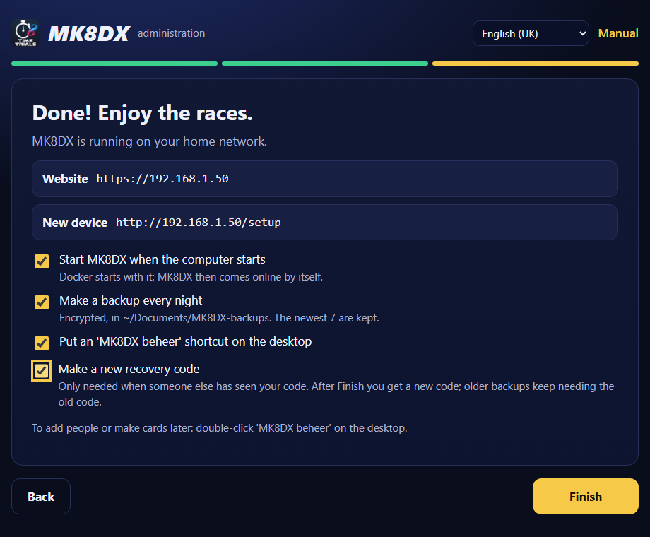

# 在家或在俱樂部使用 MK8DX — 使用手冊

*本文是[英文版手冊](../../A2_HOME_GUIDE_EN.md)的機器翻譯，以英文版為準。歡迎透過「Translation correction」問題表單提交更正。*

本手冊一步步帶你從一台空白的電腦，走到一個玩完比賽的夜晚。你不需要任何資訊方面的知識。請依序閱讀各章；每一章都以前一章為基礎。

**先說實話：** 家用與俱樂部安裝自 0.2.0 版起正式發布。Windows 11 已經過完整的端對端測試，包括網路中的一支 Android 手機。Linux 只在 WSL 2 中測試過，尚未在獨立的 Linux 電腦或樹莓派（Raspberry Pi）上測試。macOS 套件已經建置，但尚未在真正的 Mac 上測試，iPhone 也尚未測試。凡是尚未測試或尚未建置的地方，相應的步驟都會註明。

**如何閱讀一個步驟：** **操作** 後面是你要做的事，**你會看到** 後面是接著應該發生的情況，**看到的不一樣？** 後面是遇到這種情況時該怎麼做。粗體字是你在螢幕上會看到、一模一樣的按鈕或文字。

## 1. 什麼是在家或在俱樂部使用的 MK8DX？你需要什麼？

MK8DX 是一個為《瑪利歐賽車8 豪華版》（Mario Kart 8 Deluxe）打造的網站：用來保存與比較計時賽成績、LiveTrial 錄影以及錦標賽之夜。使用這種安裝方式時，網站會在你自己網路中的一台電腦上執行。同一個網路中的手機、平板和其他電腦都透過這台電腦開啟網站。不會有任何資料傳到網際網路。

每個人都用一張個人 **登入卡** 登入：一張附有 QR 碼的卡片。QR 碼是一種方形條碼，你可以用手機或平板的相機掃描。

在本手冊中，執行 MK8DX 的電腦稱為 **MK8DX 電腦**。

你需要：

- **一台在大家玩的時候一直開著的電腦：** 使用 Intel 或 AMD 處理器的 Windows 11、Linux 或 macOS。建議 8 GB 記憶體。安裝程式會檢查至少有 6 GB 的可用磁碟空間。
- **一個家用網路：** 你的路由器的 Wi-Fi 或網路線。路由器是建立你的網路的那個盒子（通常由你的網路業者提供）。所有裝置都必須在同一個網路中。不要使用訪客網路：它通常會把裝置彼此隔開。
- **手機、平板或其他電腦** 供玩家使用，最好有相機，以便掃描 QR 碼。
- **一台印表機** 方便列印登入卡和復原碼，但不是必要的。

你不需要：

- **玩的時候不需要網際網路。** 只有在準備階段，你需要下載一次 Docker、Python 和 MK8DX 套件（或者由別人用 USB 隨身碟交給你）。
- **不需要其他公司的帳號**，不需要電子郵件地址，也不需要雲端服務。
- **不需要訂閱。** MK8DX 和 Python 都是免費的。Docker Desktop 對個人使用和小型組織免費；詳細條款請見 Docker 官網。在 Linux 上你使用免費的 Docker Engine。

<!-- image: network-overview -->

## 2. 準備電腦

MK8DX 需要兩個免費的輔助程式：

- **Docker** 會在彼此隔離的「容器」中執行程式。MK8DX 的網站和資料庫就在這些容器裡執行。在 Windows 和 macOS 上，這個程式叫做 Docker Desktop。
- **Python** 是一種程式語言。MK8DX 安裝程式就是用它撰寫的。你需要 Python 3.12 到 3.15。

只做與你的電腦相符的部分（2A、2B 或 2C），跳過另外兩個部分。

## 2A. 準備 Windows 11

1. **操作：** 查看你的電腦使用哪種處理器：開始 → **Settings**（設定）→ **System**（系統）→ **About**（關於），看 **System type**（系統類型）那一行。→ **你會看到：** 「64-bit operating system, x64-based processor」（64 位元作業系統，x64 型處理器）。→ **看到的不一樣？** 如果顯示 ARM，則 MK8DX 的 Windows 套件不適用：它只有 x64（Intel 和 AMD）版本。
2. **操作：** 先安裝 **WSL**（Windows Subsystem for Linux，Windows 子系統 Linux 版）。它是 Windows 的一部分，Docker 在它上面執行；沒有 WSL，Docker Desktop 就無法安裝。在開始按鈕上按右鍵，選擇 **Terminal (Admin)**（終端機（系統管理員））或 **Windows PowerShell (Admin)**（Windows PowerShell（系統管理員））。當 Windows 要求權限時，點選 **Yes**（是）。輸入 `wsl --install` 並按 Enter。→ **你會看到：** Windows 下載並安裝 WSL 和 Ubuntu；這需要幾分鐘。最後它會提示你必須重新啟動電腦。請重新啟動電腦。→ **看到的不一樣？** 如果重新啟動後開啟一個視窗，要求為 Ubuntu 設定使用者名稱和密碼：輸入你自己選的名稱和密碼（MK8DX 不需要它們），然後關閉視窗。如果提示 WSL 已經安裝，請輸入 `wsl --update` 並按 Enter。如果提示中提到 **virtualization**（虛擬化）（「Virtual Machine Platform」或「virtualization」），表示電腦 BIOS 中的虛擬化已關閉；請把它開啟（廠商通常稱為 Intel VT-x 或 AMD-V），或請人協助。
3. **操作：** 從 docker.com 下載適用於 Windows（x86_64 / AMD64）的 **Docker Desktop**，並開啟下載的檔案。→ **你會看到：** Docker 安裝程式，其中有使用 WSL 2 的選項。WSL 是 Windows 的一部分，Docker 在它上面執行。保持該選項勾選，然後點選 **OK**（確定）。→ **看到的不一樣？** 如果 Windows 詢問是否允許此應用程式進行變更，點選 **Yes**（是）。
4. **操作：** 等待安裝完成；如果 Docker 要求重新啟動電腦，請重新啟動。→ **你會看到：** 重新啟動後 Docker Desktop 會自動開啟（或者你自己從開始功能表開啟它）。第一次使用時，Docker 會要求你接受它的條款。→ **看到的不一樣？** 如果 Docker 要求你登入或建立帳號：MK8DX 不需要 Docker 帳號，如果 Docker 提供略過的選項就略過。如果 Docker 仍然提示缺少 WSL 或必須更新 WSL，請再做一次第 2 步（`wsl --install` 或 `wsl --update`）並重新啟動。
5. **操作：** 在 Docker Desktop 視窗中等待。→ **你會看到：** 左下角顯示 **Engine running**（引擎執行中）。→ **看到的不一樣？** 「Engine starting」（引擎啟動中）可能需要幾分鐘。如果卡住或顯示錯誤，請重新啟動電腦並再次開啟 Docker Desktop。Docker 必須處於一般的 Linux 容器模式（而不是「Windows containers」）。
6. **操作：** 前往 python.org → **Downloads**（下載），下載適用於 Windows 的 **Python install manager**（Python 安裝管理員）（檔名以 `.msix` 結尾）。這是目前在 Windows 上安裝 Python 的官方方式。開啟下載的檔案並點選 **Install**（安裝）。→ **你會看到：** Windows 安裝 Python 安裝管理員；之後你可以關閉視窗。→ **看到的不一樣？** 你也可以從 Microsoft Store 安裝：搜尋「Python install manager」並點選 **Install**（安裝）。兩種方式擇一即可，不要兩個都用。
7. **操作：** 點選開始，輸入 `PowerShell`，開啟 **Windows PowerShell**，輸入 `py install 3.15` 並按 Enter。這一步會安裝 Python 本身（安裝管理員只是取得 Python 的工具）。→ **你會看到：** 第一次會有幾個檢查設定的問題；按 Enter（採用建議的選項）或輸入 `y` 回答。接著 Python 會被下載並安裝。關於把某個資料夾加入 PATH 的問題可以回答 `y`；這不是必要的。→ **看到的不一樣？** 請依上述方式安裝正好 3.15；3.12、3.13 或 3.14 也可以，更新的版本（3.16 或更新）暫時還不行。
8. **操作：** 關閉 PowerShell，再重新開啟，輸入 `python --version` 並按 Enter。→ **你會看到：** `Python 3.15` 後面接著一個數字，例如 `Python 3.15.2`。→ **看到的不一樣？** 如果開啟了 Microsoft Store，或是提示找不到 python：點選開始，輸入 **Manage app execution aliases**（管理應用程式執行別名）並開啟它。開啟 **Python (default)**，關閉 **App Installer python.exe** 和 **python3.exe**。如果你以前安裝過舊版 Python 或「Python launcher」，請透過 **Settings → Apps → Installed apps**（設定 → 應用程式 → 已安裝的應用程式）將其移除，然後再試一次。

<!-- image: docker-engine-running -->

<!-- image: python-install-manager -->

## 2B. 準備 Linux（Ubuntu 或 Debian）

Linux 尚未與 MK8DX 一起經過端對端測試。以下步驟是針對 Ubuntu 24.04 或更新版本撰寫的。你需要在 **終端機** 中輸入這些指令：終端機是一個用文字指令操作的視窗（在 Ubuntu 中按 Ctrl+Alt+T 開啟）。每一道指令都以 Enter 結束。指令前面的 **sudo** 表示「以這台電腦的管理員身分」：Linux 接著會要求輸入你的密碼，輸入時你看不到任何字元。這是正常的。

1. **操作：** 輸入 `python3 --version`。→ **你會看到：** `Python 3.12`、`3.13`、`3.14` 或 `3.15`。→ **看到的不一樣？** 較低的版本號（例如 Debian 12 內建 3.11）太舊；3.16 或更新版本暫不支援。這時你需要較新版本的 Linux；Ubuntu 24.04 內建 Python 3.12。
2. **操作：** 輸入 `sudo apt update`，接著輸入 `sudo apt install docker.io docker-compose-v2 python3-venv unzip`。詢問是否繼續時，輸入 Y 並按 Enter。→ **你會看到：** 套件被下載並安裝。→ **看到的不一樣？** 如果 apt 找不到某個套件，表示它在你的 Linux 上叫別的名稱（在 Debian 上可能會這樣）。繼續進行，並在第 5 步中檢查 Docker Compose 是否可用。
3. **操作：** 輸入 `sudo systemctl enable --now docker`。這會立即啟動 Docker，並在每次電腦開機時啟動它。→ **你會看到：** 沒有錯誤（有時會出現一行以「Created symlink」開頭的訊息）。
4. **操作：** 輸入 `sudo usermod -aG docker $USER`。這會給你的使用者使用 Docker 的權限。接著登出再重新登入（或重新開機）：這個權限要重新登入後才會生效。→ **你會看到：** 沒有錯誤。→ **注意：** docker 群組中的任何人實際上都擁有這台電腦的管理員權限。只把你自己加進去。
5. **操作：** 用 `docker info` 和 `docker compose version` 進行檢查。→ **你會看到：** 一串沒有錯誤的詳細資料，以及附有版本號的「Docker Compose version」。→ **看到的不一樣？** 出現「permission denied」（權限遭拒）：做第 4 步，別忘了登出。出現「Cannot connect to the Docker daemon」（無法連線到 Docker 常駐程式）：做第 3 步。

**防火牆** 是一種保護機制，決定電腦允許哪些連線進入。如果你的 Linux 上啟用了 ufw 或 firewalld 防火牆，第 3 章中的安裝程式會顯示讓 MK8DX 通過的指令。

## 2C. 準備 macOS

**注意：** macOS 尚未在真正的 Mac 上測試過。以下步驟依照安裝程式在 macOS 上的預期撰寫。

1. **操作：** 選擇蘋果選單 → **About This Mac**（關於這台 Mac），查看 **Chip**（晶片）或 **Processor**（處理器）。→ **你會看到：** Apple 晶片（M1、M2 及更新）：使用套件 `macos-arm64`。→ **看到的不一樣？** Intel 處理器：使用套件 `macos-amd64`。它需要 macOS 10.15 或更新版本，以及仍然支援你的 Mac 的 Docker Desktop 版本。
2. **操作：** 從 docker.com 下載與晶片相符的 Mac 版 **Docker Desktop**，開啟下載的檔案，把 Docker 拖到 **Applications**（應用程式）中。→ **你會看到：** Docker 出現在你的「應用程式」資料夾中。
3. **操作：** 開啟 Docker。接受條款；如果 macOS 要求輸入密碼，請輸入。→ **你會看到：** 過一會兒，Docker Desktop 視窗中顯示 **Engine running**（引擎執行中）。→ **看到的不一樣？** 如果 Docker 要求你登入：MK8DX 不需要 Docker 帳號，如果 Docker 提供略過的選項就略過。
4. **操作：** 從 python.org 下載 Python 3.15 的 macOS 安裝程式並開啟。依序點選 **Continue**（繼續）和 **Install**（安裝）完成各步驟。→ **你會看到：** 安裝成功的訊息。
5. **操作：** 開啟 **Terminal**（終端機）（應用程式 → 工具程式 → 終端機），輸入 `python3 --version` 並按 Enter。→ **你會看到：** `Python 3.12` 到 `3.15`。→ **看到的不一樣？** 較低的版本號（例如 Apple 內建的 3.9）：關閉終端機再重新開啟。如果仍然較低，請再次從 python.org 安裝 Python。
6. **操作：** 在終端機中輸入 `docker info`。→ **你會看到：** 一串沒有錯誤的詳細資料。→ **看到的不一樣？** 啟動 Docker Desktop，等到顯示 Engine running。

## 3. 安裝 MK8DX

**解壓縮套件**

1. **操作：** 下載適用於你的系統的家用或俱樂部版 MK8DX 套件：Windows、Linux 或 macOS；Linux 和 macOS 還要選擇你的處理器（amd64 或 arm64）。要檢查下載是否正確，請將它的 SHA-256 與同一個版本中 `SHA256SUMS.txt` 裡對應的那一行比較（Windows：`Get-FileHash <file> -Algorithm SHA256`；Linux：`sha256sum <file>`；macOS：`shasum -a 256 <file>`）；另請參閱 `docs/RELEASE_PACKAGES.md#check-a-download`。→ **你會看到：** 你的「下載」資料夾中有一個 zip 檔。→ **看到的不一樣？** 如果瀏覽器警告此檔案不安全或很少被下載：選擇 **Keep**（保留）。Windows：接著在 zip 檔上按右鍵 → **Properties**（內容），勾選下方的 **Unblock**（解除封鎖），點選 **OK**（確定）。請在解壓縮之前做這一步；否則 Windows（智慧型應用程式控制，Smart App Control）之後可能會封鎖 `Start-MK8DX-LAN.cmd`。不要關閉智慧型應用程式控制：關閉後只有重新安裝 Windows 才能再次開啟它。
2. **操作：** 把 zip 檔解壓縮到一個固定的資料夾，例如「文件」中的一個 MK8DX 資料夾。Windows：在 zip 檔上按右鍵 → **Extract All**（解壓縮全部）。請選擇一個會一直保留的資料夾：之後 MK8DX 都會從這個資料夾啟動，所以不要移動或刪除它。→ **你會看到：** 一個資料夾，其中包括 `Start-MK8DX-LAN.cmd`、`README-FIRST.txt` 以及 `docs`、`images` 和 `tooling` 資料夾。→ **看到的不一樣？** 如果你只是在檔案總管中開啟了 zip 檔，請真的把它解壓縮：從 zip 檔內部啟動是行不通的。沒有檔案管理員的 Linux（伺服器或 WSL）：`unzip ~/Downloads/mk8dx-a2-linux-amd64-<version>.zip -d ~/Documents/MK8DX`（換成你的檔名；`unzip` 來自第 2B 章第 2 步）。

<!-- os: windows -->

**在 Windows 上啟動**

1. **操作：** 在解壓縮後的資料夾中，按兩下 **Start-MK8DX-LAN.cmd**。→ **你會看到：** 一個顯示 MK8DX 標誌和帶有提示音的 3-2-1-GO 倒數的視窗（[如何關閉它](../../../guides/HOSTING.md#the-launcher-window-look-and-options)），接著是「MK8DX 套件:」和「私人安裝:」等行。第一次還會顯示「正在準備隨附的 Python 套件（僅一次，不需網際網路）。」和「正在載入隨附的 Docker 映像檔。這可能需要幾分鐘。」這需要幾分鐘。接著顯示「MK8DX setup is open in your browser:」（MK8DX 安裝程式已在瀏覽器中開啟：），安裝程式會在你的瀏覽器中開啟。→ **看到的不一樣？** 請看下方的訊息說明。
2. **操作：** 在安裝程式中點選 **完成**之前，請一直保持黑色視窗開啟。視窗中也這樣寫著：「Keep this window open until you click Finish.」（點選 Finish 之前請保持此視窗開啟。）

Windows 黑色視窗中的訊息：

- **「缺少 Python 3.12 至 3.15。請從 python.org（或 Microsoft Store）安裝 Python install manager，執行: py install 3.15，重新開啟 PowerShell 後再試一次。」**請做第 2A 章第 6 到 8 步，然後再次按兩下 Start-MK8DX-LAN.cmd。
- **「Docker Desktop 未安裝或未執行。請以 Linux 容器模式啟動 Docker Desktop，等到顯示 "Engine running" 後再試一次。」**啟動 Docker Desktop，等到顯示 Engine running，然後再按兩下一次。
- 錯誤訊息下方顯示 **「所選步驟已停止。再試一次前請先閱讀上方的訊息。」**閱讀它上面那一行，解決問題，然後按任意鍵關閉視窗。

<!-- /os -->

<!-- os: linux macos -->

**在 Linux 和 macOS 上啟動**

1. **操作：** 在解壓縮後的資料夾中開啟終端機。Linux：如果你的檔案管理員提供這個選項，在資料夾中按右鍵並選擇「Open in Terminal」（在終端機中開啟）。在 macOS 和 Linux 上也可以這樣做：開啟終端機，輸入 `cd `（後面加一個空格），把資料夾拖進視窗，然後按 Enter。→ **你會看到：** 終端機位於套件資料夾中。
2. **操作：** 輸入 `sh tooling/start-mk8dx.sh` 並按 Enter。→ **你會看到：** MK8DX 標誌和 3-2-1-GO 倒數，接著是「MK8DX 套件:」、Python 版本號和「Docker Compose version」。第一次還會顯示「正在載入隨附的 Docker 映像檔。這可能需要幾分鐘。」和「正在準備隨附的 Python 套件（僅一次，不需網際網路）。」接著是「私人安裝:」和「MK8DX setup is open in your browser:」（MK8DX 安裝程式已在瀏覽器中開啟：），安裝程式會在你的瀏覽器中開啟。→ **看到的不一樣？** 如果沒有開啟瀏覽器，請把終端機中以 `http://127.0.0.1:` 開頭的網址複製到瀏覽器中。
3. **操作：** 在點選 **完成**之前，請一直保持終端機開啟。

Linux 和 macOS 終端機中的訊息：

- **「缺少 Python 3.12 至 3.15。請安裝（Ubuntu/Debian: sudo apt install python3 python3-venv；macOS: python.org）後再試一次。」**請再做一次第 2B 或 2C 章。
- **「Docker 未執行，或此使用者無權使用（Linux: sudo systemctl start docker，並加入 docker 群組；macOS: 啟動 Docker Desktop）。」**Linux：做第 2B 章第 3 和第 4 步。macOS：啟動 Docker Desktop。
- **「無法建立私人 Python 環境（Ubuntu/Debian: sudo apt install python3-venv）。」**依照第 2B 章第 2 步安裝 python3-venv。

<!-- /os -->

**瀏覽器中的安裝程式**

安裝程式是瀏覽器中的一個網頁，只能在 MK8DX 電腦本機上使用。它使用你的瀏覽器的語言（遊戲的 15 種語言之一；否則顯示英文）。右上角是語言選單（用來選擇其他語言）和 **使用手冊**：它會開啟本手冊。底部是 **返回**、有時還有 **進階**，以及 **下一步**。上方的圓點顯示你進行到哪一步。

1. **歡迎來到 MK8DX。** **操作：** 閱讀畫面內容並點選 **下一步**。→ **你會看到：** 「快速檢查」。此畫面上的 **還原備份**按鈕只用於新電腦（第 10 章）。
2. **快速檢查。** **操作：** 稍等一下。→ **你會看到：** **Docker Desktop 正在執行**、**磁碟可用空間充足**（顯示 GB 數）和 **Windows, Linux or macOS** 旁邊出現三個綠色勾號。點選 **下一步**。→ **看到的不一樣？** 一個驚嘆號和一段說明，例如「啟動 Docker Desktop，等待出現「Engine running」，然後按一下「再試一次」。」或「請在此磁碟機上至少釋出 6 GB 空間。」。解決問題後點選 **再試一次**。在 Linux 上，第一項檢查也叫做「Docker Desktop is running」；在那裡它指的是 Docker Engine。
3. **哪種安裝？** **操作：** 保持選取 **家中、社團或 LAN 之夜的網路，不需要網際網路**（建議），然後點選 **下一步**。→ **你會看到：** 「你的網路」。
4. **你的網路。** **網路位址**（IP 位址）是網路中各裝置找到這台電腦所用的號碼，就像門牌號碼一樣。**操作：** 閱讀「手機、平板和其他電腦可透過這個位址連到 MK8DX：」下方的位址並把它記下來，例如 `https://192.168.1.50`。點選 **安裝**。→ **你會看到：** 在 Windows 上顯示「此網路已設定為家用（私人）網路。」或「Windows 目前將此網路視為公用網路。按一下「安裝」後，MK8DX 會將它設為私人網路，並只允許 MK8DX 通過。」。在 Linux 和 macOS 上，這裡不會顯示關於網路的句子。→ **看到的不一樣？** 如果電腦有多個連線（網路線和 Wi-Fi），請點選 **進階**，在「選擇這台電腦的其他位址：」處選擇手機所在網路的位址。如果顯示「找不到網路位址。」，請把電腦連上你的家用網路，然後點選 **再試一次**。
5. **安裝中。** **操作：** 等待並保持視窗開啟。→ **你會看到：** 「正在設定 MK8DX。請保持此視窗開啟。」，接著依序顯示「正在準備安裝」、「允許網路存取（Windows 會要求權限）」、「正在啟動資料庫與網站」、「檢查中」，最後是「MK8DX 正在執行。只剩兩個簡短步驟。」。點選 **下一步**。在 Windows 上，會有一個 Windows 視窗詢問一次是否允許 Windows PowerShell 進行變更：點選 **Yes**（是）。這樣 MK8DX 會把你的家用網路標示為私人網路，並且只讓 MK8DX 通過防火牆（Windows 的保護機制）。如果以前已在這台電腦和這個位址上安裝過 MK8DX，該權限仍然存在，Windows 不會再次詢問。→ **看到的不一樣？** 出現紅色錯誤：點選 **詳細資料**查看出了什麼問題，解決後點選 **再試一次**。如果你在 Windows 視窗中點選了「否」，畫面會顯示 Windows 不允許此變更；點選 **再試一次**，然後點選 **Yes**（是）。
6. **僅限 Linux：防火牆。** **操作：** 在安裝過程中或安裝之後，點選 **詳細資料**，找出以「Network:」開頭的那一行。→ **你會看到：** 「not-needed」（不需處理），或「manual:」後面接著一道指令，例如 `sudo ufw allow from 192.168.1.0/24 to 192.168.1.50 port 80,443 proto tcp`。→ **接著操作：** 在終端機中一字不差地輸入那道指令（使用那裡顯示的你自己的位址）。沒有這道指令，手機就打不開網站。
7. **你的管理員帳號。** **管理員** 是新增人員和製作登入卡的人；也就是你。**操作：** 在 **你的名稱**處輸入一個名稱，例如「爸爸」或「俱樂部團隊」，然後點選 **下一步**。這個名稱只在本安裝中可見。→ **你會看到：** 「誰要玩？」
8. **誰要玩？** **操作：** 在 **名稱（每行一個）** 處輸入玩家的名稱，每個名稱各占一行，然後點選 **新增**。或者直接點選 **略過**：之後你可以在 MK8DX beheer 中用完全相同的方式完成（第 5 章）。→ **你會看到：** 名稱出現在「此安裝中：」下方，你自己的名稱後面附有「(管理員)」。點選 **下一步**。
9. **在手機和電腦上登入。** **操作：** 你現在就可以在這裡製作登入卡（第 5 章和第 6 章會說明怎麼做），也可以直接點選 **下一步**。→ **你會看到：** 「完成！盡情享受比賽吧。」
10. **完成！盡情享受比賽吧。** **操作：** 記下兩個網址：**網站**（例如 `https://192.168.1.50`）和 **新裝置**（例如 `http://192.168.1.50/setup`）。保持三個勾選項目開啟：**隨 Windows 啟動 MK8DX**、**每晚建立一份備份**和 **在桌面上建立「MK8DX beheer」捷徑**。點選 **完成**。→ **你會看到：** 你的復原碼（第 4 章）。→ **在 Linux 和 macOS 上**，第一個勾選項目叫做「電腦開機時啟動 MK8DX」。在 macOS 上，它會在你登入時開啟 Docker Desktop。在 Linux 上，第 2B 章中的 `sudo systemctl enable --now docker` 負責這件事；如果你還沒有做，安裝程式會在點選「完成」後顯示這道指令。
11. **關閉。** **操作：** 閱讀第 4 章並保管好復原碼。然後點選 **關閉**。→ **你會看到：** 「現在可以關閉此視窗了。」關閉瀏覽器分頁。在 Windows 上，黑色視窗會要求按一個鍵；按任意鍵後它就會關閉。如果你什麼都不做，安裝網頁會在 10 分鐘後自動停止。MK8DX 本身會繼續執行。

<!-- image: windows-permission -->

## 4. 復原碼與備份資料夾

**備份** 是 MK8DX 中所有內容的一份備用複本：人員、成績、錦標賽和設定。MK8DX 每晚 03:00 建立一次備份，並保留最新的 7 份。備份是加密的：沒有金鑰就無法讀取。

**復原碼** 就是這把金鑰。它由五組、每組四個字母和數字組成，例如 `ABCD-EFGH-JKLM-NPQR-STUV`。只有在另一台電腦上還原備份時才需要它。

1. **操作：** 點選 **完成**之後，查看 **MK8DX 復原碼**卡片。→ **你會看到：** 復原碼、句子「沒有這組代碼就無法開啟備份。它只會顯示一次。」，以及下方備份存放的資料夾。
2. **操作：** 把復原碼抄在紙上，或點選 **列印卡片**列印此頁面。逐一核對每個字母。→ **你會看到：** 紙上的復原碼。→ **為什麼只顯示一次？** MK8DX 會在這台電腦上受保護地保存復原碼，用於每晚的備份，但再也不會顯示它。如果電腦壞了，你就只剩下那張紙。
3. **操作：** 把紙保存在安全的地方，不要放在電腦旁邊。任何拿到復原碼和備份的人都能開啟所有內容。

備份的位置：

- **Windows：** 在「文件」資料夾中的 `MK8DX-backups` 資料夾裡（在磁碟上：`C:\Users\<your name>\Documents\MK8DX-backups`）。
- **Linux 和 macOS：** 在你的家目錄中的 `Documents/MK8DX-backups` 資料夾裡（也就是 `~/Documents/MK8DX-backups`）。即使 Linux 使用其他語言，這個資料夾也叫做 Documents。
- 安裝程式會在復原碼下方顯示確切的資料夾。

偶爾把 `MK8DX-backups` 資料夾複製到 USB 隨身碟或另一顆硬碟上。否則，如果電腦壞了，備份就只存在那台壞掉的電腦上。

如果你取消勾選 **每晚建立一份備份** 並點選 **完成**，MK8DX 就會停止每晚的備份；已經建立的備份會保留。之後再次勾選時，備份會繼續使用同一個復原碼，而且不會再次顯示。如果你已經沒有這個復原碼，請依照下面的步驟建立新的。

**新的復原碼**

如果別人可能看過你的復原碼，或你弄丟了那張紙，請建立新的復原碼。從 0.2.7 版開始可用。

1. **操作：**開啟 MK8DX beheer，點選 **下一步** 直到出現「完成！盡情享受比賽吧。」，勾選 **建立新的復原碼** 並點選 **完成**。→ **你會看到：**寫有新復原碼的 **MK8DX 復原碼** 卡片（只會顯示一次），以及一句說明：之前的備份仍然需要舊復原碼。
2. **操作：**像上面第 2 步一樣把新復原碼記下來。把舊的那張紙和之前的備份放在一起：這些備份不會被轉換，只能用舊復原碼開啟。不再需要時，刪除這些舊備份並銷毀舊紙。→ **你會看到：**之後的備份會使用新復原碼。

## 5. 人員與登入卡（MK8DX beheer）

**MK8DX beheer**（荷蘭文，意思是「MK8DX 管理」）和安裝程式是同一個網頁，只是供之後使用：新增人員和製作登入卡。它只能在 MK8DX 電腦本機上使用。桌面捷徑在所有語言中都叫做「MK8DX beheer」；網頁標題是 **MK8DX 管理**。

**帳號** 是登入的人。**玩家** 是排名中的選手，附有自己的成績。登入後，每個人在網站上選擇或認領自己的玩家。名稱絕不會被自動連結。

**開啟 MK8DX beheer**

1. **操作（Windows）：** 按兩下桌面上的 **MK8DX beheer**。這個捷徑啟動的內容和 Start-MK8DX-LAN.cmd 相同。→ **你會看到：** 啟動視窗及其簡短的賽車開場，接著瀏覽器中出現頂端寫著「管理」的網頁，標題為 **MK8DX 管理**。→ **看到的不一樣？** 沒有捷徑：在 MK8DX 資料夾中按兩下 Start-MK8DX-LAN.cmd。
2. **操作（Linux）：** 從桌面或應用程式選單啟動 **MK8DX beheer**。在某些 Linux 桌面上，你必須先允許這樣的圖示執行（在它上面按右鍵並選擇允許啟動的選項）。也可以像第 3 章那樣，在 MK8DX 資料夾中執行 `sh tooling/start-mk8dx.sh`。→ **你會看到：** 一個終端機，接著是 **MK8DX 管理** 網頁。
3. **操作（macOS，未測試）：** 按兩下桌面上的 **MK8DX beheer.command**，或像第 3 章那樣執行 `sh tooling/start-mk8dx.sh`。→ **你會看到：** 終端機，接著是 **MK8DX 管理** 網頁。

**新增人員**

1. **操作：** 在 **名稱（每行一個）** 處輸入名稱，然後點選 **新增**。→ **你會看到：** 名稱出現在「此安裝中：」下方。
2. **操作：** 點選 **下一步**。→ **你會看到：** 分成兩個步驟的「在手機和電腦上登入」：**步驟 1 · 準備裝置**，其中有 **準備裝置**卡片（每台裝置一次，此時還不會讓你登入）；以及 **步驟 2 · 以正確的人的身分登入**，其中每個人都有一個附 **產生卡片**按鈕的方框。

**製作與列印卡片**

1. **操作：** 點選某個人旁邊的 **產生卡片**。→ **你會看到：** 一個 QR 碼，附有「有效期限至」和一個時間。一張卡只能使用一次，有效期 15 分鐘。讓那個人立刻掃描（第 6 章），或者把它列印出來。
2. **操作：** 先製作好你需要的所有卡片，然後點選 **列印卡片**。→ **你會看到：** 瀏覽器的列印視窗，畫面上的每張卡都在其中，包括「準備裝置」卡片。
3. **操作：** 如果你想在手機上登入，也為自己製作一張卡（名稱後面附有「(administrator)」的那個）。

**更換或撤銷卡片**

- **新卡片**：為那個人製作一張新卡。之後，那個人在此畫面上的上一張卡就會失效。
- **撤銷卡片**：卡片立即失效。你會看到「已撤銷：這張卡片已失效。」。當卡片遺失或給錯人時使用它。
- 你只能撤銷仍在此畫面上的卡片。如果你已經關閉了 MK8DX beheer，未使用的卡片會在 15 分鐘後自動過期。如果它可能已經被使用過，請選擇下方的 **在所有地方登出**。

**讓某人在所有地方登出**

1. **操作：** 開啟 MK8DX beheer。在第一個畫面上，每個人都有一個 **在所有地方登出**按鈕。點選它。→ **你會看到：** 按鈕變成 **確定嗎？再按一次**。
2. **操作：** 再點選一次。→ **你會看到：** 「已在所有裝置上登出。使用新卡片即可讓此人重新登入。」。此人現在已在網站和 App 中登出，一鍵切換到該帳號的功能消失，此人尚未使用的卡片也會失效。→ **看到的不一樣？** 在你自己的名稱旁邊，第二次點選會顯示「你自己可以透過網站上的帳號選單登出（「在所有裝置上登出」）。」，而且不會讓任何人登出。

**關閉 MK8DX beheer**

1. **操作：** 一直點選 **下一步**，直到出現「完成！盡情享受比賽吧。」，保持勾選項目開啟，點選 **完成**，然後點選 **關閉**。→ **你會看到：** 「現在可以關閉此視窗了。」MK8DX 會繼續執行。

## 6. 準備裝置並登入

**憑證** 是一種數位身分證明。有了它，手機就能確定自己是在和你的 MK8DX 電腦通訊，而不是別的東西，並且連線是加密的（https）。由於 MK8DX 不靠網際網路運作，安裝程式會自己製作憑證。每台裝置都必須學會信任它一次。**指紋** 是一段只屬於這張憑證的簡短代碼；你用它來核對自己安裝的是正確的憑證。

**為什麼即使在家、沒有網際網路也需要憑證？**

- **確定那就是你的 MK8DX。** 在家用或俱樂部網路中，同一個 Wi-Fi 上的任何人都可以冒充你的 MK8DX 電腦，例如一位帶著筆電的客人。沒有憑證，你的手機就無法分辨。有了憑證，瀏覽器會拒絕其他任何電腦。
- **沒有人能竊聽。** 登入卡、你的登入工作階段以及你輸入的所有內容，都會經過加密在 Wi-Fi 上傳輸。
- **為什麼 MK8DX 要自己製作憑證。** 網際網路上的網站使用知名簽發機構的憑證，這些機構早已內建在每台裝置中。它們不會為 `192.168.1.50` 這樣的家用位址簽發憑證，而且沒有網際網路就無法運作。因此 MK8DX 在安裝時自己製作憑證，而你要告訴每台裝置一次：可以信任它。
- **安裝它代表你允許了什麼。** 這張憑證只用於 MK8DX 的私人網路位址，它的私密金鑰受保護地保存在 MK8DX 電腦上。只安裝你自己的 MK8DX 的憑證（核對指紋），當你不再使用那個安裝時，就把憑證從裝置上移除。

**如果不安裝憑證，哪些功能無法使用？**

- 每次造訪時，瀏覽器都會顯示整頁警告，例如「Your connection is not private」（你的連線不是私人連線）。你可以把它按掉，但不要這樣做：那樣你就再也看不出自己是否真的在和你的 MK8DX 通訊。
- 即使把警告按掉，**瀏覽器通知** 也無法使用：瀏覽器只在憑證受信任時才允許通知。其他瀏覽器功能也可能拒絕運作。
- 不安裝憑證也能使用的是：**Android App**。它會從 **準備裝置**卡片中自行取得憑證（第 7 章）。同一台裝置上的瀏覽器仍然需要憑證。

**MK8DX 電腦本身**

執行 MK8DX 的電腦也必須信任 MK8DX 一次，否則它的瀏覽器會對網站發出警告。

1. **操作：** 開啟 MK8DX beheer，一直點選 **下一步**，直到出現「在手機和電腦上登入」，查看 **步驟 1**下方的 **這台電腦**區塊。→ **你會看到：** 「這台電腦已信任 MK8DX。」這樣就完成了。→ **看到的不一樣？** 如果顯示 **準備這台電腦**按鈕，請前往第 2 步。
2. **操作：** 點選 **準備這台電腦**。→ **你會看到：** 一個 Windows 視窗 **Security Warning**（安全性警告），詢問你是否要安裝憑證，並顯示一個 **thumbprint (sha1)**（指紋（sha1））。把它和 MK8DX beheer 中的指紋比較；如果相符，點選 **Yes**（是）。→ **你會看到：** 「這台電腦已信任 MK8DX。」→ **看到的不一樣？** 如果你點選了 **No**（否），或是指紋不相符：不要點選「是」，關閉視窗並請人協助。在 Linux 或 macOS 上，這裡沒有按鈕，而是提示你在這台電腦的瀏覽器中開啟「準備裝置」下方的網址；接著在這台電腦上依照下面的步驟操作。

**每台裝置一次：準備裝置**

1. **操作：** 把手機、平板或電腦連上與 MK8DX 電腦相同的 Wi-Fi 或有線網路。在手機上，不要用行動數據代替 Wi-Fi。→ **你會看到：** 連線處顯示你自己的 Wi-Fi 名稱。
2. **操作：** 用相機掃描 **準備裝置**卡片上的 QR 碼（在 MK8DX beheer 中或紙上），然後點一下出現的連結。沒有相機時，在瀏覽器中輸入 **新裝置**網址，例如 `http://192.168.1.50/setup`。→ **你會看到：** **準備這台裝置**網頁，上面寫著「每支手機、平板或電腦只需做一次。之後掃描你的個人登入卡。」→ **看到的不一樣？** 如果網頁打不開：檢查網路，並確認 MK8DX 電腦已開機（第 11 章）。
3. **操作：** 把「請先核對這組代碼。」下方的代碼與「準備裝置」卡片上的 **指紋**（四組、每組四個字元）比較。→ **你會看到：** 完全相同的代碼。→ **看到的不一樣？** 如果代碼不同，什麼都不要安裝。你可能連在另一個網路或另一個位址上；請先檢查這一點。
4. **操作：** 依照與你的裝置相符的部分操作。你正在使用的裝置對應的部分已經展開；要查看其他裝置，請在「其他類型的裝置？」下展開。點一下 **下載憑證**（iPhone 和 iPad：**下載描述檔**），然後依照下面的步驟操作。→ **你會看到：** 底部顯示「完成了嗎？掃描你的個人登入卡，或開啟」以及網站網址。

「準備這台裝置」網頁上的步驟：

<!-- filter: device -->

- **Android：** 點一下按鈕下載憑證。開啟「設定」並搜尋「憑證」（通常是：安全性 → 更多安全性設定 → 加密與憑證 → 安裝憑證 → CA 憑證）。選擇下載的 MK8DX 檔案，並用你的 PIN 確認。選單名稱會因手機品牌而不同。
- **iPhone 和 iPad（尚未用此安裝測試）：** 點一下按鈕下載描述檔並允許。開啟 設定 → 已下載描述檔 → 安裝。接著開啟 設定 → 一般 → 關於本機 → 憑證信任設定 → 開啟 MK8DX。
- **Windows：** 下載憑證並開啟它。選擇 Install Certificate（安裝憑證）→ Current User（目前使用者）→ Place all certificates in the following store（將所有憑證放入以下的存放區）→ Trusted Root Certification Authorities（受信任的根憑證授權單位）。不要選擇 Intermediate Certification Authorities（中繼憑證授權單位）。重新啟動瀏覽器。
- **Mac（macOS 尚未經過端對端測試）：** 下載憑證並開啟它；「鑰匙圈存取」會開啟。開啟 MK8DX 憑證 → 信任 → 永遠信任。
- **Linux（此方式尚未經過端對端測試）：** 把同一張憑證加入你的發行版或瀏覽器的受信任根憑證存放區。確切步驟因發行版而異。在 Ubuntu 和 Debian 上（已在 WSL 2 中測試）：下載的 `root.crt` 是 DER 格式，所以請在安裝時轉換它：`sudo openssl x509 -inform DER -in ~/Downloads/root.crt -out /usr/local/share/ca-certificates/mk8dx.crt`，接著執行 `sudo update-ca-certificates`。Linux 上的 Firefox 和 Chrome 可能使用自己的憑證存放區；如果瀏覽器仍然發出警告，請在其憑證設定（Authorities，憑證授權單位）中匯入同一個檔案。

<!-- /filter -->

**用你的個人卡片登入**

1. **操作：** 掃描你自己的卡片（印有你名稱的那張），然後點一下連結。→ **你會看到：** **加入這個 MK8DX 安裝**以及「請先確認這個 HTTPS 位址屬於你信任的主機。此邀請只能使用一次。」。瀏覽器網址列必須顯示網站網址，例如 `https://192.168.1.50`。→ **看到的不一樣？** 瀏覽器出現關於憑證或不安全連線的警告：絕對不要把它按掉。請先完成上面的「準備裝置」。
2. **操作：** 檢查 **你將登入為：** 下方卡片上的名稱。如果是你的名稱，等待「邀請已就緒。確認即可登入。」，然後點一下 **接受邀請**。如果顯示的是別人的名稱，不要點一下接受：這張卡對正確的人仍然有效。→ **你會看到：** 「你已登入為」和你的名稱，以及 **繼續前往 MK8DX**。點一下它。→ **看到的不一樣？** 「此邀請無效。請向管理員索取新的 QR 碼。」或「登入失敗。請向管理員索取新的邀請。」：卡片已被使用、已過期或已被撤銷。請管理員製作一張 **新卡片**。
3. **操作：** 依照網站上的歡迎步驟操作：你在這裡是否已經有成績或參加過錦標賽，以及你希望別人怎麼稱呼你。你就是這樣選擇或認領自己的玩家的。→ **你會看到：** 你的名稱和你的成績。→ **看到的不一樣？** 如果你卡片上的名稱（例如「爸爸」）沒有被預先填好：這是正常的。卡片上的名稱只是 MK8DX 管理中的標籤；你的玩家名稱由你自己在這裡選擇。

**同一個人的另一台裝置**

- 玩家可以自己製作卡片：網站的帳號選單中有 **也在另一台裝置上登入**。它會開啟 **在另一台裝置上登入**，其中有一張「Works once, valid until」（僅能使用一次，有效期限至）某個時間的卡片。用另一台裝置掃描它。只把它出示給你自己的裝置：任何掃描它的人都會登入你的帳號。
- 管理員沒有這個按鈕。他們在 MK8DX beheer 中為自己製作一張 **新卡片**。
- 新裝置一定要先做一次「準備裝置」。
- **沒有相機，或要在 MK8DX 電腦本機上登入？** 在 MK8DX beheer 中製作那個人的卡片，然後點選 **在這台電腦上登入**（在 MK8DX 電腦的瀏覽器中開啟登入網頁）或 **複製連結**。複製的連結只能傳給那個人本人，例如透過私訊：任何開啟它的人都能以那個人的身分登入。它只能使用一次，有效期 15 分鐘。在「準備裝置」卡片上，**複製位址**會複製網址；網址不是秘密。

**在某台裝置上退出此安裝：** 在你安裝憑證時使用的同一處設定中，把憑證再移除。

## 7. Android App 與 LiveTrial

**配對 Android App**

這需要 2.95.0 或更新版本的 App。App 不需要在 Android 設定中安裝憑證，但登入要透過手機的瀏覽器進行。所以請先在這支手機上完成第 6 章：「準備裝置」，並在瀏覽器中用你的卡片登入。

1. **操作：** 開啟 App。全新安裝時，它會從 **選擇你的社群** 開始；否則請點一下 App 頂端的社群名稱，然後點一下 **新增社群**。→ **你會看到：** **選擇你的社群**，其中有 **在家或在俱樂部** 和 **線上社群** 兩個面板。在 **在家或在俱樂部** 下點一下 **掃描 QR 碼**。
2. **操作：** 如有需要，點一下 **使用相機** 並允許使用相機。掃描 **準備裝置**卡片上的 QR 碼。→ **你會看到：** **確認這是你的安裝**，其中有 **位址** 和 **金鑰指紋 (SHA-256)**。→ **看到的不一樣？** 「這不是「準備裝置」卡片的 QR 碼。」：你掃描的是個人卡片。請掃描「準備裝置」卡片。如果掃描失敗：在 MK8DX 電腦上，點選 MK8DX beheer 中 **準備裝置**卡片上的 **複製位址**，把該連結傳到手機（它不是機密），貼到 **或貼上設定連結** 處，然後點一下 **下一步**。只輸入簡短的 New device 網址（例如 `http://192.168.1.50/setup`）是不夠的：App 還需要 QR 碼和複製的連結中包含的金鑰指紋，否則會顯示「這不是「準備裝置」卡片的 QR 碼。」。
3. **操作：** 把位址和網站網址比較，把那串長金鑰和「準備這台裝置」網頁比較：在那裡展開 **完整指紋**，查看「根公開金鑰 SHA-256 (SPKI)」。你可以在另一台裝置上開啟那個網頁，也可以在 MK8DX 電腦本機上透過 New device 網址開啟。→ **你會看到：** 兩者完全相同。點一下 **連線**（如果 App 之前設定的是另一台伺服器，請確認變更）。→ **看到的不一樣？** 如果不同，點一下 **返回**，不要連線。「Could not get a matching certificate from」（無法從以下位址取得相符的憑證）：檢查網路並確認 MK8DX 電腦已開機，然後再試一次。
4. **操作：** 在 **設定** 中的 **此手機上的玩家** 處，點一下 **登入**。App 會提醒你：在家或在俱樂部時，你用個人登入卡登入，而不是用電子郵件。點一下 **登入以同步**。→ **你會看到：** 瀏覽器開啟核准網頁，顯示「MK8DX Time Trials for Android 要求存取你的帳號。」以及 **裝置代碼**。確認它和 App 顯示的 **裝置代碼** 相同，只有在你剛剛在自己的手機上開始此操作時才核准，然後點一下 **核准裝置**。網頁顯示「裝置已核准。回到 App 以完成登入。」。回到 App；App 會顯示「已登入為」和你的名稱。→ **看到的不一樣？** 如果瀏覽器要求你登入，請先用你的卡片登入（第 6 章）。
5. **操作：** 在 App 中發布一筆成績。→ **你會看到：** 該成績出現在本安裝的網站上。

取消配對：點一下頂端的社群名稱 → **新增社群** → **忘記此安裝**。

俱樂部和家裡用同一個 App：App 可以容納多個社群。點一下頂端的社群名稱，然後點一下 **切換社群**；每個社群都保留各自的帳號和尚未傳送的成績。你自己的成績在你的名稱 → **我的成績** 下，即使手機連不到 MK8DX 電腦時也能查看。

**在第二台 Windows 電腦上使用 LiveTrial**

LiveTrial 是一個 Windows 程式，它透過擷取卡（一個把 Switch 畫面傳到電腦的盒子）辨識並保存你的計時賽成績。LiveTrial 本身的安裝方式請見 `docs/install/MK8DX_User_Guide_EN.txt` 的第 6 章。已在一個測試安裝上用 LiveTrial 3.37.0 測試過。簡要步驟如下：

1. 先讓那台電腦信任此安裝：第 6 章中的 Windows 部分。確認網站在瀏覽器中開啟時沒有警告。
2. 確認你的帳號在網站上有一個 **玩家**。
3. 開啟 LiveTrial，點選齒輪（**設定**），在 **社群網站地址** 處輸入網站網址，例如 `https://192.168.1.50`。
4. 點選 **登入** 並選擇 **開啟核准頁面**。在瀏覽器中核准此裝置。
5. 用 **立即傳送** 傳送成績，或在設定中開啟 **自動傳送新成績**。

須知：沒有玩家時，LiveTrial 的登入會以一則訊息結束，要求你先在網站上設定好你的玩家。變更網址後 LiveTrial 會重新啟動；如果沒有重新啟動，請結束它再重新開啟。其他伺服器的帳號和待傳送的成績會留在那台伺服器上。當你不再在這台電腦上使用此安裝時，請把 MK8DX 憑證從 **Trusted Root Certification Authorities**（受信任的根憑證授權單位）中再移除（第 6 章）。

## 8. 日常使用

**MK8DX 電腦必須開著。** 只要有人想玩，MK8DX 電腦就必須開機、保持喚醒並連上網路。在比賽之夜最好關閉睡眠功能。Docker 必須在執行中；在 Windows 和 macOS 上，Docker Desktop 會在你登入時自動啟動（第 10 章）。

**全家共用一支手機或平板**

- 每個人都用自己的卡片在那台裝置上登入一次。
- **網站：** 之後你可以在帳號選單中一鍵切換：選擇 **切換帳號**，然後選擇那個人。
- **PIN：** 任何人都可以在網站的 **設定** → **切換帳戶用的 PIN** 中設定一組 4 位數 PIN。之後切換到該帳號時，會先要求輸入這組 PIN。
- **Android App：** 點一下頂端你的名稱 → **切換玩家**（或 **設定** → **此手機上的玩家**），然後用 **切換玩家** 選擇那個人。如果那個人設定了 PIN，App 會顯示 **需要 PIN** 和 **PIN（4 位數字）**。PIN 錯誤時會顯示「該 PIN 不正確。」
- **管理員** 只有在設定了 PIN 之後（設定 → 切換帳戶用的 PIN）才會出現在那份清單中。沒有 PIN 時，他們需要用卡片重新登入。對管理員的規定更嚴格：第 5 次輸錯 PIN 後，管理員帳號就會從那台裝置上消失，14 天未使用後也是如此；之後需要再用卡片登入。在 Android App 中，管理員（目前）不在清單中。

**登出**

- 在網站右上角的帳號選單中：**登出**（僅此裝置）或 **在所有裝置上登出**。
- 要讓別人在所有地方登出，由管理員在 MK8DX beheer 中用 **在所有地方登出**完成（第 5 章）。

**卡片遺失或手機遺失**

- 遺失的卡片尚未被使用：如果它仍在 MK8DX beheer 的畫面上，點選 **撤銷卡片**；否則它會在 15 分鐘後自動過期。
- 手機遺失，或卡片可能已被使用：在 MK8DX beheer 中，選擇那個人旁邊的 **在所有地方登出**並再點選一次。然後給那個人一張 **新卡片**。

**淺色或深色：** 在新裝置上，網站會依照該裝置的 **系統** 設定。登入後，選擇 **帳號** → **設定** → **外觀** → **深色** 即可使用深色外觀；這個選擇會隨你的帳號保存。

**為你的社群命名：** 管理員可以在網站的 **管理** → **站台設定** → **社群名稱** 中為本安裝取一個名稱，例如「北區俱樂部」，然後點選 **儲存名稱**。之後各 App 會顯示這個名稱，而不是網址。清空該欄位並儲存，即可移除名稱。

**來自其他社群的成績：** 同時在另一個社群（另一家俱樂部，或網際網路上的某個網站）玩的人，可以透過 Android App 把自己的成績帶到這裡。管理員在網站的 **管理** → **站台設定** → **來自其他社群的成績** 中選擇：**關閉**（預設：拒絕這類成績）、**需審核**（每筆帶來的成績都會先隱藏，直到管理員在 **管理** → **計時賽** 中點選它旁邊的 **發布**）或 **允許**。帶來的成績一定會顯示它的來源。

## 9. 錦標賽之夜

本章只是概覽。實際步驟請見下方列出的手冊。你在本安裝的網站上舉辦錦標賽之夜；**主辦人** 是主持當晚比賽的人。

- **網站上的比賽之夜：** 步驟 0 到 10（參賽者與出席、主機、分組與座位、比分、決賽與收尾）請見 `docs/guides/TOURNAMENT_DIRECTORS.md`（在 GitHub 上的程式碼儲存庫中；不在套件裡），以及 `docs/install/MK8DX_User_Guide_EN.txt`（在套件裡）的第 6 章「Use Android, LiveTrial, the scanner, and Tournament」。
- **Tournament Live：** 一個從擷取卡讀取比賽的 Windows 程式。請見儲存庫中的 `docs/product/README_TOURNAMENT_LIVE_LAPTOP.md`。
- **Tournament Processor：** 讀取錄製的影片（.mp4 或 .mkv），並將它轉換成 Excel、CSV 和成績檔案。請見儲存庫中的 `docs/product/README_TOURNAMENT_PROCESSOR_FALLBACK_LAPTOP.md` 和 `docs/product/USING_MK8DX_TOURNAMENT_TOOLS.md`。
- **以 Excel 或 CSV 作為備援：** 在網站上，你也可以手動輸入比分，或從 Excel/CSV 檔案匯入比分。這不需要額外的程式。
- **辨識結果絕不會自行成為正式成績。** 主辦人會檢查並確認每一場比賽。
- **尚未測試：** 把 Tournament Tools 連接到家用或俱樂部安裝的方式尚未撰寫說明，也尚未測試。你可以透過網站匯入來自 Processor 或 Tournament Live 的成績檔案。

## 10. 備份、新電腦、新位址、重新啟動與更新

**保管備份**

1. **操作：** 偶爾把 USB 隨身碟插到 MK8DX 電腦上，把整個 `MK8DX-backups` 資料夾（第 4 章）複製進去。→ **你會看到：** 隨身碟上有一個 `MK8DX-backups` 資料夾，裡面是以日期開頭的資料夾，例如 `20261111-030000`。
2. **操作：** 把隨身碟和寫有復原碼的紙放在不同的地方。

**在新電腦上還原**

這只能在尚未安裝 MK8DX 的電腦上進行。

1. **操作：** 依照第 2 章準備新電腦。→ **你會看到：** Docker 在執行中，Python 可以使用。
2. **操作：** 把隨身碟中的 `MK8DX-backups` 資料夾複製到「文件」資料夾（Windows）或 `~/Documents`（Linux 和 macOS）中。或者讓隨身碟保持插著。→ **你會看到：** 新電腦上或隨身碟上的 `MK8DX-backups` 資料夾。
3. **操作：** 依照第 3 章解壓縮並啟動 MK8DX 套件。在歡迎畫面上點選 **還原備份**。→ **你會看到：** 「快速檢查」，接著是 **還原備份**，上面寫著「選擇備份，並輸入你在首次安裝時抄下的復原碼。」
4. **操作：** 選擇備份（最新的在最上面，附有日期和時間）。→ **看到的不一樣？** 「這個資料夾中沒有 MK8DX 備份。」（這則訊息寫的是 Windows 資料夾，在 Linux 和 macOS 上也是如此）：在 **其他資料夾（例如 USB 隨身碟）：** 處輸入存放備份的資料夾，然後點選 **搜尋**。點選 **進階**時也會出現這個欄位。
5. **操作：** 在 **復原碼**處輸入紙上的復原碼。空格、小寫字母或省略連字號都沒有關係。點選 **下一步**。→ **你會看到：** 「你的網路」。只有輸入完整的復原碼後，「下一步」按鈕才能使用。
6. **操作：** 依照第 3 章核對位址，然後點選 **恢復**。→ **你會看到：** 「正在開啟並還原備份」，接著是「MK8DX 已重新執行，備份中的所有內容都已還原。」。在 Windows 上，Windows 會再要求一次權限：點選 **Yes**（是）。→ **看到的不一樣？** 「這組復原碼無法開啟此備份。請檢查代碼後再試一次。」：點選兩次 **返回**回到復原碼畫面，更正復原碼（或選擇另一份備份），然後再試一次。
7. **操作：** 在 MK8DX beheer 中一直點選 **下一步**，直到出現「完成！盡情享受比賽吧。」，然後點選 **完成**。→ **你會看到：** 「新備份會使用與先前相同的復原碼。」你紙上的復原碼仍然有效。
8. **還原之後：** 所有人、所有成績、錦標賽和設定都回來了。手機和電腦仍然信任 MK8DX。如果新電腦的位址不同，每個人都要再掃描一次 **準備裝置**卡片並重新登入；App 也要重新配對（第 7 章）。

**另一個網路位址**

你的路由器會為 MK8DX 電腦分配位址。通常它會保持不變，但這並不能保證：更換路由器、停電、電腦長時間關機之後，或是在另一個網路中（例如在俱樂部），位址都可能改變。這時 MK8DX 就必須搬移，每個人都要再掃描一次卡片。固定位址可以避免這種情況。

**給電腦一個固定位址（建議，做一次即可）**

固定位址最好在路由器中透過 **DHCP 保留** 來設定：這樣路由器會為這台電腦保留一個位址，絕不會把它分配給其他裝置。

1. **操作：** 找出電腦的位址和實體位址。Windows：開啟 **Command Prompt**（命令提示字元），輸入 `ipconfig /all` 並按 Enter。Linux：輸入 `ip -br addr` 和 `ip -br link`。→ **你會看到：** 你正在使用的連線（**Wi-Fi** 或 **Ethernet**（乙太網路））有一個 **IPv4 Address**（IPv4 位址）（例如 `192.168.1.50`）和一個 **Physical Address**（實體位址）（也叫 MAC 位址，例如 `3C-52-82-AB-CD-EF`）。網路線和 Wi-Fi 各有自己的實體位址：請使用電腦實際在用的那個連線的位址（最好是網路線）。
2. **操作：** 在瀏覽器中開啟路由器的設定。網址和密碼通常印在路由器的貼紙上（例如 `192.168.1.1` 或 `192.168.0.1`）。
3. **操作：** 找出保留設定。名稱因品牌而異，例如「DHCP reservation」（DHCP 保留）、「Address reservation」（位址保留）、「Static IP」（靜態 IP）、「Static lease」（靜態租約）或「Always assign this device the same IPv4 address」（一律為此裝置分配相同的 IPv4 位址）。它通常位於 **LAN**、**Network**（網路）、**DHCP** 或 **Home network**（家用網路）下，在已連線裝置清單的旁邊。
4. **操作：** 在清單中選擇 MK8DX 電腦（或輸入它的實體位址），保留它 **目前** 的位址並儲存。→ **你會看到：** 這台電腦出現在保留清單中。
5. **操作：** 重新啟動電腦，用 `ipconfig` 檢查位址是否維持不變。如果它就是 MK8DX 已經在用的位址，就不需要再做任何事。如果你在路由器中選擇了另一個位址，請依下方的方式搬移 MK8DX。

**避免位址衝突**

當兩台裝置使用同一個位址時，就會發生位址衝突。其中一台（有時是 MK8DX 電腦）會時不時或一直連不上；Windows 有時會顯示「There is an IP address conflict」（發生 IP 位址衝突）。

- 使用路由器中的保留功能，而不是在 Windows 或 Linux 的網路設定中自己輸入位址。路由器不知道你手動輸入的位址：它之後可能會把這個位址分配給某支手機或某台遊戲機。
- 如果你無法進入路由器（例如在俱樂部），只能手動設定：請選擇路由器分配範圍（「DHCP 位址集區」）之外的位址（如果路由器分配的是 `192.168.1.100` 到 `192.168.1.199`，就選擇例如 `192.168.1.50`），並先檢查沒有人在使用它：`ping 192.168.1.50` 必須沒有回應。照抄路由器分配的子網路遮罩、閘道和 DNS。最好請管理那個網路的人協助。
- 一個網路中只讓一台裝置分配位址。前後串接的兩台路由器（例如業者的數據機和你自己的 Wi-Fi 路由器）是兩個網路：請把 MK8DX 電腦和所有手機放在同一個網路中，或者把第二台路由器切換成 **存取點模式**（access point mode）。
- 發生衝突後：給另一台裝置換一個位址（或給 MK8DX 電腦設定保留），然後開啟 MK8DX beheer。如果你看到 **這台電腦有新的網路位址**，請依照下面的步驟操作。

**搬移到新位址**

1. **操作：** 如果電腦還是取得了另一個位址，請開啟 **MK8DX beheer**（第 5 章）。→ **你會看到：** **這台電腦有新的網路位址**，附有「MK8DX 原本在」舊位址，下方是新位址。
2. **操作：** 點選 **移動**。如有需要，可以用 **進階**選擇另一個位址。→ **你會看到：** 「正在移至新位址（Windows 會要求權限）」；在 Windows 視窗中點選 **Yes**（是）。接著顯示「MK8DX 已在新位址上執行。」
3. **操作：** 點選 **下一步**，然後像在 MK8DX beheer 中一樣繼續。讓手機和電腦再掃描一次 **準備裝置**卡片並重新登入；App 也要重新配對。它們仍然信任 MK8DX；「準備裝置」卡片上現在是新位址。

**電腦重新啟動之後**

- **Windows：** 只要你登入 Windows，「MK8DX start」工作就會啟動 Docker Desktop；接著 MK8DX 會自動上線。所以必須有人登入：如果電腦在 Windows 更新後停在登入畫面，要登入之後才能再次連到 MK8DX。
- **Linux：** Docker Engine 在電腦開機時啟動（這要歸功於第 2B 章中的 `sudo systemctl enable --now docker`），MK8DX 也會自動跟著啟動。
- **macOS（未測試）：** 一個登入工作會在你登入時開啟 Docker Desktop。

**夜間工作**

- MK8DX 在 03:00 建立備份。在 03:30，MK8DX 會在需要時更新自己的憑證；你不會察覺這件事。
- **Windows：** 如果電腦當時關機或處於睡眠狀態，錯過的工作會在之後盡快執行。備份會等到 Docker 執行後再進行。
- **Linux：** 這些工作以你的使用者身分執行。錯過的工作會在你再次登入後立即執行。
- **macOS（未測試）：** 錯過的工作會在 Mac 從睡眠中喚醒後立即執行。

**更新**

1. **操作：** 下載新的 MK8DX 套件，並像第 3 章那樣把它解壓縮到一個 **新** 資料夾中（包括解除封鎖）。暫時保留舊資料夾。→ **你會看到：** 第二個含有 `Start-MK8DX-LAN.cmd` 的資料夾。
2. **操作：** 按兩下 **新** 資料夾中的 `Start-MK8DX-LAN.cmd`。→ **你會看到：** 先是程式載入並顯示一個走動的計時，接著瀏覽器中出現 **MK8DX 的新版本**，並顯示舊版本和新版本。→ **看到的不一樣？** 如果直接開啟了 MK8DX beheer，表示這個版本已經在執行。如果提示套件比目前的安裝還舊，請使用最新的套件。
3. **操作：** 點選 **更新**。→ **你會看到：** 「正在建立並檢查備份」，接著是「正在安裝並啟動新版本」，每一步都顯示一個走動的計時；幾分鐘後顯示 **MK8DX 已更新**，以及舊版本和新版本。所有人員、成績、錦標賽和登入都會保留；手機不需要再做任何操作。自動備份、憑證更新和 **MK8DX beheer** 捷徑都已經移到新資料夾。剛剛建立的備份位於 Documents\MK8DX-backups 中，名稱裡帶有 `before-update`。如果你是從 0.2.3 之前的版本更新，這次更新還會把資料庫從 MySQL 8.4 遷移到 9.7 LTS；第一次更新會稍微久一點，而在它之前建立的備份就是你的退路。黑色的啟動視窗會顯示 `OK  MK8DX update completed`。→ **看到的不一樣？** 如果啟動視窗顯示 `MK8DX update FAILED` 和原因，或是瀏覽器顯示錯誤：閱讀原因，解決問題（例如啟動 Docker Desktop），然後從新資料夾重新啟動。
4. **操作：** 點選 **關閉**。如果你之後還想設定別的東西，請先點選 **前往 MK8DX beheer**。→ **你會看到：** 瀏覽器視窗關閉；在啟動視窗中按任意鍵將它關閉。
5. **操作：** 接著刪除舊資料夾。→ **你會看到：** MK8DX 繼續正常運作。

其他安裝方式（單台電腦、你自己的伺服器、虛擬主機）請見 `docs/install/MK8DX_User_Guide_EN.txt`。若要從這台電腦移除 MK8DX，請參閱第 12 章中的 **從這台電腦移除 MK8DX**。

## 11. 疑難排解

- **手機打不開網站。** 手機是否在同一個 Wi-Fi 網路中（沒有使用行動數據，也不在訪客網路中）？MK8DX 電腦是否已開機、保持喚醒並已登入，Docker 是否在執行中？網址是否與第 3 章中的 **網站**一致？Linux：你是否執行了第 3 章中的防火牆指令？電腦是否有了新位址：請見下文。
- **瀏覽器對憑證發出警告。** 不要把警告按掉。在那台裝置上完成「準備裝置」（第 6 章）並核對指紋。
- **卡片不能用了。** 一張卡只能使用一次，有效期 15 分鐘，在 **撤銷卡片**、**新卡片**或 **在所有地方登出**之後也會失效。請在 MK8DX beheer 中製作一張新卡。
- **「這組復原碼無法開啟此備份。」** 逐一核對復原碼的每個字母；大寫、小寫、空格和連字號都沒有關係。復原碼中絕不會出現字母 I 和 O，也不會出現數字 0 和 1。也要選擇正確的備份：另一個安裝的備份無法用你的復原碼開啟。
- **「MK8DX is already installed on this computer; restore needs a computer without it」.**（這台電腦上已經安裝了 MK8DX；還原需要一台沒有安裝它的電腦。）還原只能在沒有 MK8DX 的電腦上進行。請找懂資訊的人協助（第 12 章）。
- **Docker 沒有執行。** Windows 和 macOS：啟動 Docker Desktop，等到顯示 **Engine running**（引擎執行中），然後點選 **再試一次**，或重新啟動 MK8DX。Linux：`sudo systemctl start docker`。
- **電腦有了新位址。** 開啟 MK8DX beheer 並選擇 **移動**（第 10 章）。
- **Windows：「網路為 'DomainAuthenticated'；請向該網路的管理員要求允許 TCP 80/443」.**這台電腦位於公司網路中，MK8DX 不能自行變更它。請該網路的管理員允許 TCP 連接埠 80 和 443 上的連入連線。
- **Windows：「Windows did not allow the change (the permission prompt was declined or failed)」.**（Windows 不允許此變更（權限提示遭到拒絕或失敗）。）點選 **再試一次**，然後在 Windows 視窗中點選 **Yes**（是）。
- **Linux：手機連不進來，而且防火牆已啟用。** 在安裝過程中點選 **詳細資料**，執行「manual:」後面的指令，例如 `sudo ufw allow from 192.168.1.0/24 to 192.168.1.50 port 80,443 proto tcp`。使用 firewalld 時的指令是 `sudo firewall-cmd --permanent --add-service=http --add-service=https && sudo firewall-cmd --reload`。
- **Android App 顯示「這不是「準備裝置」卡片的 QR 碼。」**請掃描 **準備裝置**卡片，而不是個人卡片。

## 12. 給資訊人員（選讀）

一般使用時不需要本章。

**私人資料的位置**

- **Windows：** `%LOCALAPPDATA%\MK8DX\LAN`（Start-MK8DX-LAN.cmd 會傳入這個資料夾）。
- **Linux：** `~/.local/share/mk8dx/LAN`（如果設定了該變數，則為 `$XDG_DATA_HOME/mk8dx/LAN`）。
- **macOS：** `~/Library/Application Support/MK8DX/LAN`。
- 在這個資料夾旁邊，有一個私人 Python 環境 `python-offline-<code>`，其中包含隨附的 Python 套件：在 Windows 上附有 `Scripts\python.exe`，在 Linux 和 macOS 上附有 `bin/python`。請用這個 Python 執行下面的指令。
- 絕不要分享這個資料夾或備份。機密資訊在 Windows 上以 DPAPI 保護，在 macOS 上保存在鑰匙圈中，在 Linux 上如果可用則以 `systemd-creds --user` 保護，否則只靠檔案權限保護。

**指令**（在套件資料夾中執行，使用上面的 Python，並讓 `--state-dir` 指向私人資料資料夾）：

- `tooling/install.py status --state-dir <folder>`：檢查設定檔、憑證和設定是否一致。
- `tooling/install.py check --state-dir <folder>`：在 status 的基礎上，再檢查 Docker Compose 設定和容器。
- `tooling/auto_backup.py run --state-dir <folder>`：像夜間工作一樣，用儲存的復原碼立即建立一份加密備份（加上 `--backup-root <folder>` 可存到另一個資料夾）。注意：`install.py backup` 用於其他安裝方式，不會建立 A2 備份。
- `tooling/install.py backup-new-code --state-dir <folder>`：和 MK8DX beheer 中的 **建立新的復原碼** 一樣建立新的復原碼，並只顯示一次。之前的備份仍使用舊復原碼。
- `tooling/install.py maintain-ca --qa-offline-candidate --state-dir <folder>`：到期時更新憑證，否則什麼都不做；`--force-ca-rotation` 會立即更新。
- `tooling/install.py change-lan-address --lan-bind-address 192.168.1.51 --qa-offline-candidate --state-dir <folder>`：搬移到新位址，和 **移動**相同。
- `tooling/install.py stop --state-dir <folder>` 和 `tooling/install.py start --qa-offline-candidate --state-dir <folder>`：停止和啟動。
- `tooling/install.py upgrade --backup-output <new folder> --qa-offline-candidate --state-dir <folder>`：先建立並驗證備份，接著套用資料庫更新，並使用本安裝建立時所用的映像檔重新啟動容器。切換到較新套件中的映像檔目前還不包括在內，而且這種方式尚未針對 A2 測試。
- `tooling/setup_wizard.py --state-dir <folder>`：安裝網頁本身；`--no-browser` 不開啟瀏覽器。
- `--qa-offline-candidate` 是一個內部旗標，A2 套件用它開啟自己的離線功能；安裝網頁和啟動檔案會自行傳入它。

**排程工作與網路**

- **Windows（工作排程器）：** 「MK8DX backup」（03:00）、「MK8DX certificate renewal」（03:30）和「MK8DX start」（登入時），三者都以已登入使用者的身分執行，不需要系統管理員權限。
- **Linux：** systemd 使用者計時器 `mk8dx-mk8dx-backup.timer` 和 `mk8dx-mk8dx-certificate-renewal.timer`（附 Persistent=true）。**MK8DX beheer** 是應用程式選單中的一個項目（`~/.local/share/applications/mk8dx-beheer.desktop`），如果 `~/Desktop` 資料夾存在，桌面上也會有一個圖示。
- **macOS：** `~/Library/LaunchAgents` 中名稱以 `nl.mariokart8.mk8dx-` 開頭的 LaunchAgents。
- 網站在所選位址的 TCP 80 和 443 上接聽。管理網頁只在 MK8DX 電腦本機的 `127.0.0.1` 上接聽。
- **Windows：** 防火牆規則 `MK8DX-A2-offline-<address>` 允許該位址上的 TCP 80 和 443，僅限私人設定檔。公用網路會被標示為私人網路；網域網路絕不會被變更。
- **Linux：** MK8DX 自己絕不會要求 sudo。啟用了 ufw 或 firewalld 時，安裝程式會顯示相應的指令；沒有啟用防火牆時則不需要任何操作。**macOS：** Docker Desktop 會自行開啟連接埠。
- 如果還原中途失敗，未完成的安裝會被移到私人資料旁邊的一個資料夾中，名稱裡帶有 `.failed-` 和一個時間，這樣你就可以再試一次。

**從這台電腦移除 MK8DX**

目前還沒有移除按鈕。這些步驟會刪除資料庫、每個帳號和成績，以及此安裝的金鑰。如果你之後可能還想找回任何內容，請先建立一份備份（`tooling/auto_backup.py run`，見上文），並把它和寫有其復原碼的那張紙保存在一起：備份只能用該安裝的復原碼開啟。已在 Windows 11 和 WSL 2 中的 Linux 上測試（皆為 0.2.6；2026-11-16 又在 Windows 11 上用 0.2.7 測試）；macOS 的指令尚未測試。請在套件資料夾中操作，使用上文中的 Python，`<folder>` 為私人資料資料夾。

- 停止排程工作。在 Windows 上，於 PowerShell 中：`Unregister-ScheduledTask -TaskName 'MK8DX backup','MK8DX certificate renewal','MK8DX start' -Confirm:$false`。在 Linux 上：`systemctl --user disable --now mk8dx-mk8dx-backup.timer mk8dx-mk8dx-certificate-renewal.timer`，接著 `rm -f ~/.config/systemd/user/mk8dx-mk8dx-*.service ~/.config/systemd/user/mk8dx-mk8dx-*.timer` 和 `systemctl --user daemon-reload`。在 macOS 上，對每個檔案 `~/Library/LaunchAgents/nl.mariokart8.mk8dx-<name>.plist`：`launchctl bootout gui/$(id -u) ~/Library/LaunchAgents/nl.mariokart8.mk8dx-<name>.plist`，接著刪除該檔案。（`install.py backup-unschedule` 用於其他安裝方式，不會影響這些工作。）
- 停止 MK8DX：`tooling/install.py stop --state-dir <folder>`。接著移除容器、網路和磁碟區（資料庫和憑證）：`docker compose --env-file <folder>/compose.env -f compose.yaml -f compose.offline-lan.yaml -f compose.images.yaml down -v`。Docker 會把容器、網路和四個磁碟區回報為「Removed」。
- 用上文中的 Python 移除這台電腦上沒有其他地方使用的映像檔（下一步會刪除這個 Python，所以先做這一步）：在 Windows 上是 `%LOCALAPPDATA%\MK8DX\python-offline-<code>\Scripts\python.exe tooling/remove_images.py`，在 Linux 上是 `~/.local/share/mk8dx/python-offline-<code>/bin/python tooling/remove_images.py`（macOS 上用同一個 `python-offline-<code>` 資料夾中的 `bin/python`）。加上 `--dry-run` 可先查看它會做什麼。它從 `PACKAGE_MANIFEST.json` 讀取映像檔，保留其他容器仍在使用的每個映像檔（另一個 MK8DX 安裝，或其他程式的 `mysql` 或 `mailpit`），並說明保留了哪些。早期 MK8DX 版本的映像檔（例如 `ghcr.io/fromthelake/mk8dx-api:v0.2.6-amd64` 或較舊的 `mysql`）不在該清單中，會保留下來：用 `docker images` 找到它們，用 `docker ps -a --filter ancestor=<image>` 確認沒有容器在使用，然後只用 `docker image rm <image>` 移除 MK8DX 帶來的映像檔。
- 刪除私人資料資料夾（在前面的步驟完成之前請保留它）、它旁邊的 `python-offline-<code>` 資料夾以及套件資料夾。接著刪除 **MK8DX beheer** 捷徑：在 Windows 上是桌面上的那個；在 Linux 上是 `~/.local/share/applications/mk8dx-beheer.desktop` 和 `~/Desktop/mk8dx-beheer.desktop`。
- 在每台裝置上移除「MK8DX offline LAN root」憑證（第 6 章），並在 Android App 中忘記此安裝（第 7 章）。
- Windows 上的防火牆規則 `MK8DX-A2-offline-<address>` 只讓 MK8DX 通過 TCP 80 和 443。如果你要在同一個位址上重新安裝 MK8DX，請保留它：這樣 Windows 就不會再次要求權限。若要移除它，請在 **Windows PowerShell (Admin)**（Windows PowerShell（系統管理員））中執行：`Remove-NetFirewallRule -Name 'MK8DX-A2-offline-<address>'`。你在 Linux 上加入的 ufw 或 firewalld 規則（第 3 章）請用同一個工具移除。
- 「文件」中的 `MK8DX-backups` 資料夾會保留；不再需要時請自行刪除。
